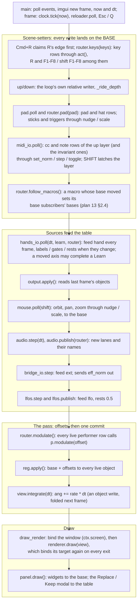

# Hyperspace — architecture

What the parts are, where a value goes each frame, and who may write a
parameter. This is the structure reference; behaviour is in
[`ENGINEERING.md`](ENGINEERING.md), the reasons in
[`DECISIONS.md`](DECISIONS.md), and what is currently wrong or drifting in
[`AUDIT-2026-09.md`](AUDIT-2026-09.md).

Written by plan 10 against `main` **ef299ef** (2026-09-27); revised for
plan 13 on `plan-13-integration` (2026-09-28), where every reference was
re-checked against the code. Plans 11 and 13 moved most of plan 10's
`file:line` numbers, so a reference is now a symbol (`Router.modulate`,
`Bindings.owner`) or a test's name; the few `file:line` numbers left are
as of that revision. The symbol names will outlive the numbers.
When a boundary, the frame order or the control model changes, change the
line here in the same PR — this document exists so that a fix can be made
in the right place, first time, by someone who has never seen the repo.

Two questions it must answer from this file alone:

1. **Where does a given controller's value go each frame?** — §2 and §3.7.
2. **Who may write a given parameter?** — §3.2.

Paths are relative to `hyperspace-python/hyperspace/` unless they start
with `tests/` or `docs/`.

---

## 1. Component map

Hyperspace is one Python process: a parameter **registry** in the middle,
**sources** that feed a **routing table**, a **render stack** that reads the
registry's live objects, a **panel** that edits the registry, and a
**library** that saves and loads it. `app.py` builds everything once and
runs the one frame loop.


*The table below is the picture's text twin.*

| Component | Modules | Owns | Reads | Writes | Boundary rule (held by) |
|---|---|---|---|---|---|
| **Registry** | `params.py`, `tapers.py` | every `Param`: id, kind, taper, flags, base, this frame's offsets | the live objects through each param's `get` | the live objects, once per frame in `Registry.apply()` | imports no adapter (`tests/test_params.py::test_core_does_not_import_the_midi_adapter`); it does import `fx`/`lookback` for their state classes, so it needs GL bindings importable (see audit) |
| **Routing table** | `routing.py` | `Binding` rows, the file `bindings.json` (the session's controls only since plan 13 WP5), the referee, the per-frame modulation pass | `Router.feeds` (what adapters fed), the analyzer's lanes, param bases | offsets via `Param.modulate` (in `Router.modulate`, the only caller in the package) | never imports `ui*`, `app`, `hands`, `midi`, `bridge`, `learn`; `glfw`/`gamepad` only lazily to resolve names, never `library` (`tests/test_routing_boundary.py::test_routing_imports_nothing_above_it`, and by a fresh interpreter) |
| **Input adapters** | `midi.py` + `apc40.py`, `hands/`, `gamepad.py`, `bridge.py`, `app.Keys` / `app.Mouse` | a device; its own pickup state (the armed learn is the host's `learn.Learn`, which either adapter completes) | the table (discrete rows), param bases (MIDI pickup, feedback) | MIDI/keys/pads: the **base**; hands/bridge: only `Router.feed` | the core never imports `midi` or `bridge` (`tests/test_params.py::test_core_does_not_import_the_midi_adapter`, `tests/test_bridge.py::test_core_does_not_import_the_bridge`); `hands/core.py` + `signal.py` import nothing from the package (`tests/test_hands_boundary.py`) |
| **Audio source** | `audio.py`, `analysis.py`, `analyzer.py`, `bands.py` (and the tests' `offline.py`) | capture / playback, the FFT, N band lanes | the audio device | `analyzer.lanes` (read by `Router.modulate`); `labels["lane"]` once a frame (`AudioEngine.publish`, WP8); `band.*` params are views onto its objects | imports nothing above itself — no routing, registry, ui, render, library or host (`tests/test_audio_boundary.py`) |
| **LFOs and clock** | `lfo.py`, `tempo.py` | four oscillators, one tap-tempo clock | their own dataclass fields (last frame's effective values) | `Router.feed("lfo", …)`, `labels`, `rests` | import **nothing** from `hyperspace` — registry, router, clock arrive as arguments (`tests/test_lfo_boundary.py`) |
| **Render stack** | `geometry.py`, `view.py`, `render.py`, `glsl.py`, `fx.py`, `lookback.py`, `dream.py`, `shaders/`, `overlay.py` | GL resources, `ViewState` (`view.py`), the frame history, the dream worker, the window's placement, the one wall clock (`Renderer.now`) | `ViewState` and the `FxState` / `DreamState` objects the registry writes | the screen; `ViewState.integrate` writes `ang` directly (folded into the base next frame) | zero registry traffic; `dream` is imported lazily by `app._open_dream` under `[dream] enabled` (`tests/test_dream.py::test_core_does_not_import_the_worker`) |
| **Panel** | `ui.py`, `ui_*.py`, `hands/panel.py`, `control.py` | imgui state, page selection, the Replace / Keep modal, the routing page's edits | everything, for display | param **bases** through `Param.set*`; table rows through `Bindings.add/enable/remove/replace_owner/move_route`, and the loaded preset's desk rows and macro subscribers in place (bumping `redraw_serial` / `macros_serial`); no file | a leaf: no engine module imports `ui*` (only `app` and `hands/panel.py`, besides the `ui*` modules themselves). Unenforced by a test |
| **Library** | `library.py`, `preset.py`, `config.py`, `library/` | the home folder, module preset and project files (the band presets *are* the analyzer's band scenes); the **presets** (`presets/*.json`, `hyperspace.preset/2`: the whole performance — values, routes, desk, macros, module labels — a document kind `preset.Presets` loads and writes); the project — the panel's **show** (`hyperspace.project/2`: the session values, the session groups' module labels, and the F1–F8 **bank of eight preset names** with a `startup` preset, "starts on"; the factory `party` show opens unless another was opened last, `<home>/last_show`, decision 22); the one-time migration of an older home (`preset.migrate_home`, plan 13 §6: schema-1 projects, `bindings.json`'s preset part and the old routing presets become presets, every rewritten file backed up first); `config.toml` | `Registry.snapshot` (a preset's performance part, a project's session part), a group's `extra` hook (the analyzer's layout) on save, a document kind's `signature` for its dirty dot | `Registry.restore` (bases); a preset load replaces every performer row (`Bindings.set_routes`); tells a group's `on_load` hook the name it landed; hands a document kind's `load` hook the file | `library` depends only on `params` (and, lazily, `routing` for `backup` (the migrations and `unshadow_default`) and `Carried`, and `preset` for `migrate`'s and `Project.load`'s migrations); `preset` on `library`, `params`, `routing`, `apc40`, `bands` and `lfo`; `library`'s importers are `app`, `preset`, `config` (for `ensure_home`), `control` (`factory_doc`, the band scenes), `dream` (for `home()`), `ui_presets` (`LibraryError`, `PRESETS`) and `ui_routing` (`PRESETS`); `preset`'s only `app` (and `library`, lazily) — `routing` imports neither |
| **Host** | `app.py`, `hotreload.py` | the two windows, construction order, the frame loop, the reload watch list (`hotreload.MODULES`: every module in the package but `app`, `hotreload`, `offline` and `watchdog`, in dependency order, leaves first — a module after everything it `from .x import`s; an optional adapter that was never imported is skipped; `tests/test_hotreload.py` holds the list, its order and every swap target against the source) | — | the relative writers' bases (`nudge`/`scale`); no key of its own but Cmd+R (restart), Esc / Q and ↑ / ↓ (R and F1–F8 / ⇧F1–F8 are table rows since plan 11 WP7, `app.LOOP_KEYS`) | the one cold module; the only importer of every optional adapter, each behind its config gate (`_open_*`; MIDI, the gamepad and the dream on by default, the bridge and hands off; torch is an ordinary dependency, imported only when the dream opens, and why it did not open is `panel.dream_error`), and the one that closes them all (`close_all`, on quit and on Cmd+R alike); `tests/test_app_boundary.py` holds the gates and that importing `app` imports no gated adapter, no `torch`, no `leap` |

The direction to remember: **everything points at the registry; the
registry points at nothing above it.** Adapters and sources feed the
router; the router writes offsets; the panel and the library write bases;
the render stack only reads.

---

## 2. The frame

`app.main()` is the only entry point: it builds everything once into an
`app.Host` and runs `app.frame(host, now, dt, fps)` in its loop — the one
place the frame order exists. `main` keeps only what needs the window
system (events, `imgui.new_frame()`, the frame's `now` and `dt`, the toast
and the swaps); `frame` is the order below, and
`tests/test_app_boundary.py::test_the_frame_runs_in_the_documented_order`
pins it over stubs.



Two rules follow from the order.

**One-frame lag.** Everything that a performer moves is landed by
`reg.apply()` once, in the pass. A source that reads a parameter — an LFO
reading its own `depth`, a route reading a macro through its depth
subscriber (or its session `scale`, `master.gain`), the bridge
sending `eff_norm`, `output.apply` reading `output.alpha` — reads what
`apply()` wrote **last** frame. So a hand that owns `lfo.1.depth` lands one
frame before that LFO's output does; a lane that owns `macro.2` scales the
routes its depth subscribers name next frame (and never moves its base
subscribers, which follow the macro's base: decision register row 12b);
and there is no recursion, because nothing in the modulation pass reads a
value it is about to write
(`tests/test_lfo.py::test_an_lfo_owning_another_lfos_depth_changes_its_output_next_frame`,
`tests/test_routing.py::test_a_macro_owned_by_a_hand_scales_a_lanes_push_one_frame_later`).

**Base before offset.** Every scene-setter runs before `router.modulate`
(the scene-setter block, the feeds, and the panel — whose draw is the previous
frame's tail),
so a base write and the offsets on top of it are combined in one `apply()`.
The one writer after `apply()` is the rotation integrator (`view.integrate`), which
writes the object directly; `Param.apply` adopts that as a delta on the
base the next frame (`Param.apply`,
`tests/test_modulation.py::test_a_direct_object_write_is_adopted_into_the_base`).

Guarding: the MIDI poll, the macro step, the hands poll, the step block (`audio.step` through
`integrate`), `renderer.draw` and `panel.draw` are each wrapped so
hot-reloaded code that raises records `reloader.runtime_error` — kept
until a clean frame — and the loop continues (`app.frame`;
`tests/test_app_boundary.py`).

**The render frame binds its target explicitly** (plan 14 WP1).
`app.draw_render` binds the window (`ctx.screen.use()`) before anything
else, and `Renderer.draw` captures the framebuffer it was called with and
binds it again — viewport and blending too — on every exit, a raise
included; `Lookback.capture` does the same for its own target. The frame
binds half a dozen offscreen framebuffers (the scene, the cover mask, the
history atlas, the FX ping-pong); before this, one left bound made every
later frame draw into it while the window swapped a stale picture — the
owner's freeze, with no error anywhere (WAKE without a dream worker; any
one exception inside the draw). A raising draw is also the render watch's
(`watchdog.RenderWatch`): its traceback goes to `<home>/stall.log`, and
the control window's red banner names it — and keeps it, after the render
recovers, until dismissed — where `runtime_error` is cleared by the next
clean frame. A frame that still starts on an offscreen framebuffer, a
render window that presents nothing for 2 s, a 2 s stall of the whole
loop and a non-finite param are logged the same way (ENGINEERING §2.6).

**The render window is opaque unless it is the overlay, and there is
no overlay unless the config asks** (decision 21 (a), plan 14 WP2). With
`[output] overlay = false`, the default, the render window is created
without a transparent framebuffer (`app._windows`) and `output.overlay`
refuses to switch on — the `T` key, the APC40's MASTER select, the panel
(which draws the toggle disabled with the reason) and a preset all land
on that one param, so one gate covers every road — and the ground
(`output.bg`, the crossfader) and opacity act only in overlay, so they do
nothing. With `overlay = true` the framebuffer keeps alpha for overlay
mode, and in window and fullscreen the final frame's alpha is still 1
everywhere — `view.cut_through` applies only on overlay's see-through
ground, and every FX pass writes alpha 1 on an opaque one — because the
compositor would show the desktop through anything less: the Pepper's
Ghost rig.

---

## 3. The control model

This is the canonical statement. Where another document disagrees with
this section, this section is wrong only if the code is; check the cited
line, then fix whichever is lying.


*The picture in one sentence:* scene-setters write the **base**; exactly
one performer row per parameter writes an **offset** through
`Router.modulate`; `Registry.apply()` lands `base + offset` on the live
object once per frame; the render stack only reads. §3.2 is the text twin.

### 3.1 The registry

Every settable thing is a `Param` with a stable id (`view.bright`,
`rot.rate.XY`, `band.2.atk`, `fx.acid.speed`, `lfo.1.depth`, `macro.3`), a
`Kind` — `CONTINUOUS`, `ENUM`, `TOGGLE`, `TRIGGER`, `TEXT` (`params.Kind`)
— and a `get`/`put` pair that reads and writes the live object it is a
view onto. Flags (fields of `params.Param`):

| Flag | Means | Default |
|---|---|---|
| `persist` | belongs in a snapshot (module preset, preset, project); its group puts it in the performance part (a preset's `values`) or the session part (a project's `session`, never a preset): `params.PERFORMANCE_GROUPS` / `SESSION_GROUPS`, `part_of`, `snapshot(part=)` | on; triggers never |
| `modulatable` | a performer may drive it | on; off for rig settings (`output.monitor…`, every `hands.*`), UI state, aliases |
| `alias` | a view onto another param (`band.sel.*` follows the selection) | off; an alias neither persists nor modulates |

A continuous param has a **taper** (`tapers.py`): an integer position ↔
real value map with `unmap(map(p)) == p` on every detent
(`tests/test_control.py::test_taper_round_trip`). The user's setters snap to detents; the
modulation path maps floats through the taper without snapping, and a
tapered value's position is continuous between detents
(`Param._taper_pos`) so a sub-detent base survives under a performer.

**Base vs effective.** A param has no storage of its own until something
modulates it. `p.value` reads the object (the *effective* value);
`p.base`, `p.norm`, `p.position()`, `p.text()` read the user's *setting*.
They are the same thing until the first `modulate()` call adopts the
object's current value as `_base` (`Param.modulate`); from then on
every setter writes `_base` (`Param.set`) and `apply()` writes
`base + Σ offsets` to the object. The frame no source calls, `apply()`
writes the base back and forgets it (`Param.apply`,
`tests/test_modulation.py::test_modulation_rides_on_the_base_and_lets_go_cleanly`).

**`Registry.apply()`** runs once per frame over every
modulated param, in registry insertion order. Per param
(`Param.apply`): fold any direct object write since last frame into
the base as a delta; `target = base + offsets`; clamp or wrap; continuous
→ float through the taper; enum → nearest index with a dead-band
(`params.MOD_DEADBAND`); toggle → hysteresis about `MOD_ON` /
`MOD_OFF`; trigger → fire once on the rising edge, re-arm
below `MOD_OFF` (`tests/test_modulation.py::test_discrete_targets_move_with_hysteresis`
and the tests after it).

### 3.2 Who may write a parameter

Three classes of writer, and the model is that they never fight:

| Class | Writes | Who | Enforced by |
|---|---|---|---|
| **Scene-setter** | the **base** | panel widgets (`ui.Panel`'s widget helpers: `_fader`, `_slider`, `_combo`, `_check`); key / pad / hat rows via `routing.act` (`Router.keys`, `Router.pad`); MIDI knobs, faders, buttons — the rows of the layer that is up and the invariant ones (`midi.py`, `Bindings.dispatch`); a macro's **base subscribers**, set by `Router.follow_macros` when the macro's base moves (never its offset); module presets and projects via `Registry.restore` (`Library.restore`); a preset via `Presets.load` (`preset.py`: every performance base in one restore, every performer row replaced — a load is a scene-setter, it writes no offset); the relative writers — mouse orbit / pan / zoom, sticks, triggers, ↑/↓ — via `Param.nudge` / `scale` (`app.Mouse.poll`, `app._ride_depth`, and the pad block of `app.frame`); `R`, F1–F8 and ⇧F1–F8 as ordinary key rows since plan 11 WP7 (`routing.LOOP_KEY_ROWS`) | every setter ends in `Param.set`, which writes `_base` while modulated (`Param.set`); `Param.nudge` / `Param.scale` read `self.base`; `tests/test_modulation.py::test_setting_a_modulated_param_moves_its_base`, `tests/test_app_relative.py`, `tests/test_midi.py::test_ring_shows_the_base_and_never_chases_a_performer` |
| **Performer** | an **offset** | `Router.modulate` → `Param.modulate` — the only caller in the package | `tests/test_routing_boundary.py` (an AST walk: one call site, in `Router.modulate`); adapters only `feed` (`HandsIO.poll`, `LFOs.publish`, `Bridge.receive`) |
| **Object writer** | the live object, bypassing `Param` | the rotation integrator (`ViewState.integrate`, `view.py`), `camera.reset` (`reset_view` in `build_registry`), `Control`'s reset undo, and its scene / band resets only with no library attached (`control.py`), `hands.core.mirror` on the non-modulatable `hands.*` | `Param.apply` folds the delta into the base next frame (`tests/test_modulation.py::test_a_direct_object_write_is_adopted_into_the_base`); non-modulatable params are never applied, so a direct write is simply the value |

Consequences to hold onto:

- A knob turned on a hand-owned parameter moves the **return value**, which
  shows when the hand's row lets go. It never prompts and is never blocked
  (plan 09 decision 3, "scene-setters don't compete";
  `tests/test_routing.py::test_audit_3_a_knob_moves_the_return_value_under_a_hand`).
  A hand leaving the box makes its rows let go that frame — its axes read
  `NaN` — and the base shows; the tracker going dark feeds `None` and does
  the same (plan 11 WP1, audit B1;
  `tests/test_hands.py::test_a_hand_leaving_the_box_releases_its_position_row`).
- Of the clock's and the LFOs' triggers, `lfo.trigger` and every
  `lfo.N.reset` are ownable: a performer fires them on its rising edge
  (a pinch drops the LFOs on the one, a kick band re-triggers them).
  `tempo.tap` is not (`modulatable=False`): a row on it is dormant,
  because a band on tap tempo would tap on every transient (decision
  register row 2, 2026-09-28;
  `tests/test_tempo.py::test_a_performer_on_tap_tempo_is_dormant_but_one_on_the_lfo_trigger_fires`).
- A relative writer reads the base, never the effective value. Reading the
  effective value folded the whole offset into the base on every drag
  frame — plan 09's audit simulation 1
  (`tests/test_app_relative.py::test_orbit_under_a_performer_moves_the_base_by_its_delta`).
- A macro is a scene-setter through its base subscribers and a performer's
  attenuator through its depth subscribers. A hand that owns a macro
  moves only the depth subscribers (they read the macro's effective
  value); the base subscribers follow the macro's base — the knob, the
  panel, a restore (plan 13 §2.4; register row 12b;
  `tests/test_macros.py::test_a_performer_on_a_macro_moves_only_its_depth_subscribers`).
  Two macros setting one param: the later one in id order wins.
- MIDI ring feedback shows the base (`MidiIO.feedback`) and never chases a
  performer; LED feedback on a toggle, or on an enum `set` row, reads the
  effective value (`MidiIO._lit`) and does. That is intended (owner, 2026-09-28,
  audit R6): a ring is a pickup readback and must show the base or the
  knob could never catch; an LED is a state light and shows what the
  show is doing.
- `Router.modulate` never checks ownership. The referee lives in the
  table's edit doors (§3.5) and in every load (`referee`); a table mutated
  directly could still stack two rows on one target (§3.10).
- A preset's route may perform **any** modulatable param, a session one
  included (decision register row 19 (a)): D9 governs the *values* a
  preset lands — never a session base — not the offsets its routes add
  while their sources are live. TUMBLE's left height pushes the drive
  (`master.gain`); when the hand goes the drive fader's setting is back,
  untouched. The ROUTING page marks such a row "session"
  (`ui_routing.is_session_target`;
  `tests/test_ui_routing.py::test_a_route_on_a_session_param_is_marked_session`).

### 3.3 Sources and rows

A `Binding` (`routing.Binding`) is one row: `source` (`scheme:address`),
`target` (a param id), `op`, `value`, `enabled`, and for performers
`scale` (a **session** param only — the rig's attenuator, `master.gain`,
the drive fader, on the legacy6 rate rows; decision register row 18 (a):
a `scale` on a macro becomes its depth subscriber, one on any other
performance param is dropped at load with a note, and a macro
attenuates a route only through a depth subscriber, §3.6), `when`,
`rest`; MIDI rows add `pickup`, `feedback`, `on`, `off`, `ring`, and
`layer` — absent for an **invariant** control (the session's, one meaning
on both layers), `"global"` (the SHIFT layer) or `"preset"` (the loaded
preset's desk; plan 13 §3.1).

| Scheme | Address | Fed by | Reaches the param as |
|---|---|---|---|
| `key:` | a GLFW key name, optional `SHIFT+` / `SUPER+` | `Router.keys` | a **discrete op** on the base |
| `pad:` / `hat:` | a `gamepad` button / hat name | `Router.pad` | discrete op on the base |
| `cc:` / `note:` / `pitch:` | `channel:number` (`pitch:` is `channel` only) | `MidiIO._handle` → `Bindings.dispatch` (the invariant rows, else the up layer's) → `MidiIO._apply` | `abs` (with soft pickup), `rel`, `rel64`, `step`, `toggle`, `set`, `momentary` — all base |
| `lane:` | analyzer band index | `analyzer.lanes / CEIL` inside `Router.modulate`; the names and rests by `AudioEngine.publish` each frame, so `Router.describe` says the band's name | **performer** |
| `hand:` | a **name** (decision register row 20): an axis as `[hands] dofs` spells it, `left.x` … `left.yaw`, `right.x` … `right.yaw`; `left.present` / `right.present`; a pinch switch, `left.pinch.index` … `right.pinch.pinky`. A number, `hand:<i>`, still reads as the lane at index i (12 axes, 2 presence, 8 switches on the default layout); nothing writes one | `HandsIO.poll` → `Router.feed("hand")`; the name → lane map by `HandsIO._publish` (`router.names["hand"]`, from `hands.core.Layout`) | performer; a switch may also be a gate |
| `ext:` | DAW lane 0–15 | `Bridge.step` → `Bridge.receive` → `Router.feed("ext")` | performer |
| `lfo:` | 0–3 (`lfo:0` is "LFO 1"; param ids are 1-based) | `LFOs.publish` → `Router.feed("lfo")` | performer |

`routing.LANE_SCHEMES = ("lane", "ext", "lfo", "hand")` are the continuous
schemes. A row on one of them may carry **only** the two performer ops
(`routing.MOD_OPS = ("push", "position")`; `Bindings._check` raises
otherwise). The other ops in `routing.OPS` belong to keys, pads and MIDI.

A lane-scheme address is a number (`lane:3`, `lfo:0`) or, where the
scheme's adapter publishes names, a **name** (`hand:right.roll`). The
hands are the one such scheme: a hand row names its axis, so a rig that
reorders or trims `[hands] dofs` keeps every preset on the axes it was
written for, and a name the rig lacks leaves its row dormant — never on
another lane (decision register row 20, audit N7;
`tests/test_hand_names.py`). The factory generator (`preset.hand`,
`preset.pinch`), Learn and the ROUTING page write names; the first-launch
migration named the numbers it carried into presets (§3.8).

### 3.4 The one path

Every continuous source reaches a parameter through exactly one pass,
`Router.modulate`, once per frame, over the enabled performer rows
(`Bindings.mods`) in table order:

1. Find the source's lane (`Router.lane`): a number is the index; a name
   is looked up in the map the scheme's adapter published
   (`router.names[scheme]`) — a name it lacks, or any name while no map
   is published (no hands adapter), is index −1. Resolved once per
   address and cached against the map's identity, so a republished
   layout re-resolves and the pass parses no strings (about 30 µs a frame
   for 28 rows, the same as the index-only pass it replaced). Then the
   vector: the analyzer's lanes for `lane:`, otherwise `feeds[scheme]`.
   No vector, an out-of-range index (−1 included) or a `NaN` reading
   (a hand out of the box, or never seen) → the row does nothing this
   frame.
2. If the row has a gate (`when`), the gate's source — a number or a
   name, resolved the same way — must be **fed** and read ≥ 0.5; a gate
   whose source is not live, or that names no lane, holds the row **shut**
   (`Router.gated`). `lane:` can never gate.
3. `depth = value × scale × Π (from + m · (to − from))`: `scale` names a
   session param (`master.gain`, row 18 (a)) whose **effective** value multiplies
   the depth, and each **depth subscriber** of a macro naming this row's
   (source, target) multiplies it by its range at `m`, the macro's
   effective value — last frame's (`Bindings.depth_subs`). A range may
   cross zero, flipping the route. A missing scale or macro param makes
   the row dormant.
4. The op:
   - **push** — `offset = depth · (u − rest)`. The performer adds to the
     base, centred where the source rests. `rest` is the row's own number
     or, when `None`, the source's rest as its adapter published it this
     frame (`Router.rest_of`; hands publish each axis's
     configured rest, LFOs 0.5, the analyzer 0, the bridge nothing → 0).
     Idle adds nothing
     (`tests/test_routing.py::test_push_is_centred_where_the_source_rests`).
   - **position** — `offset = clamp(depth · u, 0, 1) − base_norm`. The
     source *is* the fader, along the param's taper; when it lets go the
     base returns
     (`tests/test_routing.py::test_position_op_is_the_position_across_the_whole_throw`).
5. `p.modulate(offset)`, the one call in the package. Range, wrap, hysteresis and
   the return to base are all `Param.apply`'s job, run by `Registry.apply`
   in the frame's pass (§2, §3.1). `modulate` records; `apply` lands.

A row whose source stops being fed (`Router.feed(scheme, None)`: the
tracker off, the DAW port gone) or whose gate opens simply stops calling
`modulate`, and `apply()` writes the base back that frame.

**Adding a source** (a pedal over OSC, say) is an adapter that, once per
frame before `router.modulate`, does exactly what the LFOs do
(`lfo.py`, `LFOs.publish`): `router.feed("<scheme>", vector)` — a list
of floats in `[0, 1]`, `NaN` for a lane that is out of view, `None` when
the device is gone — and publishes, by plain assignment,
`router.labels["<scheme>"] = [names]`, `router.rests["<scheme>"] =
[rests]`, and, if some lanes are switches, `router.gates["<scheme>"] =
[(lane_index, name), …]`; if its rows should name lanes rather than
number them, `router.names["<scheme>"] = {address_name: lane_index}` — a
new dict whenever its layout changes (the resolved addresses are cached
against it; the hands do this, `HandsIO._publish`). The scheme must be in `LANE_SCHEMES`
for its rows to count as performers; until it is, reuse
`ext:`. The adapter imports nothing from the package (the registry and
router arrive as arguments — the rule `tests/test_lfo_boundary.py`
holds), never writes a `Param`, and is opened by `app.main` behind a
config gate. The referee needs nothing from it: ownership is settled at
the table's edit doors (§3.5) whatever the scheme.

### 3.5 One performer per parameter

A **performer** is an enabled row on a continuous scheme with a performer
op (`Binding.is_performer`). Disabled rows own
nothing; key, pad and MIDI rows never own. A target has at most one:

- `Bindings.owner(pid)` answers who.
- `Bindings.add` and `bind` raise `Owned(existing, new)` when the target
  has a different performer (`Bindings._check`); the table is untouched.
  Waking a disabled row (`Bindings.enable`) runs the same check.
- `Bindings.replace_owner(new, *, target=None)` is the **one door** onto a
  taken target: it removes whoever owns it *at commit* and adds or
  retargets the new row, a retargeted route's depth subscribers with it.
  Every *Replace* in the app is that call (`ui_routing.add_route`,
  `_wake`, `_retarget`; `learn.Learn._place`).
- Loading a file or a preset runs `routing.referee`: first performer per
  target wins in file order, the rest go to `table.dropped` with a reason,
  shown on the ROUTING page until the next edit (`Bindings.from_json`,
  `Bindings.set_routes` — the road `Presets.load_doc` takes).
- Gates do not exempt a row: two rows on one target with different pinches
  are two performers (plan 09 decision 2, "one performer per parameter").

Tests, in `tests/test_routing.py`: `test_a_target_has_one_performer`
through `test_a_preset_load_lists_what_it_dropped` (the referee),
`test_audit_1_…` to `test_audit_4_…` (the four audit simulations),
`test_every_factory_preset_names_real_params_with_one_owner` (every
factory preset's routes have one owner per target).

**The Replace / Keep prompt.** A conflicting learn or edit is *held*, not
applied:

- Right-click → Learn arms a param id on the host's one `learn.Learn`
  (`app.main` builds it over the live table whatever the MIDI gate says;
  `panel.learn`). A hand completes it through `Learn.learn_source`
  (`HandsIO._learn`), writing the axis that moved **by name**
  (`hand:right.pitch`) and a pinch held while learning as a named gate
  (`hand:right.pinch.index`; decision register row 20,
  `tests/test_hands.py::test_a_hand_learn_writes_the_axis_by_name_on_any_dofs`);
  a `band.sel.*` alias resolves to the band
  it stands for (`Learn.target_for` → `Registry.real`, the one alias rule
  `build_registry` installs and the panel's widgets read through);
  if another performer owns the target the pair is parked in
  `Learn.pending` and nothing is written. A learn onto a target the same
  axis already positions only refreshes the gate. A knob completes it
  through `MidiIO._learned`, which binds the param as armed — alias
  included, on purpose — as a **preset-layer** row (`Bindings.bind(b,
  write=False)`: it replaces every preset-layer row on that physical
  control — an any-channel row on it included (`Binding.overlaps`:
  learning `cc:0:16` where the preset has `cc:*:16` leaves one row;
  `tests/test_learn.py::test_a_knob_learn_replaces_an_any_channel_row_on_the_same_knob`)
  — and the param's previous preset-layer row in the same role, never an
  invariant or global row); a knob learn with the global layer up, or on an
  invariant control (SHIFT among them), is **refused** — nothing changes,
  `Learn.last` says why, `Learn.refused` is set (plan 13 D5, D6).
  Every learn goes into the **loaded preset**: the table changes, the
  preset's dirty dot moves (`Presets.signature`), and no file is written
  — `bindings.json` included — until a save (⇧F, the preset strip's or
  the ROUTING head's save / as…) (`tests/test_learn.py`).
- A ROUTING-page add, enable or retarget that raises `Owned` parks in the
  page's own state (`ui_routing.ask`).
- `ui_routing.modal` is drawn first thing in `Panel.draw`, on **every**
  page, panel collapsed or not (`Panel.draw`), reading whichever question is
  up (`ui_routing._question`). *Replace* → `replace_owner`, a change of
  the loaded preset's routes (its dirty dot; **no file is written**, plan
  13 §3.3); *Keep* → the table is untouched
  (`tests/test_ui_routing.py`
  `test_the_replace_prompt_swaps_the_owner_or_leaves_the_table`;
  `tests/test_learn.py::test_the_prompts_answer_replaces_or_keeps`).
- While a question is up `Learn.learning` is `None`, so moving the hands
  learns nothing more (`HandsIO._learn`;
  `tests/test_hands.py::test_a_held_learn_is_not_fired_again_by_the_hands`).

### 3.6 Chaining, not stacking

Layers come from the graph, never from two rows on one knob. Every knob
of an LFO (`lfo.N.shape/rate/sync/depth/phase`) and every macro
(`macro.1–8`) is an ordinary, ownable, persistent param, so:

```
hand:right.y ──position──▶ lfo.1.depth   lfo:0 ──push──▶ view.bright
lane:0 ──push──▶ macro.2   hand:left.y ──position──▶ fx.mix  × macro.2's depth subscriber
```

The eight macros act only through their **subscribers** (plan 13 D10,
§2.4; `routing.Macro`, `Sub`; `Bindings.macros`, `set_macros` /
`macros_doc`): a *base* subscriber `{"base": id, "from": a, "to": b}`
sets that param's base to `a + m · (b − a)` along its fader, without a
detent, whenever the macro's base moves (`Router.follow_macros`, the
frame's last scene-setter step, §2); a *depth* subscriber
`{"depth": {"source", "target"}, "from", "to"}` multiplies that route's
depth (§3.4 step 3). A base subscriber names a **performance** param —
persisted, not an alias — never a session one (D9: a preset never moves
a session base): `set_macros` drops any other with a note (the preset
load's notes, the migration's; `routing.settle_bases`, `base_refusal`)
and the ROUTING page's "+ base" picker offers performance params only
(`ui_routing.base_targets`;
`tests/test_macros.py::test_a_base_subscriber_on_a_session_param_is_dropped_with_a_note`).
A depth subscriber may scale a route on a session param (row 19 (a)).
Polarity is per subscriber, so one knob can raise
one thing while lowering another. A performer may own a macro; it moves
the depth subscribers only (§3.2). The subscribers live in the table
(`Bindings.macros`) and are the loaded preset's since plan 13 WP4: a
preset load replaces them (`set_macros`) and lands the base subscribers
at once, a save writes them (`Presets.document`), an edit on the ROUTING
page marks the preset dirty; `bindings.json` never carries them (plan
13 WP5). The macros'
*values* are **performance state** (the `macro`
group is in `PERFORMANCE_GROUPS`, plan 13 WP1): in the whole snapshot and
its performance part, so a preset carries them (plan 13 WP2) and a
project does not; the module strips list no `macro` group. The live
`bindings.json` holds no values since plan 13 WP5 — the startup preset
lands the macros' bases
(`tests/test_routing.py::test_the_live_table_writes_only_the_sessions_controls`). LFO params are
performance state too; tempo is session (a preset never moves a tapped
BPM, plan 13 §4, D9). The presets made from the old routing presets
set the bases their rows assume — `lfo-breathe` four LFO knobs and its
Breathe macro, `hands-fx` the acid speed and Acid switched on — each a
persisted, non-alias performance param
(`tests/test_routing.py::test_a_converted_presets_values_are_bases_a_preset_would_save`; audit
R1, decided 2026-09-28).

### 3.7 Where a controller's value goes

| You move… | It becomes… | Writes | Path |
|---|---|---|---|
| a panel fader, combo, checkbox | `Param.set_position` / `set` / `toggle` | base | `ui.Panel` widget helpers → `Param.set` |
| `M`, or the APC40's REC | `key:M` / `note:` row → `audio.mic` (declared by `build_registry`, so the row resolves without a panel) | base (a toggle) | `routing.keymap`, `apc40.DEFAULT_MAP`, `params.build_registry` |
| a key with a table row (`B`, `F`, `1–6`, …) | `routing.act` on the row | base (step / toggle / fire / set) | `app.frame` → `Router.keys` → `routing.act` |
| `R`, F1–F8 / ⇧F1–F8 | table rows (`key:R`, `key:F1`…, `key:SHIFT+F1`…) → `routing.act` fires `camera.reset` / `preset.load.k` / `preset.save.k` — F<k+1> loads the preset the project's bank names in slot k (`Project.load_slot` → `Presets.load`; an empty slot or a missing file loads nothing and says so), ⇧F<k+1> saves the live state as it into the user folder (`save_slot`); the APC40's clip row 1 is `preset.select`, QUANT and pad B `preset.next`; with ⌘ held the loop claims R for restart first | base (a trigger) | `routing.LOOP_KEY_ROWS`; plan 11 WP7; plan 13 WP2 |
| Cmd+R, Esc / Q | loop code: `_restart` (execv) / close the window | nothing in the registry | `app.frame` (`app.LOOP_KEYS`) |
| ↑ / ↓ | `_ride_depth` on `view.depth4` | base, relative, in log space | `app.frame` → `app._ride_depth` |
| mouse drag / shift-drag / wheel | `Mouse.poll` → `nudge` / `scale` on camera params | base, relative | `app.Mouse.poll` |
| a pad button or hat | `routing.act` on the row | base | `app.frame` → `Router.pad` |
| a stick or trigger | `nudge` / `scale` / `_ride_depth` | base, relative | `app.frame`'s pad block |
| an APC40 knob or fader (`abs`) | the row of the layer that is up, or the invariant one; `Param.set_norm` — a knob is caught at the ring just sent (the encoder re-based, `apc40.RING_REBASES_KNOB`, hand check 31), a fader after soft pickup; ring feedback shows the base | base | `midi.py` `_handle`, `_apply`, `_rebase` |
| an APC40 button (note) | `momentary` / `toggle` / `step` / `fire`, on the rows its press went to (D12: the release goes there too) | base | `midi.py` `_handle` |
| SHIFT (note 0x62) | the invariant row `note:0:98 → desk.shift` (a toggle over `Bindings.layer`, never saved or performed): each press flips the layer, its LED lit while the global layer is up; every ring and LED is redrawn for the new layer, a control the layer does not map dark and dead (D8) | the table's layer | `routing.register_desk`, `MidiIO.redraw` |
| a macro's knob (desk, panel, restore) | its base → `Router.follow_macros` → each base subscriber's base | base | `routing.py` `follow_macros` |
| an APC40 knob on a **hand-owned** param | the same — it moves the return value | base | decision 3; `tests/test_routing.py::test_audit_3_a_knob_moves_the_return_value_under_a_hand` |
| an analyzer band | `lane:<i>` → its performer row | offset | `Router.modulate` |
| a hand axis | `hand:<name>` (`hand:right.roll`) → its performer row (push or position) | offset | `HandsIO.poll` → `Router.modulate` |
| a pinch | `hand:left.pinch.index` … `hand:right.pinch.pinky` — a lane like any other, and a gate for rows whose `when` names it | offset, or opens / shuts a row | `hands.core.Layout` (the pinch lanes and gates), `Router.gated` |
| a DAW lane in | `ext:<i>` → its performer row | offset | `Bridge.receive` |
| an LFO | `lfo:<i>` → its performer row | offset | `LFOs.publish` |
| right-click → Learn, then move a hand | `Learn.learn_source` → a `position` row on the real param, or the prompt — into the loaded preset (dirty), no file written | the table | `HandsIO._learn` → `Learn.learn_source` |
| right-click → Learn, then turn a knob | `MidiIO._learned` (the armed id from the same `Learn`) → an `abs` / `rel` / `toggle` **preset-layer** row into the loaded preset (dirty), no file written; refused with the reason in `Learn.last` while the global layer is up or on an invariant control (D5, D6) | the table's preset layer | `MidiIO._learned` → `Bindings.bind(b, write=False)` |
| a preset | `Presets.load`: every performance param's base (the file's or its group default) in one `Library.restore`, then `Bindings.set_routes`, `set_desk` (the file's `desk`, or the factory preset layer when it has no `desk` key) and `set_macros` (a base subscriber on a session param dropped with a note, D9), the base subscribers landed at once (`Router.follow_macros(force=True)`, over `values`); session params never; a value that will not land puts the performance part back and refuses the load whole | base, the performer rows, the preset layer, the macros | `Presets.load_doc`; `tests/test_presets.py` |
| a module preset or project | `Registry.restore` (a project: its session part) | base | `Library.restore` |
| right-click → Unbind | `MidiIO.unbind`: the loaded preset's desk rows on the param go (the preset dirty, no file written); a param only the session maps is refused with the reason in `Learn.last` | the table's preset layer | `midi.py`, `Bindings.unbind` |
| a preset load's desk (step 4 of `Presets.load_doc`) | `Bindings.set_desk(rows)`: every preset-layer row replaced, a row on an invariant control dropped with a note (the load's notes, the ROUTING head), the layer dropped to preset, the faders' catch cleared at the next redraw, and every control that lost its last row sent dark there (D8: `MidiIO.redraw` darkens what it drew before, `_shown`; `tests/test_desk.py::test_a_control_that_loses_its_row_goes_dark`) | the table's preset layer | `routing.py` `set_desk`, `midi.py` `redraw` |
| a ROUTING-page edit (a route, a desk row's target or ×, a macro's label or subscriber) | the table in place — the loaded preset, its dirty dot; a subscriber edit re-lands the base subscribers (`macros_serial`), a desk edit redraws the desk (`redraw_serial`: a redraw, not a load — the faders keep their catch; a control whose row the × took goes dark, D8) | the table | `ui_routing.py` |

### 3.8 The binding file

`<home>/bindings.json`, schema `hyperspace.bindings/3` (`routing.SCHEMA`):
`{"schema", "profile", "bindings": [rows]}`. Rows carry only non-default
fields; a MIDI row carries `layer` when it has one. Since plan 13 WP5 it
holds the **session's controls** and nothing else (plan 13 §2.2): the
keys, the pad, and the invariant and global-layer MIDI rows (SHIFT among
them). A performer row, a preset-layer row, the macros and any `values`
are the **loaded preset's** — the table holds them in memory, but
`Bindings.to_json` / `write` never write them (`routing.is_session_row`;
`tests/test_routing.py::test_the_live_table_writes_only_the_sessions_controls`).
A Learn, an Unbind, a Replace and every ROUTING-page edit change the
table and write no file. Nothing in the app edits a session row: the
keys, the pad and the session's MIDI rows are edited in the file by hand
(the ROUTING page shows the MIDI ones read-only), and only the loader and
the migration write it (`Bindings.bind` still writes when asked,
`write=True`, but its one caller in the app, a knob Learn, passes
`False`).
The factory session table is exported to
`hyperspace/bindings.default.json` (`python -m hyperspace.routing`),
outside `library/` since it is no group's preset.

On load (`Bindings.load`):

- no file → the factory table (`keymap + padmap + apc40.DEFAULT_MAP`, the
  preset layer in memory only; no performer rows since WP5 — the house
  presets carry the legacy6 lane rows); an old `midi_map.json`'s rows
  replace its MIDI part, sorted into layers — written once when its knobs
  are the factory's, else carried (below) for the migration to write;
- schema 1 or 2 → the MIDI rows are sorted into the desk's layers, once
  (`sort_layers`, plan 13 §3.2): a row identical to a factory row in
  (source, target, op, value) takes its layer, any other row on an
  invariant factory control stays invariant, any other goes to the
  preset layer; the factory's global rows and SHIFT are added where the
  file has no row on that control for that layer;
- on any schema a row's `scale` is settled (`migrate_scales`, decision
  register row 18 (a)): `scale: "macro.N"` becomes a depth subscriber of
  `macro.N` `from 0, to 1`, a `scale` on any other performance param is
  dropped, each noted; a `scale` on a session param (`master.gain`) is
  kept;
- schema 1 → `migrate_v1` renames the ops (`mod → push`, `span →
  position`, lane `abs → position`; `replace` is dropped with a note)
  and `referee` settles duplicate owners;
- every load **of a file** runs `remap_factory` (a fresh factory table
  already has the rows): the plan-09 moves (TAP TEMPO, NUDGE ±, METRONOME,
  QUANT for `preset.next`) and the keys of plans 09 and 11 (`B`, `⇧B`,
  `R`, F1–F8, ⇧F1–F8) applied only where the user's table still has the
  exact old factory row or nothing on the source, and any
  row on a `theme.*` param moved to the `preset.*` param of the same slot
  (plan 13 WP2, `THEME_TO_PRESET`); idempotent;
- anything migrated or remapped is announced on stderr and written back
  once, with the file as it was kept beside it as `bindings.json.bak-v<n>`,
  `n` the schema the file was read at, a dated `.bak-v<n>-<stamp>` when
  that name is taken — never over an existing `.bak-*` (`routing.backup`,
  an exclusive create); an unknown schema is never rewritten — the factory
  table stands in and `Bindings.error` says why
  (`tests/test_routing.py::test_a_backup_is_kept_before_every_rewrite_and_never_over_a_hand_made_one`,
  `::test_an_unknown_schema_is_reported_not_migrated`);
- **except** a file that still holds a preset's part — performer rows,
  preset-layer rows, `macros`, `values`: every file written before plan
  13 WP5. `Bindings.load` keeps that part in memory and in
  `Bindings.carried` and does not write the file; the first launch's
  migration moves it into presets and only then backs the file up and
  rewrites it (below);
- a performer row never carries `pickup`: the field is a MIDI knob's
  (soft pickup) and `to_json` drops it on every lane-scheme row
  (`tests/test_routing.py::test_pickup_never_rides_on_a_performer_row`).

**The first-launch migration** (`preset.migrate_home`, plan 13 §6),
run by `app.main` once the library, the registry, the Router and
`Presets` exist and before the startup preset loads; idempotent, a
second launch finds nothing to do (`tests/test_migration.py`):

1. every `projects/*.hyp.json` at `hyperspace.project/1` → each filled
   bank slot becomes a user preset (its performance ids, the table's
   macro bases filling the ids it lacks; the table's performer rows,
   preset layer and macros; the project's performance groups' module
   labels), an empty slot points at the factory house preset its F-key
   loaded, and the file becomes `hyperspace.project/2` (`startup` the
   project's own look — the slot its performance `values` equal, else a
   preset `<PROJECT> SAVED` put in its first empty slot — `session`
   its session part and the first slot's session ids, `modules` its
   session groups' labels), kept first as
   `<file>.bak-v1`. A schema-1 file opened later (`Project.load`) takes
   the same road;
2. every user routing preset (`bindings/*.json`) → a **full** user preset
   (decision 10: its values less session ids, the effects its routes
   drive switched on — `preset.effects_on` — its routes, its macros, no
   `desk`); the files stay as they were, never read again, a
   `bindings/NOT-READ.txt` beside them;
3. `bindings.json`'s preset part → if no project took it, a user preset
   `MIGRATED` (the table's routes, desk and macros, the live performance
   values), made the startup and first slot of the user show `mine` (the
   show made from the factory `house` show if there is none, kept as
   `.bak-v2` if there is — until plan 14 WP3 this was the user's
   `default`, which `library.unshadow_default` now renames `mine`, a
   backup first; decision 22); then the file is backed up
   (`.bak-v<n>`, or a dated copy) and rewritten with the session's rows.

Every preset the migration writes names its hand lanes (decision register
row 20): a `hand:<i>` source, gate or depth subscriber's route becomes
`hand:<name>` by the layout the rig has at migration time — the rig's
`[hands] dofs` when `[hands]` is enabled, else the default layout
(`preset.hand_layout`, `name_hand_rows`) — with a note naming which
(`tests/test_migration.py::test_the_migration_names_the_hand_rows`). A
schema-1 project opened later names them by the layout the hands adapter
published (`preset.live_hand_layout`). A user preset saved with numbers
since is loaded as it is; the numbers still read.

A preset is only ever written as a new file: an equal one already reached
by that name (the user's, else the factory's) is pointed at; a factory
one that differs is shadowed; a user file that differs is never touched
(the new one takes `<name> 2`). A backup that cannot be made leaves its
file as it was, and the next launch tries again. Every note goes to
stderr, one line per file naming its backup, and the sum to
`Library.warning`.

The routing presets — this file format with only performer rows, a
library document kind of their own (`Library.routing`,
`Router.apply_doc` / `preset_doc`) — are gone since plan 13 WP5
(decision 10): the factory ones are full factory presets
(`library/presets/legacy6.json`, `lfo-breathe`, `hands-fx`,
`hands-pinch`, `hands-play`; generated by `python -m hyperspace.preset`),
and a project never carries the table: `<home>/bindings.json` is one
file for the rig.

### 3.9 Tempo and the LFOs

`tempo.Clock` is one free-running clock. `tick(now)` once
a frame makes every call in that frame agree on the time (the first line
of `app.frame`). `tap()`: taps more than 2 s apart start a new burst; BPM
is the mean interval of the burst's last 8 taps, clamped 20–300
(`Clock.tap`, `Clock.set_bpm`). `beat(t) = (t − t0) · bpm / 60 + nudge`;
`bar` is beat mod 4. Params `tempo.bpm`, `tempo.tap`, `tempo.nudge`
(`tempo.register`) — session params: a preset never moves them (plan 13
§4).

`B` taps and `⇧B` triggers, and both are ordinary table rows (`key:B →
tempo.tap`, `key:SHIFT+B → lfo.trigger`, in `keymap()` and added to older
files by `remap_factory`), as
are the APC40's TAP TEMPO, NUDGE ± and METRONOME (`apc40.DEFAULT_MAP`).

**The global LFO trigger** (`lfo.trigger`, registered by `lfo.register`; `⇧B`, the APC40's
METRONOME) sets the downbeat to now — folding the current nudge in so beat
0 lands on the press (`Clock.trigger`) — and restarts every LFO in a
division mode at phase 0 together; Hz LFOs are untouched. **A tap never
moves the downbeat**, before the first trigger or after it: a tap changes
the BPM, sliding `t0` only as far as keeps `beat(t)` continuous, so a
re-tap mid-set moves the readout, not the picture. A fresh clock's
downbeat is its construction time until the first trigger (decision
register row 1, 2026-09-28; `Clock.tap`;
`tests/test_lfo.py::test_a_tap_does_not_move_a_running_synced_lfo_but_the_trigger_does`,
`::test_the_trigger_realigns_every_synced_lfo_together`,
`tests/test_tempo.py::test_a_tap_on_a_never_triggered_clock_leaves_the_downbeat_alone`).

`lfo.LFOs`: four. Per LFO `shape` (sine, tri, saw, square,
random = sample-and-hold per cycle), `rate` (Hz, log 0.01–20), `sync` (Hz
or a bar division), `depth`, `phase`, and a `reset` trigger. In Hz the
phase integrates `rate · dt`; in a division it is `clock.beat · ratio +
phase` (`LFO.step`). Leaving a division for Hz carries the phase, so
the wave continues from where it is instead of a stale accumulator;
choosing a division is not carried — it lands on the clock's beat whether
a knob or a preset set it (plan 11 WP4;
`test_switching_to_hz_carries_the_phase_and_a_division_lands_on_the_clock`).
Output `u = 0.5 +
0.5 · depth · wave`, rest 0.5, published every frame (`LFOs.publish`).
An LFO is a performer and every one of its knobs is ownable; it reads its
knobs from its own dataclass fields, i.e. last frame's effective values,
which is the whole one-frame-lag / no-recursion mechanism (§2).

**Phase 0 on every trigger path.** A key row fires `lfo.trigger` before
the frame's `lfos.step` (§2), so that step reads the new downbeat. The
panel's chip and a performer-fired trigger run *after* the step; `LFOs`
holds a trigger or a per-LFO `reset` that arrives at the time it last
stepped and applies it at the start of the next step, at that step's own
`t` — so the first frame the LFOs see it, every synced LFO reads exactly
phase 0 (a Hz reset reads 0 too). One frame of latency on those paths,
never a partial phase (plan 11 WP4;
`test_a_trigger_after_this_frames_step_lands_phase_zero_on_the_next_step`).

### 3.10 What this section does not promise

Behaviour the code has today that the model above does not describe or
guard, each filed where it says:

- Nothing in `Router.modulate` checks ownership; the referee is the
  table's edit doors and the loaders (`referee`), and
  `tests/test_routing_boundary.py` holds that `Router.modulate` is the
  only caller of `Param.modulate` — a table mutated directly could still
  stack two performers on one target (audit B8, closed by that test, not
  by a runtime check).
- A `hand:<i>` row still reads by index (audit N7 is closed for every
  preset the app writes — plan 13 WP5b); one in a user preset saved by an
  older build and never re-saved still re-points on a rig that reorders
  `dofs`. Learn compares hand sources by the lane they read (`Learn.same_source`
  over `Router.lane`, review of PR #70), but the table itself compares
  sources as strings: `hand:7` and `hand:right.y` are two keys to a depth
  subscriber's (source, target) (`Bindings.depth_subs`), so a depth
  subscriber written for one spelling does not scale a row carrying the
  other.
- A preset saved after a module-preset load moved a param a macro's base
  subscriber sets does not round-trip that param: the reload lands the
  subscriber's value, not the saved one — the macro is the scene-setter
  of record (plan 13 §13, WP4's list).

---

## 4. Module shapes

The point of this section: when you have to change something, it tells
you which file to open, what that file is allowed to touch, and which test
will catch you if you break its rule. One row per module or package, in
the component map's order. Names are kept to the one or two you would
grep for; the module's docstring has the rest.

| Module | What it is for | What it owns and hands out | The rule it keeps (and who enforces it) | Tests |
|---|---|---|---|---|
| `params.py` | The parameter registry: one id per settable thing, the base-versus-effective split, and the once-per-frame `apply()` that lands everything on the live objects. | Every `Param` and the `Registry`; `build_registry` declares the whole surface. | Never imports an adapter; every persisted param is in exactly one part, performance or session (`test_every_persisted_group_is_performance_or_session`); never snaps a modulated base to a detent. (`tests/test_params.py::test_core_does_not_import_the_midi_adapter` for the import rule.) | `test_params.py`, `test_modulation.py` |
| `tapers.py` | Turns a fader's integer position into a real value and back, exactly, for every knob. | The taper objects and the per-band knob specs. | The round trip position → value → position is exact on every detent. (`tests/test_control.py::test_taper_round_trip`) | `test_control.py` |
| `routing.py` | The binding table: one row type for keys, pads, MIDI and performers; the file on disk (the session's controls only); the referee; the desk's layers; the macros' subscribers; the per-frame modulation pass. | `Binding` (`layer`), `Bindings` (the table and its edit doors; `layer`, `toggle_layer` / `drop_layer`, `dispatch` / `active`, `set_desk` / `desk`, `macros`, `set_macros` / `macros_doc`), `Macro` / `Sub`, `Router` (the pass, `follow_macros`, `feed`, `names` / `lane` / `address`: a lane by name), `register_desk` (`desk.shift`), `Owned`, `is_session_row`, `Carried` (what an older file held that is a preset's), `migrate_scales`, `backup`. | A lane-scheme row carries only `push` or `position`; a message goes to the invariant rows or the up layer's, never falling through; a desk row on an invariant control is dropped with a note; a macro's base subscribers follow its base, never its offset, and its depth subscribers are the only macro term in the pass; a target never has two enabled performers through the edit doors; `modulate` never writes a base; an unknown-schema file is never rewritten; a user file is backed up before the loader rewrites it, and one still holding a preset's part is left for the migration; the file never gets a performer row, a preset-layer row, the macros or values; a `scale` names a session param or is dropped (row 18 (a)); a named source or gate is resolved only through the map its adapter published, and a name the map lacks — or any name with no map — is dormant, never another lane, while a number still reads (row 20); imports nothing above it (`tests/test_hand_names.py`; `tests/test_routing.py`: the referee tests from `test_a_target_has_one_performer`, `test_an_unknown_schema_is_reported_not_migrated`, `test_the_live_table_writes_only_the_sessions_controls`; `tests/test_routing_boundary.py`, `tests/test_desk.py`, `tests/test_macros.py`) | `test_routing.py`, `test_hand_names.py`, `test_routing_boundary.py`, `test_desk.py`, `test_macros.py` |
| `midi.py` + `apc40.py` | The MIDI adapter (ports, the two layers' dispatch and feedback, soft pickup on the faders and ring re-basing on the knobs, the MIDI half of Learn; it reads its rows straight off the shared table — `MidiIO.bindings`) and the APC40's device profile (port name, mode SysEx, LED colours, the 119-row default map sorted into invariant / global / preset rows by plan 13 §3.2, `RING_REBASES_KNOB` — hand check 31 — plus the protocol constants the map does not use, kept as the reference). | `MidiIO` (`redraw`), `Ports`; `apc40.DEFAULT_MAP` and the button constants the clock uses. | The core never imports it; every write it makes is a base write; a ring shows the base and never chases a performer; only the up layer's rows and the invariant ones act and draw, a control with neither is dark; a note-off goes where its note-on went (D12); a learned knob binds the param as armed, alias included, into the preset layer of the loaded preset, never writing a file, and a learn with the global layer up or on an invariant control is refused with the reason (`apc40.control_name` names the control). (`tests/test_params.py::test_core_does_not_import_the_midi_adapter`, `tests/test_midi.py::test_ring_shows_the_base_and_never_chases_a_performer`, `tests/test_desk.py`, `tests/test_learn.py`) | `test_midi.py`, `test_desk.py` |
| `hands/` | The Ultraleap instrument: two hands as twelve shaped axes, two presence lanes and eight pinch switches, fed to the table; MIDI out to a DAW; box calibration; the HANDS page. | `HandsIO.poll(dt, learn, router)`, `HandSettings`, `register`; `panel.page`. | `core.py` and `signal.py` import nothing from the package — only `panel.py` knows the host; every lane has one address name (`Layout.addresses`: the axes as `dofs` spells them, `left.present`, `left.pinch.index` …) and the adapter publishes the name → lane map (`router.names["hand"]`) with its labels, once and on a change, so a hand row keeps its axis whatever `dofs` says; a learn writes names; the switches stay last so a `hand:<i>` still reads as it did; an axis whose hand is out of the box reads `NaN`, so its rows let go — the spring and `hold` shape only the DAW output; a gate never opens on a source that is not live; nothing learns while a question is up; the lane layout is written once (`Layout`) and published to the router only when it changes; the rig's defaults are one table (`DEFAULTS`, which `config.load` fills the `[hands]` section from at call time, so `config` imports no adapter); a DAW port that fails is looked for again every `RECONNECT_S` and the DAW resynced when it is back — `midi.Ports`' policy, spelled twice because `core.py` imports nothing from the package. (`tests/test_hands_boundary.py`; in `tests/test_hands.py`: `test_lanes_carry_outputs_then_presence_then_pinches`, `test_a_hand_leaving_the_box_releases_its_position_row`, `test_a_gate_whose_source_is_dark_holds_the_row_shut`, `test_a_held_learn_is_not_fired_again_by_the_hands`, `test_the_layout_is_one_object_published_once_and_rests_on_change`, `test_a_hand_learn_writes_the_axis_by_name_on_any_dofs`, `test_one_defaults_table_for_the_rig`, `test_a_lost_daw_port_is_looked_for_again_and_the_daw_resynced`; `LeapSource` and the port against a fake `leap` in `tests/test_hands_leap.py`) | `test_hands.py`, `test_hands_boundary.py`, `test_hands_leap.py` |
| `lfo.py` + `tempo.py` | Four tempo-aware LFOs and the tap-tempo clock, as a source fed to the table like any other, with every knob an ordinary param. | `LFOs.step` / `publish`, `Clock` (`tap`, `trigger`, `beat`), the two `register` functions. | Import nothing from the package; read their own fields, never a `Param` (that is the one-frame lag); a tap never moves the downbeat, so never a running synced LFO; `tempo.tap` is not ownable, the LFO triggers are; the global trigger never touches a Hz LFO; a trigger or reset lands at exactly phase 0 on the first step that sees it, whichever side of the step it fired; leaving a division for Hz carries the phase. (`tests/test_lfo_boundary.py`; in `tests/test_lfo.py` `test_a_tap_does_not_move_a_running_synced_lfo_but_the_trigger_does` through `test_the_trigger_lands_phase_zero_whatever_the_nudge_and_nudge_then_moves_it`, and the plan 11 WP4 tests; `tests/test_tempo.py`) | `test_lfo.py`, `test_tempo.py`, `test_lfo_boundary.py` |
| `geometry.py` | Builds the 25 shapes as unit-circumradius vertex, edge and face arrays, and holds the exact 4D → 2D transform. | `SHAPES`, `geom(i)`, `project_h` (the one transform; `project` is it without the divisor, the tests' oracle), `PLANES` — the six planes as `(name, i, j)`, the one table `params.PLANES` takes its names from — faces and UVs. | The first 18 shapes' vertex and edge order never changes — the golden traces key on it; `project` and `project_h` agree to the bit on every shape; a plane's name spells its axes. (`tests/test_core.py::test_construction_exact`, `::test_project_is_project_h_without_the_divisor`, `::test_the_plane_table_names_its_own_axes`, `tests/test_shapes3d.py::test_polytope_count_unchanged`) | `test_core.py`, `test_shapes3d.py`, `test_golden.py` |
| `render.py` | `Renderer.draw`: scene pass, coverage mask, look-back, FX, to the window — reading a `ViewState` from `view.py`. | `Renderer` (and `now`, the frame's one wall clock, pinned by `t_now`), `render_offscreen`; `ViewState` and `RED` re-exported from `view.py`. | Imports no audio, input or registry code; with look-back and FX off the output is bit-identical to the scene pass; the history never captures the effected frame; the patterns, the instance motion and the effect chain read one `t`. (`tests/test_render.py::test_post_pass_off_is_pixel_identical`, `::test_one_clock_reaches_the_patterns_and_the_effects`) | `test_render.py` |
| `fx.py` + `shaders/fx/` | Post effects as GLSL files whose `// @param` uniforms become registry params, run as a pass chain after the composite. | `FxState` (the params' object), `FxChain` (`run(target, t)` on the renderer's clock), `declare`. | An effect is never defined in Python; a broken edit never takes the frame down; off is bit-identical; every effect compiles behind `_common.glsl` then `_lib.glsl`. (`tests/test_fx.py::test_a_broken_edit_keeps_the_last_good_spec`, `::test_off_is_the_old_frame_exactly`, `::test_a_compile_error_is_reported_and_skipped`) | `test_fx.py` |
| `lookback.py` + `dream.py` | The frame history and its age-weighted composite, and the torch worker that dreams on it (on by default). | `Lookback`, `DreamState` (the `dream.*` object), `LookbackSource` (the slot's contract), `DreamWorker`. | Nothing in the core imports `dream`; torch appears only in `dream.py`; `submit` never blocks the frame; echoes are never re-tinted. (`tests/test_dream.py::test_core_does_not_import_the_worker`, `::test_round_trip_is_masked_rgb_at_echo_size`, `tests/test_lookback.py::test_dream_chroma_tints_the_dream_only`) | `test_lookback.py`, `test_dream.py` |
| `learn.py` | The armed param and the question the referee left: right-click → Learn arms an id here; a knob or a hand completes it into the **loaded preset** (plan 13 §3.3); a learn the referee held waits in `pending` for the Replace / Keep prompt; a knob learn the desk refuses (the global layer, an invariant control) is said in `last` with `refused` set. | `Learn` (`arm`, `take`, `learn_source`, `resolve_pending`, `target_for`, `said`, `refuse`, `last`, `refused`). | Imports nothing from the adapters or the panel; exists whatever the MIDI gate says; a `band.sel.*` alias learns onto the band it stands for; a held learn is never applied or dropped silently; no learn writes a file — the preset's dirty dot shows it until a save. (`tests/test_learn.py`, `tests/test_hands.py::test_a_hand_learn_needs_no_midi_adapter`) | `test_learn.py` |
| `view.py` | `ViewState`, the live object the view, rotation and camera params write — a plain dataclass, apart from the GL. | `ViewState` (and `integrate`, the one direct writer of `ang`), `N_MOD`, `RED` (the points' colour and the panel's one accent). | Imports only `geometry`; nothing in it needs moderngl, so the registry, the library and every test can hold a view without a GL binding. | `test_render.py`, `test_modulation.py` |
| `glsl.py` + `shaders/_common.glsl` | The GLSL every shader shares: the fullscreen-triangle vertex shader and the colour helpers (`TAU`, `LUMA`, `hsv`, `pal`, `hue_rotate`, …). | `QUAD_VS`, `common()`, `common_mtime()`, `gl_error()`, `FALLBACK` (the file as shipped). | A helper is defined once: `patterns.glsl`, `fx/_lib.glsl` and the post pass prepend `_common.glsl` and define none of its names; the two 2-D hash pairs stay separate on purpose; a broken edit never takes the show down — the patterns and effects show the error, the post pass falls back to `FALLBACK` and says so. (`tests/test_fx.py`, `test_the_shared_helpers_are_written_once`; `tests/test_lookback.py`, `test_a_broken_common_glsl_leaves_the_post_pass_on_the_shipped_helpers`) | `test_fx.py`, `test_lookback.py` |
| `overlay.py` | Where the render window is and how it looks — window, fullscreen or overlay — as `output.*` params applied once a frame. | `Output` (`register`, `apply`, `bg_alpha`, `allowed`); the `overlay.*` aliases. | Touches the window system only inside `apply()`, through a backend that tests can fake; the rig settings never persist or modulate; overlay switches on only when `[output] overlay = true` (`allowed`, decision 21). (`tests/test_overlay.py::test_rig_settings_never_persist_or_modulate`, `::test_nothing_happens_until_apply`, `::test_overlay_refuses_every_road_while_the_config_shuts_it`; `tests/test_app_boundary.py::test_the_render_window_is_transparent_only_when_the_config_asks`) | `test_overlay.py` |
| `ui.py` + `ui_*.py` + `hands/panel.py` | The control window: the rail of fourteen pages, the widgets (each a view onto one param), the right-click menu, the Replace / Keep modal, the cheat sheet; the ROUTING page is one page over the loaded preset (decision 13: its head — name, dirty dot, save / as…, the layer, the last learn or refusal, the load's desk notes — then routes, the desk's preset layer and its dark controls, the macros and their subscribers, the session's MIDI rows read-only). | `Panel.draw`, the widget helpers, `PAGES`; each page's `page(panel)`; `ui_routing.modal`; the `ui.*` params (the window, the sheet, the page) — every other param the factory table names is `build_registry`'s. | A widget writes only the base, through `Param.set*`; nothing here calls `modulate`; the modal is drawn before the panel decides whether it is open; no page scrolls at the control size (every page measured full: hands setup, `Output`, routed table; ROUTING with a preset loaded and a full desk); no ROUTING-page edit writes a file; the cheat sheet names every key row and loop key and nothing else; every widget has its own imgui id. (`tests/test_ui_routing.py` `test_the_routing_page_has_no_conflicting_ids`, `tests/test_ui_shell.py` `test_every_page_fits_the_control_window` / `test_the_cheat_sheet_matches_the_tables_and_the_loop_keys`, `tests/test_ui_lfo.py::test_the_page_has_no_conflicting_ids`) | `test_ui_shell.py`, `test_ui_bands.py`, `test_ui_routing.py`, `test_ui_lfo.py` |
| `control.py` | The headless half of the analyzer page: band selection, the scene, reset with its 8 s undo, adding and removing bands. | `Control`, whose methods the `scene.*` and `band.*` params call; `SCENES`, the combo order of the eleven band presets that are the scenes. | Reset goes to the selected scene, never to hard-coded defaults, and never changes the layout; an undo never survives a scene change; a scene is read from the library (a user file shadows the factory's) and re-tunes the bands loaded, while a strip load applies the layout too and moves the combo. (`tests/test_control.py::test_reset_resolves_to_selected_scene` and the tests after it, `tests/test_analyzer.py` "one_file") | `test_control.py`, `test_analyzer.py` |
| `app.py` + `hotreload.py` | The entry point: two windows, construction in a fixed order, the frame loop, and hot reload of every module but the cold core. | `main()`, `Host` and `frame()`, `Keys`, `Mouse`, `close_all()`; `HotReloader` and its `MODULES` list. | Optional adapters are imported lazily behind their config gate; the render window never runs imgui; a raising adapter or reload never stops the show; a relative writer reads the base, never the effective value; every module but `app` / `hotreload` / `offline` is watched, in dependency order (leaves first), and an Enum a reloaded module defines keeps its identity (`Kind`); the frame runs in §2's order and every adapter is closed on both exits. (`tests/test_app_relative.py`, `tests/test_hotreload.py`, `tests/test_app_boundary.py`) | `test_app_relative.py`, `test_hotreload.py`, `test_app_boundary.py` |
| `library.py` + `config.py` | The home folder (`~/Hyperspace`), one JSON per module preset, the projects — the panel's **shows** (`hyperspace.project/2`: the session, the F1–F8 bank of preset names, the startup preset — "starts on"), the document kinds' files, and `config.toml`. | `Library` (`load`, `save_as`, `reset`, `is_dirty`, `poll`, `kind`, `label`, `presets`, `last_show` / `remember`, `unshadow`), `Project` (the open show and its bank: `load_slot`, `save_slot`, `cycle`, `load_startup`, `factory`), `unshadow_default`, `config.load`. | Never writes a factory file; a launch opens the show opened last (`<home>/last_show`), else the factory `party` (decision 22; `tests/test_party_show.py`); a user `default` show plan 13 made is renamed `mine` once, backed up first; a dirty dot compares against the loaded preset or show, never fresh defaults, and a factory show as shipped is clean (`tests/test_ui_presets.py::test_the_dots_are_clean_after_a_factory_load`); a project keeps the session part as `session` and only session groups' module labels, never a performance value, a rotation phase or the loaded preset; a bank slot is a name, and an empty or dangling one loads nothing and says so; a user schema-1 project is migrated (at launch by `preset.migrate_home`, later by `Project.load`) and kept as `.bak-v1` first; the home's old `bindings/` folder is no group; every restore is a base write; the analyzer's layout lands before its values — from a strip load and from a project alike — and a band preset saved from the strip carries the layout back out; a group registered after `attach` still has a default. (`tests/test_library.py` "carries_its_layout", "restores_a_modules_layout", "document_kind", "after_attach"; `tests/test_presets.py` "slot"; `tests/test_migration.py`) | `test_library.py`, `test_presets.py`, `test_migration.py` |
| `preset.py` | The preset: one file (`hyperspace.preset/2`) holding everything a performance moment is — performance values, performer routes, the desk's preset layer, the macros, module labels — as a library document kind. | `Presets(lib, reg, router)` (`load`, `load_doc`, `document`, `save_as`, `signature`, `current`, `notes`, `desk_notes`); `desk_json`, `fresh_desk`; the factory generator (`FACTORY_PRESETS`, `generated`, `write_factory` — `python -m hyperspace.preset`: the party presets' routes and desk blocks, the five made from routing presets whole, every other factory preset's `desk`; `hand` / `pinch` write hand lanes by name); `effects_on`; the migration (`migrate_home`, `migrate_project`, `migrate_routing_presets`, `slot_presets`, `put_preset`, `hand_layout` / `name_hand_rows`). | A load lands **every** performance base (the file's or its group default) and replaces **every** performer row (D2), never touches a session param or a rotation phase, notes session ids, unknown ids, non-performer rows and second performers; a module label is recorded, never chain-loaded (D3); a load replaces the preset layer (no `desk` key: the factory preset layer) and drops to it (D4), replaces the macros and lands their base subscribers before the clean reference is taken; `document` and `signature` read the table, so a Learn, an Unbind or a page edit shows as the preset dirty; the migration rewrites a file only after its backup and writes a preset only as a new file, never over a user's, and runs once; no factory preset and no migrated one names a hand lane by number (row 20). (`tests/test_presets.py`, `tests/test_migration.py`) | `test_presets.py`, `test_plan12_presets.py`, `test_migration.py` |
| `gamepad.py` + `bridge.py` | The Xbox pad polled raw through GLFW with our own index map; the DAW bridge — analyzer lanes out as 14-bit MIDI, the same forms in as `ext` lanes. | `Pad`; `Bridge.step`. | The pad never raises when absent; the bridge never writes a `Param` (its lanes reach one only as a route) and is off by default. (`tests/test_gamepad.py::test_disconnect_goes_inert_and_reconnects`, `tests/test_bridge.py::test_ext_route_modulates_a_param_end_to_end`, `::test_bridge_is_off_by_default`) | `test_gamepad.py`, `test_bridge.py` |
| `audio.py` + `analysis.py` + `analyzer.py` + `bands.py` | The audio source (a capture device or a file, through a ring buffer), the FFT front end, and the one chain that runs: the N-band analyzer whose output is `lanes`. `bands.py` is its parts bin. | `AudioEngine` (`chain`, `step`, the transport, `devices` / `rescan`, `rate`), `Analyzer` (`lanes`, layout, `apply_scene`), `bands.default_params` and the reference constants. | The legacy six-band layout never diverges from the frozen oracle by a bit; a lane never reaches `CEIL`; the callbacks never do chain work; a source attaches once, at its own rate, and never loses the layout or the faders; the stack imports nothing above itself. (`tests/test_analyzer.py::test_legacy_layout_is_bit_exact`, `::test_audio_engine_carries_the_layout_across_sources`, `tests/test_core.py::test_soft_ceil_properties`, `::test_headroom_discipline`, `tests/test_audio.py`, `tests/test_audio_boundary.py`) | `test_analyzer.py`, `test_core.py`, `test_audio.py`, `test_audio_boundary.py` |

Every rule in the rows above that plan 10 listed as unheld has a test
now: the frame order and the host's import boundary
(`tests/test_app_boundary.py`, P5), the audio stack's imports
(`tests/test_audio_boundary.py`, A9), `routing.py`'s import boundary and
"only `Router.modulate` calls `Param.modulate`"
(`tests/test_routing_boundary.py`, R11 and B8). The panel being a leaf is
still by convention.
