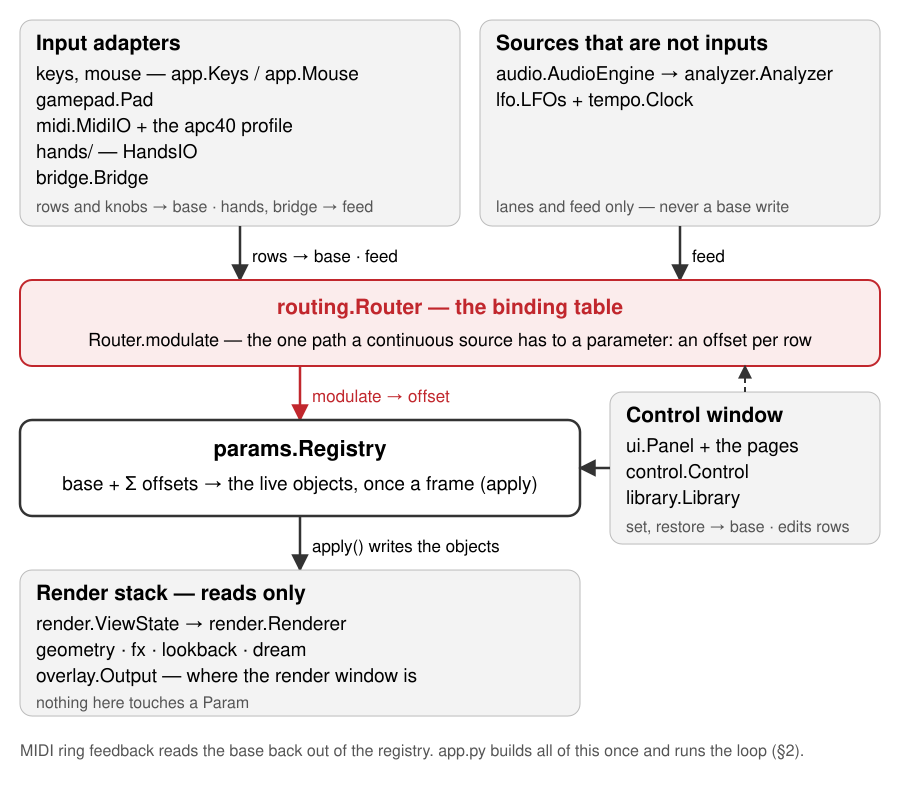
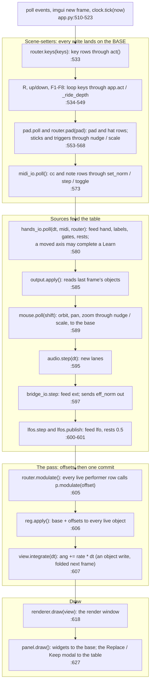
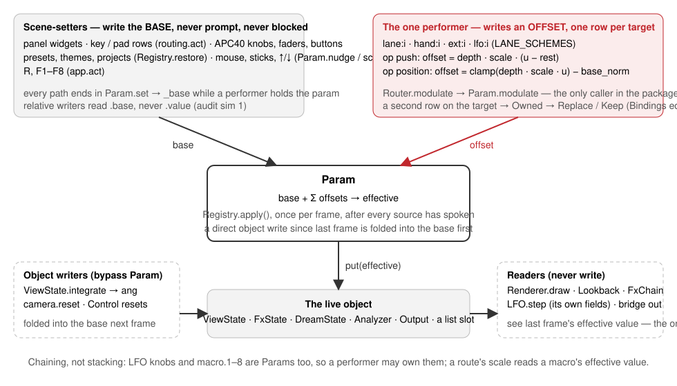

# Hyperspace — architecture

What the parts are, where a value goes each frame, and who may write a
parameter. This is the structure reference; behaviour is in
[`ENGINEERING.md`](ENGINEERING.md), the reasons in
[`DECISIONS.md`](DECISIONS.md), and what is currently wrong or drifting in
[`AUDIT-2026-09.md`](AUDIT-2026-09.md).

Written by plan 10 against `main` **ef299ef** (2026-09-27); the `file:line`
references are as of plan 10's own commit **488c445**, which changed only
docstrings and comments. The symbol names will outlive the numbers.
When a boundary, the frame order or the control model changes, change the
line here in the same PR — this document exists so that a fix can be made
in the right place, first time, by someone who has never seen the repo.

Two questions it must answer from this file alone:

1. **Where does a given controller's value go each frame?** — §2 and §3.7.
2. **Who may write a given parameter?** — §3.2.

Paths are relative to `hyperspace-python/hyperspace/` unless they start
with `tests/` or `docs/`.

---

## 1. Component map

Hyperspace is one Python process: a parameter **registry** in the middle,
**sources** that feed a **routing table**, a **render stack** that reads the
registry's live objects, a **panel** that edits the registry, and a
**library** that saves and loads it. `app.py` builds everything once and
runs the one frame loop.



*The table below is the picture's text twin.*

| Component | Modules | Owns | Reads | Writes | Boundary rule (held by) |
|---|---|---|---|---|---|
| **Registry** | `params.py`, `tapers.py` | every `Param`: id, kind, taper, flags, base, this frame's offsets | the live objects through each param's `get` | the live objects, once per frame in `Registry.apply()` | imports no adapter (`tests/test_params.py:286` for `midi`); it does import `fx`/`lookback` for their state classes, so it needs GL bindings importable (see audit) |
| **Routing table** | `routing.py` | `Binding` rows, the file `bindings.json`, the referee, the per-frame modulation pass | `Router.feeds` (what adapters fed), the analyzer's lanes, param bases | offsets via `Param.modulate` (`routing.py:1149`, the only caller in the package) | never imports `ui*`, `app`, `hands`; `glfw`/`gamepad` only lazily to resolve names (`routing.py:1193-1203`). Unenforced by a test |
| **Input adapters** | `midi.py` + `apc40.py`, `hands/`, `gamepad.py`, `bridge.py`, `app.Keys` / `app.Mouse` | a device; its own learn or pickup state | the table (discrete rows), param bases (MIDI pickup, feedback) | MIDI/keys/pads: the **base**; hands/bridge: only `Router.feed` | the core never imports `midi` or `bridge` (`tests/test_params.py:286`, `tests/test_bridge.py:381`); `hands/core.py` + `signal.py` import nothing from the package (`tests/test_hands_boundary.py`) |
| **Audio source** | `audio.py`, `analysis.py`, `analyzer.py`, `bands.py` | capture / playback, the FFT, N band lanes | the audio device | `analyzer.lanes` (read by `Router.modulate`); `band.*` params are views onto its objects | imports nothing from routing, ui or the render stack |
| **LFOs and clock** | `lfo.py`, `tempo.py` | four oscillators, one tap-tempo clock | their own dataclass fields (last frame's effective values) | `Router.feed("lfo", …)`, `labels`, `rests` | import **nothing** from `hyperspace` — registry, router, clock arrive as arguments (`tests/test_lfo_boundary.py`) |
| **Render stack** | `geometry.py`, `view.py`, `render.py`, `glsl.py`, `fx.py`, `lookback.py`, `dream.py`, `shaders/`, `overlay.py` | GL resources, `ViewState` (`view.py`), the frame history, the dream worker, the window's placement, the one wall clock (`Renderer.now`) | `ViewState` and the `FxState` / `DreamState` objects the registry writes | the screen; `ViewState.integrate` writes `ang` directly (folded into the base next frame) | zero registry traffic; `dream` is imported lazily by `app.py:248` under `[dream] enabled` (`tests/test_dream.py:55-72`) |
| **Panel** | `ui.py`, `ui_*.py`, `hands/panel.py`, `control.py` | imgui state, page selection, the Replace / Keep modal, the routing page's edits | everything, for display | param **bases** through `Param.set*`; table rows through `Bindings.add/enable/remove/replace_owner` | a leaf: no engine module imports `ui*` (only `app.py:79` and `hands/panel.py:41`). Unenforced by a test |
| **Library** | `library.py`, `presets.py`, `config.py`, `library/` | the home folder, preset and project files, the F1–F8 bank, `config.toml` | `Registry.snapshot` | `Registry.restore` (bases) | depends only on `params` and `presets`; its importers are `app`, `config` (for `ensure_home`), `dream` (for `home()`), `ui_presets` (`LibraryError`) and, lazily, `routing` (`slug`) |
| **Host** | `app.py`, `hotreload.py` | the two windows, construction order, the frame loop, the reload watch list | — | the relative writers' bases (`nudge`/`scale`), `act()` for its four loop keys | the one cold module; the only importer of every optional adapter, each behind its config gate (`app.py:185-253`) |

The direction to remember: **everything points at the registry; the
registry points at nothing above it.** Adapters and sources feed the
router; the router writes offsets; the panel and the library write bases;
the render stack only reads.

---

## 2. The frame

`app.main()` (`app.py:393`) is the only entry point and the loop at
`app.py:505-642` is the only place the frame order exists. No test pins
it; read the loop when it matters.



Two rules follow from the order.

**One-frame lag.** Everything that a performer moves is landed by
`reg.apply()` once, in the pass. A source that reads a parameter — an LFO
reading its own `depth`, a route reading its `scale` macro, the bridge
sending `eff_norm`, `output.apply` reading `output.alpha` — reads what
`apply()` wrote **last** frame. So a hand that owns `lfo.1.depth` lands one
frame before that LFO's output does; a lane that owns `macro.2` scales its
dependent route next frame; and there is no recursion, because nothing in
the modulation pass reads a value it is about to write
(`tests/test_lfo.py:253-290`, `tests/test_routing.py:1310`).

**Base before offset.** Every scene-setter runs before `router.modulate`
(the scene-setter block, the feeds, and the panel — whose draw is the previous
frame's tail),
so a base write and the offsets on top of it are combined in one `apply()`.
The one writer after `apply()` is the rotation integrator (`view.integrate`), which
writes the object directly; `Param.apply` adopts that as a delta on the
base the next frame (`params.py:460-466`, `tests/test_modulation.py:198`).

Guarding: the step block (`audio.step` through `integrate`), `renderer.draw`
and `panel.draw`
are each wrapped so hot-reloaded code that raises records
`reloader.runtime_error` and the loop continues (`app.py:593-629`).

---

## 3. The control model

This is the canonical statement. Where another document disagrees with
this section, this section is wrong only if the code is; check the cited
line, then fix whichever is lying.



*The picture in one sentence:* scene-setters write the **base**; exactly
one performer row per parameter writes an **offset** through
`Router.modulate`; `Registry.apply()` lands `base + offset` on the live
object once per frame; the render stack only reads. §3.2 is the text twin.

### 3.1 The registry

Every settable thing is a `Param` with a stable id (`view.bright`,
`rot.rate.XY`, `band.2.atk`, `fx.acid.speed`, `lfo.1.depth`, `macro.3`), a
`Kind` — `CONTINUOUS`, `ENUM`, `TOGGLE`, `TRIGGER`, `TEXT` (`params.py:100`)
— and a `get`/`put` pair that reads and writes the live object it is a
view onto. Flags (`params.py:133-135`):

| Flag | Means | Default |
|---|---|---|
| `persist` | belongs in a snapshot (preset, theme, project) | on; triggers never |
| `modulatable` | a performer may drive it | on; off for rig settings (`output.monitor…`, every `hands.*`), UI state, aliases |
| `alias` | a view onto another param (`band.sel.*` follows the selection) | off; an alias neither persists nor modulates |

A continuous param has a **taper** (`tapers.py`): an integer position ↔
real value map with `unmap(map(p)) == p` on every detent
(`tests/test_control.py:27`). The user's setters snap to detents; the
modulation path maps floats through the taper without snapping, and a
tapered value's position is continuous between detents (`_taper_pos`,
`params.py:221-242`) so a sub-detent base survives under a performer.

**Base vs effective.** A param has no storage of its own until something
modulates it. `p.value` reads the object (the *effective* value);
`p.base`, `p.norm`, `p.position()`, `p.text()` read the user's *setting*.
They are the same thing until the first `modulate()` call adopts the
object's current value as `_base` (`params.py:441-444`); from then on
every setter writes `_base` (`params.py:182-187`) and `apply()` writes
`base + Σ offsets` to the object. The frame no source calls, `apply()`
writes the base back and forgets it (`params.py:455-459`,
`tests/test_modulation.py:151`).

**`Registry.apply()`** (`params.py:546-552`) runs once per frame over every
modulated param, in registry insertion order. Per param
(`params.py:448-489`): fold any direct object write since last frame into
the base as a delta; `target = base + offsets`; clamp or wrap; continuous
→ float through the taper; enum → nearest index with a dead-band
(`MOD_DEADBAND`, `params.py:97`); toggle → hysteresis about `MOD_ON` /
`MOD_OFF` (`params.py:96`); trigger → fire once on the rising edge, re-arm
below `MOD_OFF` (`tests/test_modulation.py:232-277`).

### 3.2 Who may write a parameter

Three classes of writer, and the model is that they never fight:

| Class | Writes | Who | Enforced by |
|---|---|---|---|
| **Scene-setter** | the **base** | panel widgets (`ui.py:683-807`); key / pad / hat rows via `routing.act` (`routing.py:454-479`); MIDI knobs, faders, buttons (`midi.py:434-485`); presets, themes, projects via `Registry.restore` (`library.py:523`, `routing.py:1005/1159/1176`); the relative writers — mouse orbit / pan / zoom, sticks, triggers, ↑/↓ — via `Param.nudge` / `scale` (`app.py:331-373, 560-568`); the loop keys `R`, F1–F8 via `app.act` (`app.py:96`) | every setter ends in `Param.set`, which writes `_base` while modulated (`params.py:182-187`); `nudge`/`scale` read `self.base` (`params.py:370, 385`); `tests/test_modulation.py:180`, `tests/test_app_relative.py`, `tests/test_midi.py:272` |
| **Performer** | an **offset** | `Router.modulate` → `Param.modulate` (`routing.py:1149`) — the only caller in the package | grep; adapters only `feed` (`hands/core.py:758`, `lfo.py:174`, `bridge.py:228`). No test |
| **Object writer** | the live object, bypassing `Param` | the rotation integrator (`render.py:232`), `camera.reset` (`params.py:756-762`), `Control`'s scene / band resets (`control.py:57-134`), `mirror()` on the non-modulatable `hands.*` (`hands/core.py:449`) | `Param.apply` folds the delta into the base next frame (`params.py:460-466`, `tests/test_modulation.py:198`); non-modulatable params are never applied, so a direct write is simply the value |

Consequences to hold onto:

- A knob turned on a hand-owned parameter moves the **return value**, which
  shows when the hand's row lets go. It never prompts and is never blocked
  (plan 09 decision 3, "scene-setters don't compete";
  `tests/test_routing.py:1068`). Caveat, §3.10: today a hand leaving the
  box does not make its `position` row let go; the tracker going dark does.
- A relative writer reads the base, never the effective value. Reading the
  effective value folded the whole offset into the base on every drag
  frame — plan 09's audit simulation 1 (`tests/test_app_relative.py:53`).
- MIDI ring feedback shows the base (`midi.py:505`) and never chases a
  performer; LED feedback on a toggle, or on an enum `set` row, reads the
  effective value
  (`midi.py:526-528`) and does. That asymmetry is real (audit).
- `Router.modulate` never checks ownership. The referee lives in the
  table's edit doors (§3.5); a table mutated directly could still stack two
  rows on one target.

### 3.3 Sources and rows

A `Binding` (`routing.py:290`) is one row: `source` (`scheme:address`),
`target` (a param id), `op`, `value`, `enabled`, and for performers
`scale`, `when`, `rest`; MIDI rows add `pickup`, `feedback`, `on`, `off`,
`ring`.

| Scheme | Address | Fed by | Reaches the param as |
|---|---|---|---|
| `key:` | a GLFW key name, optional `SHIFT+` / `SUPER+` | `Router.keys` (`routing.py:1024`) | a **discrete op** on the base |
| `pad:` / `hat:` | a `gamepad` button / hat name | `Router.pad` (`routing.py:1051`) | discrete op on the base |
| `cc:` / `note:` / `pitch:` | `channel:number` (`pitch:` is `channel` only) | `MidiIO._apply` (`midi.py:434`) | `abs` (with soft pickup), `rel`, `rel64`, `step`, `toggle`, `set`, `momentary` — all base |
| `lane:` | analyzer band index | `analyzer.lanes / CEIL` inside `Router.modulate` (`routing.py:1118`) | **performer** |
| `hand:` | axis index: 12 axes, 2 presence, 8 pinch switches | `HandsIO.poll` → `Router.feed("hand")` (`hands/core.py:758`) | performer; a switch may also be a gate |
| `ext:` | DAW lane 0–15 | `Bridge.step` → `Router.feed("ext")` (`bridge.py:228`) | performer |
| `lfo:` | 0–3 (`lfo:0` is "LFO 1"; param ids are 1-based) | `LFOs.publish` → `Router.feed("lfo")` (`lfo.py:174`) | performer |

`LANE_SCHEMES = ("lane", "ext", "lfo", "hand")` are the continuous
schemes (`routing.py:225`). A row on one of them may carry **only** the
two performer ops (`MOD_OPS = ("push", "position")`, `routing.py:226`;
`Bindings._check` raises otherwise, `routing.py:856-858`). The other ops
in `OPS` (`routing.py:227`) belong to keys, pads and MIDI.

### 3.4 The one path

Every continuous source reaches a parameter through exactly one pass,
`Router.modulate` (`routing.py:1113-1149`), once per frame, in table order:

1. Find the source's vector: the analyzer's lanes for `lane:`, otherwise
   `feeds[scheme]`. No vector, an out-of-range index or a `NaN` reading
   (a hand never yet seen) → the row does nothing this frame.
2. If the row has a gate (`when`), the gate's source must be **fed** and
   read ≥ 0.5; a gate whose source is not live holds the row **shut**
   (`Router.gated`, `routing.py:1074-1099`). `lane:` can never gate.
3. `depth = value × scale`, where `scale` names a param (a macro, say)
   whose **effective** value multiplies the depth; a missing scale param
   makes the row dormant (`routing.py:1132-1137`).
4. The op:
   - **push** — `offset = depth · (u − rest)`. The performer adds to the
     base, centred where the source rests. `rest` is the row's own number
     or, when `None`, the source's rest as its adapter published it this
     frame (`Router.rest_of`, `routing.py:1101`; hands publish each axis's
     configured rest, LFOs 0.5, the analyzer and the bridge nothing → 0).
     Idle adds nothing (`tests/test_routing.py:586`).
   - **position** — `offset = clamp(depth · u, 0, 1) − base_norm`. The
     source *is* the fader, along the param's taper; when it lets go the
     base returns (`tests/test_routing.py:641`).
5. `p.modulate(offset)` (`routing.py:1149`). Range, wrap, hysteresis and
   the return to base are all `Param.apply`'s job, run by `Registry.apply`
   in the frame's pass (§2, §3.1). `modulate` records; `apply` lands.

A row whose source stops being fed (`Router.feed(scheme, None)`: the
tracker off, the DAW port gone) or whose gate opens simply stops calling
`modulate`, and `apply()` writes the base back that frame.

**Adding a source** (a pedal over OSC, say) is an adapter that, once per
frame before `router.modulate`, does exactly what the LFOs do
(`lfo.py`, `LFOs.publish`): `router.feed("<scheme>", vector)` — a list
of floats in `[0, 1]`, `NaN` for a lane that is out of view, `None` when
the device is gone — and publishes, by plain assignment,
`router.labels["<scheme>"] = [names]`, `router.rests["<scheme>"] =
[rests]`, and, if some lanes are switches, `router.gates["<scheme>"] =
[(lane_index, name), …]`. The scheme must be in `LANE_SCHEMES`
(`routing.py:225`) for its rows to count as performers; until it is, reuse
`ext:`. The adapter imports nothing from the package (the registry and
router arrive as arguments — the rule `tests/test_lfo_boundary.py`
holds), never writes a `Param`, and is opened by `app.main` behind a
config gate. The referee needs nothing from it: ownership is settled at
the table's edit doors (§3.5) whatever the scheme.

### 3.5 One performer per parameter

A **performer** is an enabled row on a continuous scheme with a performer
op (`Binding.is_performer`, `routing.py:377-381`). Disabled rows own
nothing; key, pad and MIDI rows never own. A target has at most one:

- `Bindings.owner(pid)` answers who (`routing.py:837`).
- `Bindings.add` and `bind` raise `Owned(existing, new)` when the target
  has a different performer (`routing.py:852-864, 899-905`); the table is
  untouched. Waking a disabled row (`enable`) runs the same check
  (`routing.py:935-947`).
- `Bindings.replace_owner(new, *, target=None)` is the **one door** onto a
  taken target: it removes whoever owns it *at commit* and adds or
  retargets the new row (`routing.py:907-933`). Every *Replace* in the app
  is that call (`ui_routing.py:206, 237, 243`; `midi.py:383`).
- Loading a file or a preset runs `referee()`: first performer per target
  wins in file order, the rest go to `table.dropped` with a reason, shown
  on the ROUTING page until the next edit (`routing.py:567-584, 779, 956`).
- Gates do not exempt a row: two rows on one target with different pinches
  are two performers (plan 09 decision 2, "one performer per parameter").

Tests: `tests/test_routing.py:892-1009` (the referee), `:1029-1095` (the
four audit simulations), `:1359` (every factory preset has one owner per
target).

**The Replace / Keep prompt.** A conflicting learn or edit is *held*, not
applied:

- A hand learn goes through `MidiIO.learn_source` (`midi.py:326-358`): if
  another performer owns the target the pair is parked in `MidiIO.pending`
  and nothing is written. A learn onto a target the same axis already
  positions only refreshes the gate.
- A ROUTING-page add, enable or retarget that raises `Owned` parks in the
  page's own state (`ui_routing.py:225-231`).
- `ui_routing.modal` is drawn first thing in `Panel.draw`, on **every**
  page, panel collapsed or not (`ui.py:939`), reading whichever question is
  up (`_question`, `ui_routing.py:245-266`). *Replace* →
  `replace_owner` and the file is written; *Keep* → the table is untouched
  (`tests/test_ui_bands.py:333`,
  `test_the_replace_prompt_swaps_the_owner_or_leaves_the_table`;
  `tests/test_midi.py:387`).
- While a question is up `MidiIO.learning` is `None`, so moving the hands
  learns nothing more (`hands/core.py:812-814`, `tests/test_hands.py:521`).

### 3.6 Chaining, not stacking

Layers come from the graph, never from two rows on one knob. Every knob
of an LFO (`lfo.N.shape/rate/sync/depth/phase`) and every macro
(`macro.1–8`) is an ordinary, ownable, persistent param, so:

```
hand:7 ──position──▶ lfo.1.depth      lfo:0 ──push──▶ view.bright
lane:0 ──push──▶ macro.2              hand:1 ──position──▶ fx.mix  ×scale macro.2
```

The eight macros exist only to be a route's `scale` and to be owned
(`params.py:80, 885-892`). They are **routing-layer state**
(`ROUTING_GROUPS = ("macro",)`, `params.py:85`): outside the whole-surface
snapshot a theme or project takes, inside a routing preset's `values` and
the live `bindings.json`'s `values`, landed at startup by the first
`Router` built over the table (`routing.py:988-1005`,
`tests/test_routing.py:1449`). LFO and tempo params are **not** in
`ROUTING_GROUPS`: they are theme state, though the `lfo-breathe` routing
preset also writes four of them (`lfo.1.sync/shape/depth`, `lfo.2.sync`) as
`values` (audit R1).

### 3.7 Where a controller's value goes

| You move… | It becomes… | Writes | Path |
|---|---|---|---|
| a panel fader, combo, checkbox | `Param.set_position` / `set` / `toggle` | base | `ui.py:683-807` → `params.py:182` |
| a key with a table row (`B`, `F`, `1–6`, …) | `routing.act` on the row | base (step / toggle / fire / set) | `app.py:533` → `routing.py:1024` → `:454` |
| `R`, F1–F8 / ⇧F1–F8 | loop code: `app.act(reg, pid, "fire")` on `camera.reset` / `theme.load.k` / `theme.save.k` | base (a trigger) | `app.py:534-549` — the keys outside the table |
| Cmd+R, Esc / Q | loop code: `_restart` (execv) / close the window | nothing in the registry | `app.py:530-536` |
| ↑ / ↓ | `_ride_depth` on `view.depth4` | base, relative, in log space | `app.py:540-545, 370-373` |
| mouse drag / shift-drag / wheel | `Mouse.poll` → `nudge` / `scale` on camera params | base, relative | `app.py:321-367` |
| a pad button or hat | `routing.act` on the row | base | `app.py:555` → `routing.py:1051` |
| a stick or trigger | `nudge` / `scale` / `_ride_depth` | base, relative | `app.py:558-568` |
| an APC40 knob or fader (`abs`) | `Param.set_norm` after soft pickup; ring feedback shows the base | base | `midi.py:476-485, 494-521` |
| an APC40 button (note) | `momentary` / `toggle` / `step` / `fire` | base | `midi.py:438-450` |
| an APC40 knob on a **hand-owned** param | the same — it moves the return value | base | decision 3; `tests/test_routing.py:1068` |
| an analyzer band | `lane:<i>` → its performer row | offset | `routing.py:1118` |
| a hand axis | `hand:<i>` → its performer row (push or position) | offset | `hands/core.py:758` → `routing.py:1113` |
| a pinch | `hand:<14+…>` — a lane like any other, and a gate for rows whose `when` names it | offset, or opens / shuts a row | `hands/core.py:688-696`, `routing.py:1074` |
| a DAW lane in | `ext:<i>` → its performer row | offset | `bridge.py:228` |
| an LFO | `lfo:<i>` → its performer row | offset | `lfo.py:174` |
| right-click → Learn, then move a hand | `MidiIO.learn_source` → a `position` row, or the prompt | the table | `hands/core.py:808-832` → `midi.py:326` |
| right-click → Learn, then turn a knob | `MidiIO._learned` → an `abs` / `rel` / `toggle` MIDI row | the table | `midi.py:299-324` |
| a preset, theme or project | `Registry.restore` | base | `library.py:523` |
| a routing preset | `Bindings.set_routes` + `reg.restore(values)` | the performer rows and the macros | `routing.py:1161-1176` |

### 3.8 The binding file

`<home>/bindings.json`, schema `hyperspace.bindings/2` (`routing.py:216`):
`{"schema", "profile", "bindings": [rows], "values": {macro ids}}`. Rows
carry only non-default fields. It is the live table — keys, pads, MIDI and
performer rows in one file — written on every edit (`Bindings.write`,
`routing.py:802`), which also refreshes `values` from the registry.

On load (`Bindings.load`, `routing.py:713-749`):

- no file → the factory table (`keymap + padmap + apc40.DEFAULT_MAP +
  legacy6_routes`, `routing.py:707`); an old `midi_map.json` beside it is
  merged once;
- schema 1 → `migrate_v1` renames the ops (`mod → push`, `span →
  position`, lane `abs → position`; `replace` is dropped with a note)
  and `referee` settles duplicate owners (`routing.py:587-610`);
- every load **of a file** runs `remap_factory` (`routing.py:613-642`; a
  fresh factory table already has the rows): the plan-09 moves (TAP TEMPO,
  NUDGE ±, METRONOME, QUANT for `theme.next`, `B`, `⇧B`) applied only where the
  user's table still has the exact old factory row or nothing on the
  source; idempotent;
- anything migrated or remapped is announced on stderr and written back
  once; an unknown schema is never rewritten — the factory table stands
  in and `Bindings.error` says why (`tests/test_routing.py:1138-1285`).

Routing **presets** (`library/bindings/*.json`, user files shadow factory
ones) carry only performer rows and `values`; loading one replaces every
performer row — learned hand rows included — and leaves key, pad and MIDI
rows alone (`routing.py:1161-1176`). The factory set is generated from
code by `python -m hyperspace.routing` and pinned by
`tests/test_routing.py:393`.

### 3.9 Tempo and the LFOs

`tempo.Clock` (`tempo.py:62`) is one free-running clock. `tick(now)` once
a frame makes every call in that frame agree on the time (`app.py:523`).
`tap()`: taps more than 2 s apart start a new burst; BPM is the mean
interval of the burst's last 8 taps, clamped 20–300 (`tempo.py:84-101`).
`beat(t) = (t − t0) · bpm / 60 + nudge`; `bar` is beat mod 4. Params
`tempo.bpm`, `tempo.tap`, `tempo.nudge` (`tempo.py:141-159`).

`B` taps and `⇧B` triggers, and both are ordinary table rows (`key:B →
tempo.tap`, `key:SHIFT+B → lfo.trigger`, in `keymap()` and added to older
files by `remap_factory`), as
are the APC40's TAP TEMPO, NUDGE ± and METRONOME (`apc40.DEFAULT_MAP`).

**The global LFO trigger** (`lfo.trigger`, `lfo.py:185`; `⇧B`, the APC40's
METRONOME) sets the downbeat to now — folding the current nudge in so beat
0 lands on the press (`tempo.py:113-121`) — and restarts every LFO in a
division mode at phase 0 together; Hz LFOs are untouched. Once the clock
has been triggered, a tap changes the BPM and not the downbeat, so a
re-tap mid-set moves the readout, not the picture (`tempo.py:95-101`,
`tests/test_lfo.py:98-140`). Before the first trigger a tap does re-pin the
downbeat (audit B2; the module docstring now says so).

`lfo.LFOs` (`lfo.py:134`): four. Per LFO `shape` (sine, tri, saw, square,
random = sample-and-hold per cycle), `rate` (Hz, log 0.01–20), `sync` (Hz
or a bar division), `depth`, `phase`, and a `reset` trigger. In Hz the
phase integrates `rate · dt`; in a division it is `clock.beat · ratio +
phase` (`lfo.py:110-123`). Output `u = 0.5 + 0.5 · depth · wave`, rest
0.5, published every frame (`lfo.py:171-176`). An LFO is a performer and
every one of its knobs is ownable; it reads its knobs from its own
dataclass fields, i.e. last frame's effective values, which is the whole
one-frame-lag / no-recursion mechanism (§2).

### 3.10 What this section does not promise

Behaviour the code has today that the model above does not describe, all
filed in [`AUDIT-2026-09.md`](AUDIT-2026-09.md):

- A hand leaving the box with the tracker still on does **not** release a
  `position` row: the axis springs to its rest value and the row keeps
  positioning the param there. Only the tracker going dark feeds `None`
  (`hands/core.py:693` for the NaN rule, `:758` for the `None` feed,
  `hands/signal.py:124-131` for the spring; with `rest = hold` it holds instead).
- Hand Learn lives in the MIDI adapter object; with `[midi] enabled =
  false` there is no hand Learn.
- Nothing in `Router.modulate` checks ownership.
- `tempo.tap`, `lfo.trigger` and `lfo.N.reset` are modulatable by default.

---

## 4. Module shapes

The point of this section: when you have to change something, it tells
you which file to open, what that file is allowed to touch, and which test
will catch you if you break its rule. One row per module or package, in
the component map's order. Names are kept to the one or two you would
grep for; the module's docstring has the rest.

| Module | What it is for | What it owns and hands out | The rule it keeps (and who enforces it) | Tests |
|---|---|---|---|---|
| `params.py` | The parameter registry: one id per settable thing, the base-versus-effective split, and the once-per-frame `apply()` that lands everything on the live objects. | Every `Param` and the `Registry`; `build_registry` declares the whole surface. | Never imports an adapter; never puts a macro into a whole-surface snapshot; never snaps a modulated base to a detent. (`tests/test_params.py:286` for the import rule.) | `test_params.py`, `test_modulation.py` |
| `tapers.py` | Turns a fader's integer position into a real value and back, exactly, for every knob. | The taper objects and the per-band knob specs. | The round trip position → value → position is exact on every detent. (`tests/test_control.py:27`) | `test_control.py` |
| `routing.py` | The binding table: one row type for keys, pads, MIDI and performers; the file on disk; the referee; the per-frame modulation pass. | `Binding`, `Bindings` (the table and its edit doors), `Router` (the pass, `feed`, presets), `Owned`. | A lane-scheme row carries only `push` or `position`; a target never has two enabled performers through the edit doors; `modulate` never writes a base; an unknown-schema file is never rewritten. (`tests/test_routing.py:892-1009, 1212`) | `test_routing.py` |
| `midi.py` + `apc40.py` | The MIDI adapter (ports, soft pickup, ring and LED feedback, Learn) and the APC40's device profile (port name, mode SysEx, LED colours, the 113-row default map). | `MidiIO`, `Ports`; `apc40.DEFAULT_MAP` and the button constants the clock uses. | The core never imports it; every write it makes is a base write; a ring shows the base and never chases a performer; a held Learn is never applied or dropped silently. (`tests/test_params.py:286`, `tests/test_midi.py:272, 387`) | `test_midi.py` |
| `hands/` | The Ultraleap instrument: two hands as twelve shaped axes, two presence lanes and eight pinch switches, fed to the table; MIDI out to a DAW; box calibration; the HANDS page. | `HandsIO.poll(dt, midi, router)`, `HandSettings`, `register`; `panel.page`. | `core.py` and `signal.py` import nothing from the package — only `panel.py` knows the host; the lane order never changes under a saved `hand:<i>`; a gate never opens on a source that is not live; nothing learns while a question is up. (`tests/test_hands_boundary.py`, `tests/test_hands.py:391, 752, 521`) | `test_hands.py`, `test_hands_boundary.py` |
| `lfo.py` + `tempo.py` | Four tempo-aware LFOs and the tap-tempo clock, as a source fed to the table like any other, with every knob an ordinary param. | `LFOs.step` / `publish`, `Clock` (`tap`, `trigger`, `beat`), the two `register` functions. | Import nothing from the package; read their own fields, never a `Param` (that is the one-frame lag); once triggered, a tap never moves a running synced LFO; the global trigger never touches a Hz LFO. (`tests/test_lfo_boundary.py`, `tests/test_lfo.py:98-156`) | `test_lfo.py`, `test_tempo.py`, `test_lfo_boundary.py` |
| `geometry.py` | Builds the 25 shapes as unit-circumradius vertex, edge and face arrays, and holds the exact 4D → 2D transform. | `SHAPES`, `geom(i)`, `project_h` (the one transform; `project` is it without the divisor, the tests' oracle), `PLANES` — the six planes as `(name, i, j)`, the one table `params.PLANES` takes its names from — faces and UVs. | The first 18 shapes' vertex and edge order never changes — the golden traces key on it; `project` and `project_h` agree to the bit on every shape; a plane's name spells its axes. (`tests/test_core.py:33, test_project_is_project_h_without_the_divisor, test_the_plane_table_names_its_own_axes`, `tests/test_shapes3d.py:16`) | `test_core.py`, `test_shapes3d.py`, `test_golden.py` |
| `view.py` | `ViewState`, the live object the view, rotation and camera params write — a plain dataclass, apart from the GL. | `ViewState` (and `integrate`, the one direct writer of `ang`), `N_MOD`, `RED` (the points' colour and the panel's one accent). | Imports only `geometry`; nothing in it needs moderngl, so the registry, the library and every test can hold a view without a GL binding. | `test_render.py`, `test_modulation.py` |
| `render.py` | `Renderer.draw`: scene pass, coverage mask, look-back, FX, to the window — reading a `ViewState` from `view.py`. | `Renderer` (and `now`, the frame's one wall clock, pinned by `t_now`), `render_offscreen`; `ViewState` and `RED` re-exported from `view.py`. | Imports no audio, input or registry code; with look-back and FX off the output is bit-identical to the scene pass; the history never captures the effected frame; the patterns, the instance motion and the effect chain read one `t`. (`tests/test_render.py:306`, `test_one_clock_reaches_the_patterns_and_the_effects`) | `test_render.py` |
| `glsl.py` + `shaders/_common.glsl` | The GLSL every shader shares: the fullscreen-triangle vertex shader and the colour helpers (`TAU`, `LUMA`, `hsv`, `pal`, `hue_rotate`, …). | `QUAD_VS`, `common()`, `common_mtime()`, `gl_error()`, `FALLBACK` (the file as shipped). | A helper is defined once: `patterns.glsl`, `fx/_lib.glsl` and the post pass prepend `_common.glsl` and define none of its names; the two 2-D hash pairs stay separate on purpose; a broken edit never takes the show down — the patterns and effects show the error, the post pass falls back to `FALLBACK` and says so. (`tests/test_fx.py`, `test_the_shared_helpers_are_written_once`; `tests/test_lookback.py`, `test_a_broken_common_glsl_leaves_the_post_pass_on_the_shipped_helpers`) | `test_fx.py`, `test_lookback.py` |
| `fx.py` + `shaders/fx/` | Post effects as GLSL files whose `// @param` uniforms become registry params, run as a pass chain after the composite. | `FxState` (the params' object), `FxChain` (`run(target, t)` on the renderer's clock), `declare`. | An effect is never defined in Python; a broken edit never takes the frame down; off is bit-identical; every effect compiles behind `_common.glsl` then `_lib.glsl`. (`tests/test_fx.py:194, 268, 293`) | `test_fx.py` |
| `lookback.py` + `dream.py` | The frame history and its age-weighted composite, and the optional torch worker that dreams on it. | `Lookback`, `DreamState` (the `dream.*` object), `LookbackSource` (the slot's contract), `DreamWorker`. | Nothing in the core imports `dream`; torch appears only in `dream.py`; `submit` never blocks the frame; echoes are never re-tinted. (`tests/test_dream.py:55, 151`, `tests/test_lookback.py:405`) | `test_lookback.py`, `test_dream.py` |
| `overlay.py` | Where the render window is and how it looks — window, fullscreen or overlay — as `output.*` params applied once a frame. | `Output` (`register`, `apply`, `bg_alpha`); the `overlay.*` aliases. | Touches the window system only inside `apply()`, through a backend that tests can fake; the rig settings never persist or modulate. (`tests/test_overlay.py:86, 115`) | `test_overlay.py` |
| `ui.py` + `ui_*.py` + `hands/panel.py` | The control window: the rail of fourteen pages, the widgets (each a view onto one param), the right-click menu, the Replace / Keep modal, the cheat sheet. | `Panel.draw`, the widget helpers, `PAGES`; each page's `page(panel)`; `ui_routing.modal`. | A widget writes only the base, through `Param.set*`; nothing here calls `modulate`; the modal is drawn before the panel decides whether it is open; no page scrolls at the control size; every widget has its own imgui id. (`tests/test_ui_bands.py:436`, `tests/test_ui_shell.py:92`, `tests/test_ui_lfo.py:86`) | `test_ui_shell.py`, `test_ui_bands.py`, `test_ui_lfo.py` |
| `control.py` | The headless half of the analyzer page: band selection, the scene, reset with its 8 s undo, adding and removing bands. | `Control`, whose methods the `scene.*` and `band.*` params call. | Reset goes to the selected scene, never to hard-coded defaults; an undo never survives a scene change. (`tests/test_control.py:74-112`) | `test_control.py` |
| `library.py` + `presets.py` + `config.py` | The home folder (`~/Hyperspace`), one JSON per module preset, projects with the F1–F8 bank, and `config.toml`. Routing presets are `routing.py`'s, not the library's. | `Library` (`load`, `save_as`, `reset`, `is_dirty`, `poll`), `Presets` (the bank's view), `config.load`. | Never writes a factory file; a theme or project never carries a macro or a rotation phase; every restore is a base write; the analyzer's layout lands before its values. (`tests/test_library.py:123, 164, 240`, `tests/test_presets.py:73`) | `test_library.py`, `test_presets.py` |
| `app.py` + `hotreload.py` | The entry point: two windows, construction in a fixed order, the frame loop, and hot reload of the modules on its watch list. | `main()`, `Keys`, `Mouse`; `HotReloader` and its `MODULES` list. | Optional adapters are imported lazily behind their config gate; the render window never runs imgui; a raising adapter or reload never stops the show; a relative writer reads the base, never the effective value. (`tests/test_app_relative.py`, `tests/test_hotreload.py:109`) | `test_app_relative.py`, `test_hotreload.py` |
| `gamepad.py` + `bridge.py` | The Xbox pad polled raw through GLFW with our own index map; the DAW bridge — analyzer lanes out as 14-bit MIDI, the same forms in as `ext` lanes. | `Pad`; `Bridge.step`. | The pad never raises when absent; the bridge never writes a `Param` (its lanes reach one only as a route) and is off by default. (`tests/test_gamepad.py:77`, `tests/test_bridge.py:272, 392`) | `test_gamepad.py`, `test_bridge.py` |
| `audio.py` + `analysis.py` + `analyzer.py` + `bands.py` | The audio source (a capture device or a file, through a ring buffer), the FFT front end, and the one chain that runs: the N-band analyzer whose output is `lanes`. `bands.py` is its parts bin. | `AudioEngine` (`chain`, `step`, the transport), `Analyzer` (`lanes`, layout, scenes), `bands.PRESETS` and the constants. | The legacy six-band layout never diverges from the frozen oracle by a bit; a lane never reaches `CEIL`; the callbacks never do chain work; a source attach never loses the layout or the faders. (`tests/test_analyzer.py:63, 412`, `tests/test_core.py:58, 144`) | `test_analyzer.py`, `test_core.py` |

Things no test holds today, in every row that says so above: the frame
order in `app.py`, `routing.py`'s import boundary, "only `Router.modulate`
calls `Param.modulate`", the audio stack's imports, the panel being a
leaf. They are filed as audit items R11, A9 and P5.
