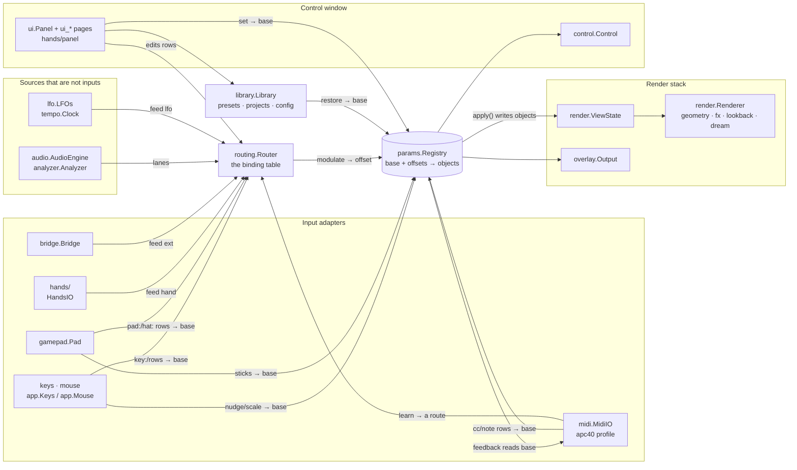

# Hyperspace — architecture

What the parts are, where a value goes each frame, and who may write a
parameter. This is the structure reference; behaviour is in
[`ENGINEERING.md`](ENGINEERING.md), the reasons in
[`DECISIONS.md`](DECISIONS.md), and what is currently wrong or drifting in
[`AUDIT-2026-09.md`](AUDIT-2026-09.md).

Written by plan 10 against `main` **ef299ef** (2026-09-27). Every
`file:line` is that commit; the symbol names will outlive the numbers.
When a boundary, the frame order or the control model changes, change the
line here in the same PR — this document exists so that a fix can be made
in the right place, first time, by someone who has never seen the repo.

Two questions it must answer from this file alone:

1. **Where does a given controller's value go each frame?** — §2 and §3.7.
2. **Who may write a given parameter?** — §3.2.

Paths are relative to `hyperspace-python/hyperspace/` unless they start
with `tests/` or `docs/`.

---

## 1. Component map

Hyperspace is one Python process: a parameter **registry** in the middle,
**sources** that feed a **routing table**, a **render stack** that reads the
registry's live objects, a **panel** that edits the registry, and a
**library** that saves and loads it. `app.py` builds everything once and
runs the one frame loop.



| Component | Modules | Owns | Reads | Writes | Boundary rule (held by) |
|---|---|---|---|---|---|
| **Registry** | `params.py`, `tapers.py` | every `Param`: id, kind, taper, flags, base, this frame's offsets | the live objects through each param's `get` | the live objects, once per frame in `Registry.apply()` | imports no adapter (`tests/test_params.py:286` for `midi`); it does import `fx`/`lookback` for their state classes, so it needs GL bindings importable (see audit) |
| **Routing table** | `routing.py` | `Binding` rows, the file `bindings.json`, the referee, the per-frame modulation pass | `Router.feeds` (what adapters fed), the analyzer's lanes, param bases | offsets via `Param.modulate` (`routing.py:1138`, the only caller in the package) | never imports `ui*`, `app`, `hands`; `glfw`/`gamepad` only lazily to resolve names (`routing.py:1182-1192`). Unenforced by a test |
| **Input adapters** | `midi.py` + `apc40.py`, `hands/`, `gamepad.py`, `bridge.py`, `app.Keys` / `app.Mouse` | a device; its own learn or pickup state | the table (discrete rows), param bases (MIDI pickup, feedback) | MIDI/keys/pads: the **base**; hands/bridge: only `Router.feed` | the core never imports `midi` or `bridge` (`tests/test_params.py:286`, `tests/test_bridge.py:381`); `hands/core.py` + `signal.py` import nothing from the package (`tests/test_hands_boundary.py`) |
| **Audio source** | `audio.py`, `analysis.py`, `analyzer.py`, `bands.py` | capture / playback, the FFT, N band lanes | the audio device | `analyzer.lanes` (read by `Router.modulate`); `band.*` params are views onto its objects | imports nothing from routing, ui or the render stack |
| **LFOs and clock** | `lfo.py`, `tempo.py` | four oscillators, one tap-tempo clock | their own dataclass fields (last frame's effective values) | `Router.feed("lfo", …)`, `labels`, `rests` | import **nothing** from `hyperspace` — registry, router, clock arrive as arguments (`tests/test_lfo_boundary.py`) |
| **Render stack** | `geometry.py`, `render.py`, `fx.py`, `lookback.py`, `dream.py`, `shaders/`, `overlay.py` | GL resources, `ViewState`, the frame history, the dream worker, the window's placement | `ViewState` and the `FxState` / `DreamState` objects the registry writes | the screen; `ViewState.integrate` writes `ang` directly (folded into the base next frame) | zero registry traffic; `dream` is imported lazily by `app.py:247` under `[dream] enabled` (`tests/test_dream.py:55-72`) |
| **Panel** | `ui.py`, `ui_*.py`, `hands/panel.py`, `control.py` | imgui state, page selection, the Replace / Keep modal, the routing page's edits | everything, for display | param **bases** through `Param.set*`; table rows through `Bindings.add/enable/remove/replace_owner` | a leaf: no engine module imports `ui*` (only `app.py:78` and `hands/panel.py:41`). Unenforced by a test |
| **Library** | `library.py`, `presets.py`, `config.py`, `library/` | the home folder, preset and project files, the F1–F8 bank, `config.toml` | `Registry.snapshot` | `Registry.restore` (bases) | depends only on `params` and `presets`; nothing imports it back except `config`, `bridge`, `dream` for `DEFAULTS`/`FACTORY` |
| **Host** | `app.py`, `hotreload.py` | the two windows, construction order, the frame loop, the reload watch list | — | the relative writers' bases (`nudge`/`scale`), `act()` for its four loop keys | the one cold module; the only importer of every optional adapter, each behind its config gate (`app.py:184-252`) |

The direction to remember: **everything points at the registry; the
registry points at nothing above it.** Adapters and sources feed the
router; the router writes offsets; the panel and the library write bases;
the render stack only reads.

---

## 2. The frame

`app.main()` (`app.py:392`) is the only entry point and the loop at
`app.py:504-641` is the only place the frame order exists. No test pins
it; read the loop when it matters.

```mermaid
sequenceDiagram
    autonumber
    participant W as glfw / imgui
    participant K as keys · pad · mouse<br/>(app.py)
    participant M as midi.MidiIO
    participant H as hands.HandsIO
    participant A as audio / analyzer
    participant B as bridge.Bridge
    participant L as lfo.LFOs
    participant R as routing.Router
    participant P as params.Registry
    participant V as render.ViewState
    participant D as Renderer / Panel

    W->>W: poll_events · new_frame · clock.tick(now)  app.py:509-522
    K->>R: router.keys(keys)  :532 — table rows → act() → base
    K->>P: R, ↑/↓, F1–F8 — loop keys → base  :533-548
    K->>R: router.pad(pad)  :554 — pad/hat rows → base
    K->>P: sticks, triggers → nudge/scale → base  :557-567
    M->>P: cc/note rows → set_norm/step/toggle → base  :572
    H->>R: feed("hand", lanes | None), labels, gates, rests  :579
    H->>M: a moved axis completes a learn → route or pending
    W->>W: output.apply() (reads last frame's objects)  :584
    K->>P: mouse orbit / pan / zoom → nudge/scale → base  :588
    A->>A: audio.step(dt) — new lanes  :594
    B->>R: feed("ext", …); reads eff_norm out  :596
    L->>R: lfos.step; publish → feed("lfo", …)  :599-600
    R->>P: modulate(): every live performer row → p.modulate(offset)  :604
    P->>V: reg.apply(): base + Σoffsets → every object  :605
    V->>V: integrate(dt): ang += rate · dt  :606
    D->>D: renderer.draw(view)  :617
    D->>P: panel.draw(): widgets → base; modal → table  :626
```

Two rules follow from the order.

**One-frame lag.** Everything that a performer moves is landed by
`reg.apply()` once, at step 15. A source that reads a parameter — an LFO
reading its own `depth`, a route reading its `scale` macro, the bridge
sending `eff_norm`, `output.apply` reading `output.alpha` — reads what
`apply()` wrote **last** frame. So a hand that owns `lfo.1.depth` lands one
frame before that LFO's output does; a lane that owns `macro.2` scales its
dependent route next frame; and there is no recursion, because nothing in
the modulation pass reads a value it is about to write
(`tests/test_lfo.py:253-290`, `tests/test_routing.py:1310`).

**Base before offset.** Every scene-setter runs before `router.modulate`
(steps 2–11 and the panel at step 18, which is the previous frame's tail),
so a base write and the offsets on top of it are combined in one `apply()`.
The one writer after `apply()` is the rotation integrator (step 16), which
writes the object directly; `Param.apply` adopts that as a delta on the
base the next frame (`params.py:449-455`, `tests/test_modulation.py:198`).

Guarding: the step block (steps 11–16), `renderer.draw` and `panel.draw`
are each wrapped so hot-reloaded code that raises records
`reloader.runtime_error` and the loop continues (`app.py:592-628`).

---

## 3. The control model

This is the canonical statement. Where another document disagrees with
this section, this section is wrong only if the code is; check the cited
line, then fix whichever is lying.

### 3.1 The registry

Every settable thing is a `Param` with a stable id (`view.bright`,
`rot.rate.XY`, `band.2.atk`, `fx.acid.speed`, `lfo.1.depth`, `macro.3`), a
`Kind` — `CONTINUOUS`, `ENUM`, `TOGGLE`, `TRIGGER`, `TEXT` (`params.py:98`)
— and a `get`/`put` pair that reads and writes the live object it is a
view onto. Flags (`params.py:131-133`):

| Flag | Means | Default |
|---|---|---|
| `persist` | belongs in a snapshot (preset, theme, project) | on; triggers never |
| `modulatable` | a performer may drive it | on; off for rig settings (`output.monitor…`, every `hands.*`), UI state, aliases |
| `alias` | a view onto another param (`band.sel.*` follows the selection) | off; an alias neither persists nor modulates |

A continuous param has a **taper** (`tapers.py`): an integer position ↔
real value map with `unmap(map(p)) == p` on every detent
(`tests/test_control.py:27`). The user's setters snap to detents; the
modulation path maps floats through the taper without snapping, and a
tapered value's position is continuous between detents (`_taper_pos`,
`params.py:227-247`) so a sub-detent base survives under a performer.

**Base vs effective.** A param has no storage of its own until something
modulates it. `p.value` reads the object (the *effective* value);
`p.base`, `p.norm`, `p.position()`, `p.text()` read the user's *setting*.
They are the same thing until the first `modulate()` call adopts the
object's current value as `_base` (`params.py:428-431`); from then on
every setter writes `_base` (`params.py:197-202`) and `apply()` writes
`base + Σ offsets` to the object. The frame no source calls, `apply()`
writes the base back and forgets it (`params.py:444-448`,
`tests/test_modulation.py:151`).

**`Registry.apply()`** (`params.py:517-523`) runs once per frame over every
modulated param, in registry insertion order. Per param
(`params.py:437-477`): fold any direct object write since last frame into
the base as a delta; `target = base + offsets`; clamp or wrap; continuous
→ float through the taper; enum → nearest index with a dead-band
(`MOD_DEADBAND`, `params.py:95`); toggle → hysteresis about `MOD_ON` /
`MOD_OFF` (`params.py:94`); trigger → fire once on the rising edge, re-arm
below `MOD_OFF` (`tests/test_modulation.py:232-277`).

### 3.2 Who may write a parameter

Three classes of writer, and the model is that they never fight:

| Class | Writes | Who | Enforced by |
|---|---|---|---|
| **Scene-setter** | the **base** | panel widgets (`ui.py:683-807`); key / pad / hat rows via `routing.act` (`routing.py:443-468`); MIDI knobs, faders, buttons (`midi.py:431-482`); presets, themes, projects via `Registry.restore` (`library.py:520`, `routing.py:994/1148/1165`); the relative writers — mouse orbit / pan / zoom, sticks, triggers, ↑/↓ — via `Param.nudge` / `scale` (`app.py:330-372, 559-567`); the loop keys `R`, F1–F8 via `app.act` (`app.py:95`) | every setter ends in `Param.set`, which writes `_base` while modulated (`params.py:197-202`); `nudge`/`scale` read `self.base` (`params.py:368, 383`); `tests/test_modulation.py:180`, `tests/test_app_relative.py`, `tests/test_midi.py:272` |
| **Performer** | an **offset** | `Router.modulate` → `Param.modulate` (`routing.py:1138`) — the only caller in the package | grep; adapters only `feed` (`hands/core.py:758`, `lfo.py:170`, `bridge.py:228`). No test |
| **Object writer** | the live object, bypassing `Param` | the rotation integrator (`render.py:231`), `camera.reset` (`params.py:748-751`), `Control`'s scene / band resets (`control.py:56-133`), `mirror()` on the non-modulatable `hands.*` (`hands/core.py:449`) | `Param.apply` folds the delta into the base next frame (`params.py:449-455`, `tests/test_modulation.py:198`); non-modulatable params are never applied, so a direct write is simply the value |

Consequences to hold onto:

- A knob turned on a hand-owned parameter moves the **return value**, which
  shows when the hand's row lets go. It never prompts and is never blocked
  (decision 3; `tests/test_routing.py:1052`).
- A relative writer reads the base, never the effective value. Reading the
  effective value folded the whole offset into the base on every drag
  frame — plan 09's audit simulation 1 (`tests/test_app_relative.py:53`).
- MIDI ring feedback shows the base (`midi.py:502`) and never chases a
  performer; LED feedback on a toggle or enum reads the effective value
  (`midi.py:523-525`) and does. That asymmetry is real (audit).
- `Router.modulate` never checks ownership. The referee lives in the
  table's edit doors (§3.5); a table mutated directly could still stack two
  rows on one target.

### 3.3 Sources and rows

A `Binding` (`routing.py:279`) is one row: `source` (`scheme:address`),
`target` (a param id), `op`, `value`, `enabled`, and for performers
`scale`, `when`, `rest`; MIDI rows add `pickup`, `feedback`, `on`, `off`,
`ring`.

| Scheme | Address | Fed by | Reaches the param as |
|---|---|---|---|
| `key:` | a GLFW key name, optional `SHIFT+` / `SUPER+` | `Router.keys` (`routing.py:1013`) | a **discrete op** on the base |
| `pad:` / `hat:` | a `gamepad` button / hat name | `Router.pad` (`routing.py:1040`) | discrete op on the base |
| `cc:` / `note:` / `pitch:` | `channel:number` | `MidiIO._apply` (`midi.py:431`) | `abs` (with soft pickup), `rel`, `rel64`, `step`, `toggle`, `set`, `momentary` — all base |
| `lane:` | analyzer band index | `analyzer.lanes / CEIL` inside `Router.modulate` (`routing.py:1107`) | **performer** |
| `hand:` | axis index: 12 axes, 2 presence, 8 pinch switches | `HandsIO.poll` → `Router.feed("hand")` (`hands/core.py:758`) | performer; a switch may also be a gate |
| `ext:` | DAW lane 0–15 | `Bridge.step` → `Router.feed("ext")` (`bridge.py:228`) | performer |
| `lfo:` | 0–3 (`lfo:0` is "LFO 1"; param ids are 1-based) | `LFOs.publish` → `Router.feed("lfo")` (`lfo.py:170`) | performer |

`LANE_SCHEMES = ("lane", "ext", "lfo", "hand")` are the continuous
schemes (`routing.py:214`). A row on one of them may carry **only** the
two performer ops (`MOD_OPS = ("push", "position")`, `routing.py:215`;
`Bindings._check` raises otherwise, `routing.py:845-847`). The other ops
in `OPS` (`routing.py:216`) belong to keys, pads and MIDI.

### 3.4 The one path

Every continuous source reaches a parameter through exactly one pass,
`Router.modulate` (`routing.py:1102-1138`), once per frame, in table order:

1. Find the source's vector: the analyzer's lanes for `lane:`, otherwise
   `feeds[scheme]`. No vector, an out-of-range index or a `NaN` reading
   (a hand never yet seen) → the row does nothing this frame.
2. If the row has a gate (`when`), the gate's source must be **fed** and
   read ≥ 0.5; a gate whose source is not live holds the row **shut**
   (`Router.gated`, `routing.py:1063-1088`). `lane:` can never gate.
3. `depth = value × scale`, where `scale` names a param (a macro, say)
   whose **effective** value multiplies the depth; a missing scale param
   makes the row dormant (`routing.py:1121-1126`).
4. The op:
   - **push** — `offset = depth · (u − rest)`. The performer adds to the
     base, centred where the source rests. `rest` is the row's own number
     or, when `None`, the source's rest as its adapter published it this
     frame (`Router.rest_of`, `routing.py:1090`; hands publish each axis's
     configured rest, LFOs 0.5, the analyzer and the bridge nothing → 0).
     Idle adds nothing (`tests/test_routing.py:586`).
   - **position** — `offset = clamp(depth · u, 0, 1) − base_norm`. The
     source *is* the fader, along the param's taper; when it lets go the
     base returns (`tests/test_routing.py:641`).
5. `p.modulate(offset)` (`routing.py:1138`). Range, wrap, hysteresis and
   the return to base are all `Param.apply`'s job (§3.1).

A row whose source stops being fed (`Router.feed(scheme, None)`: the
tracker off, the DAW port gone) or whose gate opens simply stops calling
`modulate`, and `apply()` writes the base back that frame.

### 3.5 One performer per parameter

A **performer** is an enabled row on a continuous scheme with a performer
op (`Binding.is_performer`, `routing.py:366-370`). Disabled rows own
nothing; key, pad and MIDI rows never own. A target has at most one:

- `Bindings.owner(pid)` answers who (`routing.py:826`).
- `Bindings.add` and `bind` raise `Owned(existing, new)` when the target
  has a different performer (`routing.py:841-853, 888-894`); the table is
  untouched. Waking a disabled row (`enable`) runs the same check
  (`routing.py:924-936`).
- `Bindings.replace_owner(new, *, target=None)` is the **one door** onto a
  taken target: it removes whoever owns it *at commit* and adds or
  retargets the new row (`routing.py:896-922`). Every *Replace* in the app
  is that call (`ui_routing.py:206, 237, 243`; `midi.py:380`).
- Loading a file or a preset runs `referee()`: first performer per target
  wins in file order, the rest go to `table.dropped` with a reason, shown
  on the ROUTING page until the next edit (`routing.py:556-573, 768, 945`).
- Gates do not exempt a row: two rows on one target with different pinches
  are two performers (decision 2).

Tests: `tests/test_routing.py:892-1009` (the referee), `:1029-1095` (the
four audit simulations), `:1359` (every factory preset has one owner per
target).

**The Replace / Keep prompt.** A conflicting learn or edit is *held*, not
applied:

- A hand learn goes through `MidiIO.learn_source` (`midi.py:323-355`): if
  another performer owns the target the pair is parked in `MidiIO.pending`
  and nothing is written. A learn onto a target the same axis already
  positions only refreshes the gate.
- A ROUTING-page add, enable or retarget that raises `Owned` parks in the
  page's own state (`ui_routing.py:225-231`).
- `ui_routing.modal` is drawn first thing in `Panel.draw`, on **every**
  page, panel collapsed or not (`ui.py:938`), reading whichever question is
  up (`_question`, `ui_routing.py:245-266`). *Replace* →
  `replace_owner` and the file is written; *Keep* → the table is untouched
  (`tests/test_routing.py`,
  `test_the_replace_prompt_swaps_the_owner_or_leaves_the_table`;
  `tests/test_midi.py:387`).
- While a question is up `MidiIO.learning` is `None`, so moving the hands
  learns nothing more (`hands/core.py:812-814`, `tests/test_hands.py:521`).

### 3.6 Chaining, not stacking

Layers come from the graph, never from two rows on one knob. Every knob
of an LFO (`lfo.N.shape/rate/sync/depth/phase`) and every macro
(`macro.1–8`) is an ordinary, ownable, persistent param, so:

```
hand:7 ──position──▶ lfo.1.depth      lfo:0 ──push──▶ view.bright
lane:0 ──push──▶ macro.2              hand:1 ──position──▶ fx.mix  ×scale macro.2
```

The eight macros exist only to be a route's `scale` and to be owned
(`params.py:823-836`). They are **routing-layer state**
(`ROUTING_GROUPS = ("macro",)`, `params.py:83`): outside the whole-surface
snapshot a theme or project takes, inside a routing preset's `values` and
the live `bindings.json`'s `values`, landed at startup by the first
`Router` built over the table (`routing.py:977-994`,
`tests/test_routing.py:1449`). LFO and tempo params are **not** in
`ROUTING_GROUPS`: they are theme state, though the `lfo-breathe` routing
preset also writes three of them as `values` (audit).

### 3.7 Where a controller's value goes

| You move… | It becomes… | Writes | Path |
|---|---|---|---|
| a panel fader, combo, checkbox | `Param.set_position` / `set` / `toggle` | base | `ui.py:683-807` → `params.py:197` |
| a key with a table row (`B`, `F`, `1–6`, …) | `routing.act` on the row | base (step / toggle / fire / set) | `app.py:532` → `routing.py:1013` → `:443` |
| `R`, F1–F8, ⇧F1–F8, Cmd+R, Esc/Q | loop code in `app.py` | base (fire) / restart / quit | `app.py:529-548` — the four keys outside the table |
| ↑ / ↓ | `_ride_depth` on `view.depth4` | base, relative, in log space | `app.py:539-544, 369-372` |
| mouse drag / shift-drag / wheel | `Mouse.poll` → `nudge` / `scale` on camera params | base, relative | `app.py:320-366` |
| a pad button or hat | `routing.act` on the row | base | `app.py:554` → `routing.py:1040` |
| a stick or trigger | `nudge` / `scale` / `_ride_depth` | base, relative | `app.py:557-567` |
| an APC40 knob or fader (`abs`) | `Param.set_norm` after soft pickup; ring feedback shows the base | base | `midi.py:473-482, 491-518` |
| an APC40 button (note) | `momentary` / `toggle` / `step` / `fire` | base | `midi.py:435-447` |
| an APC40 knob on a **hand-owned** param | the same — it moves the return value | base | decision 3; `tests/test_routing.py:1052` |
| an analyzer band | `lane:<i>` → its performer row | offset | `routing.py:1107` |
| a hand axis | `hand:<i>` → its performer row (push or position) | offset | `hands/core.py:758` → `routing.py:1102` |
| a pinch | `hand:<14+…>` — a lane like any other, and a gate for rows whose `when` names it | offset, or opens / shuts a row | `hands/core.py:688-696`, `routing.py:1063` |
| a DAW lane in | `ext:<i>` → its performer row | offset | `bridge.py:228` |
| an LFO | `lfo:<i>` → its performer row | offset | `lfo.py:170` |
| right-click → Learn, then move a hand | `MidiIO.learn_source` → a `position` row, or the prompt | the table | `hands/core.py:808-832` → `midi.py:323` |
| right-click → Learn, then turn a knob | `MidiIO._learned` → an `abs` / `rel` / `toggle` MIDI row | the table | `midi.py:296-321` |
| a preset, theme or project | `Registry.restore` | base | `library.py:520` |
| a routing preset | `Bindings.set_routes` + `reg.restore(values)` | the performer rows and the macros | `routing.py:1150-1165` |

### 3.8 The binding file

`<home>/bindings.json`, schema `hyperspace.bindings/2` (`routing.py:205`):
`{"schema", "profile", "bindings": [rows], "values": {macro ids}}`. Rows
carry only non-default fields. It is the live table — keys, pads, MIDI and
performer rows in one file — written on every edit (`Bindings.write`,
`routing.py:791`), which also refreshes `values` from the registry.

On load (`Bindings.load`, `routing.py:702-738`):

- no file → the factory table (`keymap + padmap + apc40.DEFAULT_MAP +
  legacy6_routes`, `routing.py:696`); an old `midi_map.json` beside it is
  merged once;
- schema 1 → `migrate_v1` renames the ops (`mod → push`, `span →
  position`, lane `abs → position`; `replace` is dropped with a note)
  and `referee` settles duplicate owners (`routing.py:576-599`);
- **every** load runs `remap_factory` (`routing.py:602-631`): the plan-09
  moves (TAP TEMPO, NUDGE ±, METRONOME, `B`, `⇧B`) applied only where the
  user's table still has the exact old factory row or nothing on the
  source; idempotent;
- anything migrated or remapped is announced on stderr and written back
  once; an unknown schema is never rewritten — the factory table stands
  in and `Bindings.error` says why (`tests/test_routing.py:1138-1285`).

Routing **presets** (`library/bindings/*.json`, user files shadow factory
ones) carry only performer rows and `values`; loading one replaces every
performer row — learned hand rows included — and leaves key, pad and MIDI
rows alone (`routing.py:1150-1165`). The factory set is generated from
code by `python -m hyperspace.routing` and pinned by
`tests/test_routing.py:393`.

### 3.9 Tempo and the LFOs

`tempo.Clock` (`tempo.py:60`) is one free-running clock. `tick(now)` once
a frame makes every call in that frame agree on the time (`app.py:522`).
`tap()`: taps more than 2 s apart start a new burst; BPM is the mean
interval of the burst's last 8 taps, clamped 20–300 (`tempo.py:82-98`).
`beat(t) = (t − t0) · bpm / 60 + nudge`; `bar` is beat mod 4. Params
`tempo.bpm`, `tempo.tap`, `tempo.nudge` (`tempo.py:138-156`).

**The global LFO trigger** (`lfo.trigger`, `lfo.py:181`; `⇧B`, the APC40's
METRONOME) sets the downbeat to now — folding the current nudge in so beat
0 lands on the press (`tempo.py:110-118`) — and restarts every LFO in a
division mode at phase 0 together; Hz LFOs are untouched. Once the clock
has been triggered, a tap changes the BPM and not the downbeat, so a
re-tap mid-set moves the readout, not the picture (`tempo.py:93-98`,
`tests/test_lfo.py:98-140`). Before the first trigger a tap does re-pin the
downbeat (audit: the docstring says otherwise).

`lfo.LFOs` (`lfo.py:130`): four. Per LFO `shape` (sine, tri, saw, square,
random = sample-and-hold per cycle), `rate` (Hz, log 0.01–20), `sync` (Hz
or a bar division), `depth`, `phase`, and a `reset` trigger. In Hz the
phase integrates `rate · dt`; in a division it is `clock.beat · ratio +
phase` (`lfo.py:106-119`). Output `u = 0.5 + 0.5 · depth · wave`, rest
0.5, published every frame (`lfo.py:167-172`). An LFO is a performer and
every one of its knobs is ownable; it reads its knobs from its own
dataclass fields, i.e. last frame's effective values, which is the whole
one-frame-lag / no-recursion mechanism (§2).

### 3.10 What this section does not promise

Behaviour the code has today that the model above does not describe, all
filed in [`AUDIT-2026-09.md`](AUDIT-2026-09.md):

- A hand leaving the box with the tracker still on does **not** release a
  `position` row: the axis springs to its rest value and the row keeps
  positioning the param there. Only the tracker going dark feeds `None`
  (`hands/core.py:693`, `signal.py:124-131`).
- Hand Learn lives in the MIDI adapter object; with `[midi] enabled =
  false` there is no hand Learn.
- Nothing in `Router.modulate` checks ownership.
- `tempo.tap`, `lfo.trigger` and `lfo.N.reset` are modulatable by default.

---

## 4. Module shapes

One screen per module or package, in the component map's order. *Public
surface* is what other modules or tests use; *must never* is the invariant
and what holds it; *tests* is where to look first.
