# Hyperspace — architecture

What the parts are, where a value goes each frame, and who may write a
parameter. This is the structure reference; behaviour is in
[`ENGINEERING.md`](ENGINEERING.md), the reasons in
[`DECISIONS.md`](DECISIONS.md), and what is currently wrong or drifting in
[`AUDIT-2026-09.md`](AUDIT-2026-09.md).

Written by plan 10 against `main` **ef299ef** (2026-09-27); revised for
plan 13 on `plan-13-integration` (2026-09-28), where every reference was
re-checked against the code. Plans 11 and 13 moved most of plan 10's
`file:line` numbers, so a reference is now a symbol (`Router.modulate`,
`Bindings.owner`) or a test's name; the few `file:line` numbers left are
as of that revision. The symbol names will outlive the numbers. Revised
again for plan 15 on `plan-15-integration` at 2c3b282 (2026-10-04:
undo, home, the master dim, save-as on the desk), and for plan 20 on
`plan-20-integration` at b822426 (the faces as an effect target, the
chain view, the look-back page, instance layouts).
When a boundary, the frame order or the control model changes, change the
line here in the same PR — this document exists so that a fix can be made
in the right place, first time, by someone who has never seen the repo.

Two questions it must answer from this file alone:

1. **Where does a given controller's value go each frame?** — §2 and §3.7.
2. **Who may write a given parameter?** — §3.2.

Paths are relative to `hyperspace-python/hyperspace/` unless they start
with `tests/` or `docs/`.

---

## 1. Component map

Hyperspace is one Python process: a parameter **registry** in the middle,
**sources** that feed a **routing table**, a **render stack** that reads the
registry's live objects, a **panel** that edits the registry, and a
**library** that saves and loads it. `app.py` builds everything once and
runs the one frame loop.


*The table below is the picture's text twin.*

| Component | Modules | Owns | Reads | Writes | Boundary rule (held by) |
|---|---|---|---|---|---|
| **Registry** | `params.py`, `tapers.py` | every `Param`: id, kind, taper, flags, base, this frame's offsets | the live objects through each param's `get` | the live objects, once per frame in `Registry.apply()` | imports no adapter (`tests/test_params.py::test_core_does_not_import_the_midi_adapter`); it does import `fx`/`lookback`/`ghost` for their state classes, so it needs GL bindings importable (see audit) |
| **Routing table** | `routing.py` | `Binding` rows, the file `bindings.json` (the session's controls only since plan 13 WP5), the referee, the per-frame modulation pass | `Router.feeds` (what adapters fed), the analyzer's lanes, param bases | offsets via `Param.modulate` (in `Router.modulate`, the only caller in the package) | never imports `ui*`, `app`, `hands`, `midi`, `bridge`, `learn`; `glfw`/`gamepad` only lazily to resolve names, never `library` (`tests/test_routing_boundary.py::test_routing_imports_nothing_above_it`, and by a fresh interpreter) |
| **Input adapters** | `midi.py` + `apc40.py`, `hands/`, `gamepad.py`, `bridge.py`, `app.Keys` / `app.Mouse` | a device; its own pickup state (the armed learn is the host's `learn.Learn`; the MIDI adapter, the hands or a click on the on-screen desk completes it — only the one its `want` names, plan 17, §3.5) | the table (discrete rows), param bases (MIDI pickup, feedback) | MIDI/keys/pads: the **base**; hands/bridge: only `Router.feed` | the core never imports `midi` or `bridge` (`tests/test_params.py::test_core_does_not_import_the_midi_adapter`, `tests/test_bridge.py::test_core_does_not_import_the_bridge`); `hands/core.py` + `signal.py` import nothing from the package (`tests/test_hands_boundary.py`) |
| **Audio source** | `audio.py`, `analysis.py`, `analyzer.py`, `bands.py` (and the tests' `offline.py`) | capture / playback, the FFT, N band lanes | the audio device | `analyzer.lanes` (read by `Router.modulate`); `labels["lane"]` once a frame (`AudioEngine.publish`, WP8); `band.*` params are views onto its objects | imports nothing above itself — no routing, registry, ui, render, library or host (`tests/test_audio_boundary.py`) |
| **LFOs and clock** | `lfo.py`, `tempo.py` | four oscillators, one tap-tempo clock | their own dataclass fields (last frame's effective values) | `Router.feed("lfo", …)`, `labels`, `rests` | import **nothing** from `hyperspace` — registry, router, clock arrive as arguments (`tests/test_lfo_boundary.py`) |
| **Render stack** | `geometry.py`, `view.py`, `render.py`, `glsl.py`, `fx.py`, `lookback.py`, `dream.py`, `ghost.py`, `shaders/`, `overlay.py` | GL resources, `ViewState` (`view.py`), the frame history, the dream worker, the window's placement, the one wall clock (`Renderer.now`); since plan 20 the faces' effect chain and the picture it ends on (`Renderer.face_fx`, `FaceTarget`), made only while an effect is aimed at the faces | `ViewState` and the `FxState` / `DreamState` objects the registry writes | the screen; `ViewState.integrate` writes `ang` directly (folded into the base next frame) | zero registry traffic; `dream` is imported lazily by `app._open_dream` under `[dream] enabled` (`tests/test_dream.py::test_core_does_not_import_the_worker`) |
| **Panel** | `ui.py`, `ui_*.py`, `hands/panel.py`, `control.py` | imgui state, page selection, the Replace / Keep modal, the routing page's edits | everything, for display | param **bases** through `Param.set*`; table rows through `Bindings.add/enable/remove/replace_owner/move_route`, and the loaded preset's desk rows and macro subscribers in place (bumping `redraw_serial` / `macros_serial`); since plan 17 the menu's Unbind through `Learn.unbind` and a desk row from a click through `Learn.learn_control` / `map_picked` (§3.5); no file | a leaf: no engine module imports `ui*` (only `app` and `hands/panel.py`, besides the `ui*` modules themselves). Unenforced by a test |
| **Library** | `library.py`, `preset.py`, `config.py`, `library/` | the home folder, module preset and project files (the band presets *are* the analyzer's band scenes); the **presets** (`presets/*.json`, `hyperspace.preset/2`: the whole performance — values, routes, desk, macros, module labels — a document kind `preset.Presets` loads and writes); the project — the panel's **show** (`hyperspace.project/2`: the session values, the session groups' module labels, and the F1–F8 **bank of eight preset names** with a `startup` preset, "starts on"; the factory `party` show opens unless another was opened last, `<home>/last_show`, decision 22); the one-time migration of an older home (`preset.migrate_home`, plan 13 §6: schema-1 projects, `bindings.json`'s preset part and the old routing presets become presets, every rewritten file backed up first); the **trash** (`<home>/trash/<group>/`, plan 15 WP1: `to_trash` copies a user preset file there before `Library.save_as` overwrites it with other text or `Library.delete` removes it; no group, never listed, watched or emptied); `Marks`, "what is loaded" for an undo step that undoes a load (the show's own fields, every group's landed name and clean reference, each group's layout, the loaded preset's notes); `config.toml` (`config.load` reads `[output] monitor` / `control_monitor` through `placement.read`: a value that is not a number is −1 with a note in `cfg["notes"]`, plan 16 WP7). The home also holds `windows.json`, beside `config.toml` and `last_show`: where the windows were at the last quit — the Host's file, read and written by `placement.py` | `Registry.snapshot` (a preset's performance part, a project's session part), a group's `extra` hook (the analyzer's layout) on save, a document kind's `signature` for its dirty dot (every dirty dot compares floats within undo's tolerance, `undo.alike`, so the last bits a performer leaves in a base light none: plan 16 WP7) | `Registry.restore` (bases); a preset load replaces every performer row (`Bindings.set_routes`); tells a group's `on_load` hook the name it landed; hands a document kind's `load` hook the file | `library` depends only on `params` and the leaf `undo` (and, lazily, `routing` for `backup` (the migrations and `unshadow_default`) and `Carried`, and `preset` for `migrate`'s and `Project.load`'s migrations); `preset` on `library`, `params`, `routing`, `apc40`, `bands` and `lfo`; `config` imports `library` and the leaf `placement` (for the one reading of a screen index); `library`'s importers are `app`, `preset`, `config` (for `ensure_home`), `control` (`factory_doc`, the band scenes), `dream` (for `home()`), `ui_presets` (`LibraryError`, `PRESETS`) and `ui_routing` (`PRESETS`); `preset`'s only `app` (and `library`, lazily) — `routing` imports neither |
| **Undo** | `undo.py` | the undo and redo stacks (`Undo.stack`, `redos`; at most `LIMIT` = 100 steps), the last settled `State` (the watched bases by id, copies of the performer rows and the preset-layer rows, the macros' document, the band-layout tag), the open step, the status line the footer shows | once a frame (`Undo.tick`): the **base** of every watched param (`watched`: persisted, not an alias, not a trigger, not the `tempo` group), the table's performer rows, preset-layer rows and macros, the tag (`app.main` passes the bands' names in strip order); the library's `Marks`, opaque | on Ctrl/⌘Z only, and only what differs: bases through `Registry.restore`; `Bindings.set_routes`, `set_desk(rows, load=False)`, `set_macros`; then `Router.sync_macros` (`on_restore`) and the marks (`Marks.before` / `put` / `mend`). Never an offset, never a live object, never a file | a leaf: imports the standard library and **nothing from the package** — registry, table, marks and tag arrive as arguments, duck-typed — so any module may import it: `app`, `params` (the `edit.undo` / `edit.redo` triggers), `library`, `preset`, `learn` and `ui_routing` (`midi` and `hands/panel.py` no longer do: since plan 17 a knob Learn's and an Unbind's push is `learn.py`'s) (`tests/test_undo.py::test_undo_imports_nothing_from_the_package`); `routing` does not import it; it never calls `Param.modulate` (`tests/test_routing_boundary.py`'s walk still finds one call site) |
| **Host** | `app.py`, `hotreload.py`, `placement.py` | the two windows and where they open (`placement.py`, plan 16 WP4 — a leaf that imports nothing from the package and is handed `glfw`: `app._windows` asks `place` for each window — the screen `[output] monitor` / `control_monitor` names, else the rect remembered in `<home>/windows.json` when enough of it is on a connected screen, else the default spots on the primary screen — and `app._save_windows` writes the windowed rects on quit and on Cmd+R, never while running; `tests/test_placement.py`, `tests/test_app_boundary.py::test_the_windows_open_where_placement_says`, `::test_the_exits_save_the_windowed_rects`), construction order, the frame loop, the reload watch list (`hotreload.MODULES`: every module in the package but `app`, `hotreload`, `offline` and `watchdog`, in dependency order, leaves first — a module after everything it `from .x import`s; an optional adapter that was never imported is skipped; `tests/test_hotreload.py` holds the list, its order and every swap target against the source) | — | the relative writers' bases (`nudge`/`scale`); no key of its own but Cmd+R (restart), Esc / Q and ↑ / ↓ (R and F1–F8 / ⇧F1–F8 are table rows since plan 11 WP7, `app.LOOP_KEYS`) | the one cold module; the only importer of every optional adapter, each behind its config gate (`_open_*`; MIDI, the gamepad and the dream on by default, the bridge and hands off; torch is an ordinary dependency, imported only when the dream opens, and why it did not open is `panel.dream_error`), and the one that closes them all (`close_all`, on quit and on Cmd+R alike); `tests/test_app_boundary.py` holds the gates and that importing `app` imports no gated adapter, no `torch`, no `leap` |

The direction to remember: **everything points at the registry; the
registry points at nothing above it.** Adapters and sources feed the
router; the router writes offsets; the panel and the library write bases;
the render stack only reads.

---

## 2. The frame

`app.main()` is the only entry point: it builds everything once into an
`app.Host` and runs `app.frame(host, now, dt, fps)` in its loop — the one
place the frame order exists. `main` keeps only what needs the window
system (events, `imgui.new_frame()`, the frame's `now` and `dt`, the toast
and the swaps); `frame` is the order below, and
`tests/test_app_boundary.py::test_the_frame_runs_in_the_documented_order`
pins it over stubs.

```mermaid
%%{init: {"themeVariables": {"fontSize": "18px"}, "flowchart": {"nodeSpacing": 28, "rankSpacing": 44, "wrappingWidth": 420}}}%%
flowchart TB
    S0["main: poll events, imgui new frame, now and dt;<br/>frame: clock.tick(now), reloader.poll, Esc / Q"]
    subgraph setters ["Scene-setters: every write lands on the BASE"]
        direction TB
        S1["Cmd+R claims R's edge first; router.keys(keys): key rows through act(),<br/>R and F1-F8 / shift F1-F8 among them"]
        S2["up/down: the loop's own relative writer, _ride_depth"]
        S3["pad.poll and router.pad(pad): pad and hat rows;<br/>sticks and triggers through nudge / scale"]
        S4["midi_io.poll(): cc and note rows of the up layer (and the invariant ones)<br/>through set_norm / step / toggle; SHIFT latches the layer;<br/>a desk Learn armed: a message from a control that is not invariant completes or is refused, and is not dispatched;<br/>knob smoothing: an abs value glides to its detent, still a base write"]
        S4b["router.follow_macros(): a macro whose base moved sets its<br/>base subscribers' bases (plan 13 §2.4)"]
        S1 --> S2 --> S3 --> S4 --> S4b
    end
    U["undo.tick(now): compares the watched bases and the preset's table with last frame's;<br/>a change opens a step, 0.4 s of quiet closes it. Writes nothing (plan 15)"]
    subgraph feeds ["Sources feed the table"]
        direction TB
        S5["hands_io.poll(dt, learn, router): a hand outside the interaction box is absent;<br/>feed hand every frame, labels / gates / rests when they change;<br/>a moved axis of the wanted hand may complete a Learn"]
        S6["output.apply(): reads last frame's objects;<br/>then renderer.bg_alpha and renderer.dim are handed over from the Output"]
        S7["mouse.poll(shift): orbit, pan, zoom through nudge / scale, to the base"]
        S8["audio.step(dt), audio.publish(router): new lanes and their names"]
        S9["bridge_io.step: feed ext; sends eff_norm out"]
        S10["lfos.step and lfos.publish: feed lfo, rests 0.5"]
        S5 --> S6 --> S7 --> S8 --> S9 --> S10
    end
    subgraph pass ["The pass: offsets, then one commit"]
        direction TB
        S11["router.modulate(): every live performer row calls p.modulate(offset)"]
        S12["reg.apply(): base + offsets to every live object"]
        S13["view.integrate(dt): ang += rate * dt (an object write, folded next frame)"]
        S11 --> S12 --> S13
    end
    subgraph draw ["Draw"]
        direction TB
        S14["draw_render: bind the window (ctx.screen), then renderer.draw(view):<br/>the face picture (only while an effect is aimed at the faces), scene, look-back,<br/>FX, the ghost hands, then the master dim; it binds its target again on every exit"]
        S15["panel.draw(): widgets to the base; the Replace / Keep modal to the table"]
        S14 --> S15
    end
    S0 --> S1
    S4b --> U
    U --> S5
    S10 --> S11
    S13 --> S14
```



Two rules follow from the order.

**One-frame lag.** Everything that a performer moves is landed by
`reg.apply()` once, in the pass. A source that reads a parameter — an LFO
reading its own `depth`, a route reading a macro through its depth
subscriber (or its session `scale`, `master.gain`), the bridge
sending `eff_norm`, `output.apply` reading `output.alpha` — reads what
`apply()` wrote **last** frame. So a hand that owns `lfo.1.depth` lands one
frame before that LFO's output does; a lane that owns `macro.2` scales the
routes its depth subscribers name next frame (and never moves its base
subscribers, which follow the macro's base: decision register row 12b);
and there is no recursion, because nothing in the modulation pass reads a
value it is about to write
(`tests/test_lfo.py::test_an_lfo_owning_another_lfos_depth_changes_its_output_next_frame`,
`tests/test_routing.py::test_a_macro_owned_by_a_hand_scales_a_lanes_push_one_frame_later`).

**Base before offset.** Every scene-setter runs before `router.modulate`
(the scene-setter block, the feeds, and the panel — whose draw is the previous
frame's tail),
so a base write and the offsets on top of it are combined in one `apply()`.
The one writer after `apply()` is the rotation integrator (`view.integrate`), which
writes the object directly; `Param.apply` adopts that as a delta on the
base the next frame (`Param.apply`,
`tests/test_modulation.py::test_a_direct_object_write_is_adopted_into_the_base`).

**The undo watcher sits between the scene-setters and the feeds** (plan
15 WP1). `h.undo.tick(now)` runs right after `router.follow_macros()` and
before `hands_io.poll`: by then this frame's keys, pad, MIDI rows and
macro follow-ups have written their bases, and no performer has run — and
none writes a base anyway. The panel's edits are the previous frame's
tail, so the watcher sees them one frame late, which costs nothing. The
tick writes no parameter and no table row; it only compares
(`Undo._fingerprint`) and, on a change, keeps the state as it was. What
puts a state back is the `edit.undo` / `edit.redo` triggers, fired from
key rows in `router.keys` at the top of the frame like any other
scene-setter (§3.2). The `Undo` is built in `app.main` after the startup
preset has loaded, so a launch starts with an empty stack
(`tests/test_app_boundary.py::test_the_frame_runs_in_the_documented_order`:
`undo.tick` after `router.follow_macros`; `tests/test_undo.py::test_an_idle_app_makes_no_step`
runs the real `app.frame`).

Guarding: the MIDI poll, the macro step, the undo tick, the hands poll, the step block (`audio.step` through
`integrate`), `renderer.draw` and `panel.draw` are each wrapped so
hot-reloaded code that raises records `reloader.runtime_error` — kept
until a clean frame — and the loop continues (`app.frame`;
`tests/test_app_boundary.py`). The key block is not wrapped, so the
module-level `undo.push` / `undo.undo` / `undo.redo` catch every
exception themselves and say it on the status line (`undo._guarded`).

**The render frame binds its target explicitly** (plan 14 WP1).
`app.draw_render` binds the window (`ctx.screen.use()`) before anything
else, and `Renderer.draw` captures the framebuffer it was called with and
binds it again — viewport and blending too — on every exit, a raise
included; `Lookback.capture` does the same for its own target. The frame
binds half a dozen offscreen framebuffers (the scene, the cover mask, the
history atlas, the FX ping-pong, and since plan 20 the face picture's
two); before this, one left bound made every
later frame draw into it while the window swapped a stale picture — the
owner's freeze, with no error anywhere (WAKE without a dream worker; any
one exception inside the draw). A raising draw is also the render watch's
(`watchdog.RenderWatch`): its traceback goes to `<home>/stall.log`, and
the control window's red banner names it — and keeps it, after the render
recovers, until dismissed — where `runtime_error` is cleared by the next
clean frame. A frame that still starts on an offscreen framebuffer, a
render window that presents nothing for 2 s, a 2 s stall of the whole
loop and a non-finite param are logged the same way (ENGINEERING §2.6).

**The faces' effects are made before the scene pass** (plan 20 WP1;
decision register row 65). `Renderer._draw_frame` in order: 0 the scene
target and the blank texture on units 0–3; **1 the face picture**
(`_face_picture`), only when an effect aimed at the faces is running
(`face_fx.active()`: `FxState.chain(FACES)` is not empty), `view.faces`
is on, `view.instances` is above 0 and the face and seed programs
built — a seed pass draws what face 0 shows (the pattern, the bitmap
over it; `face_px(uv, 0.0, …)`, premultiplied with alpha as the face's
intensity) into the faces' chain's first texture at `FACE_PIC` (1024)
square, the chain runs every effect aimed at the faces over it into
`FaceTarget`'s RGBA8 texture, and its mipmaps are built; 2 the scene
pass, whose face fragment shows that picture (per face at the face's
own UV, or in screen space, cover-fit) in place of the pattern and
bitmap; 3 resolve; 4 the cover mask; 5–8 the look-back (tick, pull,
composite, capture of the scene); 9 the frame's chain
(`FxState.chain(FRAME)`); 10 the ghost hands; 11 the dim. The picture is
handed to the one scene pass it wraps as `Renderer._pic` and cleared in
a `finally`, so `draw_scene` called alone shows none; the face target's
framebuffers are bound only in step 1, and the scene's is bound
explicitly right after it. **The faces' effects are therefore in the
scene texture: the echoes and the dream carry them** (the frame's
effects still never reach the history), and the frame's effects run
over them. Two chains run over one `FxState`, so **the effects' clocks
advance once a frame**: `FxChain.run` calls `FxState.advance_to(t)`,
which moves the clocks by the time since its last call and by nothing on
a second call with the same `t`. The faces' chain borrows the frame
chain's programs and error dict. A face pass that raises is caught in
`_face_picture`: `Renderer.face_error` says why (the FX page shows it)
and the frame is drawn as with no face effect. With nothing aimed at the
faces, step 1 does not run, nothing is allocated and the frame is
bit-identical. The render stack still only reads: `fx.<name>.target`
and `fx.face_map` reach the renderer as `FxState` fields, like every
other value
(`tests/test_render.py::test_nothing_aimed_at_the_faces_is_the_old_frame_exactly`,
`::test_the_echoes_carry_the_faces_effects`,
`::test_draw_scene_alone_shows_no_face_picture`,
`::test_a_face_pass_that_raises_leaves_the_frame_and_the_window_bound`,
`::test_both_chains_in_a_frame_run_the_clocks_once`,
`::test_the_render_stack_imports_no_registry`).

**A hand outside the interaction box is absent before any lane is
fed** (plan 18 WP1; `hands/core.py`). The first thing `HandsIO.poll`
decides for each hand is whether it is *here*: the tracker has it at or
above the confidence floor, and — when `hands.json` holds a box and no
calibration sweep is running — its palm is inside the box
(`hands.core.inside`, with a Schmitt edge of `BOX_EDGE` kept per palm in
`HandsIO._in_box`). Everything after that line keys on presence, as it
did when "here" was only the confidence floor: the axes read `NaN`
(§3.4, so every row on them lets go and the base returns that frame),
the presence lane and note go off, the pinch switches drop, and no
skeleton is kept, so the ghost fades. A hand tracked but outside is
kept only in `HandsIO.outside`, for the HANDS page to draw hollow.
Nothing downstream of the adapter knows there is a box: the router, the
DAW port and the ghost see an absent hand
(`tests/test_hands.py::test_a_hand_outside_the_box_reads_absent_everywhere`,
`::test_a_hand_outside_the_box_releases_its_rows_and_the_base_returns`,
`::test_no_box_is_todays_presence`).

**The desk's session param is declared before the show lands** (plan
18 WP2). `app.main` reads the binding table and calls
`app._desk_table(reg, table)` — `routing.register_desk`, then
`table.slew = routing.SLEW_DEFAULT_S` — **before** `library.attach(reg)`,
like every other session param's registration; the `Router` is built
after attach over the same table. `attach` takes the registry as it
stands as "fresh" and then lands the show's session values, so a show
that saved `desk.slew` gets its number and one that names none opens at
the app's 80 ms, clean. A persisted param declared after attach would be
an unknown id to a show that names it and would make every show dirty;
a test rig that builds its `Router` after `Library.attach` and then asks
whether the show is dirty declares the desk first, the same way
(`tests/test_app_boundary.py::test_the_app_starts_with_knob_smoothing_at_80_ms_and_a_show_keeps_its_own`).

**The ghost hands are the last thing drawn and read no parameter
path but their own** (`ghost.py`; the master dim, below, multiplies the
frame after them and draws nothing). `hands_io.poll` keeps the skeleton of
each hand present this frame (`HandsIO.skeleton`, plain floats copied on
the SDK thread by `LeapSource`); `Renderer.draw` reads it through
`renderer.ghost.source` — the `HandsIO`, set once by `app.main`, `None`
without a tracker; its camera frames the interaction box where one is
set (`ghost.box_of`) — after the FX chain has written the target, so no
effect, echo or dream touches the hands and the look-back history (the
scene texture, captured before) never holds them. They are not a source:
nothing feeds the table, the skeleton skips every axis's shaping, and
`ghost.*` are session params like the output's placement. Off, or with
no hand to draw, the pass touches no GL state and the frame is
bit-identical; on, it draws into its own depth-tested framebuffer and
composites once, leaving the target's alpha as it was on an opaque
ground, and ends on the target like every other pass.

**The dim is the frame's last pass, after the ghost hands** (plan 15
WP3, decision 28). `output.dim` lives on the `Output` (`overlay.py`: a
rig setting, `persist=False, modulatable=False`, 1 at every launch) and
reaches the renderer the way the ground does: `app.frame` sets
`renderer.dim` beside `renderer.bg_alpha`, right after `output.apply()`.
`Renderer._draw_frame` ends with `dim_pass(target, vp, dim,
opaque=fx.opaque)` when `dim < 1.0`: one full-screen triangle whose
fragment is `vec4(0, 0, 0, factor)`, blending only — it reads no texture
and draws nothing of its own. On an opaque ground the blend is `(ZERO,
SRC_ALPHA, ZERO, ONE)`: colour × factor, alpha exactly as it was, so the
Pepper's Ghost window stays opaque black. On overlay's see-through
ground it is `(ZERO, SRC_ALPHA, ZERO, SRC_ALPHA)`: the frame is
premultiplied, so colour and alpha both scale and the render fades off
the desktop (decision register row 41). It is last, so the scene, the
look-back, every effect and the ghost hands dim alike; the look-back's
history and the dream worker are fed from the scene texture before it,
so an echo never remembers a dim. At 1 the pass does not run, no GL
state is touched and the frame is bit-identical; a program the driver
refuses leaves the frame undimmed and says why on `Renderer.dim_error`
(the OUTPUT page prints it), never raising. `dim_pass` takes the factor,
which is the seam plan 21 calls once per output
(`tests/test_render.py::test_dim_at_one_is_the_old_frame_exactly`,
`::test_dim_scales_the_colour_and_leaves_an_opaque_grounds_alpha`,
`::test_dim_is_after_the_effects_and_the_ghost_hands`,
`::test_dim_fades_a_see_through_ground`,
`::test_the_history_never_holds_the_dim`).

**The render window is opaque unless it is the overlay, and there is
no overlay unless the config asks** (decision 21 (a), plan 14 WP2). With
`[output] overlay = false`, the default, the render window is created
without a transparent framebuffer (`app._windows`) and `output.overlay`
refuses to switch on — the `T` key, the APC40's MASTER select, the panel
(which draws the toggle disabled with the reason) and a preset all land
on that one param, so one gate covers every road — and the ground
(`output.bg`) and opacity act only in overlay, so they do nothing (the
crossfader was the ground's until plan 15 WP3 and is the master dim
now; the ground is set from the OUTPUT page). With `overlay = true` the framebuffer keeps alpha for overlay
mode, and in window and fullscreen the final frame's alpha is still 1
everywhere — `view.cut_through` applies only on overlay's see-through
ground, and every FX pass writes alpha 1 on an opaque one — because the
compositor would show the desktop through anything less: the Pepper's
Ghost rig.

---

## 3. The control model

This is the canonical statement. Where another document disagrees with
this section, this section is wrong only if the code is; check the cited
line, then fix whichever is lying.


*The picture in one sentence:* scene-setters write the **base**; exactly
one performer row per parameter writes an **offset** through
`Router.modulate`; `Registry.apply()` lands `base + offset` on the live
object once per frame; the render stack only reads. §3.2 is the text twin.

### 3.1 The registry

Every settable thing is a `Param` with a stable id (`view.bright`,
`rot.rate.XY`, `band.2.atk`, `fx.acid.speed`, `lfo.1.depth`, `macro.3`), a
`Kind` — `CONTINUOUS`, `ENUM`, `TOGGLE`, `TRIGGER`, `TEXT` (`params.Kind`)
— and a `get`/`put` pair that reads and writes the live object it is a
view onto. Flags (fields of `params.Param`):

| Flag | Means | Default |
|---|---|---|
| `persist` | belongs in a snapshot (module preset, preset, project); its group puts it in the performance part (a preset's `values`) or the session part (a project's `session`, never a preset): `params.PERFORMANCE_GROUPS` / `SESSION_GROUPS`, `part_of`, `snapshot(part=)` | on; triggers never |
| `modulatable` | a performer may drive it | on; off for rig settings (`output.monitor…`, every `hands.*`), UI state, aliases, the three dream params whose change rebuilds something (`dream.gap`, `dream.res` and, since plan 16 WP5, `dream.layer`: a route onto one is a dormant row), and an effect's structure (`fx.<name>.order` and, since plan 20, `fx.<name>.target`: frame or faces; `fx.face_map` beside it stays modulatable — decision register row 66) |
| `alias` | a view onto another param (`band.sel.*` follows the selection) | off; an alias neither persists nor modulates |

A continuous param has a **taper** (`tapers.py`): an integer position ↔
real value map with `unmap(map(p)) == p` on every detent
(`tests/test_control.py::test_taper_round_trip`). The user's setters snap to detents; the
modulation path maps floats through the taper without snapping, and a
tapered value's position is continuous between detents
(`Param._taper_pos`) so a sub-detent base survives under a performer.

**Base vs effective.** A param has no storage of its own until something
modulates it. `p.value` reads the object (the *effective* value);
`p.base`, `p.norm`, `p.position()`, `p.text()` read the user's *setting*.
They are the same thing until the first `modulate()` call adopts the
object's current value as `_base` (`Param.modulate`); from then on
every setter writes `_base` (`Param.set`) and `apply()` writes
`base + Σ offsets` to the object. The frame no source calls, `apply()`
writes the base back and forgets it (`Param.apply`,
`tests/test_modulation.py::test_modulation_rides_on_the_base_and_lets_go_cleanly`).

**`Registry.apply()`** runs once per frame over every
modulated param, in registry insertion order. Per param
(`Param.apply`): fold any direct object write since last frame into
the base as a delta; `target = base + offsets`; clamp or wrap; continuous
→ float through the taper; enum → nearest index with a dead-band
(`params.MOD_DEADBAND`); toggle → hysteresis about `MOD_ON` /
`MOD_OFF`; trigger → fire once on the rising edge, re-arm
below `MOD_OFF` (`tests/test_modulation.py::test_discrete_targets_move_with_hysteresis`
and the tests after it).

### 3.2 Who may write a parameter

Three classes of writer, and the model is that they never fight:

| Class | Writes | Who | Enforced by |
|---|---|---|---|
| **Scene-setter** | the **base** | panel widgets (`ui.Panel`'s widget helpers: `_fader`, `_slider`, `_combo`, `_check`); key / pad / hat rows via `routing.act` (`Router.keys`, `Router.pad`); MIDI knobs, faders, buttons — the rows of the layer that is up and the invariant ones (`midi.py`, `Bindings.dispatch`) — and, since plan 18 WP2, the adapter's **glide** (knob smoothing, `MidiIO._aim` / `_glide`): with `desk.slew` above 0 an `abs` row on a continuous, non-integer param is written over that long, once a poll, between detents through `Param.set` and landing with the `Param.set_norm` the row always made — two base writes, never `Param.modulate`; a macro's **base subscribers**, set by `Router.follow_macros` when the macro's base moves (never its offset); module presets and projects via `Registry.restore` (`Library.restore`); a preset via `Presets.load` (`preset.py`: every performance base in one restore, every performer row replaced — a load is a scene-setter, it writes no offset); the relative writers — mouse orbit / pan / zoom, sticks, triggers, ↑/↓ — via `Param.nudge` / `scale` (`app.Mouse.poll`, `app._ride_depth`, and the pad block of `app.frame`); `R`, F1–F8 and ⇧F1–F8 as ordinary key rows since plan 11 WP7 (`routing.LOOP_KEY_ROWS`); **home** (`Project.home`, the `preset.home` trigger: a preset load like any other, plan 15 WP2); **undo and redo** (`Undo._restore`, the `edit.undo` / `edit.redo` triggers, plan 15 WP1): the bases that differ through `Registry.restore`, the table parts that differ through `Bindings.set_routes` / `set_desk(load=False)` / `set_macros` — never an offset, never an object, never a file | every setter ends in `Param.set`, which writes `_base` while modulated (`Param.set`); `Param.nudge` / `Param.scale` read `self.base`; `tests/test_modulation.py::test_setting_a_modulated_param_moves_its_base`, `tests/test_app_relative.py`, `tests/test_midi.py::test_ring_shows_the_base_and_never_chases_a_performer` |
| **Performer** | an **offset** | `Router.modulate` → `Param.modulate` — the only caller in the package | `tests/test_routing_boundary.py` (an AST walk: one call site, in `Router.modulate`); adapters only `feed` (`HandsIO.poll`, `LFOs.publish`, `Bridge.receive`) |
| **Object writer** | the live object, bypassing `Param` | the rotation integrator (`ViewState.integrate`, `view.py`), `camera.reset` (`reset_view` in `build_registry`), `Control`'s reset undo, and its scene / band resets only with no library attached (`control.py`), `hands.core.mirror` on the non-modulatable `hands.*` | `Param.apply` folds the delta into the base next frame (`tests/test_modulation.py::test_a_direct_object_write_is_adopted_into_the_base`); non-modulatable params are never applied, so a direct write is simply the value |

Consequences to hold onto:

- A knob turned on a hand-owned parameter moves the **return value**, which
  shows when the hand's row lets go. It never prompts and is never blocked
  (plan 09 decision 3, "scene-setters don't compete";
  `tests/test_routing.py::test_audit_3_a_knob_moves_the_return_value_under_a_hand`).
  With knob smoothing the base glides there under the hand like any
  knob's value
  (`tests/test_midi.py::test_a_glide_on_a_hand_owned_param_moves_the_return_value`).
  A hand leaving the box makes its rows let go that frame — its axes read
  `NaN` — and the base shows; the tracker going dark feeds `None` and does
  the same (plan 11 WP1, audit B1;
  `tests/test_hands.py::test_a_hand_leaving_the_box_releases_its_position_row`).
  Since plan 18 WP1 "the box" has explicit bounds where `hands.json`
  holds them (§2): a palm outside them is a hand that left.
- **A glide is the adapter's own, and anyone else's write ends it**
  (plan 18 WP2). One glide per param (`MidiIO._slews`), whoever sent it.
  Each poll the adapter reads the param's norm back: further than
  `SLEW_TOL` from its own last write means the panel, a key, a macro's
  subscriber or an undo set it, so theirs stands and the glide is
  dropped. A preset load ends every glide but a session param's
  (`MidiIO.redraw(load=True)`: the load's value stands even where it
  equals the glide's last write; the crossfader's dim goes on arriving,
  D9); a layer switch ends none; `desk.slew` turned to 0, the port going
  away or `MidiIO.close()` lands them all on their targets. `poll` runs
  `_glide` after it has followed the table for the second time, so a
  preset a pad loaded in that very poll has ended its glides before any
  of them steps. A param that moves on its own (`rot.phase.*` while its
  plane turns) would look foreign-written every frame; once seen, it is
  written at once (`MidiIO._restless`). `rel` / `rel64` rows, buttons,
  and `abs` rows on an enum, a toggle, a trigger or an integer param are
  never glided. On a bare `Bindings` (`slew` 0) no glide is ever made
  and every base and message is the one from before; the app sets 80 ms
  (§2). `routing.SLEW_MAX_S` (0.25 s) is held under `undo.SETTLE_S` by a
  test, so one knob turn is still one undo step
  (`tests/test_midi.py::test_someone_elses_write_stops_a_glide`,
  `::test_a_load_from_a_pad_ends_a_glide_before_it_steps`,
  `::test_a_param_that_moves_on_its_own_is_written_at_once`,
  `::test_turning_smoothing_off_or_losing_the_port_lands_every_glide`,
  `tests/test_undo.py::test_the_slew_can_never_outlast_the_settle_time`).
- Of the clock's and the LFOs' triggers, `lfo.trigger` and every
  `lfo.N.reset` are ownable: a performer fires them on its rising edge
  (a pinch drops the LFOs on the one, a kick band re-triggers them).
  `tempo.tap` is not (`modulatable=False`): a row on it is dormant,
  because a band on tap tempo would tap on every transient (decision
  register row 2, 2026-09-28;
  `tests/test_tempo.py::test_a_performer_on_tap_tempo_is_dormant_but_one_on_the_lfo_trigger_fires`).
- A relative writer reads the base, never the effective value. Reading the
  effective value folded the whole offset into the base on every drag
  frame — plan 09's audit simulation 1
  (`tests/test_app_relative.py::test_orbit_under_a_performer_moves_the_base_by_its_delta`).
- A macro is a scene-setter through its base subscribers and a performer's
  attenuator through its depth subscribers. A hand that owns a macro
  moves only the depth subscribers (they read the macro's effective
  value); the base subscribers follow the macro's base — the knob, the
  panel, a restore (plan 13 §2.4; register row 12b;
  `tests/test_macros.py::test_a_performer_on_a_macro_moves_only_its_depth_subscribers`).
  Two macros setting one param: the later one in id order wins.
- MIDI ring feedback shows the base (`MidiIO.feedback`) and never chases a
  performer; LED feedback on a toggle, or on an enum `set` row, reads the
  effective value (`MidiIO._lit`) and does. That is intended (owner, 2026-09-28,
  audit R6): a ring is a pickup readback and must show the base or the
  knob could never catch; an LED is a state light and shows what the
  show is doing. While a knob's value is gliding the ring shows the
  glide's **target** (`MidiIO._ring_norm`: `MidiIO._landing`, the norm
  `set_norm` would leave) — the base the knob is setting, and the same
  message that turn sent before there was a glide — never the base in
  flight, which would re-base the encoder behind the hand
  (`tests/test_midi.py::test_the_ring_shows_where_the_knob_is_going`,
  `::test_the_ring_a_glide_shows_is_the_ring_after_the_write`).
- `Router.modulate` never checks ownership. The referee lives in the
  table's edit doors (§3.5) and in every load (`referee`); a table mutated
  directly could still stack two rows on one target (§3.10).
- A preset's route may perform **any** modulatable param, a session one
  included (decision register row 19 (a)): D9 governs the *values* a
  preset lands — never a session base — not the offsets its routes add
  while their sources are live. TUMBLE's left height pushes the drive
  (`master.gain`); when the hand goes the drive fader's setting is back,
  untouched. The ROUTING page marks such a row "session"
  (`ui_routing.is_session_target`;
  `tests/test_ui_routing.py::test_a_route_on_a_session_param_is_marked_session`).
- **Undo is a scene-setter that watches the other scene-setters** (plan
  15 WP1, decision 26; `undo.py`). It has no write hook: `Param` and
  `Registry` do not know it exists. Because a performer writes an offset
  and the watcher reads bases, a hand, a band or an LFO moving makes no
  step; the frame a performer takes or leaves a param its base can move
  in the last bits (the norm round trip in `Param.modulate` /
  `Param.apply`), so two fingerprints are the same when every float pair
  is within `undo.REL_TOL` / `ABS_TOL`
  (`tests/test_undo.py::test_a_performer_moving_makes_no_step`). A
  direct object write under a performer (`camera.reset`, the band
  reset's undo) is folded into the base by `Param.apply` a frame later
  and is seen then, as a real change. A restore puts back **only what
  differs**: undoing one slider calls `Param.set` on one param, and no
  load runs — the desk layer that is up, the faders' catch and the LFOs'
  phases stay (`Bindings.set_desk(load=False)` bumps `redraw_serial`,
  not `desk_serial`;
  `tests/test_undo.py::test_undo_of_a_slider_does_not_rerun_a_load`,
  `tests/test_desk.py::test_undoing_a_desk_row_redraws_and_keeps_the_layer_and_the_faders_catch`).
  A restored base whose setter has side effects (`scene.select` lands a
  whole scene) is followed by up to two more passes that put the rest
  back (`undo.PASSES`). After the writes, `Router.sync_macros` marks the
  macros' bases as acted on, so `follow_macros` does not re-land the
  base subscribers over the values just restored
  (`::test_the_macros_do_not_re_land_after_an_undo`). The watched set
  leaves out everything that is not persisted (the rotation phases,
  selections, the panel's own state, transport, the rig's output
  settings — `output.dim` among them), every trigger and alias, and the
  `tempo` group; the session's rows of the table (keys, pad, invariant
  and global-layer MIDI rows) are not watched either: they are
  `bindings.json`'s. A `band.*` value is put back only onto the band
  layout it was taken on (the tag), and a band added, removed or moved
  is not a step (§3.10).

### 3.3 Sources and rows

A `Binding` (`routing.Binding`) is one row: `source` (`scheme:address`),
`target` (a param id), `op`, `value`, `enabled`, and for performers
`scale` (a **session** param only — the rig's attenuator, `master.gain`,
the drive fader, on the legacy6 rate rows; decision register row 18 (a):
a `scale` on a macro becomes its depth subscriber, one on any other
performance param is dropped at load with a note, and a macro
attenuates a route only through a depth subscriber, §3.6), `when`,
`rest`; MIDI rows add `pickup`, `feedback`, `on`, `off`, `ring`, and
`layer` — absent for an **invariant** control (the session's, one meaning
on both layers), `"global"` (the SHIFT layer) or `"preset"` (the loaded
preset's desk; plan 13 §3.1).

| Scheme | Address | Fed by | Reaches the param as |
|---|---|---|---|
| `key:` | a GLFW key name, with any of the modifiers `SHIFT+` / `SUPER+` / `CONTROL+` in front (`routing.MODIFIERS`; `CONTROL` since plan 15 WP1: `key:CONTROL+SHIFT+Z`) | `Router.keys`, reading `app.Keys.pressed` and `shift()` / `super()` / `control()` | a **discrete op** on the base |
| `pad:` / `hat:` | a `gamepad` button / hat name | `Router.pad` | discrete op on the base |
| `cc:` / `note:` / `pitch:` | `channel:number` (`pitch:` is `channel` only) | `MidiIO._handle` → `Bindings.dispatch` (the invariant rows, else the up layer's) → `MidiIO._apply` | `abs` (with soft pickup), `rel`, `rel64`, `step`, `toggle`, `set`, `momentary` — all base |
| `lane:` | analyzer band index | `analyzer.lanes / CEIL` inside `Router.modulate`; the names and rests by `AudioEngine.publish` each frame, so `Router.describe` says the band's name | **performer** |
| `hand:` | a **name** (decision register row 20): an axis as `[hands] dofs` spells it, `left.x` … `left.yaw`, `right.x` … `right.yaw`; `left.present` / `right.present`; a pinch switch, `left.pinch.index` … `right.pinch.pinky`. A number, `hand:<i>`, still reads as the lane at index i (12 axes, 2 presence, 8 switches on the default layout); nothing writes one | `HandsIO.poll` → `Router.feed("hand")`; the name → lane map by `HandsIO._publish` (`router.names["hand"]`, from `hands.core.Layout`) | performer; a switch may also be a gate |
| `ext:` | DAW lane 0–15 | `Bridge.step` → `Bridge.receive` → `Router.feed("ext")` | performer |
| `lfo:` | 0–3 (`lfo:0` is "LFO 1"; param ids are 1-based) | `LFOs.publish` → `Router.feed("lfo")` | performer |

`routing.LANE_SCHEMES = ("lane", "ext", "lfo", "hand")` are the continuous
schemes. A row on one of them may carry **only** the two performer ops
(`routing.MOD_OPS = ("push", "position")`; `Bindings._check` raises
otherwise). The other ops in `routing.OPS` belong to keys, pads and MIDI.

**A key press fires only its own chord** (plan 15 WP1, decision
register row 34; `Router.keys`). Rows on one key are settled together: a
row fires when its modifiers **equal** the held modifiers that some row
on that key names (`b.modifiers == held & used`). So `key:B` taps and
`key:SHIFT+B` triggers, neither hearing the other's press;
`key:SUPER+Z` undoes and `key:SHIFT+SUPER+Z` redoes, and ⌘⇧Z fires the
second alone. A held modifier that no row on the key names changes
nothing (Ctrl held while pressing `B` still taps). Until plan 15 a
modified row fired when its modifiers were a *subset* of those held, and
no factory key had two modifiers to show it. Two things change for a
hand-made row: a bare `key:Z` no longer fires on ⇧Z, ⌘Z or Ctrl+Z (the
four factory Z rows name all three modifiers), and two one-modifier rows
on one key no longer both fire on the two-modifier chord. A keys object
without a `control()` method reads as "not held"
(`tests/test_routing.py::test_a_chord_fires_only_its_own_row`,
`::test_key_rows_with_modifiers_are_distinct_controls`;
`tests/test_app_boundary.py::test_keys_read_the_modifiers_the_table_spells`).
While imgui is typing, `Keys` ignores the control window's keys, so
Ctrl+Z in a text field is the field's own.

**`hold`** (plan 15 WP4, PR #87; decision register row 42) is a MIDI
note row's op: the target fires once the button has been down
`midi.HOLD_S` (0.6 s), while it is still held, and a release before that
fires nothing. `routing.act` ignores it, so a key or pad row carrying it
does nothing; the timing is the MIDI adapter's, on its own `clock`
(`MidiIO._handle` records a note-on whose dispatched rows include
enabled `hold` rows, in `_holds`, and a note-off forgets it — even while
a Learn is armed; `MidiIO._fire_holds`, which `poll` calls after the
messages, fires). The rows are those of the press (D12). Every enabled
`hold` row with one target is one control: any of them held lights them
all (`_light_bars`), a hand lying across several fires once, every press
on that target is then forgotten, and only a new press starts a new
hold. On the fire, the bar's rows and every LED the fire turned on blink
for `midi.BLINK_S` (1.5 s) at the profile's `blink_of` velocity, then
show their own state; the adapter does not know why a light came on. A
fire whose callback returns `False` did nothing, and nothing blinks. A
reconnect forgets holds and blinks. The eight clip-stop rows on
`preset.save_new` are its one use
(`tests/test_midi.py::test_a_hold_fires_once_at_the_hold_time_while_held`,
`::test_a_tap_fires_nothing`, `::test_the_bar_is_one_control`,
`::test_the_bar_lights_while_held_and_the_new_slots_pad_blinks`).

A lane-scheme address is a number (`lane:3`, `lfo:0`) or, where the
scheme's adapter publishes names, a **name** (`hand:right.roll`). The
hands are the one such scheme: a hand row names its axis, so a rig that
reorders or trims `[hands] dofs` keeps every preset on the axes it was
written for, and a name the rig lacks leaves its row dormant — never on
another lane (decision register row 20, audit N7;
`tests/test_hand_names.py`). The factory generator (`preset.hand`,
`preset.pinch`), Learn and the ROUTING page write names; the first-launch
migration named the numbers it carried into presets (§3.8).

### 3.4 The one path

Every continuous source reaches a parameter through exactly one pass,
`Router.modulate`, once per frame, over the enabled performer rows
(`Bindings.mods`) in table order:

1. Find the source's lane (`Router.lane`): a number is the index; a name
   is looked up in the map the scheme's adapter published
   (`router.names[scheme]`) — a name it lacks, or any name while no map
   is published (no hands adapter), is index −1. Resolved once per
   address and cached against the map's identity, so a republished
   layout re-resolves and the pass parses no strings (about 30 µs a frame
   for 28 rows, the same as the index-only pass it replaced). Then the
   vector: the analyzer's lanes for `lane:`, otherwise `feeds[scheme]`.
   No vector, an out-of-range index (−1 included) or a `NaN` reading
   (a hand out of the box — past the interaction box's faces where one
   is set, plan 18 — or never seen) → the row does nothing this
   frame.
2. If the row has a gate (`when`), the gate's source — a number or a
   name, resolved the same way — must be **fed** and read ≥ 0.5; a gate
   whose source is not live, or that names no lane, holds the row **shut**
   (`Router.gated`). `lane:` can never gate.
3. `depth = value × scale × Π (from + m · (to − from))`: `scale` names a
   session param (`master.gain`, row 18 (a)) whose **effective** value multiplies
   the depth, and each **depth subscriber** of a macro naming this row's
   (source, target) multiplies it by its range at `m`, the macro's
   effective value — last frame's (`Bindings.depth_subs`). A range may
   cross zero, flipping the route. A missing scale or macro param makes
   the row dormant.
4. The op:
   - **push** — `offset = depth · (u − rest)`. The performer adds to the
     base, centred where the source rests. `rest` is the row's own number
     or, when `None`, the source's rest as its adapter published it this
     frame (`Router.rest_of`; hands publish each axis's
     configured rest, LFOs 0.5, the analyzer 0, the bridge nothing → 0).
     Idle adds nothing
     (`tests/test_routing.py::test_push_is_centred_where_the_source_rests`).
   - **position** — `offset = clamp(depth · u, 0, 1) − base_norm`. The
     source *is* the fader, along the param's taper; when it lets go the
     base returns
     (`tests/test_routing.py::test_position_op_is_the_position_across_the_whole_throw`).
5. `p.modulate(offset)`, the one call in the package. Range, wrap, hysteresis and
   the return to base are all `Param.apply`'s job, run by `Registry.apply`
   in the frame's pass (§2, §3.1). `modulate` records; `apply` lands.

A row whose source stops being fed (`Router.feed(scheme, None)`: the
tracker off, the DAW port gone) or whose gate opens simply stops calling
`modulate`, and `apply()` writes the base back that frame.

**Which of the two ops a hand learn writes** (plan 18 WP3;
`learn.Learn._row`). The pass above is not edited; what changed is the
row a *new* learn puts in the table:

| The target | A centred axis | A one-sided axis (height) |
|---|---|---|
| continuous, range centred on zero (`learn.centred_target`: no taper, not log, `lo == -hi`) | `push`, depth D | `push`, depth D |
| any other continuous param | `push`, depth D | `position`, depth 1 |
| an enum, a toggle, a trigger, a whole-number param | `position`, depth 1 | `position`, depth 1 |

D is the session's `hands.learn_depth` (0.25), passed by the hands
adapter with the axis's `bipolar` setting as `centred`
(`HandsIO._learn` → `learn_source(source, when=, centred=, depth=)`;
`learn.PUSH_DEPTH` when a caller names none). A learned push has `rest
= None`, so it is centred where the axis rests (`Router.rest_of`): a
level hand, or a height at the bottom, adds nothing. Nothing reads the
target's id or group and nothing is refused. Rows already in a table or
a preset file are never converted
(`tests/test_learn.py::test_a_centred_axis_learns_as_a_push_about_the_base_at_the_learn_depth`,
`::test_a_one_sided_axis_on_a_one_sided_param_is_still_the_fader`,
`::test_a_whole_number_param_keeps_the_position_row`,
`::test_no_target_is_refused_or_flagged`,
`::test_existing_rows_are_never_rewritten`).

**Adding a source** (a pedal over OSC, say) is an adapter that, once per
frame before `router.modulate`, does exactly what the LFOs do
(`lfo.py`, `LFOs.publish`): `router.feed("<scheme>", vector)` — a list
of floats in `[0, 1]`, `NaN` for a lane that is out of view, `None` when
the device is gone — and publishes, by plain assignment,
`router.labels["<scheme>"] = [names]`, `router.rests["<scheme>"] =
[rests]`, and, if some lanes are switches, `router.gates["<scheme>"] =
[(lane_index, name), …]`; if its rows should name lanes rather than
number them, `router.names["<scheme>"] = {address_name: lane_index}` — a
new dict whenever its layout changes (the resolved addresses are cached
against it; the hands do this, `HandsIO._publish`). The scheme must be in `LANE_SCHEMES`
for its rows to count as performers; until it is, reuse
`ext:`. The adapter imports nothing from the package (the registry and
router arrive as arguments — the rule `tests/test_lfo_boundary.py`
holds), never writes a `Param`, and is opened by `app.main` behind a
config gate. The referee needs nothing from it: ownership is settled at
the table's edit doors (§3.5) whatever the scheme.

### 3.5 One performer per parameter

A **performer** is an enabled row on a continuous scheme with a performer
op (`Binding.is_performer`). Disabled rows own
nothing; key, pad and MIDI rows never own. A target has at most one:

- `Bindings.owner(pid)` answers who.
- `Bindings.add` and `bind` raise `Owned(existing, new)` when the target
  has a different performer (`Bindings._check`); the table is untouched.
  Waking a disabled row (`Bindings.enable`) runs the same check.
- `Bindings.replace_owner(new, *, target=None)` is the **one door** onto a
  taken target: it removes whoever owns it *at commit* and adds or
  retargets the new row, a retargeted route's depth subscribers with it.
  Every *Replace* in the app is that call (`ui_routing.add_route`,
  `_wake`, `_retarget`; `learn.Learn._place`).
- Loading a file or a preset runs `routing.referee`: first performer per
  target wins in file order, the rest go to `table.dropped` with a reason,
  shown on the ROUTING page until the next edit (`Bindings.from_json`,
  `Bindings.set_routes` — the road `Presets.load_doc` takes).
- Gates do not exempt a row: two rows on one target with different pinches
  are two performers (plan 09 decision 2, "one performer per parameter").

Tests, in `tests/test_routing.py`: `test_a_target_has_one_performer`
through `test_a_preset_load_lists_what_it_dropped` (the referee),
`test_audit_1_…` to `test_audit_4_…` (the four audit simulations),
`test_every_factory_preset_names_real_params_with_one_owner` (every
factory preset's routes have one owner per target).

**The Replace / Keep prompt.** A conflicting learn or edit is *held*, not
applied:

- The menu arms a param id on the host's one `learn.Learn`
  (`app.main` builds it over the live table whatever the MIDI gate says;
  `panel.learn`) **with what the learn waits for** (plan 17 WP2;
  decision register row 60): **Learn desk** is `arm(pid, "desk")`,
  **Learn hand ▸ left / right** `arm(pid, "hand:left")` /
  `"hand:right"` (`learn.WANTS`). `Learn.accepts(source)` is the one
  question every completer asks — a `cc` / `note` / `pitch` source
  completes only a desk learn, a `hand:left.…` source only a left-hand
  one, and a bare `arm(pid)` (`want` None) takes whichever comes first
  (`tests/test_learn.py::test_accepts_by_want`). There are three
  completers: the hands, the MIDI adapter, and a click on the on-screen
  desk.
- **A hand** completes it through `Learn.learn_source`
  (`HandsIO._learn`, which asks `accepts` per axis address, so only the
  wanted hand's axes can win and under a desk learn none can; its
  baseline is keyed on the param, the want and `Learn.armed_n`, so a
  re-arm starts fresh —
  `tests/test_hands.py::test_a_hand_learn_listens_to_one_hand`,
  `::test_the_hands_never_complete_a_desk_learn`,
  `::test_a_rearm_starts_a_fresh_baseline`), writing the axis that moved
  **by name** (`hand:right.pitch`) and a pinch held while learning as a
  named gate (`hand:right.pinch.index`, the learning hand's thumb first
  and then the other hand's — `held_gate`, left as it was, register row
  64; decision register row 20,
  `tests/test_hands.py::test_a_hand_learn_writes_the_axis_by_name_on_any_dofs`);
  a `band.sel.*` alias resolves to the band
  it stands for (`Learn.target_for` → `Registry.real`, the one alias rule
  `build_registry` installs and the panel's widgets read through);
  if another performer owns the target the pair is parked in
  `Learn.pending` and nothing is written. A learn onto a target the same
  axis already performs, whatever the op, only refreshes the gate: the
  row's op and depth stay (plan 18 WP3;
  `tests/test_learn.py::test_the_same_axis_again_only_refreshes_the_gate_whatever_the_op`).
  A learn that lands takes the axis's other `push` / `position` rows
  first, switched on or off — one axis, one param — and `Learn.last`
  names the params they were on (`Learn._place`;
  `::test_a_learned_axis_drives_one_param`).
- **A desk control** completes it through `Learn.learn_control(source,
  profile)` — the one road onto the desk (plan 17 fork 7, register row
  62), in `learn.py` and needing no adapter: `MidiIO._learned` calls it
  with the message it received and its profile, `ui_desk.click` with the
  control clicked and `apc40`
  (`tests/test_learn.py::test_learn_control_needs_no_adapter`,
  `tests/test_ui_desk.py::test_a_click_completes_an_armed_desk_learn`).
  It binds the param as armed — alias
  included, on purpose — as a **preset-layer** row (`Bindings.bind(b,
  write=False)`: it replaces every preset-layer row on that physical
  control — an any-channel row on it included (`Binding.overlaps`:
  learning `cc:0:16` where the preset has `cc:*:16` leaves one row;
  `tests/test_learn.py::test_a_knob_learn_replaces_an_any_channel_row_on_the_same_knob`)
  — and the param's previous preset-layer row in the same role, never an
  invariant or global row), with the op and the feedback the profile
  gives (`rel` for a relative CC, `toggle` for a note or a CC onto a
  trigger, else `abs`), one `undo.push`, `redraw_serial` bumped so an
  adapter redraws, and `Learn.last` naming what let go ("…; K1 let go").
  With the global layer up, or on an
  invariant control (SHIFT among them), it is **refused** — one rule,
  `learn.blocked`; nothing changes,
  `Learn.last` says why, `Learn.refused` is set (plan 13 D5, D6) — and
  since plan 17 (fork 6, register row 61) **the learn stays armed**: the
  next control that can take it does. An id the registry lacks clears
  it. In the MIDI adapter an invariant control is not even a candidate:
  `MidiIO._handle` hands `_learned` a CC or a press only when the learn
  accepts a desk source **and** the control is not invariant, and does
  not dispatch that message, landed or refused; every other message is
  dispatched as if no learn were armed — a knob during a hand learn does
  its job, and SHIFT, a fader, TAP, a preset pad, OVERDUB and the
  clip-stop bar do theirs through a desk learn, which then lands in
  whatever preset is loaded
  (`tests/test_midi.py::test_an_invariant_control_works_through_a_desk_learn`,
  `::test_a_knob_bump_during_a_hand_learn_does_its_own_job`,
  `tests/test_learn.py::test_learn_refuses_the_global_layer_and_invariant_controls`).
  A desk learn never prompts: a desk row is a scene-setter.
- **Click a control, then a param** (plan 17 WP4; register row 58) is
  the same road from the other end. With nothing armed, a click on the
  on-screen desk (`ui_desk.click`) picks the control: `Learn.pick(source)`
  holds it in `Learn.control` (a pick changes no table and is no undo
  step; arming a param lets it go, picking cancels an armed learn). The
  next click on a param's widget is `Learn.map_picked(pid, apc40)` —
  `arm(pid, "desk")` then `learn_control(control)`, so the row, the
  refusals, the undo step and the message are the knob learn's; one that
  does not land keeps the pick and leaves no learn armed
  (`tests/test_learn.py::test_pick_then_param_maps_through_the_learn`,
  `::test_a_pick_on_an_invariant_control_or_the_global_layer_maps_nothing`).
  How the panel shows a pick — the dimmed page, the 20 s after which it
  lets go by itself — is ENGINEERING §5.
- Every learn goes into the **loaded preset**: the table changes, the
  preset's dirty dot moves (`Presets.signature`), and no file is written
  — `bindings.json` included — until a save (⇧F, the preset strip's or
  the ROUTING head's save / as…) (`tests/test_learn.py`).
- **Unbind** is `Learn.unbind(ids, *, desk=True, routes=True, name=None)`
  (plan 17 WP1; register row 59), with or without a MIDI adapter: the
  loaded preset's desk rows on the drawn param and the real one
  (`Bindings.unbind`) and every route on them, any scheme, enabled or
  not (`Bindings.remove`, depth subscribers with it), as one undo step
  pushed only when something goes; a session row is never removed, and
  with nothing else to remove that is a refusal in `Learn.last`. A
  question held in `pending` against a row that goes is withdrawn.
  `learn.bound(table, ids)` → (preset desk rows, routes, session MIDI
  rows) is what both the removal and the menu's lines ask, so Unbind
  removes what the menu lists; a MIDI row is never counted as a route.
  `MidiIO.unbind(pid)` is a delegate (`routes=False`, the control named
  by its glyph)
  (`tests/test_learn.py::test_unbind_removes_the_presets_desk_rows_and_every_route`,
  `::test_unbind_by_kind`,
  `::test_unbind_is_one_undo_step_and_none_when_nothing_goes`).
- A ROUTING-page add, enable or retarget that raises `Owned` parks in the
  page's own state (`ui_routing.ask`).
- `ui_routing.modal` is drawn first thing in `Panel.draw`, on **every**
  page, panel collapsed or not (`Panel.draw`), reading whichever question is
  up (`ui_routing._question`). *Replace* → `replace_owner`, a change of
  the loaded preset's routes (its dirty dot; **no file is written**, plan
  13 §3.3); *Keep* → the table is untouched
  (`tests/test_ui_routing.py`
  `test_the_replace_prompt_swaps_the_owner_or_leaves_the_table`;
  `tests/test_learn.py::test_the_prompts_answer_replaces_or_keeps`).
- While a question is up `Learn.learning` is `None`, so moving the hands
  learns nothing more (`HandsIO._learn`;
  `tests/test_hands.py::test_a_held_learn_is_not_fired_again_by_the_hands`).

### 3.6 Chaining, not stacking

Layers come from the graph, never from two rows on one knob. Every knob
of an LFO (`lfo.N.shape/rate/sync/depth/phase`) and every macro
(`macro.1–8`) is an ordinary, ownable, persistent param, so:

```
hand:right.y ──position──▶ lfo.1.depth   lfo:0 ──push──▶ view.bright
lane:0 ──push──▶ macro.2   hand:left.y ──position──▶ fx.mix  × macro.2's depth subscriber
```

The eight macros act only through their **subscribers** (plan 13 D10,
§2.4; `routing.Macro`, `Sub`; `Bindings.macros`, `set_macros` /
`macros_doc`): a *base* subscriber `{"base": id, "from": a, "to": b}`
sets that param's base to `a + m · (b − a)` along its fader, without a
detent, whenever the macro's base moves (`Router.follow_macros`, the
frame's last scene-setter step, §2); a *depth* subscriber
`{"depth": {"source", "target"}, "from", "to"}` multiplies that route's
depth (§3.4 step 3). A base subscriber names a **performance** param —
persisted, not an alias — never a session one (D9: a preset never moves
a session base): `set_macros` drops any other with a note (the preset
load's notes, the migration's; `routing.settle_bases`, `base_refusal`)
and the ROUTING page's "+ base" picker offers performance params only
(`ui_routing.base_targets`;
`tests/test_macros.py::test_a_base_subscriber_on_a_session_param_is_dropped_with_a_note`).
A depth subscriber may scale a route on a session param (row 19 (a)).
Polarity is per subscriber, so one knob can raise
one thing while lowering another. A performer may own a macro; it moves
the depth subscribers only (§3.2). The subscribers live in the table
(`Bindings.macros`) and are the loaded preset's since plan 13 WP4: a
preset load replaces them (`set_macros`) and lands the base subscribers
at once, a save writes them (`Presets.document`), an edit on the ROUTING
page marks the preset dirty; `bindings.json` never carries them (plan
13 WP5). The macros'
*values* are **performance state** (the `macro`
group is in `PERFORMANCE_GROUPS`, plan 13 WP1): in the whole snapshot and
its performance part, so a preset carries them (plan 13 WP2) and a
project does not; the module strips list no `macro` group. The live
`bindings.json` holds no values since plan 13 WP5 — the startup preset
lands the macros' bases
(`tests/test_routing.py::test_the_live_table_writes_only_the_sessions_controls`). LFO params are
performance state too; tempo is session (a preset never moves a tapped
BPM, plan 13 §4, D9). The presets made from the old routing presets
set the bases their rows assume — `lfo-breathe` four LFO knobs and its
Breathe macro, `hands-fx` the acid speed and Acid switched on — each a
persisted, non-alias performance param
(`tests/test_routing.py::test_a_converted_presets_values_are_bases_a_preset_would_save`; audit
R1, decided 2026-09-28).

### 3.7 Where a controller's value goes

| You move… | It becomes… | Writes | Path |
|---|---|---|---|
| a panel fader, combo, checkbox | `Param.set_position` / `set` / `toggle` | base | `ui.Panel` widget helpers → `Param.set` |
| `M`, or the APC40's REC | `key:M` / `note:` row → `audio.mic` (declared by `build_registry`, so the row resolves without a panel) | base (a toggle) | `routing.keymap`, `apc40.DEFAULT_MAP`, `params.build_registry` |
| a key with a table row (`B`, `F`, `1–6`, …) | `routing.act` on the row | base (step / toggle / fire / set) | `app.frame` → `Router.keys` → `routing.act` |
| `R`, F1–F8 / ⇧F1–F8 | table rows (`key:R`, `key:F1`…, `key:SHIFT+F1`…) → `routing.act` fires `camera.reset` / `preset.load.k` / `preset.save.k` — F<k+1> loads the preset the project's bank names in slot k (`Project.load_slot` → `Presets.load`; an empty slot or a missing file loads nothing and says so), ⇧F<k+1> saves the live state as it into the user folder (`save_slot`); the APC40's clip row 1 is `preset.select`, QUANT and pad B `preset.next`; with ⌘ held the loop claims R for restart first | base (a trigger) | `routing.LOOP_KEY_ROWS`; plan 11 WP7; plan 13 WP2 |
| ⌘Z / Ctrl+Z, and with ⇧ | table rows (`key:SUPER+Z`, `key:CONTROL+Z` → `edit.undo`; `key:SHIFT+SUPER+Z`, `key:CONTROL+SHIFT+Z` → `edit.redo`; a chord fires only its own row, §3.3) → `undo.undo()` / `undo.redo()` on the installed `Undo`: the newest step with something to put back is restored, only what differs, and the state it replaced goes on the other stack; the footer says what ("undid Brightness 2.00× → 2.96×", "undid load FACES", "nothing to undo"). A new gesture clears the redo stack at once, an action when it closes with something to put back | the bases that differ, and the routes / preset layer / macros where they differ; for a load step also what the library calls loaded (`library.Marks`) | `routing.LOOP_KEY_ROWS`, `params.build_registry` (`edit.undo`, `edit.redo`), `undo.Undo._swap` / `_restore`; plan 15 WP1 |
| Home (fn ← on a laptop), or the APC40's OVERDUB (B11) | `key:HOME` / the invariant row `note:0:64` → `preset.home` → `Project.home`: the show's "starts on" preset loads, as `load_startup` loads it, as one undo step labelled `home → <name>`; a show that names none says so (`library.HOME_UNSET` on `Library.warning`) and loads nothing. OVERDUB is the same on both layers, cannot be learned (while a learn is armed it still sends home: §3.5), and its LED is lit while the show names a "starts on" (`routing.led_lit`: the trigger's own light) | base, the performer rows, the preset layer, the macros (a preset load, the row below) | `routing.LOOP_KEY_ROWS`, `apc40.DEFAULT_MAP`, `library.Project.home`; plan 15 WP2; `tests/test_desk.py::test_overdub_is_home_on_both_layers_and_is_lit` |
| Cmd+R, Esc / Q | loop code: `_restart` (execv) / close the window | nothing in the registry | `app.frame` (`app.LOOP_KEYS`) |
| ↑ / ↓ | `_ride_depth` on `view.depth4` | base, relative, in log space | `app.frame` → `app._ride_depth` |
| mouse drag / shift-drag / wheel | `Mouse.poll` → `nudge` / `scale` on camera params | base, relative | `app.Mouse.poll` |
| a pad button or hat | `routing.act` on the row | base | `app.frame` → `Router.pad` |
| a stick or trigger | `nudge` / `scale` / `_ride_depth` | base, relative | `app.frame`'s pad block |
| an APC40 knob or fader (`abs`) | the row of the layer that is up, or the invariant one; `Param.set_norm` — a knob is caught at the ring just sent (the encoder re-based, `apc40.RING_REBASES_KNOB`, hand check 31), a fader after soft pickup; ring feedback shows the base. With knob smoothing (`desk.slew`, 80 ms in the app; plan 18 WP2) the value of a continuous, non-integer param arrives over that long instead — `Param.set` between detents once a poll, then the same `set_norm` — and the ring shows where it is going; soft pickup is tested as before | base | `midi.py` `_handle`, `_apply`, `_rebase`; `_aim`, `_glide`, `_ring_norm` |
| the APC40's crossfader (X) | the invariant row `cc:0:15 → output.dim`, `abs` with soft pickup: the **master dim** of the finished frame, CC 0 black … 127 full (that CC 0 is the left end is not hand-checked: check 55), the same on both layers. `output.dim` is 1 at every launch and is never saved, so a crossfader parked anywhere does nothing until it reaches the value. Until plan 15 WP3 the row was `overlay.bg`, which acts only in overlay (decision 21); an existing `bindings.json` has its exact old factory row swapped (§3.8) | base of a rig setting (not persisted, not modulatable; a preset never moves it, D9) → `renderer.dim` → `Renderer.dim_pass`, the frame's last pass (§2) | `apc40.DEFAULT_MAP`, `overlay.Output.register`, `app.frame`; plan 15 WP3; `tests/test_midi.py::test_the_crossfader_dims_with_soft_pickup` |
| an APC40 button (note) | `momentary` / `toggle` / `step` / `fire`, on the rows its press went to (D12: the release goes there too) | base | `midi.py` `_handle` |
| a hold anywhere on the APC40's clip-stop row (G6·1–G6·8) | eight invariant `hold` rows `note:<k>:52 → preset.save_new`, one bar: held 0.6 s (`midi.HOLD_S`) it fires once, while held → `Project.save_new`: the live state is saved as a **new** user preset named from the loaded one (`library.next_name`: TRIP → TRIP 2; the name's slug free among the file stems of both preset folders — counted as slugs — the listed names and the bank), which becomes the loaded preset and goes into the next empty bank slot (`Project.next_empty`, which reads `len(self.bank)`), the show written at once: "saved TRIP 2 → F6". A full bank saves to the list and warns "saved TRIP 3 — the bank is full: it is in the preset list" (no slot is lit); if the show's file cannot be written the slot is put back and the warning says so. `save_new` returns True when a preset was saved, False when none was, and on False nothing blinks. A tap fires nothing. The bar is dark at rest, lit while held, and blinks with the new slot's pad for `midi.BLINK_S`, then goes dark while the pad stays lit. Same on both layers; it cannot be learned, and a hold while a desk learn is armed still saves (§3.5) | a preset file and the show's file (the bank); the library's "what is loaded"; no live value changes, so it is no undo step | `apc40.DEFAULT_MAP`, `midi.py` `_handle` / `_fire_holds` / `feedback`, `library.Project.save_new`; plan 15 WP4 (PR #87); `tests/test_presets.py::test_save_new_never_overwrites`, `::test_save_new_fills_the_next_empty_slot_and_becomes_the_loaded_preset`, `tests/test_desk.py::test_the_clip_stop_row_is_invariant` |
| right-click a bank slot on the PRESETS page → **put preset here…** / **clear slot** | `Project.put_slot(k, name)` / `clear_slot(k)` → `_set_slot`: the slot's pointer, written into the show at once (a factory show's first write makes your copy; if the write fails the slot is put back and `bank_error` says why); no preset file is written or deleted; `active` follows the loaded preset to a slot that names it, or to none; the footer says "F6: TRIP 3" or "F6: cleared — ACID is still in the preset list" (`Library.say`) | the show's file (the bank); no param, no undo step | `ui_presets._slot_menu` (through `Panel._ctx(…, extra=)`), `library.py`; plan 15 WP4; `tests/test_presets.py::test_put_and_clear_slot_write_the_show_and_delete_no_file`, `::test_the_bank_calls_are_no_undo_step`, `tests/test_ui_presets.py::test_a_slots_menu_offers_put_and_clear` |
| SHIFT (note 0x62) | the invariant row `note:0:98 → desk.shift` (a toggle over `Bindings.layer`, never saved or performed): each press flips the layer, its LED lit while the global layer is up; every ring and LED is redrawn for the new layer, a control the layer does not map dark and dead (D8) | the table's layer | `routing.register_desk`, `MidiIO.redraw` |
| a macro's knob (desk, panel, restore) | its base → `Router.follow_macros` → each base subscriber's base | base | `routing.py` `follow_macros` |
| an APC40 knob on a **hand-owned** param | the same — it moves the return value | base | decision 3; `tests/test_routing.py::test_audit_3_a_knob_moves_the_return_value_under_a_hand` |
| an analyzer band | `lane:<i>` → its performer row | offset | `Router.modulate` |
| a hand axis | `hand:<name>` (`hand:right.roll`) → its performer row (push or position) | offset | `HandsIO.poll` → `Router.modulate` |
| a pinch | `hand:left.pinch.index` … `hand:right.pinch.pinky` — a lane like any other, and a gate for rows whose `when` names it | offset, or opens / shuts a row | `hands.core.Layout` (the pinch lanes and gates), `Router.gated` |
| a DAW lane in | `ext:<i>` → its performer row | offset | `Bridge.receive` |
| an LFO | `lfo:<i>` → its performer row | offset | `LFOs.publish` |
| right-click → Learn hand ▸ left / right, then move that hand | only an axis of the wanted hand may complete it (`Learn.accepts`); `Learn.learn_source` → a row on the real param whose op is `Learn._row`'s table (§3.4; plan 18 WP3): a `push` at `hands.learn_depth` wherever the axis or the target's range is centred, the `position` row for a one-sided axis on a one-sided param and for a discrete or whole-number target — or the prompt; the axis's other `push` / `position` rows go; into the loaded preset (dirty), no file written | the table | `HandsIO._learn` → `Learn.learn_source` → `_row`, `_place` |
| right-click → Learn desk, then turn a knob or press a button — or click a control on the on-screen desk | `Learn.learn_control(source, profile)` (the MIDI adapter through `MidiIO._learned`, the click through `ui_desk.click`) → an `abs` / `rel` / `toggle` **preset-layer** row into the loaded preset (dirty), no file written, one undo step; refused with the reason in `Learn.last` while the global layer is up, the learn still armed; an invariant control is no candidate in the adapter and does its own job (a click on one is refused) (D5, D6; plan 17) | the table's preset layer | `MidiIO._handle` → `_learned` → `Learn.learn_control` → `Bindings.bind(b, write=False)`; `tests/test_learn.py::test_learn_control_needs_no_adapter` |
| click a control on the on-screen desk (nothing armed), then click a param's widget or label | `ui_desk.click` → `Learn.pick(source)`; ROUTING's rows scroll to the control's line (`ui_routing.goto`); while a mappable control is picked every page but ROUTING is drawn disabled and the click on a param is `Panel._ctx_pick` → `Learn.map_picked(pid, apc40)` = `arm(pid, "desk")` + `learn_control(control)`: the row above. A pick lets go after `ui_desk.PICK_S` (20 s) with no click, on a click on the picked control, the desk's ground or the footer's line | the table's preset layer (the pick itself writes nothing) | `ui_desk.py`, `learn.py`, `Panel._draw` / `_ctx_pick`; plan 17 WP4; `tests/test_ui_shell.py::test_a_click_on_a_param_maps_the_picked_control` |
| a preset | `Presets.load`: every performance param's base (the file's or its group default) in one `Library.restore`, then `Bindings.set_routes`, `set_desk` (the file's `desk`, or the factory preset layer when it has no `desk` key) and `set_macros` (a base subscriber on a session param dropped with a note, D9), the base subscribers landed at once (`Router.follow_macros(force=True)`, over `values`); session params never; a value that will not land puts the performance part back and refuses the load whole | base, the performer rows, the preset layer, the macros | `Presets.load_doc`; `tests/test_presets.py` |
| a module preset or project | `Registry.restore` (a project: its session part) | base | `Library.restore` |
| right-click → Unbind (a submenu — desk / route / both — when the param has both kinds) | `Learn.unbind`: the loaded preset's desk rows on the param and every route on it go, one kind or both (the preset dirty, no file written, one undo step); the item is not drawn when only the session maps the param, and `Learn.unbind` called then refuses with the reason in `Learn.last` | the table's preset layer and its performer rows | `Panel._ctx_unbind` → `learn.py` → `Bindings.unbind` / `remove`; plan 17 WP1 |
| a preset load's desk (step 4 of `Presets.load_doc`) | `Bindings.set_desk(rows)`: every preset-layer row replaced, a row on an invariant control dropped with a note (the load's notes, the ROUTING head), the layer dropped to preset, at the next redraw (`MidiIO.redraw(load=True)`) the catch cleared of each fader **whose param the load moved** — since plan 15 WP3 (decision register row 44): a fader's catch goes only when its param is gone, or the adapter has no last write for it, or the fader has no last reading, or the param is more than `PICKUP_TOL` from the adapter's last write or from where this fader last was (`Binding.last_hw`); the crossfader, S1–S8 and SM, whose params a preset never moves (D9), keep their hold (`tests/test_desk.py::test_the_crossfader_keeps_its_hold_across_a_preset_load`, `::test_a_preset_load_clears_the_faders_catch`) — and every control that lost its last row sent dark there (D8: `MidiIO.redraw` darkens what it drew before, `_shown`; `tests/test_desk.py::test_a_control_that_loses_its_row_goes_dark`) | the table's preset layer | `routing.py` `set_desk`, `midi.py` `redraw` |
| a ROUTING-page edit (a route, a desk row's target or ×, a macro's label or subscriber) | the table in place — the loaded preset, its dirty dot; a subscriber edit re-lands the base subscribers (`macros_serial`), a desk edit redraws the desk (`redraw_serial`: a redraw, not a load — the faders keep their catch; a control whose row the × took goes dark, D8); a route's ×, a desk row's ×, a subscriber's × and Replace each call `undo.push` first, and every other edit there is a gesture the watcher sees (plan 15 WP1) | the table | `ui_routing.py` |
| an undo of a desk edit (a Learn, an Unbind, a row's ×) | `Bindings.set_desk(rows, load=False)`: the same replacement and dropping rules as a load's, but `redraw_serial` is bumped, not `desk_serial` — the desk redraws, the layer that is up stays up and no fader's catch is cleared; a row still in the table comes back as the live object, one that was gone with its runtime fields (catch, last reading, last feedback) at their defaults, so it picks up afresh | the table's preset layer | `undo.Undo._restore` / `_rows_for`, `routing.py` `set_desk`; `tests/test_undo.py::test_a_row_that_undo_brings_back_picks_up_afresh` |

### 3.8 The binding file

`<home>/bindings.json`, schema `hyperspace.bindings/3` (`routing.SCHEMA`):
`{"schema", "profile", "bindings": [rows]}`. Rows carry only non-default
fields; a MIDI row carries `layer` when it has one. Since plan 13 WP5 it
holds the **session's controls** and nothing else (plan 13 §2.2): the
keys, the pad, and the invariant and global-layer MIDI rows (SHIFT among
them). A performer row, a preset-layer row, the macros and any `values`
are the **loaded preset's** — the table holds them in memory, but
`Bindings.to_json` / `write` never write them (`routing.is_session_row`;
`tests/test_routing.py::test_the_live_table_writes_only_the_sessions_controls`).
A Learn, an Unbind, a Replace and every ROUTING-page edit change the
table and write no file. Nothing in the app edits a session row: the
keys, the pad and the session's MIDI rows are edited in the file by hand
(the ROUTING page shows the MIDI ones read-only), and only the loader and
the migration write it (`Bindings.bind` still writes when asked,
`write=True`, but its one caller in the app, `Learn.learn_control`,
passes `False`).
The factory session table is exported to
`hyperspace/bindings.default.json` (`python -m hyperspace.routing`),
outside `library/` since it is no group's preset. Plan 15's factory
rows, all the session's:

| Row | Layer | Since |
|---|---|---|
| `key:SUPER+Z → edit.undo`, `key:SHIFT+SUPER+Z → edit.redo`, `key:CONTROL+Z → edit.undo`, `key:CONTROL+SHIFT+Z → edit.redo`, all `fire` | keys | WP1 (`LOOP_KEY_ROWS`) |
| `key:HOME → preset.home`, `fire` | keys | WP2 (`LOOP_KEY_ROWS`) |
| `note:0:64 → preset.home`, `toggle`, LED (OVERDUB, B11) | invariant | WP2 (`apc40.DEFAULT_MAP`) |
| `cc:0:15 → output.dim`, `abs` (the crossfader, X; was `→ overlay.bg`) | invariant | WP3 (`apc40.DEFAULT_MAP`) |
| `note:0:52` … `note:7:52 → preset.save_new`, `hold`, LED (clip stop, G6·1–G6·8) | invariant | WP4 (`apc40.DEFAULT_MAP`) |

`tests/test_routing.py::test_factory_files_match_the_code` holds the
exported file to the code, and `::test_factory_table_binds_only_real_params`
every row to a real param and op.

On load (`Bindings.load`):

- no file → the factory table (`keymap + padmap + apc40.DEFAULT_MAP`, the
  preset layer in memory only; no performer rows since WP5 — the house
  presets carry the legacy6 lane rows); an old `midi_map.json`'s rows
  replace its MIDI part, sorted into layers — written once when its knobs
  are the factory's, else carried (below) for the migration to write;
- schema 1 or 2 → the MIDI rows are sorted into the desk's layers, once
  (`sort_layers`, plan 13 §3.2): a row identical to a factory row in
  (source, target, op, value) takes its layer, any other row on an
  invariant factory control stays invariant, any other goes to the
  preset layer; the factory's global rows and SHIFT are added where the
  file has no row on that control for that layer;
- on any schema a row's `scale` is settled (`migrate_scales`, decision
  register row 18 (a)): `scale: "macro.N"` becomes a depth subscriber of
  `macro.N` `from 0, to 1`, a `scale` on any other performance param is
  dropped, each noted; a `scale` on a session param (`master.gain`) is
  kept;
- schema 1 → `migrate_v1` renames the ops (`mod → push`, `span →
  position`, lane `abs → position`; `replace` is dropped with a note)
  and `referee` settles duplicate owners;
- every load **of a file** runs `remap_factory` (a fresh factory table
  already has the rows): the plan-09 moves (TAP TEMPO, NUDGE ±, METRONOME,
  QUANT for `preset.next`) and the keys of plans 09 and 11 (`B`, `⇧B`,
  `R`, F1–F8, ⇧F1–F8) applied only where the user's table still has the
  exact old factory row or nothing on the source, and any
  row on a `theme.*` param moved to the `preset.*` param of the same slot
  (plan 13 WP2, `THEME_TO_PRESET`); idempotent. Plan 15 adds to the same
  three tables: `APC_REMAP` swaps the exact old crossfader row
  (`cc:0:15`, `overlay.bg`, `abs`, 1.0) for `output.dim` (WP3; a
  crossfader row the owner changed is left alone, one identical to the
  old factory row cannot be told from it and is swapped);
  `APC_NEW_ROWS` adds OVERDUB, `note:0:64 → preset.home` (WP2), and the
  eight clip-stop rows `note:<k>:52 → preset.save_new`, op `hold` (WP4),
  each only where nothing uses the source — so a row of these the owner
  *deletes* from the file comes back on the next load, as METRONOME's
  does; a row kept with `"enabled": false` holds its source and stays
  off; `KEY_NEW_ROWS`, built from
  `LOOP_KEY_ROWS`, adds `key:SUPER+Z`, `key:SHIFT+SUPER+Z`,
  `key:CONTROL+Z`, `key:CONTROL+SHIFT+Z` (WP1) and `key:HOME` (WP2),
  each only where the chord is free — a key row is taken by its key and
  modifier set, however the modifiers are ordered, so a user's
  `key:SUPER+SHIFT+Z` holds ⌘⇧Z. Each note names the plan that moved or
  added the source (`APC_REMAP_PLAN`; "the keys of plans 09, 11 and 15").
  A table made on this launch from a `midi_map.json` (the first bullet)
  is not remapped until the next load, which then adds OVERDUB and the
  clip-stop rows
  (`tests/test_routing.py::test_an_old_crossfader_row_moves_to_the_dim_with_a_backup`,
  `::test_an_older_file_gets_the_save_bar_where_it_is_free`,
  `::test_an_older_file_gets_the_undo_keys_where_they_are_free`,
  `::test_an_older_file_gets_home_where_it_is_free`,
  `::test_old_midi_map_migrates_into_bindings_json`,
  `::test_the_apc_migration_tables_agree_with_the_default_map`);
- anything migrated or remapped is announced on stderr and written back
  once, with the file as it was kept beside it as `bindings.json.bak-v<n>`,
  `n` the schema the file was read at, a dated `.bak-v<n>-<stamp>` when
  that name is taken — never over an existing `.bak-*` (`routing.backup`,
  an exclusive create); an unknown schema is never rewritten — the factory
  table stands in and `Bindings.error` says why
  (`tests/test_routing.py::test_a_backup_is_kept_before_every_rewrite_and_never_over_a_hand_made_one`,
  `::test_an_unknown_schema_is_reported_not_migrated`);
- **except** a file that still holds a preset's part — performer rows,
  preset-layer rows, `macros`, `values`: every file written before plan
  13 WP5. `Bindings.load` keeps that part in memory and in
  `Bindings.carried` and does not write the file; the first launch's
  migration moves it into presets and only then backs the file up and
  rewrites it (below);
- a performer row never carries `pickup`: the field is a MIDI knob's
  (soft pickup) and `to_json` drops it on every lane-scheme row
  (`tests/test_routing.py::test_pickup_never_rides_on_a_performer_row`).

**The first-launch migration** (`preset.migrate_home`, plan 13 §6),
run by `app.main` once the library, the registry, the Router and
`Presets` exist and before the startup preset loads; idempotent, a
second launch finds nothing to do (`tests/test_migration.py`):

1. every `projects/*.hyp.json` at `hyperspace.project/1` → each filled
   bank slot becomes a user preset (its performance ids, the table's
   macro bases filling the ids it lacks; the table's performer rows,
   preset layer and macros; the project's performance groups' module
   labels), an empty slot points at the factory house preset its F-key
   loaded, and the file becomes `hyperspace.project/2` (`startup` the
   project's own look — the slot its performance `values` equal, else a
   preset `<PROJECT> SAVED` put in its first empty slot — `session`
   its session part and the first slot's session ids, `modules` its
   session groups' labels), kept first as
   `<file>.bak-v1`. A schema-1 file opened later (`Project.load`) takes
   the same road;
2. every user routing preset (`bindings/*.json`) → a **full** user preset
   (decision 10: its values less session ids, the effects its routes
   drive switched on — `preset.effects_on` — its routes, its macros, no
   `desk`); the files stay as they were, never read again, a
   `bindings/NOT-READ.txt` beside them;
3. `bindings.json`'s preset part → if no project took it, a user preset
   `MIGRATED` (the table's routes, desk and macros, the live performance
   values), made the startup and first slot of the user show `mine` (the
   show made from the factory `house` show if there is none, kept as
   `.bak-v2` if there is — until plan 14 WP3 this was the user's
   `default`, which `library.unshadow_default` now renames `mine`, a
   backup first; decision 22); then the file is backed up
   (`.bak-v<n>`, or a dated copy) and rewritten with the session's rows.

Every preset the migration writes names its hand lanes (decision register
row 20): a `hand:<i>` source, gate or depth subscriber's route becomes
`hand:<name>` by the layout the rig has at migration time — the rig's
`[hands] dofs` when `[hands]` is enabled, else the default layout
(`preset.hand_layout`, `name_hand_rows`) — with a note naming which
(`tests/test_migration.py::test_the_migration_names_the_hand_rows`). A
schema-1 project opened later names them by the layout the hands adapter
published (`preset.live_hand_layout`). A user preset saved with numbers
since is loaded as it is; the numbers still read.

A preset is only ever written as a new file: an equal one already reached
by that name (the user's, else the factory's) is pointed at; a factory
one that differs is shadowed; a user file that differs is never touched
(the new one takes `<name> 2`). A backup that cannot be made leaves its
file as it was, and the next launch tries again. Every note goes to
stderr, one line per file naming its backup, and the sum to
`Library.warning`.

The routing presets — this file format with only performer rows, a
library document kind of their own (`Library.routing`,
`Router.apply_doc` / `preset_doc`) — are gone since plan 13 WP5
(decision 10): the factory ones are full factory presets
(`library/presets/legacy6.json`, `lfo-breathe`, `hands-fx`,
`hands-pinch`, `hands-play`; generated by `python -m hyperspace.preset`),
and a project never carries the table: `<home>/bindings.json` is one
file for the rig.

### 3.9 Tempo and the LFOs

`tempo.Clock` is one free-running clock. `tick(now)` once
a frame makes every call in that frame agree on the time (the first line
of `app.frame`). `tap()`: taps more than 2 s apart start a new burst; BPM
is the mean interval of the burst's last 8 taps, clamped 20–300
(`Clock.tap`, `Clock.set_bpm`). `beat(t) = (t − t0) · bpm / 60 + nudge`;
`bar` is beat mod 4. Params `tempo.bpm`, `tempo.tap`, `tempo.nudge`
(`tempo.register`) — session params: a preset never moves them (plan 13
§4).

`B` taps and `⇧B` triggers, and both are ordinary table rows (`key:B →
tempo.tap`, `key:SHIFT+B → lfo.trigger`, in `keymap()` and added to older
files by `remap_factory`), as
are the APC40's TAP TEMPO, NUDGE ± and METRONOME (`apc40.DEFAULT_MAP`).

**The global LFO trigger** (`lfo.trigger`, registered by `lfo.register`; `⇧B`, the APC40's
METRONOME) sets the downbeat to now — folding the current nudge in so beat
0 lands on the press (`Clock.trigger`) — and restarts every LFO in a
division mode at phase 0 together; Hz LFOs are untouched. **A tap never
moves the downbeat**, before the first trigger or after it: a tap changes
the BPM, sliding `t0` only as far as keeps `beat(t)` continuous, so a
re-tap mid-set moves the readout, not the picture. A fresh clock's
downbeat is its construction time until the first trigger (decision
register row 1, 2026-09-28; `Clock.tap`;
`tests/test_lfo.py::test_a_tap_does_not_move_a_running_synced_lfo_but_the_trigger_does`,
`::test_the_trigger_realigns_every_synced_lfo_together`,
`tests/test_tempo.py::test_a_tap_on_a_never_triggered_clock_leaves_the_downbeat_alone`).

`lfo.LFOs`: four. Per LFO `shape` (sine, tri, saw, square,
random = sample-and-hold per cycle), `rate` (Hz, log 0.01–20), `sync` (Hz
or a bar division), `depth`, `phase`, and a `reset` trigger. In Hz the
phase integrates `rate · dt`; in a division it is `clock.beat · ratio +
phase` (`LFO.step`). Leaving a division for Hz carries the phase, so
the wave continues from where it is instead of a stale accumulator;
choosing a division is not carried — it lands on the clock's beat whether
a knob or a preset set it (plan 11 WP4;
`test_switching_to_hz_carries_the_phase_and_a_division_lands_on_the_clock`).
Output `u = 0.5 +
0.5 · depth · wave`, rest 0.5, published every frame (`LFOs.publish`).
An LFO is a performer and every one of its knobs is ownable; it reads its
knobs from its own dataclass fields, i.e. last frame's effective values,
which is the whole one-frame-lag / no-recursion mechanism (§2).

**Phase 0 on every trigger path.** A key row fires `lfo.trigger` before
the frame's `lfos.step` (§2), so that step reads the new downbeat. The
panel's chip and a performer-fired trigger run *after* the step; `LFOs`
holds a trigger or a per-LFO `reset` that arrives at the time it last
stepped and applies it at the start of the next step, at that step's own
`t` — so the first frame the LFOs see it, every synced LFO reads exactly
phase 0 (a Hz reset reads 0 too). One frame of latency on those paths,
never a partial phase (plan 11 WP4;
`test_a_trigger_after_this_frames_step_lands_phase_zero_on_the_next_step`).

### 3.10 What this section does not promise

Behaviour the code has today that the model above does not describe or
guard, each filed where it says:

- Nothing in `Router.modulate` checks ownership; the referee is the
  table's edit doors and the loaders (`referee`), and
  `tests/test_routing_boundary.py` holds that `Router.modulate` is the
  only caller of `Param.modulate` — a table mutated directly could still
  stack two performers on one target (audit B8, closed by that test, not
  by a runtime check).
- A `hand:<i>` row still reads by index (audit N7 is closed for every
  preset the app writes — plan 13 WP5b); one in a user preset saved by an
  older build and never re-saved still re-points on a rig that reorders
  `dofs`. Learn compares hand sources by the lane they read (`Learn.same_source`
  over `Router.lane`, review of PR #70), but the table itself compares
  sources as strings: `hand:7` and `hand:right.y` are two keys to a depth
  subscriber's (source, target) (`Bindings.depth_subs`), so a depth
  subscriber written for one spelling does not scale a row carrying the
  other.
- A preset saved after a module-preset load moved a param a macro's base
  subscriber sets does not round-trip that param: the reload lands the
  subscriber's value, not the saved one — the macro is the scene-setter
  of record (plan 13 §13, WP4's list).
- What undo does not take back (plan 15, each a recorded fork — decision
  register rows 35–37, 39, 43): a band added, removed or moved is not a
  step, and a strip edited before one is left alone by an undo until the
  layout is the same again (the 8-second "Reset all" undo in
  `control.py` is unchanged beside it); a tap or a typed BPM (the
  `tempo` group is not watched), so undoing a show load leaves the tempo
  where it is; the bank and "starts on", which are the show file's and
  are written the moment they change; a save or a delete, whose net is
  the trash, not the stack; an edit made in the two frames after a
  restore (`undo.ABSORB_FRAMES`), which is absorbed into it. A slider
  held still for more than `SETTLE_S` mid-drag is two steps. Camera
  moves *are* steps.
- A fader moved while its row is disabled stays caught and jumps, by
  however far it travelled, on its next applied message (audit R13).
  Until plan 17 an armed Learn took one message the same way; since
  then an invariant control — every factory fader — is dispatched
  through a learn, and what is swallowed is a preset-mappable control's
  message while a desk learn is armed (landed, or refused for the global
  layer, for as long as the learn stays armed).
  A preset load used to heal this by clearing every catch; since plan 15
  WP3 it clears only the faders whose param moved.
- Knob smoothing's seams (plan 18 WP2, each left on purpose by its
  review): a glide's ownership is inferred by reading the norm back
  (`SLEW_TOL`), not from a write counter on `Param`, and
  `MidiIO._landing` repeats the detent arithmetic through `Param`'s
  private maps (`tests/test_midi.py::test_the_ring_a_glide_shows_is_the_ring_after_the_write`
  holds the two together); a preset load *drops* a performance param's
  glide without landing it, so a param the preset does not name stays
  where the glide had got to, between detents; an uncaught fader's
  pickup test reads the base in flight and can catch on a value a glide
  is only passing through; a show switched in a running app to one that
  does not name `desk.slew` keeps the live number, not the app default.
- A hand learn reads "centred" from the axis's `bipolar` flag while a
  push centres on its `rest_value`; the two are set together by default
  and can be set apart on the HANDS page (plan 18 WP3). The interaction
  box is off for the whole of a calibration sweep, and the confidence
  floor under it still has no hysteresis (plan 18 WP1).
- Plan 17's seams, each left on purpose: a desk learn armed with the
  global layer up swallows every non-invariant control until SHIFT is
  unlatched or the learn cancelled; a preset pad pressed mid-learn loads
  its preset and the learn lands there (read from `MidiIO._handle`, held
  by no test); under "Learn hand ▸ left" the gate may be the right
  hand's pinch; a ROUTING filter hides a row added while it is set and
  matches a raw source address ("lfo 1" finds `lfo:1`, which is LFO 2);
  a control is named in several places (`apc40.named`,
  `ui_routing.control_name` / `control_glyph`, `MidiIO.control_name`,
  `Panel._row_name`, the namer inside `Learn.learn_control`); the panel is placed once, so the desk does not
  widen under a window resized after launch until the panel is moved;
  `ui_lfo`'s two nudge chips share one popup id (audit U9).

---

## 4. Module shapes

The point of this section: when you have to change something, it tells
you which file to open, what that file is allowed to touch, and which test
will catch you if you break its rule. One row per module or package, in
the component map's order. Names are kept to the one or two you would
grep for; the module's docstring has the rest.

| Module | What it is for | What it owns and hands out | The rule it keeps (and who enforces it) | Tests |
|---|---|---|---|---|
| `params.py` | The parameter registry: one id per settable thing, the base-versus-effective split, and the once-per-frame `apply()` that lands everything on the live objects. | Every `Param` and the `Registry`; `build_registry` declares the whole surface. | Never imports an adapter; every persisted param is in exactly one part, performance or session (`test_every_persisted_group_is_performance_or_session`); never snaps a modulated base to a detent. (`tests/test_params.py::test_core_does_not_import_the_midi_adapter` for the import rule.) | `test_params.py`, `test_modulation.py` |
| `tapers.py` | Turns a fader's integer position into a real value and back, exactly, for every knob. | The taper objects and the per-band knob specs. | The round trip position → value → position is exact on every detent. (`tests/test_control.py::test_taper_round_trip`) | `test_control.py` |
| `routing.py` | The binding table: one row type for keys, pads, MIDI and performers; the file on disk (the session's controls only); the referee; the desk's layers; the macros' subscribers; the per-frame modulation pass. | `Binding` (`layer`), `Bindings` (the table and its edit doors; `layer`, `toggle_layer` / `drop_layer`, `dispatch` / `active`, `set_desk` / `desk`, `macros`, `set_macros` / `macros_doc`), `Macro` / `Sub`, `Router` (the pass, `follow_macros`, `feed`, `names` / `lane` / `address`: a lane by name), `register_desk` (`desk.shift`, and since plan 18 WP2 `desk.slew` — knob smoothing: `SLEW_PARAM`, `SLEW_MAX_S`, `SLEW_DEFAULT_S`, `Bindings.slew`, 0 on a bare table), `Owned`, `is_session_row`, `Carried` (what an older file held that is a preset's), `migrate_scales`, `backup`; since plan 15: `MODIFIERS` with `CONTROL`, `set_desk(rows, load=False)` (an undo's redraw-only replacement), `Router.sync_macros` (an undo's "the macros are acted on"), the `APC_REMAP` / `APC_REMAP_PLAN` / `APC_NEW_ROWS` / `LOOP_KEY_ROWS` entries of §3.8, and the op `hold` (WP4, PR #87: a MIDI note row's, timed by the adapter; `act` ignores it). | A key press fires only the rows whose modifiers equal the held ones some row on that key names (`test_a_chord_fires_only_its_own_row`); a lane-scheme row carries only `push` or `position`; a message goes to the invariant rows or the up layer's, never falling through; a desk row on an invariant control is dropped with a note; a macro's base subscribers follow its base, never its offset, and its depth subscribers are the only macro term in the pass; a target never has two enabled performers through the edit doors; `modulate` never writes a base; an unknown-schema file is never rewritten; a user file is backed up before the loader rewrites it, and one still holding a preset's part is left for the migration; the file never gets a performer row, a preset-layer row, the macros or values; a `scale` names a session param or is dropped (row 18 (a)); a named source or gate is resolved only through the map its adapter published, and a name the map lacks — or any name with no map — is dormant, never another lane, while a number still reads (row 20); imports nothing above it (`tests/test_hand_names.py`; `tests/test_routing.py`: the referee tests from `test_a_target_has_one_performer`, `test_an_unknown_schema_is_reported_not_migrated`, `test_the_live_table_writes_only_the_sessions_controls`; `tests/test_routing_boundary.py`, `tests/test_desk.py`, `tests/test_macros.py`) | `test_routing.py`, `test_hand_names.py`, `test_routing_boundary.py`, `test_desk.py`, `test_macros.py` |
| `midi.py` + `apc40.py` | The MIDI adapter (ports, the two layers' dispatch and feedback, soft pickup on the faders and ring re-basing on the knobs, which desk message is a candidate for an armed learn; it reads its rows straight off the shared table — `MidiIO.bindings`) and the APC40's device profile (port name, mode SysEx, LED colours, `blink_of`, a row's blink velocity; the 128-row default map (119 until plan 15, which added OVERDUB and the eight clip-stop rows) sorted into invariant / global / preset rows by plan 13 §3.2, `RING_REBASES_KNOB` — hand check 31 — plus the protocol constants the map does not use, kept as the reference; `LAYOUT`, every control's place, kind and glyph — K1–K8, D1–D8, S1–S8, SM, X, C, G row·column, B1–B22, ⇧ — decision 25, plan 14 WP7). | `MidiIO` (`redraw`), `Ports`; `apc40.DEFAULT_MAP` and the button constants the clock uses; since plan 18 WP2 the glide: `Slew`, `MidiIO._aim` / `_glide` / `_land_all` / `_landing` / `_ring_norm`, `SLEW_TOL`, `SLEW_BACK_S`. | The core never imports it; every write it makes is a base write, a glide's included (`Param.set` between detents, `Param.set_norm` to land; never `modulate`); a glide rests on the detent the row always landed on, is dropped when anyone else writes its param, and with `desk.slew` at 0 is never made (`tests/test_midi.py::test_a_smoothed_knob_arrives_in_a_straight_line_and_rests_on_the_detent`, `::test_someone_elses_write_stops_a_glide`, `::test_smoothing_is_off_by_default_and_every_write_is_immediate`); a ring shows the base — a glide's target while one runs — and never chases a performer; only the up layer's rows and the invariant ones act and draw, a control with neither is dark; a note-off goes where its note-on went (D12); a learned knob binds the param as armed, alias included, into the preset layer of the loaded preset, never writing a file — the row-making is `Learn.learn_control`'s since plan 17 (`_learned` and `unbind` are delegates), and the adapter's part is the learning branch of `_handle`: a message is a candidate only for a learn that accepts the desk and from a control that is not invariant, a candidate is never dispatched, an invariant control always is, and a learn refused for the global layer stays armed (`apc40.named` names the control: its glyph and Akai's name; `tests/test_midi.py::test_an_invariant_control_works_through_a_desk_learn`, `::test_a_knob_bump_during_a_hand_learn_does_its_own_job`); a preset load clears a fader's catch only when its param moved, so the crossfader (the master dim), S1–S8 and SM keep their hold through it (plan 15 WP3, `MidiIO.redraw`; `tests/test_desk.py::test_the_crossfader_keeps_its_hold_across_a_preset_load`); a knob Learn and an Unbind each push one undo step first (in `learn.py` since plan 17); a `hold` row fires once at `HOLD_S` while held, a tap fires nothing, all the rows of one target are one control, the bar and the LEDs the fire turned on blink for `BLINK_S`, and a fire that returns False blinks nothing — the adapter knows nothing of the bank (plan 15 WP4, PR #87; `tests/test_midi.py::test_the_bar_is_one_control`, `::test_the_bar_lights_while_held_and_the_new_slots_pad_blinks`). Every MIDI row shipped has a glyph (`tests/test_ui_desk.py`). (`tests/test_params.py::test_core_does_not_import_the_midi_adapter`, `tests/test_midi.py::test_ring_shows_the_base_and_never_chases_a_performer`, `tests/test_desk.py`, `tests/test_learn.py`) | `test_midi.py`, `test_desk.py` |
| `hands/` | The Ultraleap instrument: two hands as twelve shaped axes, two presence lanes and eight pinch switches, fed to the table; MIDI out to a DAW; box calibration and, since plan 18 WP1, the interaction box; the HANDS page. | `HandsIO.poll(dt, learn, router)`, `HandSettings` (`learn_depth`, plan 18 WP3), `register`; `panel.page`; in `core.py` the box: `Box`, `load_box`, `inside`, `save_calibration(path, ranges, box=None)`, `CAL_SCHEMA` (`hyperspace.hands/2`), `BOX_MARGIN` / `BOX_EDGE` / `BOX_MIN_SPAN`, `HandsIO.box` / `.outside`. | `core.py` and `signal.py` import nothing from the package — only `panel.py` knows the host; every lane has one address name (`Layout.addresses`: the axes as `dofs` spells them, `left.present`, `left.pinch.index` …) and the adapter publishes the name → lane map (`router.names["hand"]`) with its labels, once and on a change, so a hand row keeps its axis whatever `dofs` says; a learn writes names, and only an axis the armed learn accepts can complete it (`Learn.accepts`, asked per axis address: plan 17 WP2; `tests/test_hands.py::test_a_hand_learn_listens_to_one_hand`); the switches stay last so a `hand:<i>` still reads as it did; an axis whose hand is out of the box reads `NaN`, so its rows let go — the spring and `hold` shape only the DAW output; a hand whose palm is outside the interaction box is out of the box for every consumer (lanes, presence, pinches, skeleton), with a Schmitt edge, and no box bounds nothing; the sweep sets the box and "reset ranges" opens it; a `/1` `hands.json` is never rewritten at load and is kept as `hands.json.bak-v1` before the first rewrite; a bad box opens, it never hides the hands; the box, its file and its backup are `core.py`'s own code (`tests/test_hands.py::test_a_hand_outside_the_box_reads_absent_everywhere`, `::test_the_boxs_edge_has_hysteresis`, `::test_an_old_hands_json_reads_as_before_and_is_not_rewritten_at_load`, `::test_a_malformed_box_opens_and_says_so`); a learn is told the axis's centredness and the session's depth and decides nothing itself (`::test_learn_passes_the_axiss_centredness_and_the_sessions_depth`); a gate never opens on a source that is not live; nothing learns while a question is up; the lane layout is written once (`Layout`) and published to the router only when it changes; the rig's defaults are one table (`DEFAULTS`, which `config.load` fills the `[hands]` section from at call time, so `config` imports no adapter); a DAW port that fails is looked for again every `RECONNECT_S` and the DAW resynced when it is back — `midi.Ports`' policy, spelled twice because `core.py` imports nothing from the package. (`tests/test_hands_boundary.py`; in `tests/test_hands.py`: `test_lanes_carry_outputs_then_presence_then_pinches`, `test_a_hand_leaving_the_box_releases_its_position_row`, `test_a_gate_whose_source_is_dark_holds_the_row_shut`, `test_a_held_learn_is_not_fired_again_by_the_hands`, `test_the_layout_is_one_object_published_once_and_rests_on_change`, `test_a_hand_learn_writes_the_axis_by_name_on_any_dofs`, `test_one_defaults_table_for_the_rig`, `test_a_lost_daw_port_is_looked_for_again_and_the_daw_resynced`; `LeapSource` and the port against a fake `leap` in `tests/test_hands_leap.py`) | `test_hands.py`, `test_hands_boundary.py`, `test_hands_leap.py` |
| `lfo.py` + `tempo.py` | Four tempo-aware LFOs and the tap-tempo clock, as a source fed to the table like any other, with every knob an ordinary param. | `LFOs.step` / `publish`, `Clock` (`tap`, `trigger`, `beat`), the two `register` functions. | Import nothing from the package; read their own fields, never a `Param` (that is the one-frame lag); a tap never moves the downbeat, so never a running synced LFO; `tempo.tap` is not ownable, the LFO triggers are; the global trigger never touches a Hz LFO; a trigger or reset lands at exactly phase 0 on the first step that sees it, whichever side of the step it fired; leaving a division for Hz carries the phase. (`tests/test_lfo_boundary.py`; in `tests/test_lfo.py` `test_a_tap_does_not_move_a_running_synced_lfo_but_the_trigger_does` through `test_the_trigger_lands_phase_zero_whatever_the_nudge_and_nudge_then_moves_it`, and the plan 11 WP4 tests; `tests/test_tempo.py`) | `test_lfo.py`, `test_tempo.py`, `test_lfo_boundary.py` |
| `geometry.py` | Builds the 25 shapes as unit-circumradius vertex, edge and face arrays, and holds the exact 4D → 2D transform. | `SHAPES`, `geom(i)`, `project_h` (the one transform; `project` is it without the divisor, the tests' oracle), `PLANES` — the six planes as `(name, i, j)`, the one table `params.PLANES` takes its names from — faces and UVs. | The first 18 shapes' vertex and edge order never changes — the golden traces key on it; `project` and `project_h` agree to the bit on every shape; a plane's name spells its axes. (`tests/test_core.py::test_construction_exact`, `::test_project_is_project_h_without_the_divisor`, `::test_the_plane_table_names_its_own_axes`, `tests/test_shapes3d.py::test_polytope_count_unchanged`) | `test_core.py`, `test_shapes3d.py`, `test_golden.py` |
| `render.py` | `Renderer.draw`: the face picture (only while an effect is aimed at the faces, plan 20), scene pass, coverage mask, look-back, FX, to the window, then the ghost hands (`ghost.py`), then the master dim — reading a `ViewState` from `view.py`. | `Renderer` (and `now`, the frame's one wall clock, pinned by `t_now`; `dim`, set each frame by `app.frame` from the `Output`; `dim_pass(target, vp, factor, opaque)`, `dim_error`; since plan 20 `face_fx` — the faces' `FxChain`, borrowing `fx`'s programs — `face_pic`, `face_error`, `_face_picture`, `_face_uniforms`, `_pic`, the handover to the one scene pass), `FaceTarget` (the 1024² RGBA8 mipmapped picture, `FACE_PIC`, made on first use), the face and seed shaders sharing `FACE_PX`, `inst_positions(n, layout)` (plan 20 WP6: GRID / HEX / RING, `LAYOUT_*`, `_hex_spiral`; pure, in cells), `render_offscreen`; `ViewState` and `RED` re-exported from `view.py`. | Imports no audio, input or registry code (`tests/test_render.py::test_the_render_stack_imports_no_registry`: neither does `fx.py`); with nothing aimed at the faces no face pass runs, nothing is allocated and the frame is bit-identical, and the face picture is finished before the scene pass and handed to it alone (`::test_nothing_aimed_at_the_faces_is_the_old_frame_exactly`, `::test_the_face_target_costs_nothing_while_unused`, `::test_draw_scene_alone_shows_no_face_picture`); a face pass that raises leaves `face_error` and the frame as with no face effect; GRID is the old layout to the bit and 0 and 1 copies are the same in every layout (`::test_grid_layout_is_the_frame_it_was`, `::test_zero_and_one_are_the_same_in_every_layout`); with look-back and FX off the output is bit-identical to the scene pass; at `view.instances` 0 the scene pass clears to the ground and draws nothing while every later pass runs as usual, and at 1 the frame is the one it always was (plan 16 WP5; `tests/test_render.py::test_zero_instances_draws_only_the_ground`, `::test_one_instance_is_the_frame_it_was`); the history never captures the frame's effects — since plan 20 the faces' effects are in the scene it captures, so the echoes and the dream carry them (`::test_the_echoes_carry_the_faces_effects`); the patterns, the instance motion and the effect chain read one `t`; the dim is the last pass, reads no texture, leaves an opaque ground's alpha exactly as it was, does not run at 1, and never raises. (`tests/test_render.py::test_post_pass_off_is_pixel_identical`, `::test_one_clock_reaches_the_patterns_and_the_effects`, `::test_dim_at_one_is_the_old_frame_exactly`, `::test_dim_scales_the_colour_and_leaves_an_opaque_grounds_alpha`, `::test_a_dim_program_the_driver_refuses_leaves_the_frame_and_says_why`) | `test_render.py` |
| `fx.py` + `shaders/fx/` | Post effects as GLSL files whose `// @param` uniforms become registry params, run as a pass chain after the composite — or, for an effect aimed at the faces (plan 20), as a second chain over the faces' picture before the scene pass. | `FxState` (the params' object; which effect's strip is open is a **name**, `sel_name`, through `select(name)` / `selected()` — the contract plan 20's chain view drives — and `fx.select` is a view onto it, not persisted, not modulatable, not an undo step: plan 16 WP2; since plan 20 `face_map`, `chain(target=None)` — every running effect, or with `FRAME` / `FACES` only those aimed there — and `advance_to(t)`, the clocks once a frame), `TARGETS` / `FRAME` / `FACES`, `FACE_MAPS` / `PER_FACE` / `SCREEN`, `RESERVED` (with `target`), `FxChain(ctx, state, *, target=FRAME, programs=None)` (`run(target, t)` on the renderer's clock; with `programs=` another chain it borrows that chain's programs and its `errors` dict; `release`), `declare` (generates `fx.<name>.target` after `order`, and `fx.face_map`), `reordered(seq, orders, moved)` (plan 20 WP3: the fewest orders to rewrite so the stack sorts as `seq`; pure). | An effect is never defined in Python; a broken edit never takes the frame down; off is bit-identical; every effect compiles behind `_common.glsl` then `_lib.glsl`. A reorder, a preset load or an effect file coming and going never changes which effect is open. `chain(None)` is the list it always was; two chains over one state advance the clocks once; a borrower compiles nothing and never releases programs; an effect's target is not modulatable and a preset that names none loads as the frame; `reordered` never makes or relies on a tie. (`tests/test_fx.py::test_a_broken_edit_keeps_the_last_good_spec`, `::test_off_is_the_old_frame_exactly`, `::test_a_compile_error_is_reported_and_skipped`, `::test_selection_is_by_name_and_survives_a_reorder`, `::test_selection_survives_a_preset_load`, `::test_chain_splits_by_target_and_keeps_order`, `::test_two_chains_advance_the_clocks_once`, `::test_the_face_chain_borrows_the_frame_chains_programs`, `::test_target_is_declared_per_effect_and_is_not_modulatable`, `::test_reordered_always_sorts_to_the_sequence_asked_for`) | `test_fx.py` |
| `ghost.py` | The ghost hands: both tracked hands as capsule hands over the finished frame, in their own pass and camera — a display, not a source. | `Ghost` (`draw(target, vp, t, opaque)`, `source`: anything with `.skeleton`), `GhostState` / `register` (`ghost.on / alpha / mirror / guide`, session), `guide` (the per-hand axis gauge), `tethers` / `TetherLabels` (labelled lines to what each routed mark drives), `CapsuleHands` (the replaceable geometry over `HandPose`), `MODES` / `camera` / `box_of` (the interaction box's bounds where the source has them, else the axis ranges: plan 18 WP1). | Off or with no hand, it touches no GL state (bit-identical frame); never writes the target's alpha on an opaque ground; never in the history; reads the skeleton raw, through no axis's shaping. (`tests/test_ghost.py`) | `test_ghost.py`, `test_hands_tape.py` |
| `lookback.py` + `dream.py` | The frame history and its age-weighted composite, and the torch worker that dreams on it (on by default). | `Lookback`, `DreamState` (the `dream.*` object), `LookbackSource` (the slot's contract), `DreamWorker`. | Nothing in the core imports `dream`; torch appears only in `dream.py`; `submit` never blocks the frame; echoes are never re-tinted. (`tests/test_dream.py::test_core_does_not_import_the_worker`, `::test_round_trip_is_masked_rgb_at_echo_size`, `tests/test_lookback.py::test_dream_chroma_tints_the_dream_only`) | `test_lookback.py`, `test_dream.py` |
| `learn.py` | The armed param, what it waits for, and the question the referee left: the menu arms an id here with a `want` (the desk, or one hand); the completer it names lands it in the **loaded preset** (plan 13 §3.3) — a hand through `learn_source`, a knob, a button or a click on the on-screen desk through `learn_control`, the one road onto the desk; a learn the referee held waits in `pending` for the Replace / Keep prompt; a desk learn refused (the global layer, an invariant control) is said in `last` with `refused` set and stays armed. Also the picked desk control (click a control, then a param) and Unbind. | `Learn` (`arm(pid, want)`, `want`, `accepts`, `take`, `learn_control`, `learn_source`, `resolve_pending`, `target_for`, `said`, `refuse`, `last`, `refused`, `said_n`, `armed_n`; `control`, `pick`, `map_picked`; `bound`, `unbind`), `WANTS`, `blocked(table, source)` (why no desk row can be learned onto a control: the rule `learn_control` refuses by and `ui_desk.mappable` asks), `bound(table, ids)`; since plan 18 WP3 `PUSH_DEPTH`, `centred_target(p)` and the rule in `Learn._row` (§3.4). | Nothing completes a learn its `want` does not name (`accepts`, asked by `learn_control` and `learn_source` themselves); a refused desk learn stays armed and changes nothing; an invariant control and the global layer are never learned, clicked into a mapping or unbound; `map_picked` is `arm` + `learn_control`, never a second path; Unbind removes exactly what `bound` lists, as one undo step, and never a session row (`tests/test_learn.py::test_accepts_by_want`, `::test_learn_control_needs_no_adapter`, `::test_learn_refuses_the_global_layer_and_invariant_controls`, `::test_pick_then_param_maps_through_the_learn`, `::test_unbind_removes_the_presets_desk_rows_and_every_route`). A new hand learn's op and depth come from `_row`'s table and from nothing else — no id or group is read, nothing is refused, an existing row is never rewritten; a learned axis drives one param (`_place` takes its other `push` / `position` rows, on or off), and the same axis on the same param again only refreshes the gate (`tests/test_learn.py::test_a_learned_axis_drives_one_param`, `::test_the_same_axis_again_only_refreshes_the_gate_whatever_the_op`, `::test_the_two_default_depths_agree`). Imports only `undo`, `params` and `routing` — nothing from the adapters or the panel: the device profile arrives as an argument; exists whatever the MIDI gate says; a `band.sel.*` alias learns onto the band it stands for; a held learn is never applied or dropped silently; no learn writes a file — the preset's dirty dot shows it until a save. (`tests/test_learn.py`, `tests/test_hands.py::test_a_hand_learn_needs_no_midi_adapter`) | `test_learn.py` |
| `view.py` | `ViewState`, the live object the view, rotation and camera params write — a plain dataclass, apart from the GL. | `ViewState` (and `integrate`, the one direct writer of `ang`; `inst_layout` since plan 20 WP6), `N_MOD`, `RED` (the points' colour and the panel's one accent). | Imports only `geometry`; nothing in it needs moderngl, so the registry, the library and every test can hold a view without a GL binding. | `test_render.py`, `test_modulation.py` |
| `glsl.py` + `shaders/_common.glsl` | The GLSL every shader shares: the fullscreen-triangle vertex shader and the colour helpers (`TAU`, `LUMA`, `hsv`, `pal`, `hue_rotate`, …). | `QUAD_VS`, `common()`, `common_mtime()`, `gl_error()`, `FALLBACK` (the file as shipped). | A helper is defined once: `patterns.glsl`, `fx/_lib.glsl` and the post pass prepend `_common.glsl` and define none of its names; the two 2-D hash pairs stay separate on purpose; a broken edit never takes the show down — the patterns and effects show the error, the post pass falls back to `FALLBACK` and says so. (`tests/test_fx.py`, `test_the_shared_helpers_are_written_once`; `tests/test_lookback.py`, `test_a_broken_common_glsl_leaves_the_post_pass_on_the_shipped_helpers`) | `test_fx.py`, `test_lookback.py` |
| `overlay.py` | Where the render window is and how it looks — window, fullscreen or overlay — as `output.*` params applied once a frame. | `Output` (`register`, `apply`, `bg_alpha`, `allowed`; `dim`, the master dim's value — not a window-system setting: the renderer multiplies the finished frame by it); the `overlay.*` aliases (none for the dim). | Touches the window system only inside `apply()`, through a backend that tests can fake; the rig settings never persist or modulate, `output.dim` among them, which has no config key either, so a launch is always at full; overlay switches on only when `[output] overlay = true` (`allowed`, decision 21). (`tests/test_overlay.py::test_rig_settings_never_persist_or_modulate`, `::test_dim_is_a_rig_setting_that_starts_bright`, `::test_nothing_happens_until_apply`, `::test_overlay_refuses_every_road_while_the_config_shuts_it`; `tests/test_app_boundary.py::test_the_render_window_is_transparent_only_when_the_config_asks`) | `test_overlay.py` |
| `ui.py` + `ui_*.py` + `hands/panel.py` | The control window: the rail of fourteen pages, the widgets (each a view onto one param), the right-click menu, the Replace / Keep modal, the cheat sheet (off at every launch since plan 16 WP1; `/`, the pad's MENU and the APC40's DETAIL show it); the ROUTING page is one page over the loaded preset (decision 13: its head — name, dirty dot, save / as…, the layer, the last learn or refusal, the load's desk notes — then routes, the desk's preset layer and its dark controls, the macros and their subscribers, the session's MIDI rows read-only — each desk and session row led by its control's glyph); the APC40 drawn in the room left of the panel, bottom-left, above the cheat sheet when that shows — the whole control window with the panel hidden (`ui_desk.py`, plan 14 WP7 and plan 17 WP4: `room(display, panel_x, sheet)`; the up layer's controls lit, from the table, not the port; in its place on the sheet's first frame, `tests/test_ui_desk.py::test_the_desk_does_not_jump_when_the_sheet_comes_up`; at `LABEL_UNIT` × `LABEL_UNIT_H` a unit every lit control carries `text(reg, b)`, wrapped by `wrap`; a click is `click(panel, table, c, b)` — it completes an armed desk learn or picks the control, `mappable` says whether a click on a param could map it, `tick` lets a pick go after `PICK_S`, `armed` holds a map until the mouse has moved `PICK_MOVE`); the ROUTING page's filter (`ui_routing.matches`, `found`, the state key `"find"`), its `goto(panel, source)` — scroll the rows' child to a picked control's line and clear the filter — and `desk_target(p)`, the one rule for what a desk control may be put on; the FX page (`ui_fx.py`, plan 16 WP2 and WP3): three chips to a row, each two items — the LED `##led.fx.<name>.on` switches the effect and never opens it, the name `##chip.fx.<name>.on` opens its strip and never switches it — and an open effect that is not running says why (`ui_fx.why_idle`), its rows dimmed by a veil and still live; since plan 20 (WP2, WP3) the chip grid is the chain view — while any effect is aimed at the faces the status is two rows, `frame` and `faces` (`_status`, `_faces_row`: the per face / screen chips of `fx.face_map`, "(Faces is off)", "(no copies to show them)" or `Renderer.face_error`), a chip aimed at the faces has a diamond LED, the strip's blend row is blend, target, order, `why_idle` has "faces off", and a chip dragged by its name and dropped before another (`_drop_target`; the right half of the last chip's name is the end) moves the name the drag began on (`panel._fx_drag`) through `_drop` → `fx.reordered`, one undo step, opening the dragged effect's strip; the LOOKBACK page (`ui_lookback.py`, plan 20 WP4–WP5) is drawn from `SECTIONS` — ECHOES, DREAM, BOTH — its cells labelled by `SHORT` while ROUTING, Learn and the desk say the registry's labels, `dream.layer` as the chips of `LAYER_CHIPS`, the worker's status at most `STATUS_LINES`; the VIEW page's field row (layout, motion, amp, rate) and its plane rates two to a row (plan 20 WP6). | `Panel.draw`, the widget helpers, `PAGES`; each page's `page(panel)`; `ui_routing.modal`; the menu (`Panel._ctx`, `_ctx_label` for a row's label, `_ctx_pick` while a desk control is picked); the `ui.*` params (the window, the sheet, the page) — every other param the factory table names is `build_registry`'s. | A widget writes only the base, through `Param.set*`; nothing here calls `modulate`; the modal is drawn before the panel decides whether it is open; no page scrolls at the control size (every page measured full: hands setup, `Output`, routed table; ROUTING with a preset loaded and a full desk; since plan 20 the FX page with the faces' row showing, the LOOKBACK page over a real renderer with echoes captured, the VIEW page with a field in motion — `tests/test_fx.py::test_the_page_fits_with_the_faces_row_showing`, `tests/test_ui_shell.py::test_the_look_back_page_fits_with_thumbnails`, `::test_the_view_page_fits_with_a_field_in_motion`); a chip drop is one undo step and writes all its orders or none (`tests/test_fx.py::test_a_drop_reorders_selects_and_is_one_undo_step`); no ROUTING-page edit writes a file; the cheat sheet names every key row and loop key and nothing else; every widget has its own imgui id; the menu reads and edits the table, never the MIDI adapter, lists what Unbind would remove and offers Unbind only when it would remove something, "Learn desk" only where a desk row can go and "Learn hand" only with a tracker on a modulatable param (`tests/test_ui_shell.py::test_the_menu_lists_and_unbinds_with_no_midi_adapter`, `::test_the_menu_offers_learn_desk_and_learn_hand`); the desk window is hit-tested, has one widget (its header's chip) and never scrolls; while a mappable control is picked every page but ROUTING is drawn disabled, and a pick never outlives `PICK_S` without a click (`tests/test_ui_shell.py::test_a_picked_control_dims_every_page_but_routing`, `tests/test_ui_desk.py::test_a_pick_lets_go_by_itself`); the ROUTING filter is UI state and a filtered line keeps its unfiltered imgui id (`tests/test_ui_routing.py::test_the_filter_is_ui_state`, `::test_a_filtered_page_draws_only_matching_lines_and_keeps_its_ids`); the footer has one message slot (`Panel._message`: the newest of the undo's status, the library's status, the library's warning and — since plan 17 — the learn's line, a refusal in the warning colour, for `MESSAGE_S` = 4 s after it changes — its text, or for a line set through `Library.say` its count, and every library line that reports an event is set through it since plan 16 WP7 — on every page; `tests/test_ui_presets.py::test_the_footer_says_a_library_line_again`, `::test_a_line_said_twice_shows_twice`, `::test_a_line_assigned_every_frame_does_not_pin_the_footer`); when nothing newer is up the slot shows an armed learn's line (what it waits for, in red; a click cancels) or a picked control's (with the seconds left; a click lets go) (`tests/test_ui_shell.py::test_the_footer_says_what_a_learn_waits_for_and_what_it_did`, `::test_the_footer_says_what_is_picked_and_a_click_lets_go`); a bank slot's right-click menu has "put preset here…" and "clear slot" (`ui_presets._slot_menu`) and a `dim …` readout while `output.dim` is under 1 (`tests/test_ui_shell.py::test_the_footer_says_what_was_undone`, `::test_the_dim_is_first_on_output_and_the_footer_says_so_while_dimmed`). (`tests/test_ui_routing.py` `test_the_routing_page_has_no_conflicting_ids`, `tests/test_ui_shell.py` `test_every_page_fits_the_control_window` / `test_the_cheat_sheet_matches_the_tables_and_the_loop_keys`, `tests/test_ui_lfo.py::test_the_page_has_no_conflicting_ids`; the desk diagram lights exactly `Bindings.active`, `tests/test_ui_desk.py`) | `test_ui_shell.py`, `test_ui_bands.py`, `test_ui_routing.py`, `test_ui_lfo.py`, `test_ui_desk.py` |
| `control.py` | The headless half of the analyzer page: band selection, the scene, reset with its 8 s undo, adding and removing bands. | `Control`, whose methods the `scene.*` and `band.*` params call; `SCENES`, the combo order of the eleven band presets that are the scenes. | Reset goes to the selected scene, never to hard-coded defaults, and never changes the layout; an undo never survives a scene change; a scene is read from the library (a user file shadows the factory's) and re-tunes the bands loaded, while a strip load applies the layout too and moves the combo. (`tests/test_control.py::test_reset_resolves_to_selected_scene` and the tests after it, `tests/test_analyzer.py` "one_file") | `test_control.py`, `test_analyzer.py` |
| `app.py` + `hotreload.py` | The entry point: two windows, construction in a fixed order, the frame loop, and hot reload of every module but the cold core. | `main()`, `_desk_table(reg, table)` (the desk's params declared and knob smoothing at the app's default, before `library.attach`: plan 18 WP2, §2), `_windows(overlay, cfg, home)` and `_save_windows` (where the windows open and the file that remembers it, through `placement.py`), `Host` (`undo`: the `Undo` the frame ticks) and `frame()`, `Keys` (`shift` / `super` / `control`), `Mouse`, `close_all()`; `HotReloader` and its `MODULES` list (`undo`, then `placement`, after `tapers` and before `params`: both are leaves). | Optional adapters are imported lazily behind their config gate; the render window never runs imgui; a raising adapter or reload never stops the show; a relative writer reads the base, never the effective value; every module but `app` / `hotreload` / `offline` is watched, in dependency order (leaves first), and an Enum a reloaded module defines keeps its identity (`Kind`); the frame runs in §2's order and every adapter is closed on both exits. (`tests/test_app_relative.py`, `tests/test_hotreload.py`, `tests/test_app_boundary.py`) | `test_app_relative.py`, `test_hotreload.py`, `test_app_boundary.py` |
| `placement.py` | Where the two windows open at a launch, and the file that remembers where they were (plan 16 WP4). | `screens(glfw)`, `load` / `save` over `<home>/windows.json` (`hyperspace.windows/1`: the control window's rect and a list of render rects, always the *windowed* rect), `usable`, `default_rect`, `place(kind, size, screens, monitor, remembered) -> (rect, note)`, and `read(key, value)` / `index`, the one reading of a config screen index. | No GL, no imgui, nothing imported from the package (`glfw` is passed in); an explicit config index beats the remembered file; a remembered rect is used only when at least `MIN_VISIBLE` of it and its top edge are on a connected screen's work area, so no window opens out of reach; a remembered size is clipped to its screen, a default size is not; fullscreen is never remembered; a failed write costs only the memory; nothing here raises on a bad file or a bad config value. (`tests/test_placement.py`: `test_placement_imports_nothing_from_the_package`, `test_first_launch_places_as_before`, `test_a_config_monitor_beats_the_remembered_screen`, `test_a_rect_on_a_screen_that_is_gone_falls_back`, `test_a_bad_file_is_ignored`, `test_an_unwritable_home_costs_only_the_memory`) | `test_placement.py`, `test_app_boundary.py` |
| `library.py` + `config.py` | The home folder (`~/Hyperspace`), one JSON per module preset, the projects — the panel's **shows** (`hyperspace.project/2`: the session, the F1–F8 bank of preset names, the startup preset — "starts on"), the document kinds' files, and `config.toml`. | `Library` (`load`, `save_as`, `reset`, `is_dirty`, `poll`, `kind`, `label`, `presets`, `last_show` / `remember`, `unshadow`), `Project` (the open show and its bank: `load_slot`, `save_slot`, `cycle`, `load_startup`, `factory`; `home`, plan 15 WP2; `mark` / `remark` / `same_show` for an undo; and, plan 15 WP4, `next_empty` / `save_new` / `put_slot` / `clear_slot`), `Marks`, `to_trash` / `TRASH`, `HOME_UNSET`, `BANK_FULL`, `next_name` (plan 15 WP4), `Library.say` / `said` (a status or warning counted, so the footer shows the same words again; since plan 16 WP7 every line that reports something that just happened is set through it — an empty F-key, home with no "starts on", a load, a save — and a plain assignment only clears a line; `Library.adopt` says a scene only when it changes), `unshadow_default`, `config.load`. | Never writes a factory file; the desk's save-as never overwrites a file and never shadows a factory preset, a full bank saves to the list and says so, and the bank's size is read from the bank's own list (`tests/test_presets.py::test_save_new_never_overwrites`, `::test_save_new_on_a_full_bank_saves_to_the_list_and_says_so`, `tests/test_library.py::test_next_empty_reads_the_banks_own_length`); a user preset file is copied to `<home>/trash/<group>/` before a save overwrites it with other text (a failed copy warns and the save goes on) or a delete removes it (a failed copy refuses the delete), and a save that changes nothing trashes nothing; `trash` is no group and is never watched (`tests/test_library.py::test_a_save_over_a_preset_keeps_the_old_file_in_the_trash`, `::test_a_delete_keeps_the_file_in_the_trash_or_does_not_delete`, `::test_a_save_that_changes_nothing_trashes_nothing`, `::test_the_trash_is_no_group_and_is_never_watched`); every load, reset and new show calls `undo.push(…, load=True)` before it changes anything; home loads what the show starts on, or says there is none (`tests/test_presets.py::test_home_loads_what_the_show_starts_on`); a launch opens the show opened last (`<home>/last_show`), else the factory `party` (decision 22; `tests/test_party_show.py`); a user `default` show plan 13 made is renamed `mine` once, backed up first; a dirty dot compares against the loaded preset or show, never fresh defaults, and a factory show as shipped is clean (`tests/test_ui_presets.py::test_the_dots_are_clean_after_a_factory_load`); it compares floats within undo's tolerance (`undo.alike`), so a base a performer took and gave back lights no dot while one detent does (`tests/test_undo.py::test_a_performers_round_off_lights_no_dot`); a screen index in `config.toml` that is not a number is −1 and a note, never a raise (`tests/test_config.py::test_a_screen_that_is_not_a_number_is_minus_one_and_a_note`); a project keeps the session part as `session` and only session groups' module labels, never a performance value, a rotation phase or the loaded preset; a bank slot is a name, and an empty or dangling one loads nothing and says so; a user schema-1 project is migrated (at launch by `preset.migrate_home`, later by `Project.load`) and kept as `.bak-v1` first; the home's old `bindings/` folder is no group; every restore is a base write; the analyzer's layout lands before its values — from a strip load and from a project alike — and a band preset saved from the strip carries the layout back out; a group registered after `attach` still has a default. (`tests/test_library.py` "carries_its_layout", "restores_a_modules_layout", "document_kind", "after_attach"; `tests/test_presets.py` "slot"; `tests/test_migration.py`) | `test_library.py`, `test_presets.py`, `test_migration.py` |
| `preset.py` | The preset: one file (`hyperspace.preset/2`) holding everything a performance moment is — performance values, performer routes, the desk's preset layer, the macros, module labels — as a library document kind. | `Presets(lib, reg, router)` (`load`, `load_doc`, `document`, `save_as`, `signature`, `current`, `notes`, `desk_notes`); `desk_json`, `fresh_desk`; the factory generator (`FACTORY_PRESETS`, `generated`, `write_factory` — `python -m hyperspace.preset`: the party presets' routes and desk blocks, the five made from routing presets whole, every other factory preset's `desk`; `hand` / `pinch` write hand lanes by name); `effects_on`; the migration (`migrate_home`, `migrate_project`, `migrate_routing_presets`, `slot_presets`, `put_preset`, `hand_layout` / `name_hand_rows`). | A load lands **every** performance base (the file's or its group default) and replaces **every** performer row (D2), never touches a session param or a rotation phase, notes session ids, unknown ids, non-performer rows and second performers; a module label is recorded, never chain-loaded (D3); a load replaces the preset layer (no `desk` key: the factory preset layer) and drops to it (D4), replaces the macros and lands their base subscribers before the clean reference is taken; `document` and `signature` read the table, so a Learn, an Unbind or a page edit shows as the preset dirty; the migration rewrites a file only after its backup and writes a preset only as a new file, never over a user's, and runs once; no factory preset and no migrated one names a hand lane by number (row 20). (`tests/test_presets.py`, `tests/test_migration.py`) | `test_presets.py`, `test_plan12_presets.py`, `test_migration.py` |
| `undo.py` | Undo and redo, one step per gesture or per replacing action, with no write hook: a once-a-frame comparison of what the user sets. | `Undo` (`tick`, `push`, `undo`, `redo`, `clear`, `status` / `said_at`, `stack` / `redos`), `watched`, the constants (`SETTLE_S` 0.4 s, `LIMIT` 100, `ABSORB_FRAMES` 2, `REL_TOL` / `ABS_TOL`, `EXCLUDED_GROUPS`, `PASSES`), `alike(a, b)` (two snapshots or signatures equal but for float round-off: what the library's dirty dots compare with, plan 16 WP7), and the module-level `install` / `push` / `undo` / `redo` over the app's one instance — `undo.push(label, *, load=False)` is the call every replacing action makes **before** it changes anything, and a no-op when nothing is installed. | Imports nothing from the package; a restore is a scene-setter — bases through `Registry.restore`, table parts through the table's own calls, only what differs — and writes no offset and no file; a performer moving makes no step; one gesture is one step and one action is one step, by whichever road; `rot.phase.*`, the clock and the panel's own state are never watched; a `band.*` value lands only on the layout it was taken on; a raise in here never fails the caller. (`tests/test_undo.py`: `test_undo_imports_nothing_from_the_package`, `test_a_slider_drag_is_one_step_and_undo_sets_only_that_param`, `test_a_performer_moving_makes_no_step`, `test_integrated_state_and_the_clock_are_not_watched`, `test_a_preset_load_is_one_step_by_every_road`, `test_undo_writes_no_file_and_the_dirty_dot_is_honest`, `test_strips_are_put_back_only_onto_the_layout_they_were_made_on`, `test_an_idle_app_makes_no_step`) | `test_undo.py` |
| `gamepad.py` + `bridge.py` | The Xbox pad polled raw through GLFW with our own index map; the DAW bridge — analyzer lanes out as 14-bit MIDI, the same forms in as `ext` lanes. | `Pad`; `Bridge.step`. | The pad never raises when absent; the bridge never writes a `Param` (its lanes reach one only as a route) and is off by default. (`tests/test_gamepad.py::test_disconnect_goes_inert_and_reconnects`, `tests/test_bridge.py::test_ext_route_modulates_a_param_end_to_end`, `::test_bridge_is_off_by_default`) | `test_gamepad.py`, `test_bridge.py` |
| `audio.py` + `analysis.py` + `analyzer.py` + `bands.py` | The audio source (a capture device or a file, through a ring buffer), the FFT front end, and the one chain that runs: the N-band analyzer whose output is `lanes`. `bands.py` is its parts bin. | `AudioEngine` (`chain`, `step`, the transport, `devices` / `rescan`, `rate`), `Analyzer` (`lanes`, layout, `apply_scene`), `bands.default_params` and the reference constants. | The legacy six-band layout never diverges from the frozen oracle by a bit; a lane never reaches `CEIL`; the callbacks never do chain work; a source attaches once, at its own rate, and never loses the layout or the faders; the stack imports nothing above itself. (`tests/test_analyzer.py::test_legacy_layout_is_bit_exact`, `::test_audio_engine_carries_the_layout_across_sources`, `tests/test_core.py::test_soft_ceil_properties`, `::test_headroom_discipline`, `tests/test_audio.py`, `tests/test_audio_boundary.py`) | `test_analyzer.py`, `test_core.py`, `test_audio.py`, `test_audio_boundary.py` |

Every rule in the rows above that plan 10 listed as unheld has a test
now: the frame order and the host's import boundary
(`tests/test_app_boundary.py`, P5), the audio stack's imports
(`tests/test_audio_boundary.py`, A9), `routing.py`'s import boundary and
"only `Router.modulate` calls `Param.modulate`"
(`tests/test_routing_boundary.py`, R11 and B8). The panel being a leaf is
still by convention.
