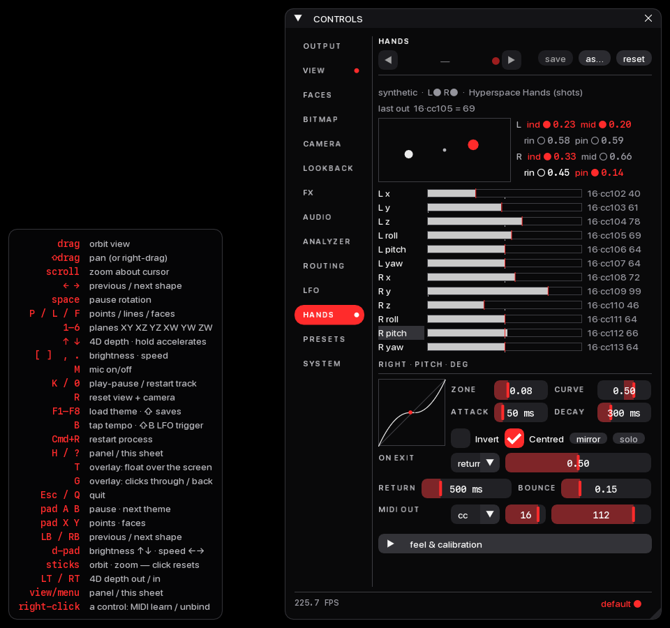

# Plan 08 — Ultraleap hands as the performing surface

**After plan 07.** The hands are the main way to perform: two hands in an
enclosed box over an Ultraleap camera, six axes each. The APC40 stays on
presets, scenes and master controls. The goal is **few controls, each
completely predictable**, not many. The 12 axes are shaped as analog
signals, and there are no gesture vocabularies to teach.

Code: the `hyperspace/hands/` package — `core.py` (source, setup,
adapter), `signal.py` (the pure signal chain), `panel.py` (the HANDS
page) — plus `tools/hands_probe.py`, `tests/test_hands.py`. The package
is built to be lifted out whole: `core.py` and `signal.py` import
nothing from hyperspace, everything they need arrives duck-typed as an
argument, and `tests/test_hands_boundary.py` fails the build if that
ever stops being true. `panel.py` is the one adapter to this host.
Small hooks in
`routing.py` (`hand:<i>` sources, `Router.rests` / `gates`), `midi.py`
(`MidiIO.learn_source` → a `position` route, plan 09), `ui.py`,
`config.py` and `app.py`.



## Shape

```
Ultraleap service ─(leap bindings, SDK thread)─▶ LeapSource.latest()
                                                      │ once per render frame
                                                 HandsIO.poll(dt)
                     per axis: norm → One Euro → dead zone/curve → attack/decay
                               → rest spring / catch glide → y ∈ [0, 1]
               ┌──────────────────────────────┴──────────────────────────────┐
     Router.feed("hand")                       MIDI out port ("Hyperspace Hands")
  hand:<i> in the routing table: Learn         per axis: 7-bit CC · 14-bit CC ·
  writes a `position` route (the hand is      pitch bend · channel pressure,
  the fader: floats, no detents); ROUTING     rate-limited; presence notes
  page push / position; presence lanes
```

**Inside Hyperspace nothing goes through MIDI.** A learned hand is a
`position` route like any other (plan 09: one path, `Router.modulate`),
so it drives its param at float precision — no 7-bit steps, no fader
detents — and it never shares a channel with the APC40. MIDI encodings
only exist for the DAW port.

## What Ultraleap reports

LeapC (through the `leap` Python bindings) reports, per hand per frame:
- `palm.position` / `palm.velocity` in **mm**. The origin is the camera,
  +y points away from it, and +z points toward the performer in desktop
  mode.
- `palm.normal` and `palm.direction` as **unit vectors**, plus
  `palm.orientation` as a quaternion.
- `grab_strength` / `pinch_strength` in **0–1**.
- `grab_angle` in **radians**.
- `pinch_distance` in **mm**.
- `confidence` in 0–1, and `type` left/right.

| Axis | Derived from | Unit | Default range | Shaped |
|---|---|---|---|---|
| `x` | palm.position.x | mm | left −220…20, right −20…220 | centred |
| `y` (height) | palm.position.y | mm | 100…350 | from the bottom |
| `z` (depth) | palm.position.z | mm | −100…100 | centred |
| `roll` | atan2(n.x, −n.y) | ° | ±90 (thumb up = up, both hands) | centred |
| `pitch` | atan2(d.y, −d.z) | ° | ±60 (fingers up = up) | centred |
| `yaw` | atan2(d.x, −d.z) | ° | ±45 (fingers outward = up, both hands) | centred |

`grab`, `pinch` (0–1), `grab_angle` (°) and `pinch_mm` (mm) are
available through `[hands] dofs`, but the default stays the palm pose.

## The analog chain (per axis, `hands/signal.py`)

1. **Range.** `u = (v − lo) / (hi − lo)`. The ranges come from the box's
   calibration (`<home>/hands.json`); the table above is only the
   fallback. `invert` flips u.
2. **One Euro filter.** Its cutoff is `Steadiness` at rest and rises by
   `Response` × speed, so a still hand doesn't shimmer and a fast one
   doesn't lag.
3. **Dead zone.** On a *centred* axis it's a flat band at neutral, so a
   level hand reads exactly neutral. Otherwise it sits at the bottom, so
   "off" is easy to hit. The remaining throw is stretched so both ends
   are still reachable.
4. **Curve.** The exponent 4^c on the distance from neutral (or from the
   bottom). + gives fine control near neutral, − the reverse.
5. **Attack / decay.** A one-pole slew with separate rise and fall times,
   the envelope you'd put on a CV.
6. **On exit.** `hold` keeps the last value. `return` springs to `Rest`
   over `Return` seconds (within about 2 %), with `Bounce` from a
   critically damped glide up to a ringing spring.
   **Catch:** a returning hand is glided onto over `Catch` seconds
   rather than jumped to. The spring and the hold shape the **DAW output
   only**: the routing lane reads NaN while the hand is out of the box,
   so a row lets go the frame the hand leaves; the catch is live, so a
   returning hand glides its rows back on (plan 11, B1).
7. **To MIDI.** `cc` and `pressure` are 0–127. `cc14` (MSB on n, LSB on
   n + 32, n ≤ 31) and `pitch` are 0–16383. Each holds its last value
   with hysteresis, so a still hand sends nothing, and each is limited
   to `MIDI rate` messages a second per axis. The newest value always
   lands once the limit allows.

The HANDS page flags any output that can't be sent as set: a 14-bit
number over 31, two axes on the same CC (including an LSB), or two bend
or pressure axes on one channel.

## Pinch switches (eight more signals)

Each hand also reports the gap from the thumb tip to each fingertip,
**divided by palm width** — a ratio, not millimetres, so one threshold
fits any hand. They are ordinary features (`pinch_index`,
`pinch_middle`, `pinch_ring`, `pinch_pinky`): name one in `[hands] dofs`
and it becomes a full analog axis like any other.

Each ratio also drives a switch, whether or not it was chosen as a dof:

- a **Schmitt trigger** — closes under `pinch_close`, and only lets go
  past the wider `pinch_open`. One threshold chatters where the fingers
  hover; the gap between two does not.
- then a **debounce** (`pinch_hold`), so a single noisy frame cannot flip
  it.

They leave as the last eight hand lanes — after the presence pair, so a
saved `hand:<i>` binding keeps meaning the axis it always did — and as
note on/off from `[hands] pinch_note`. A hand that leaves drops its
switches, so nothing hangs on in the DAW.

Measured on the camera at their closest: index 0.12, middle 0.14, pinky
0.28. **Ring only reached 0.39 and never closed** — it is the weak one,
as expected (occlusion when the palm turns away, and ring and pinky do
not move independently). Whether that wants a looser per-finger
threshold is still open; the page and the probe both print the live gap
so it can be read off a real hand.

## Gating: one hand movement, two meanings

`Binding.when` names a second source that must read on before a row acts
at all. Pinch and move and the param follows; open the hand and the same
movement does nothing; let go and the base is back. A gated-off row
stops modulating and `apply()` writes the base back — for a `position`
row that is the panel's value, for a `push` row the value it was adding
to. A gate whose source is not live holds the row **shut**, never open —
no param should start moving because a camera was unplugged. Only fed
sources (hand, ext, lfo) can gate; the analyzer's lanes are not switches.
A gate doesn't exempt a row from the referee: two rows on one target
with different pinches are still two performers (plan 09, decision 2).

Since plan 09 every gated row lives in one place — the routing table's
`position` / `push` rows, which Learn writes and the ROUTING page lists —
so there is one gate and three ways to set it:

- **pinch while learning** and the pinch becomes the row's gate; the hand
  that moved is asked for its own thumb first
- **right-click a control → Gate**, on the hand rows that drive it
- **the gate combo** on each ROUTING row, beside the scale

The adapter publishes which of its lanes are switches on `router.gates`,
so the routing UI offers them without importing anything from `hands`.

## Starting presets

Three factory routing presets, in the ROUTING strip next to `default`
and `legacy6`. They are routes only, so loading one leaves the keyboard,
pad and MIDI bindings alone.

| preset | what the hands do |
| --- | --- |
| `hands-play` | R height *positions* brightness, L height speed, R tilt 4D depth. Nothing to hold; the quickest way to feel the shaping. |
| `hands-pinch` | One hand, several instruments, the thumb picks which: R index → brightness, R middle → speed, L index → fx mix, L middle → zoom — all `position`, each gated on its pinch. An open hand changes nothing. |
| `hands-fx` | The effect stack under both hands: R height positions fx mix, R tilt acid twist, R yaw acid bend; L roll *pushes* acid speed about its rest (depth 0.5 on a base of 4: thumb-up 8, thumb-down 0); L height pushes brightness (+0.4). |

These use the two performer ops of plan 09, `position` and `push`,
because a routing preset carries only performer rows — and since plan 09
a learned hand *is* one (a `position` route), so **loading a preset
replaces learned hand rows too**; there is no separate class of rows a
preset leaves alone. Every performer row springs back to the base when
the gate opens or the hand leaves: the hand grabs, and never yields
(decision 4). Latching — a hand that "holds where you left it" — is not
an op any more, and not a setup either: `rest = hold` holds the DAW
output, never a routed param (audit N6). Set the base with the panel or
a knob instead, which a performer never blocks.

`position` is the one to reach for: the hand's 0–1 is the control's
*position*, along its own taper, so the hand covers the whole fader
exactly as a learned hand does (brightness 0.13×–4.00×, speed stop–4
rad/s, 4D depth 1.05–13.8). `push` adds `depth · (u − rest)` to the base
in norm units, centred where the axis rests (its configured rest value,
published in `Router.rests`), so a level hand adds nothing — the right
op for "a bit more of this on top" (`hands-fx`'s brightness) or an
explicit slice about a base the preset sets (`hands-fx`'s acid speed,
`values: {"fx.acid.speed": 4.0}`). The old `replace` op, which put
`depth · u` in the control's *units* and capped a hand at the value 1
with the default depth, is gone; the first cut of these presets used it
and did exactly that.

The lane numbers in the files assume the default six dofs per hand
(`hand:1` = L y, `hand:7` = R y, `hand:14`… = the switches). Change
`[hands] dofs` and the axis indices move; `tests/test_routing.py`
checks every shipped row still names a real param and a real lane.

## Setups, the page and the box

- **A setup** is every per-axis and global setting above. They're
  registry params in the `hands` group, so the library's preset strip
  saves and loads setups, a project carries one, and a setting can itself
  be Learned onto an APC40 knob. They're registered even with the tracker
  off, so setups still edit and save offline.
- **The HANDS page** has six parts:
  - the preset strip, the tracker/port status and the last message out
  - the box from above: palms as dots (left white, right red), size = height
  - the eight pinch switches beside the box, each with its live gap
  - a live row per axis: output bar, a red hairline where the hand is, a
    tick at the rest value, and the MIDI out and value
  - the selected axis's editor, with its transfer curve drawn and the
    hand's live point on it, plus **mirror** (copy the feel to the other
    hand) and **solo** (only this axis to the DAW, for a DAW's learn)
  - feel & calibration: a 20 s sweep writes the box's ranges
- **Learn:** right-click → Learn MIDI, then move one axis. The axis that
  moved furthest wins, and the learn writes a `position` route from it —
  the hand is the fader, in floats, through the Router like every route.
  A learned axis drives one param: learning it onto another *moves* it
  (its old position row goes); learning it again onto the same param only
  refreshes the gate. If the param already has a different performer the
  learn is held and the panel asks — *"Brightness is already performed by
  R height positions — Replace / Keep"* — Replace swaps the owner and
  writes the file, Keep leaves the table as it was; moving the hands
  learns nothing more while the question is up. A panel edit or a knob
  moves the *base*, the value the hand returns to, and is never blocked.
  Pinch while learning and the row is gated on that pinch. Unbind is in
  the same menu, and it leaves the axis's other routes alone. Loading a
  routing preset replaces learned rows along with every other route.
- **Rig** settings (tracking mode, which features, the port, presence
  notes) are `[hands]` in config.toml. **Box** ranges are `hands.json`.
  **Performance** settings are a setup. Each lives where it changes.

## Install

Verified 2026-09-26 on this machine: a Leap Motion Controller 2 (serial
LE51000020000093A2-6710), Ultraleap Hand Tracking 6.2.0, Apple Silicon,
Python 3.12. The service connected, the camera was seen, and frames
arrived at ~119 fps through `LeapSource`.

1. Install **Ultraleap Hand Tracking** for macOS. This is the one step
   that needs a person: the download, the licence, the admin password,
   macOS prompts, and the camera plugged in. On USB it shows up as
   "Tracking Camera" (vendor 0x2936).
2. `uv sync`. Nothing is compiled. The app ships a prebuilt cffi module
   for Python 3.12 (`…/Contents/LeapSDK/leapc_cffi`). The project depends
   on Ultraleap's pure-Python `leap` wrapper, which isn't on PyPI, so it's
   pinned by commit in `[tool.uv.sources]`, plus `cffi` as that module's
   runtime. `leap` finds the SDK at the default path. Set
   `LEAPSDK_INSTALL_LOCATION` if the app is elsewhere. Its file check
   still names SDK 5's `libLeapC.5.dylib`, but that only changes an
   error message, and SDK 6's `libLeapC.6.dylib` imports fine.
3. `[hands] enabled = true` in `~/Hyperspace/config.toml` (**not**
   `pyproject.toml`, which the app never reads), plus `mode =
   "screentop"` if the camera looks down from the lid.
4. Check it: `uv run python tools/hands_probe.py` shows every axis live.
   Then open the HANDS page and run **calibrate 20 s**, sweeping every
   axis end to end.

## Not yet verified (needs the camera and the box)

- [x] The bindings load against the installed Gemini 6.2 on Apple Silicon / 3.12
      (prebuilt; no build step).
- [x] The listener's event names match the `leap` API (`on_error` added so a
      callback failure shows in the status line).
- [x] `features()` reads every field, pinches included, off the SDK's real
      `Hand` type.
- [ ] Real hands through the probe and the HANDS page.
- [ ] Angle signs in the box's actual mounting; check them on the page.
- [ ] The default feel: Steadiness 1 Hz, Response 4, Catch 150 ms, return
      500 ms / bounce 0.15, dead zone 0.04 on centred axes. Tune by hand
      and save the result as the factory setup.
- [ ] How independently yaw and pitch can be held without moving x and y.
- [ ] Whether thumb-ring wants a looser threshold than thumb-index, or
      whether the 0.39 above was simply not a deliberate pinch.
- [ ] How a gated row feels on a second pinch at a different height: it
      takes the hand at once — settled as the rule in plan 09 (decision
      4: hands grab, they never yield; `pickup` is meaningless on a
      performer row and is dropped), so this is a feel check, not a
      design question.
- [ ] End-to-end latency, hand to pixels and hand to DAW.
- [x] Oscillators: done in plan 09 — four tempo-aware LFOs are `lfo:<i>`
      sources, and `lfo-breathe` chains R height into LFO 1's depth.
