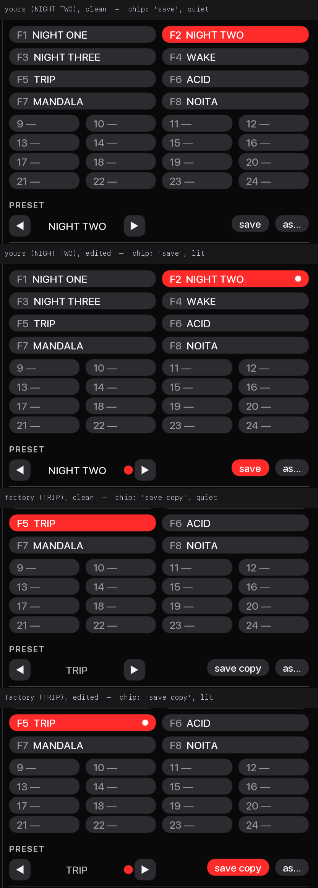
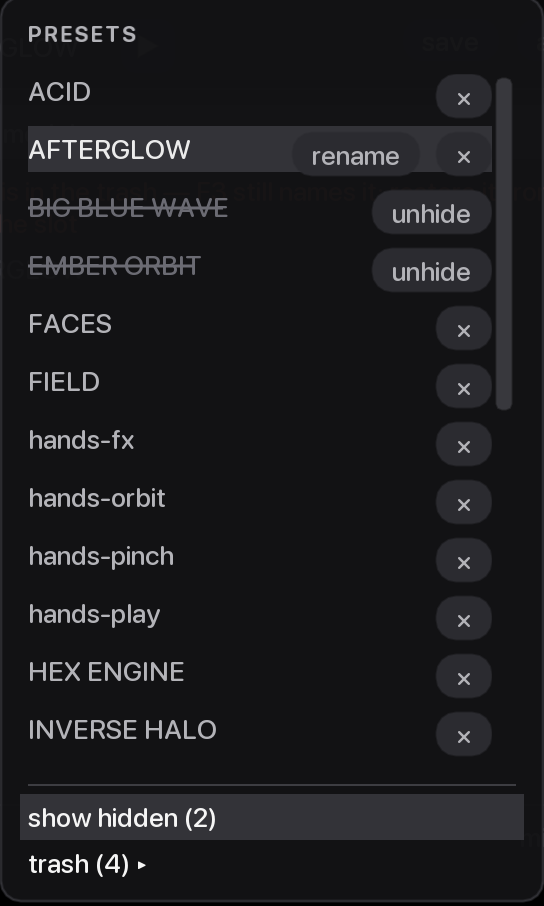
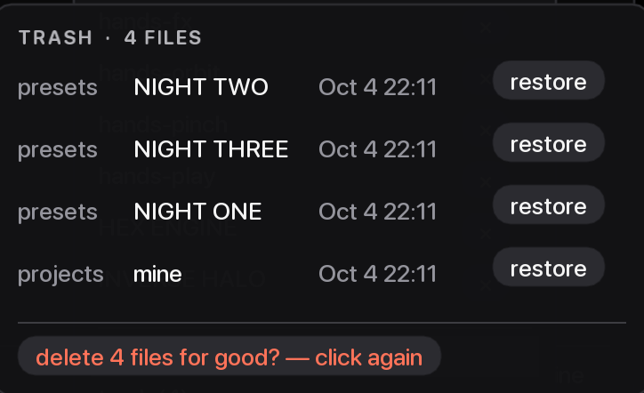

# Plan 19 — Presets and the desk layout

This plan grew the preset bank from eight slots to twenty-four (F1–F8 on
the keyboard and clip row 1 on the APC40, slots 9–24 on clip rows 4 and
5), gave the device knobs D1–D4 something to do on every scene preset,
made the dirty dot big enough to read at arm's length, and let you hide,
rename, delete and restore presets from the preset list, with an
opt-in git history of the home folder.

Hand checks: [`11-hand-checks.md`](11-hand-checks.md) group O, checks
81–90. Open decisions: [`DECISION-REGISTER.md`](../DECISION-REGISTER.md)
rows 72–78.

## What was built

### A bank of twenty-four

- **At the machine.** The PRESETS page shows the eight F-key slots two to
  a row (name and F-key), then slots 9–24 four to a row (number and
  name), the loaded one lit. Click or F1–F8 loads; ⇧click or ⇧F1–F8
  saves the live state into the slot. Slots 9–24 have no key of their
  own: click them, or press their pad on the desk. Save-as lands in the
  first empty slot; the factory party show has TRACER on slot 9, so its
  first empty slot is 10. A slot is called "F3" for the first eight and
  "slot 12" after, in every message (`library.slot_key`).
- **Code.** `library.SLOTS = 24`; `params.F_KEYS = 8` (imported by
  `library` and `routing`). `Project.bank`, `Project.load_slot`,
  `save_slot`, `next_empty`, `save_new`, `cycle`; `Project.follow()` is
  the one place "the lit slot follows the loaded preset" is decided.
  `preset.select` is an enum over the 24 slots with `has` (does the slot
  hold a preset); a learned step or cycle on it goes to the next filled
  slot (`Param._walk`): past the last filled slot a step stays put and a
  cycle wraps. The page: `ui_presets.preset_bank` (`BANK_COLS`,
  `FAR_COLS`). No params were added (the F-key load/save triggers are
  still sixteen).
- **The show file.** `projects/<show>.hyp.json` keeps the bank as far as
  its last filled slot and never shorter than eight (`library.bank_doc`),
  so a show that uses only F1–F8 is written exactly as before. A load
  never rewrites it. A schema-1 bank is read as eight
  (`preset.migrate_project`, `library.migrate`).
- **Tests.** `test_library.py::test_the_bank_is_twenty_four_and_the_f_keys_eight`,
  `::test_a_bank_is_written_as_far_as_its_last_filled_slot`,
  `::test_an_eight_slot_show_loads_and_is_not_rewritten`,
  `::test_the_first_write_past_slot_eight_keeps_the_eight_slot_file`,
  `::test_save_as_lands_on_slot_nine_once_the_f_keys_are_full`;
  `test_presets.py::test_active_follows_the_loaded_preset_from_one_place`;
  `test_params.py::test_the_bank_adds_no_params`;
  `test_ui_presets.py::test_twenty_four_slots_fit_the_page_with_more_open`;
  `test_migration.py::test_the_migrations_still_write_an_eight_slot_bank`.
  The `owner_home` fixture (`tests/conftest.py`) is the copy of an
  owner-shaped home every file test runs on.

### Clip rows 4–5 are the bank

- **At the machine.** Clip row 1 loads slots 1–8 and clip rows 4 and 5
  load slots 9–24, on both desk layers (SHIFT does not change them). A
  bank pad is **green** when its slot is loaded, **amber** (yellow,
  velocity 5) when it holds a preset, **dark** when empty. On the
  on-screen desk a filled pad is amber at half strength with its
  preset's name; an empty one has no label. Shape selection is the cue
  knob only (the old shape pads on rows 4–5 are gone).
- **Code.** `apc40.BANK_PADS` (24 `(note, channel)` pairs),
  `apc40.filled_of`; `routing.led_level` (2 lit / 1 filled / 0 off),
  read by `MidiIO.feedback` and `ui_desk` (`FILLED = 0.5`).
  `routing.remap_factory` adds the bank rows to an existing
  `bindings.json` only where no MIDI row the owner has is already on that
  pad (`Binding.overlaps`), and swaps the sixteen old shape rows
  (`BANK_REMAP`). A preset that still carries those old shape rows
  (`RETIRED_DESK_ROWS`) loads without them and without a note; a row the
  owner put on a bank pad is dropped from the preset with a note. The
  launch's one-line summary of any `bindings.json` rewrite is
  `Bindings.said`, shown on the SYSTEM page; each changed row is on
  stderr.
- **Tests.** `test_desk.py::test_rows_four_and_five_load_slots_nine_to_twenty_four_on_both_layers`,
  `::test_the_bank_pads_are_invariant`;
  `test_midi.py::test_a_bank_pad_is_green_loaded_amber_filled_and_dark_empty`;
  `test_routing.py::test_an_older_file_gets_the_bank_pads_with_a_backup`,
  `::test_a_row_the_owner_put_on_a_bank_pad_is_left_alone`,
  `::test_a_second_launch_writes_nothing_and_says_nothing`;
  `test_presets.py::test_an_old_preset_loads_without_its_shape_pads_and_its_file_is_untouched`;
  `test_ui_desk.py::test_a_filled_pad_is_amber_and_an_empty_one_has_no_label`.

### The device knobs

- **At the machine.** On the scene presets (the eight house moods,
  TUMBLE, FACES, FIELD, `legacy6`, `hands-play`, `hands-orbit`) D1–D4 are
  4D depth, Yaw, Pitch and Pattern; D5–D8 are dark. `hands-fx`,
  `hands-pinch` and `lfo-breathe` have knob sets of their own; WAKE,
  TRACER, TRIP, ACID, MANDALA and NOITA keep their eight. Pattern changes
  only what the faces show, so on a preset with faces off D4 changes
  nothing visible. A user preset keeps its own desk; only a user file
  with no `desk` key gets D1–D4.
- **Code.** `apc40.SCENE`; `preset.HANDS_FX_KNOBS`, `HANDS_PINCH_KNOBS`,
  `BREATHE_KNOBS`; `preset.knob_desk` replaces the fresh layer's device
  knobs (`_is_device_knob`) rather than adding to them. Factory files are
  regenerated with `python -m hyperspace.preset`.
- **Tests.** `test_midi.py::test_a_knob_on_the_pattern_steps_through_every_pattern`;
  `test_plan12_presets.py::test_no_factory_knob_is_dead`;
  `test_presets.py::test_a_users_desk_is_untouched_by_the_recut`,
  `::test_every_factory_presets_desk_is_the_generators`.

### The dirty dot and the save chip

- **At the machine.** An edited group shows a 12 px red disc on its strip
  and on ROUTING's head (a 10 px one on the page rail), and its **save**
  chip turns solid red. The loaded bank slot gets a small white disc
  while its preset is edited. On a factory preset the preset strip and
  ROUTING's head say **save copy** (the save writes your own copy, which
  takes its place in the list). The preset strip has no `reset`; module
  strips keep save · as… · reset.
- **Code.** `ui.dirty_dot`, `ui.DOT_R`, `ui.RAIL_DOT_R`, `ui.lit_chip`;
  `ui_presets.save_chip`, `save_label`, `save_tip`, `SLOT_DOT_R`.
- **Tests.** `test_ui_presets.py::test_the_dot_is_a_twelve_pixel_disc_and_save_is_lit_while_dirty`,
  `::test_save_reads_save_copy_on_a_factory_preset`,
  `::test_the_preset_strip_has_no_reset_and_does_not_overlap`;
  `test_ui_routing.py::test_the_head_has_the_same_dot_and_label`.

### Hide, rename and the trash

- **At the machine.** Open the preset list from the strip's name. Every
  preset has **×**: yours goes to the trash, a factory one is hidden.
  Yours also has **rename** (the row becomes a name field). At the foot,
  **show hidden (n)** lists hidden presets struck through, each with
  **unhide**, and **trash (n) ▸** opens the trash: group, name, time and
  **restore** per row, newest first, then **empty trash…**, which turns
  into "delete N files for good? — click again" for 4 s; any other click
  disarms it. Both lists show twelve rows, then scroll. A bank slot
  whose preset has no file is drawn in the warning colour and its hover
  says it may be in the trash; its pad stays amber. × on a preset a slot
  or "starts on" still names says so. None of this is an undo step.
- **Code.** `Library.delete`, `hide`, `unhide`, `rename` (with
  `_repoint`), `trash`, `restore_trash`, `empty_trash`, `still_named`;
  `library.to_trash`; `ui_presets._list_popup`, `LIST_ROWS`, `EMPTY_S`.
- **Tests.** `test_library.py::test_hiding_a_factory_preset_takes_it_off_the_list_and_nothing_else`,
  `::test_rename_updates_every_show_and_keeps_each_old_file`,
  `::test_rename_refuses_a_taken_name_and_a_factory_preset`,
  `::test_a_rename_that_cannot_keep_the_old_file_changes_nothing`,
  `::test_renaming_the_loaded_preset_keeps_its_unsaved_edit`,
  `::test_restore_never_overwrites`, `::test_empty_trash_removes_only_the_trash`,
  `::test_the_trash_lists_only_what_it_kept`;
  `test_presets.py::test_rename_and_trash_are_no_undo_step`;
  `test_ui_presets.py::test_the_list_has_a_cross_on_every_preset_and_rename_on_yours`,
  `::test_empty_asks_once_and_disarms`, `::test_a_slot_whose_preset_is_gone_says_so`.

### The home in git (opt-in)

- **At the machine.** With `[library] git = true` in `config.toml` (off
  by default; a value that is not a boolean is off, with a note) every
  save, trash, rename, hide, unhide, restore and show write becomes a
  commit in the home folder, in words like "save preset TRIP 2" or
  "show mine: bank". The SYSTEM page's home line ends in " · git". A
  failure says once, on the warning line, "git: not committed (<reason>);
  saves are not affected". Emptying the trash makes no commit (the trash
  is ignored).
- **Code.** `homegit.py` (a leaf, imported only when the key is on):
  `Committer`, `IGNORE`, `SAFE`. `app._open_homegit` attaches it after
  the startup preset, so the launch's own writes ride in the first
  save's commit. `Library._commit` never raises or waits. Nothing is run
  at launch: `git init` happens at the first save; a home that is inside
  another repository is never initialised or committed (one note);
  an existing repository at the home is used as it is. Every command
  runs with no hooks, no signing, no prompt, a 10 s timeout (SIGTERM,
  then SIGKILL 2 s later). It runs no network command. The identity
  `Hyperspace <hyperspace@localhost>` is used only for what the machine
  lacks.
- **Tests.** `tests/test_homegit.py` (most need `git` on the machine);
  `test_library.py::test_each_save_asks_for_one_commit_in_the_librarys_words`,
  `::test_hide_rename_and_restore_each_ask_for_a_commit`;
  `test_config.py::test_library_git_is_off_by_default_and_a_switch`;
  `test_app_boundary.py::test_homegit_is_a_leaf_and_the_library_never_imports_it`.

### The owner's files this code can rewrite, move or delete

"Backup" is what is copied before the change. **No backup, no change**
holds everywhere a backup is listed: when the copy cannot be made the
change is refused and the file is left as it was.

| File in the home | What changes it | Backup |
|---|---|---|
| `projects/<show>.hyp.json` | A bank change, "starts on", save, rename. A load never writes it. | Before the first write that makes the file's bank longer than eight: `routing.backup(path, "2-bank8")` → `<show>.hyp.json.bak-v2-bank8` (a stamped name when that exists; skipped when one already holds the same bytes). Refused → `LibraryError`, the slot is put back, the footer says why. |
| every user show in `projects/` | Rename repoints its `bank` and `startup` (schema-2 shows only; a schema-1 show is left and named; factory shows are never written). | Each show is copied to `trash/projects/<show>.hyp.<stamp>.json` first; a show whose copy or write fails is left and named. |
| `bindings.json` | Once, at launch, when `remap_factory` changes rows (the bank pads added, old shape rows swapped). | `routing.backup(path, <schema read>)` → `bindings.json.bak-v3` for a current file (a stamped name when that exists). Refused → `Bindings.unbacked`, "bindings: not rewritten — no backup could be made", and every later `Bindings.write` in the session tries the copy first and writes nothing without it. `preset.migrate_home` follows the same rule. |
| `presets/<name>.json` (yours) | Save overwrites; × deletes. A load never rewrites it (old shape rows are dropped in memory only). | `to_trash` → `trash/presets/<stem>.<YYYYMMDD-HHMMSS>[-n].json`. A failed copy refuses the delete. |
| the same | Rename: the new file is written exclusively, the old one copied to the trash, then removed. A rename that only changes case or spacing rewrites the file in place after its copy. | `to_trash`; a failed copy removes the new file (or refuses the in-place rename). |
| `<group>/<stem>.json`, `projects/<stem>.hyp.json` | Restore from the trash. Created exclusively, never over a file; under the next free name when the stem (factory stems included) or the preset's name is taken. The trash copy is removed only after the write. | — (never over a file) |
| `trash/**` | **Empty trash deletes for good — the one action in the app that keeps no copy.** Only files `trash()` lists (named as `to_trash` writes them, never a dotfile), then empty folders; a symlink or a path outside `trash/` is refused. | None: asked twice, in place. |
| `hidden.json` | × on a factory preset and unhide. `{"schema": "hyperspace.hidden/1", "presets": [<file stem>, …]}`. | An unreadable one is kept as `hidden.json.bak-v0` (`routing.backup(path, "0")`) before the first rewrite. |
| `.git/`, `.gitignore` | Only with `[library] git = true`: at the first save after launch; `.gitignore` (`homegit.IGNORE`) only when there is none; never when the home is inside another repository. | — (no file of the owner's is rewritten) |

## Not verified by a person

Nothing of this plan has been on the APC40 or in front of a person:
amber beside green on the mk1, the bank pads on rows 4–5, the D1–D4
knobs (Pattern on an endless encoder), the disc and lit chip at arm's
length, every popup (the list, rename, the trash), and the " · git"
line. Checks 81–90 in [`11-hand-checks.md`](11-hand-checks.md) and
[`../TESTING-GUIDE.md`](../TESTING-GUIDE.md) say how; copy the home
folder first.

## Known rough edges

- An `abs` knob learned onto `preset.select` spreads over all 24 slots,
  empty ones included (audit R14, the knob half).
- On a module strip under "more" the save chip covers the right end of
  the name button (audit U10).
