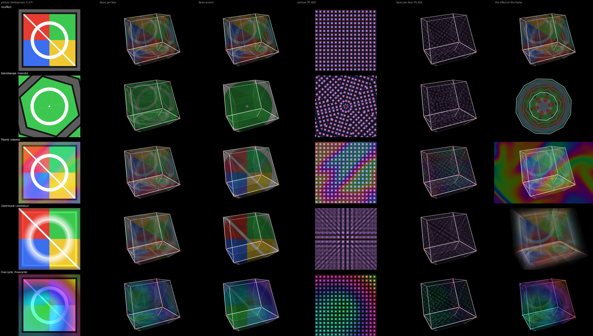
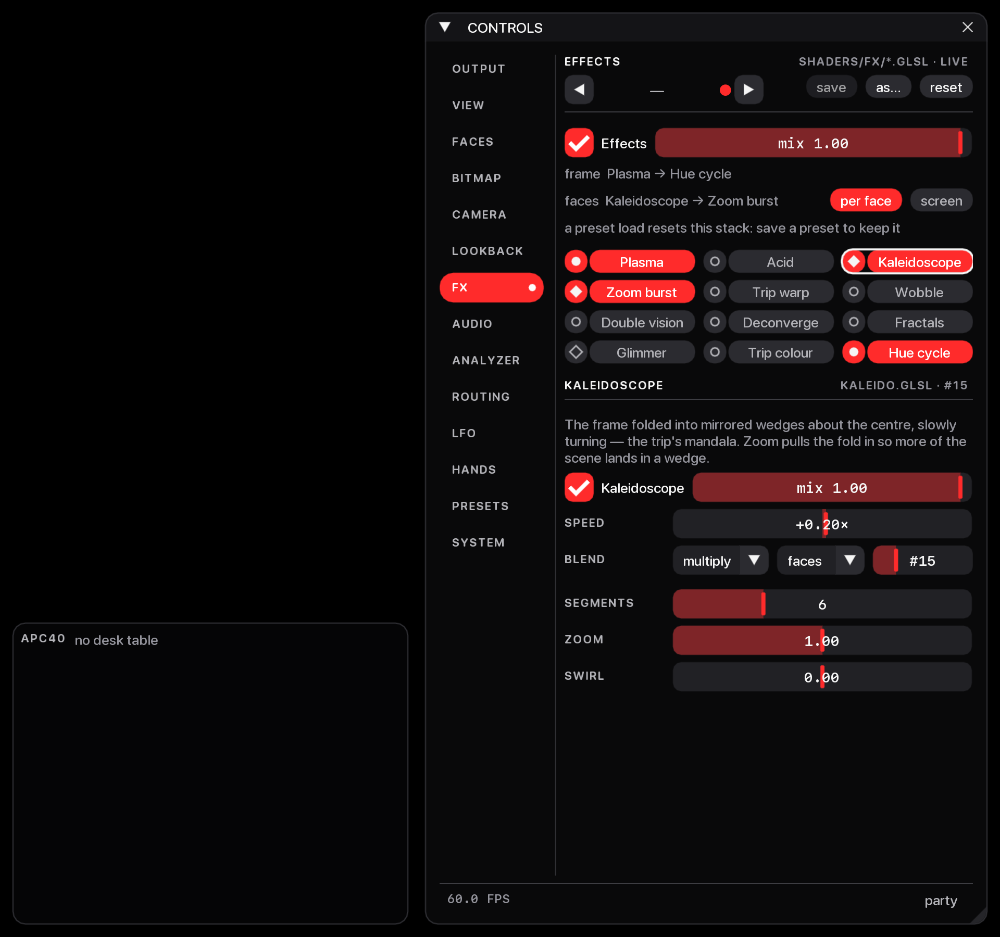
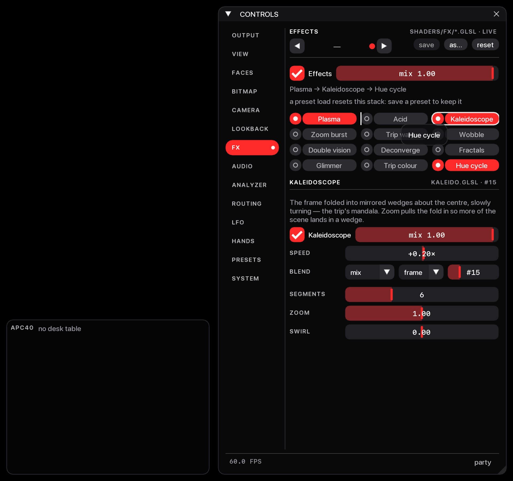
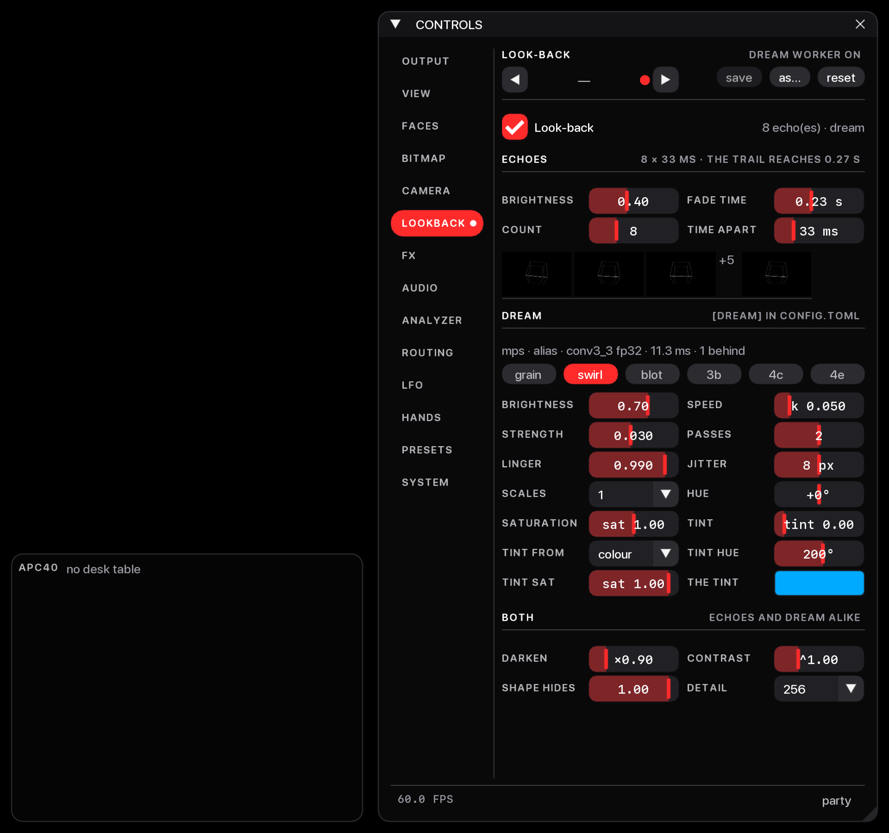
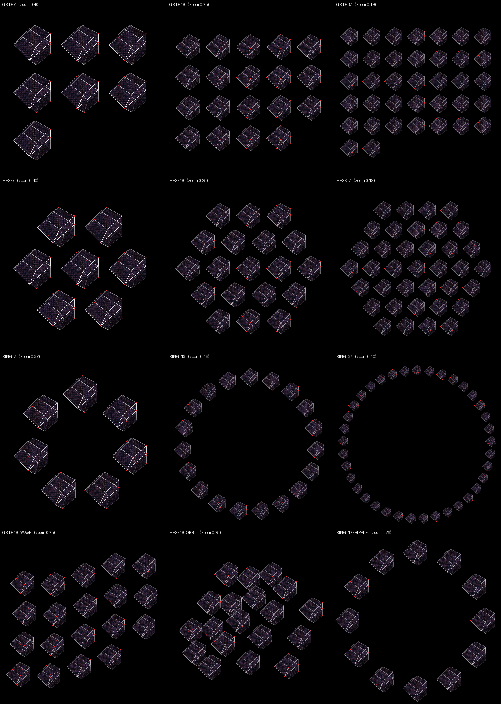

# Plan 20 — FX, dream and looks: the faces as an effect target

This plan lets any effect run on the picture inside the shape's faces
instead of on the whole frame, makes the effect order something you drag
on the FX page, rebuilds the look-back page as ECHOES, DREAM and BOTH with
labels that say what each knob does, turns `dream.k` into one "Dream
speed" control, and adds HEX and RING instance layouts beside GRID.

Hand checks: [`11-hand-checks.md`](11-hand-checks.md) group P, checks
91–98. Open decisions: [`DECISION-REGISTER.md`](../DECISION-REGISTER.md)
rows 65–71.

## What was built

### The faces as an effect target

- **At the machine.** Each effect has a **target**, frame or faces (the
  combo between blend and order on its open strip). Effects aimed at the
  faces run, in stack order, on one 1024² picture — the face pattern
  with the bitmap over it, as face 0 draws it — and every face shows that
  picture. **Faces show** (`fx.face_map`) picks how: **per face** (each
  face carries the whole picture and it turns with the shape) or
  **screen** (the faces are windows onto one still, upright picture,
  cover-fit). The echoes and the dream see the faces' effects as part of
  the scene; frame effects run over them. Nothing aimed at the faces
  costs nothing: the frame is the old frame exactly.
- **Code.** `fx.py`: `TARGETS`, `FRAME` / `FACES`, `FACE_MAPS`,
  `PER_FACE` / `SCREEN`; `fx.<name>.target` (not modulatable),
  `fx.face_map` (modulatable); `FxState.chain(target)`,
  `FxState.advance_to` (the effect clocks advance once a frame whichever
  chain runs). `render.py`: `FACE_PIC = 1024`, `FaceTarget`, `FACE_PX`,
  `SEED_FS_HEAD`; `Renderer.face_fx` (a second `FxChain` that borrows the
  frame chain's programs and errors), `face_pic`, `face_error`,
  `_face_picture` (step one of `_draw_frame`, only while an effect is
  aimed at the faces, faces are on and there is at least one copy),
  `_build_face_program` (builds the face and seed programs together, or
  neither). A stray target value in a hand-edited file reads as frame.
- **Tests.** `tests/test_fx.py::test_target_is_declared_per_effect_and_is_not_modulatable`,
  `::test_chain_splits_by_target_and_keeps_order`,
  `::test_two_chains_advance_the_clocks_once`,
  `::test_every_effect_runs_on_the_face_target`;
  `tests/test_render.py::test_nothing_aimed_at_the_faces_is_the_old_frame_exactly`,
  `::test_a_face_effect_changes_the_faces_and_nothing_else`,
  `::test_screen_mapping_is_a_cover_fit_window_onto_the_picture`,
  `::test_the_echoes_carry_the_faces_effects`,
  `::test_a_face_pass_that_raises_leaves_the_frame_and_the_window_bound`,
  `::test_on_reload_rebuilds_the_seed_with_the_face_program`.
- **Demo.** `tools/face_target_shots.py` (offscreen).

### The face target on the FX page

- **At the machine.** While any effect (on or off) is aimed at the
  faces, the status under the bypass is two rows: `frame  Plasma → Hue
  cycle` and `faces  Kaleidoscope → Zoom burst`, each "nothing on" or
  "bypassed" when so; at the faces row's right end the **per face** and
  **screen** chips. The faces row says `(Faces is off)` while
  `view.faces` is off, `(no copies to show them)` at 0 copies, and the
  face program's error when it did not build. A chip aimed at the faces
  has a **diamond** LED instead of a dot. An effect aimed at the faces
  while Faces is off says so on its strip, with a **faces on** chip.
  With nothing aimed at the faces the page is the one status line it
  always was.
- **Code.** `ui_fx.page`, `_status`, `_faces_row`, `why_idle`,
  `TARGET_W`, `DIAMOND`.
- **Tests.** `tests/test_fx.py::test_the_status_reads_per_target`,
  `::test_the_map_chips_set_fx_face_map`,
  `::test_the_strips_target_combo_moves_an_effect_between_chains`,
  `::test_a_chip_aimed_at_the_faces_is_marked`,
  `::test_why_idle_names_faces_off`,
  `::test_the_page_fits_with_the_faces_row_showing`.
- **Demo.** `tools/fx_page_demo.py --faces` (hidden window).

### Drag to reorder

- **At the machine.** Drag an effect chip by its name and drop it on
  another chip: it goes before that chip, a 2 px bar on the chip's left
  edge showing where. Drop on the right half of the last chip's name to
  send it to the end. The drop opens the dragged effect's strip and is
  one undo step ("reorder effects"); a drop that changes nothing is no
  step. A click without a drag still just opens the strip. The order
  slider is still there.
- **Code.** `ui_fx._chip` (the drag source, payload `DRAG`), `_drop`,
  `_drop_target`, `DRAG_BAR`; `fx.reordered` renumbers the shortest run
  of `order` values that makes room; the drop is all or nothing.
- **Tests.** `tests/test_fx.py::test_reordered_renumbers_the_smallest_window`,
  `::test_reordered_always_sorts_to_the_sequence_asked_for`,
  `::test_a_drop_reorders_selects_and_is_one_undo_step`,
  `::test_a_click_without_a_drag_still_only_opens`,
  `::test_a_drop_moves_the_effect_the_drag_began_on`.
- **Demo.** `tools/fx_page_demo.py --drag` (hidden window, simulated
  mouse; no cursor drawn).

### The look-back page: ECHOES, DREAM, BOTH

- **At the machine.** Three sections: **ECHOES** (brightness, fade time,
  count, time apart, the thumbnails), **DREAM** (the worker's status, at
  most three lines; the layer as six chips — grain, swirl, blot, 3b, 4c,
  4e; then brightness, speed, strength, passes, linger, jitter, scales,
  hue, saturation, tint, tint from, tint hue, tint sat and the tint's
  swatch) and **BOTH** (darken, contrast, shape hides, detail), two
  cells a row. The registry labels say whose knob each is ("Echo …",
  "Dream …"), so ROUTING, Learn and the desk read the same. No
  `dream.*` id, range, default or flag changed.
- **Code.** `ui_lookback.SECTIONS`, `SHORT`, `LAYER_CHIPS`, `LABEL_W`,
  `STATUS_LINES`.
- **Tests.** `tests/test_lookback.py::test_no_dream_id_range_default_or_flag_changed`,
  `::test_the_page_has_three_sections_and_every_dream_param_once`,
  `::test_the_layer_is_a_row_of_chips`,
  `::test_every_dream_label_says_whose_knob_it_is`,
  `::test_the_worker_status_is_never_taller_than_its_room`;
  `tests/test_ui_shell.py::test_the_look_back_page_fits_with_thumbnails`.
- **Demo.** `tools/lookback_page_shots.py` (hidden window over a real
  renderer, with a stand-in for the dream worker).

### Dream speed

- **At the machine.** DREAM's **speed** cell is `dream.k` ("Dream
  speed"), right is faster. It reads the dream frames in which a frame's
  share of the dream halves: "≈23 frames" at the slow end, "≈14 frames"
  at the default, "1.9 frames" at the fast end (one decimal under ten).
  It counts dream frames, so a slower worker is a slower dream; faster is
  also shallower (`dream.step` is not moved with it).
- **Code.** `params.dream_half_life`, `params.dream_speed_text`;
  `dream.k` range 0.03–0.3, default 0.05.
- **Tests.** `tests/test_lookback.py::test_dream_speed_is_dream_k`,
  `::test_the_speed_readout_is_the_half_life_in_frames`.

### Instance layouts

- **At the machine.** On the VIEW page, while copies are above 1, one
  row under the count: **Layout** (GRID, HEX, RING), **Field motion**,
  and while the motion is not STILL, **Field amp** and **Field rate**.
  HEX is a honeycomb spiral from the centre (a copy never moves as the
  count grows); RING is one circle, copy 0 at the top, clockwise. 0 and
  1 copies look the same in every layout. The six plane rates are three
  rows of two cells labelled by plane ("XY").
- **Code.** `render.inst_positions`, `_hex_spiral`, `LAYOUT_GRID` /
  `LAYOUT_HEX` / `LAYOUT_RING`; `params.INST_LAYOUT`,
  `view.inst_layout` (`view` group, saved with presets, modulatable);
  `ViewState.inst_layout`; `ui.Panel._page_view`. An unknown layout is
  GRID.
- **Tests.** `tests/test_render.py::test_grid_layout_is_the_frame_it_was`,
  `::test_hex_neighbours_are_one_cell_apart`,
  `::test_ring_is_one_circle_with_neighbours_one_cell_apart`,
  `::test_every_layout_and_motion_draws_any_count`;
  `tests/test_params.py::test_inst_layout_is_declared`;
  `tests/test_ui_shell.py::test_the_view_page_fits_with_a_field_in_motion`.
- **Demo.** `tools/layout_shots.py` (offscreen).

## Not verified by a person

Nobody has seen a face effect on a screen, the projector or the glass,
dragged a chip with a real mouse or trackpad, looked at the six dream
layers side by side, or judged the dream at any speed. Per-face effects
read faint in the offscreen renders (faces draw at low alpha and
overlap): whether they are worth using at the rig is checks 91 and 98.
The drag is check 94, the layer chips' names 95, the speed 96, the
layouts and motions 97. See also
[`../TESTING-GUIDE.md`](../TESTING-GUIDE.md).

## Known rough edges

- HEX with ORBIT makes neighbours overlap: ORBIT's phase uses `gx + gy`,
  which is not a whole number on a honeycomb (check 97).
- The Field amp and rate sliders are narrow enough to clip a modulated
  `base → effective` readout.
- On the FX page, a 2 px gap between a chip's LED and its name takes no
  drop.
- Stale wording left in non-doc files: `library/dream/wake.json`'s note
  ("Echo mix, fade, hue and dream mix"), `Renderer._tile`'s docstring
  ("the instance grid"), and an assertion message in
  `tests/test_render.py` ("instance grid missing from a quadrant").
