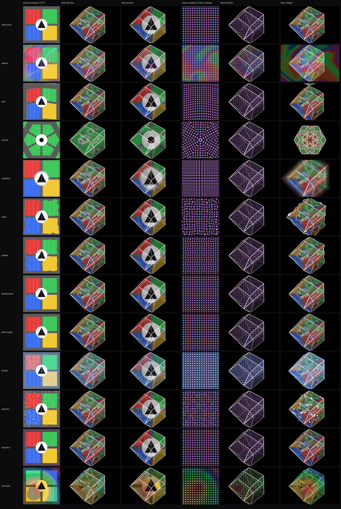

# Plan 20 — FX, dream and looks: the faces as an effect target

**From the Oct 3–4 session at the machine** (roadmap
[`15-21-roadmap.md`](15-21-roadmap.md) §4, "Plan 20", and the owner's
answer in its §7: "Faces through FX: the faces as their own effect
target"). Five things: effects that run on the picture in the faces
instead of on the whole frame; the effect order as something you drag;
the look-back page as ECHOES and DREAM with labels that say what each
knob does; one control for how fast the dream moves; and instance
layouts other than the grid.

Written 2026-10-04 against `finish-line` a24acde (1178 tests pass, 1
skipped), by reading the code and running three headless probes on a
temp home (the numbers marked *measured*). The probes were throwaway
scripts outside the repository: a prototype of the face target that
patched the face shader in its own process, a timing loop, and a page
measurer. Nothing in `hyperspace/` was changed to write this plan.

Plans 17 (Learn, Unbind, the desk) and 18 (hands, knob smoothing) are
being built now and land first. Neither touches `fx.py`, `ui_fx.py`,
`render.py`, `lookback.py`, `dream.py`, `ui_lookback.py` or the shaders;
plan 17 edits `ui.py`, which WP6 here also edits (the VIEW page), so WP6
re-reads it. **Plan 19 is built beside this plan**; where the two meet is
in §2, "Where plan 20 meets plan 19".

The plan adds **two registry params and one generated per effect** (§3),
no page and no menu item.

**Evidence.** `assets/20-fx-dream-looks/face-target-contact-sheet.png`:
every factory effect run over a face picture by the prototype, beside the
same effect on the frame as today. It is an offscreen render from a
prototype, not the app on a screen, and not the code WP1 will merge.



Columns, left to right: the 1024² face picture with a test bitmap over
the FLAT pattern; a tesseract showing it per face; the same in screen
mapping; the picture with the PLAID pattern and no bitmap; a tesseract
showing that per face; the effect on the frame, as today. The first row
is the picture with no effect.

## 1. What the owner hit, and what it is

| # | The owner asked for | What it is in the code | Where the roadmap's wording and the code differ |
|---|---|---|---|
| 1 | "Shaders that run against the screen space … that render target should just be the bitmaps in the faces on the geometry." | The effect chain is one `FxChain` on the renderer (`Renderer.fx`, `render.py`), run once a frame over the composited frame: `Renderer._draw_frame` has the look-back composite into `fx.begin(self.scene.size)` and then `fx.run(target, t)`. The faces are drawn earlier, inside `draw_scene`, by the face program (`FACE_VS` / `FACE_FS_HEAD` + `patterns.glsl` + `FACE_FS_TAIL`): each fragment has a face-local `v_uv` (perspective-correct through `in_wc`; `geometry.face_uvs`: centre (0.5, 0.5), circumradius 0.5), computes a colour and a `shade` from `pattern(u_mode, v_uv, v_fid)`, mixes the bitmap over it inside the bitmap's rectangle, and writes `vec4(rgb, v_alpha * shade)`. | Four, each designed around in WP1. **(a)** "Starting from the face bitmap (or the flat face pattern when no bitmap is loaded)": the bitmap is not the face's picture. It is a decal *over* the pattern, inside `q = (v_uv − 0.5 − u_bmp_pos) / u_bmp_scale + 0.5`, at `b.a × u_bmp_alpha`; pattern and bitmap are on screen together. And the pattern with no mode chosen is FLAT, `vec4(1.0)` at `shade` 1, a plain fill. So the start is the two composited (fork F1). **(b)** "`FxChain` is a self-contained ping-pong that can be instanced at another size": true of its textures (`begin(size)`), but `FxChain.run` also advances every effect's clock on the shared `FxState` (`st.advance(dt)`), so two chains over one state would run every clock at double speed; and each chain compiles its own programs and keeps its own `errors`, while the page reads only `renderer.fx.error` (`ui_fx._error`). **(c)** "Effects that read the previous frame or assume the window's aspect": none do either (the audit below). **(d)** "A face coverage pass exists": it does (`Renderer._draw_cover`), and the design does not need it. |
| 2 | See the effects that are on, in order, and reorder by dragging. | The FX page (`ui_fx.page`) already draws every effect as a chip **in stack order** (`FxState.names()`: sorted by `(order, name)`), three to a row, lit while on, and a status line that lists what runs as text (`" → ".join(...)` over `fx.chain()`). Reordering is the open strip's order slider (`panel._slider(f"{pre}.order", ORDER_W)`), one effect and one integer at a time. | "A list" assumes room. *Measured* (the rig of `tests/test_fx.py::test_the_page_draws_and_fits`, every effect open in turn, on and off, an error line showing): the page has **29 px** to spare at worst (Zoom burst or Fractals open and off), 392 px wide. A second list of rows does not fit; the chip grid is already the list (fork F5). |
| 3 | The look-back page is hard to read; "Spacing" does not say what it is; pick the dream's layer more easily. | `ui_lookback.page` has four sections named for the pipeline: *composite*, *chroma*, *history*, *dream worker*. Echo knobs and dream knobs are mixed in the first (`dream.mix` beside `dream.echo_mix`), and three knobs act on both (`dream.darken`, `dream.contrast`, `dream.occlude`: `lookback.POST_FS` grades every layer and occludes the whole wake). `dream.layer` is a combo labelled "net". | **Six layers, not four**: `lookback.LAYERS` is `conv2_2, conv3_3, conv4_3, inception3b, inception4c, inception4e`; the roadmap's "a row of four" is wrong. And **the page already scrolls in the app**: *measured* with a real `Renderer` and eight echoes captured, the scroll range is 23 px. `tests/test_ui_shell.py::test_every_page_fits_the_control_window` measures it with no renderer, where the thumbnail row is one line of text instead of a 48 px image row (`ui_lookback._thumbnails`). "Labels and layout only" therefore has to *recover* height. |
| 4 | A dream "speed". | See "Which quantity 'speed' was", below. | The roadmap offers `gap`, `fade`, `k` and `steps`. Two of the four do not act on the dream at all. |
| 5 | Instance layouts: grid, hex, ring. | One layout, in `Renderer.draw_scene`: `cols = ceil(sqrt(n))`, `rows = ceil(n / cols)`, `gx = k % cols − (cols − 1) / 2`, `gy = k // cols − (rows − 1) / 2`, offsets `(gx, gy) × cell` with `cell = min(w, h) × 0.72 × zoom`. The three motions read only `gx`, `gy` and `cell`, so a layout is a different `(gx, gy)` per copy and nothing else. | None in the maths. On the page: *measured*, the VIEW page scrolls by 19 px whenever `view.instances` is above 1 (the motion row appears; the fit test measures it at 1). WP6 has to make room before it adds anything. The three params' labels say "Grid" (`"Grid motion"`, `"Grid amp"`, `"Grid rate"`, `params.build_registry`). |

### The per-effect audit

Every file under `hyperspace/shaders/fx/` (twelve effects and `_lib.glsl`),
read whole. What an effect is given: `u_src` (the frame so far), `u_res`
(its size), `u_phase`, `u_time`, and `v_uv` (`fx.FS_HEAD`). There is no
feedback texture in the chain: nothing an effect can sample holds the
previous frame.

| Effect | Reads the previous frame? | Aspect / size it assumes | Generator? | Needs the scene's alpha? | On the faces |
|---|---|---|---|---|---|
| `acid` | no | `centred()` / `uncentred()`: the aspect of `u_res` | no (warp) | no (returns `src()`) | works |
| `deconverge` | no | `u_amount` is **pixels** of `u_res` | no | takes the max of three samples' alpha | works; the split is in the picture's texels |
| `doublevision` | no | offsets in `uv` | no | no | works |
| `fractals` | no | `u_res.y / u_res.x`; `u_halo` in **pixels** | yes where the input is lit (`reach`), everywhere with Ground | alpha is its own glow | works; lit means the picture's bright parts |
| `glimmer` | no | `u_size` and `u_halo` in **pixels**; cells from `uv × u_res` | yes where lit, everywhere with Ground | alpha is its own glow | works; glints are sized in the picture's texels |
| `huecycle` | no | `centred()` | no (re-colours) | passes `c.a` through | works |
| `kaleido` | no | `centred()` | no (fold) | no | works |
| `plasma` | no | `centred()` | **yes**, on any input | alpha is its own colour's peak | works; over FLAT it is the whole picture |
| `tripcolour` | no | grain from `floor(uv × u_res)` | no | passes it through | works |
| `warp` | no | `centred()` | no | no | works |
| `wobble` | no | `u_res.x / u_res.y` | no | no | works |
| `zoomblur` | no | `centred()`; `u_cx` in frame heights | no | no | works |

All twelve work on a square texture with no change: every aspect is
computed from `u_res`, which the chain sets to its own size
(`FxChain.run`: `u_res = self.size`). No effect is adapted and none is
refused. Three have a param in pixels (`deconverge.amount`,
`glimmer.size` / `halo`, `fractals.halo`); on the faces a pixel is a
texel of the 1024² picture, so the same number reads finer on a small
face. That is the knob's to answer, not Python's. *Measured* (the
prototype): all twelve compile on a second chain, run with
`GL_NO_ERROR`, and change the picture (the smallest change, Trip colour
on PLAID, is a mean of 2.4 / 255 against the picture with no effect).

### The look-back page's knobs today

What each is called on the page and in the registry against what it
does (`params.build_registry`, `ui_lookback.SHORT`, `lookback.py`,
`dream.py`).

| Param | Page label today | Registry label | What it does | Acts on |
|---|---|---|---|---|
| `dream.on` | Look-back | Look-back | The whole pipeline on or off (`Lookback.composite`, `_capture`) | both |
| `dream.echo_mix` | echo | Echo mix | The newest echo's weight (`Lookback.weights`) | echoes |
| `dream.fade` | fade | Fade | An echo's half-life in seconds | echoes |
| `dream.echoes` | Echoes | Echoes | How many of the newest captures are drawn (`Lookback.layers`) | echoes |
| `dream.gap` | spacing | Spacing | Seconds between captures committed to the ring (`Lookback._due_now`) | echoes |
| `dream.res` | (a combo, no label) | Resolution | The short side of an echo and of the dream buffer, in pixels (`lookback.echo_size`); a change rebuilds the ring | both |
| `dream.darken` | Darken | Darken | `grade()`: every layer × (1 − darken) | both |
| `dream.contrast` | Contrast | Contrast | `grade()`: a power curve on every layer | both |
| `dream.occlude` | Occlude | Occlude | How much this frame's shape hides the wake behind it | both |
| `dream.mix` | dream | Dream mix | The dream buffer's weight (`u_dream_w`) | dream |
| `dream.hue`, `sat`, `tint`, `tint_from`, `tint_hue`, `tint_sat` | hue, sat, Tint, from, tint hue, tint sat | Hue shift, … | `chroma()`: re-colours the dream buffer only | dream |
| `dream.layer` | net | Layer | Which net layer the worker maximises; a change loads another trunk (`DreamWorker._ensure_net`) | dream |
| `dream.octaves` | (a combo, no label) | Octaves | Scales the worker runs at, one a frame in rotation | dream |
| `dream.k` | blend k | Blend k | The share of the newest frame blended into the dream buffer each processed frame: `D ← D·(1 − k) + frame·k` (`DreamWorker._process`) | dream |
| `dream.step` | step | Step size | How far each gradient step pushes, clamped to `1.5 × k / steps` (`dream.guard_step`) | dream |
| `dream.steps` | Steps | Steps | Gradient steps per processed frame, 1–3; each costs worker time | dream |
| `dream.mask_decay` | mask | Mask decay | How long the dream may stay where content was, per processed frame | dream |
| `dream.jitter` | Jitter | Jitter | Random roll per step, in pixels | dream |

### Which quantity "speed" was

The session's transcript is not in the repository, so this is argued from
the code, as the roadmap asks. Of its four candidates:

- **`dream.gap` is not it.** With a worker attached, every frame is
  downsampled and submitted whatever the gap: `Lookback._capture` returns
  early only when `not commit and self.source is None and not want_mean`.
  The gap spaces the *echoes*.
- **`dream.fade` is not it.** It appears only in `Lookback.weights`, the
  echoes' weights. The dream buffer's weight is `dream.mix` alone.
- **`dream.steps`** changes how hard the dream is pushed per frame, in
  three integer steps, and each step is another pass through the net: it
  makes the worker slower, so fewer dream frames a second. It is the
  dream's depth, bought with time.
- **`dream.k` is the dream's time constant**, and the only continuous
  one. A frame's share of the buffer after *n* processed frames is
  `(1 − k)ⁿ`: at the default 0.05 it halves in 13.5 frames, at 0.03 in
  23, at 0.3 in 2. High `k` and the dream follows the picture closely and
  lets go of what left; low `k` and it lags, lingers and has time to grow
  deep. That is what reads as fast and slow.

So "speed" is `dream.k`. Two things about it that the session could not
have known: its unit is processed frames, not seconds (it follows the
worker's rate, where echo time has been seconds since plan 14 WP6); and
it trades against depth, because the stability guard ties the push to it
(`step × steps / k ≤ 1.5`): at the defaults (step 0.03, 2 steps) the
guard starts to bite below `k` 0.04 (a half-life of 17 frames), and the
worker's status line says "step clamped". WP5 exposes `k` as the one control and says both in its
hover (fork F8).

## 2. Work packages

| WP | What | Size | Needs |
|---|---|---|---|
| 1 | **The face target: the render path and its params** | L | — |
| 2 | **The face target on the FX page** | S | WP1 |
| 3 | **The chain view: drag to reorder** | S–M | WP2 (both edit `ui_fx.py`; WP3 stacks on WP2's branch) |
| 4 | **The look-back page as ECHOES and DREAM** | S–M | — |
| 5 | **Dream speed** | S | WP4 (stacks on it: the same two files) |
| 6 | **Instance layouts** | S–M | — (rebases onto WP1 before its PR merges: both edit `render.py`) |
| 7 | **Docs and hand checks** | S | last |

**WP1, WP4 and WP6 are built at once.** WP2 starts when WP1's PR is up,
WP3 when WP2's is, WP5 when WP4's is. Merge order onto
`plan-20-integration`: **WP1, WP6, WP2, WP3, WP4, WP5, WP7**. One PR per
package, each with a demo (decision 30). Every agent runs with
`HYPERSPACE_HOME` at a temp folder and never opens `~/Hyperspace`.

**Shared files, and who edits what.** A package may edit only its lines.

| File | WP1 | WP2 | WP3 | WP4 | WP5 | WP6 |
|---|---|---|---|---|---|---|
| `fx.py` | `TARGETS`, `FACE_MAPS`, `RESERVED`, `FxState` (`face_map`, `_adopt`, `chain`, `advance_to`), `declare`, `FxChain` | — | one pure function, `reordered` | — | — | — |
| `render.py` | the face and seed programs, `FaceTarget`, `_face_picture`, `_draw_frame`, the face block of `draw_scene`, `on_reload` | — | — | — | — | `inst_positions` (new) and the instance block of `draw_scene` |
| `ui_fx.py` | — | the status lines, the target combo, the map chips, `why_idle`, the chip's mark, `RESET_NOTE` | the drag source and target on the chip | — | — | — |
| `ui_lookback.py` | — | — | — | whole | the speed cell's readout | — |
| `params.py` | — | — | — | the `dream.*` labels, formats and tips | `dream.k`'s label, format and tip | `INST_LAYOUT`, `view.inst_layout`, three labels |
| `view.py` | — | — | — | — | — | `ViewState.inst_layout` |
| `ui.py` | — | — | — | — | — | `_page_view` only |
| `tests/test_fx.py` | new tests | new tests | new tests | — | — | — |
| `tests/test_render.py` | new tests | — | — | — | — | new tests |
| `tests/test_lookback.py`, `tests/test_ui_shell.py` | — | — | — | new tests | new tests | `test_ui_shell.py`: one new test |

No code package edits `ARCHITECTURE.md`, `ENGINEERING.md`, `DECISIONS.md`,
`DECISION-REGISTER.md`, `plans/README.md`, `CHECKPOINT.md`,
`11-hand-checks.md` or this file. Each PR body carries its "as built"
paragraph and three lines on what the documents should say; WP7 folds
them in.

**Where plan 20 meets plan 19.** They conflict in three places, once
each, and plan 20 is written so that the first two are small.

- `params.py`: plan 19 grows the slot loop (`preset.load.k`,
  `preset.save.k`) and whatever its hide and rename need. Plan 20 edits
  the `view.inst_*` block, adds one enum beside it, and rewrites strings
  in the `dream.*` block. Different blocks of `build_registry`; a textual
  conflict only if plan 19 re-flows the file.
- `preset.py` and `library/presets/*.json`: **plan 20 does not touch
  them.** Every param it adds has a default (`frame`, `per face`,
  `GRID`) and the factory files are sparse: a load fills what a file does
  not name from the group's defaults (`Presets.load_doc` step 2,
  `Library.resolved`). *Verified:* with `fx.<name>.target`,
  `fx.face_map` and `view.inst_layout` added to a scratch copy of the
  code and nothing else changed, the suite passed, 1178 and 1 skipped,
  with no factory file regenerated. If plan 19's re-cut of the factory
  layer wants a preset that aims an effect at the faces, it names
  `fx.<name>.target: 1` in that preset's values; that is plan 19's data
  change, made after plan 20's WP1 is on `finish-line`.
- The document tables (WP7): `DECISIONS.md`, `DECISION-REGISTER.md`
  (plans 17, 18 and 19 take the rows after 49; WP7 numbers this plan's
  after whatever is there), `11-hand-checks.md` (groups M, N, O are
  theirs; **P** is this plan's), `plans/README.md`, `CHECKPOINT.md`.
  Whichever of plans 19 and 20 writes its docs package second rebases its
  rows.

Plan 19 also owns `library.py`, `ui_presets.py` and `apc40.py`. Plan 20
edits none of them: it adds no desk row and no key.

### WP1 — The face target: the render path and its params

**Size L. Owns:** `hyperspace/fx.py`, `hyperspace/render.py`,
`tests/test_fx.py`, `tests/test_render.py`, new `tools/face_target_shots.py`
(the demo). **Must not touch:** `ui_fx.py` (WP2), any file under
`shaders/` (no effect and no pattern changes: "new effects are new
`.glsl` files, not Python", and old ones are not edited to suit a
target), `lookback.py`, `ghost.py`, `params.py` (the `fx.*` params are
declared in `fx.declare`), `preset.py`, the factory JSON.

**What it is.** Each effect is aimed at the frame, as today, or at the
faces. The effects aimed at the faces run as their own chain over a
1024² picture of what a face shows; the face shader then draws that
picture on every face in place of computing the pattern and the bitmap
per fragment. With nothing aimed at the faces none of this runs.

**The frame, with the face target in.** `Renderer._draw_frame`, in order.
Step 1 is new; every other step is as it is today.

```text
0  scene.ensure(size, samples); the blank texture on units 0–3
1  THE FACE PICTURE   only when face_fx.active() and s.faces and s.instances > 0
                      and the face program built
     a  seed pass     → face_fx.begin((1024, 1024))      RGBA16F, the chain's first texture
     b  face_fx.run   → face_pic.fbo                      RGBA8 1024², then build_mipmaps()
2  THE SCENE PASS     → scene.draw_fbo                    draw_scene: faces (showing the
                                                          picture), edges, points
3  scene.resolve()
4  the cover mask     → cover.fbo                         unchanged: geometry only
5  lookback.tick, pull
6  fx.tick(); fx.opaque
7  lookback.composite → the frame chain's first texture, or the target
8  lookback.capture   ← scene.tex                         the echoes and the dream worker
9  fx.run(target)     the FRAME chain                     effects aimed at the frame
10 ghost.draw(target)
11 dim_pass(target)
```

What follows from the order, and what plan 21 can rely on:

- **The faces' effects are in the scene texture.** They are drawn in
  step 2, so everything downstream sees them as part of the scene: the
  echoes and the dream worker (step 8 captures `scene.tex`) carry the
  faces' effects, where they have never carried the frame's; the frame
  chain (step 9) runs over them, so a frame effect bends the faces'
  effects too; the ghost hands and the dim follow as today.
- **The face target is finished before the scene pass begins and is not
  bound again in the frame.** Its framebuffers are bound only in step 1.
- **Plan 21** composes outputs after step 11. It needs to know nothing
  about the face target: the picture is per renderer, not per output, and
  is spent by step 3. The two plans meet only in this list; plan 21 adds
  after its last line.
- **`draw_scene` called on its own** (it is public, "the scene pass
  alone"; `tests/test_render.py`, `tools/lookback_shots.py`) shows no
  face picture, as it shows no frame effect: the picture is handed over
  by `_draw_frame` for the one scene pass it wraps and cleared after it.

**Contracts in `fx.py`.**

```python
TARGETS = ["frame", "faces"]          # fx.<name>.target's choices
FRAME, FACES = 0, 1
FACE_MAPS = ["per face", "screen"]    # fx.face_map's choices
PER_FACE, SCREEN = 0, 1
RESERVED = {"on", "mix", "speed", "blend", "order", "target"}

class FxState:
    face_map: int                     # fx.face_map; 0 at construction

    def chain(self, target: int | None = None) -> list[str]:
        """The effects that run this frame, in order: all of them, or with
        `target` only those aimed at it."""

    def advance_to(self, t: float) -> float:
        """Every effect's clock up to the frame time `t`: advance(dt) with
        dt the time since the last call, clamped to 0…0.25 s, 0 on the
        first. A second call with the same `t` advances nothing. Returns
        the dt applied."""

class FxChain:
    def __init__(self, ctx, state=None, *, target: int = FRAME,
                 programs: "FxChain | None" = None): ...
    def active(self) -> bool          # bool(state.chain(self.target))
    def run(self, target_fbo, t) -> list[str]   # runs state.chain(self.target)
```

- `FxState._adopt` gives every effect `v["target"] = int(old.get("target",
  FRAME))`. Every read of it is `v.get("target", FRAME)`, and every read
  of `face_map` and of `FxState`'s new time is a `getattr` with a
  default: a hot reload re-classes the live `FxState` and `FxChain`
  without running `__init__` (`hotreload.py`; `FxState.selected` already
  does this for `sel_name`).
- `chain(None)` returns exactly what `chain()` returns today, so
  `ui_fx.why_idle`, the status line and every existing test keep their
  meaning. `chain(FRAME)` with every target at `frame` is the same list.
- **The clocks advance once a frame.** `FxChain.run` calls
  `st.advance_to(t)` in place of its own `dt` arithmetic and `_t_last`,
  which move to the state. Whichever chain runs first in a frame advances
  the clocks; the other gets 0. With one chain running it is today's
  arithmetic. `FxState.advance(dt)` stays (`test_clocks_integrate_the_speed`).
- **The face chain borrows the frame chain's programs.** With
  `programs=` set, `_program(name)` returns `programs._program(name)`,
  and `errors` / `error()` / `compile_all()` are the owner's. One compile
  per effect, one error line, and the page's `renderer.fx.error(name)`
  speaks for both targets. A program's uniforms are all set before each
  pass (`FxChain.run`), so sharing one between two chains in a frame is
  safe. Only the owner's `on_reload` releases programs.
- The face chain's `opaque` is always `False`: in the picture, alpha is
  the face's intensity, not the window's (below).
- `u_target` becomes a reserved uniform name like `u_order`: an effect
  file that declares `uniform float u_target; // @param …` gets the
  existing parse error ("'target' is taken"). No factory effect uses it
  (checked by grep).

**The params, generated in `fx.declare`.**

| Id | Kind | Default | Flags | Label and tip |
|---|---|---|---|---|
| `fx.<name>.target` | enum over `TARGETS` | `frame` | persisted; **`modulatable=False`**, like `order` (fork F4) | "`<Label>` target" — "What the effect runs on: the whole frame, or the picture in the faces (Faces must be on)." |
| `fx.face_map` | enum over `FACE_MAPS` | `per face` | persisted, modulatable | "Faces show" — "How the faces' effects sit on the shape: per face, every face carries the whole picture and it turns with the shape; screen, the faces are windows onto one picture that stays still while the shape moves across it." |

`fx.<name>.target` is declared after `order`, for every effect, by the
loop that declares `order`. `fx.face_map` is declared with `fx.on` and
`fx.mix`, when `names is None`. Both are in the `fx` group, so a preset
saves them, a load lands them (D2), and **a preset saved before this
plan loads as all-`frame`, `per face`**: a file that does not name an id
gets the group's default (`Library.resolved`). No migration and no
schema change. A toggle of either is one undo step with no code: undo
watches every persisted base (`undo.watched`).

**The picture: size and format.** A constant, `render.FACE_PIC = 1024`.

- `FaceTarget` (new, beside `CoverTarget`): one RGBA8 texture
  `(1024, 1024)`, clamp to edge, `LINEAR_MIPMAP_LINEAR` / `LINEAR`, and a
  framebuffer on it; made on first use, never resized. The chain's own
  ping-pong pair stays RGBA16F (`FxChain.begin`). About 21 MiB in all,
  allocated the first frame an effect is aimed at the faces.
- Mipmaps are rebuilt after every run (`tex.build_mipmaps()`): per face,
  a 1024² picture lands on a face a hundred or so pixels across, and
  without them it shimmers. The bitmap is mipmapped today for the same
  reason (`Renderer._sync_bitmap`).
- Why 1024 and why fixed. *Measured* (Apple M3 Max, 1920×1080 offscreen,
  no MSAA, `ctx.finish()` around each frame, medians of 240 frames, two
  runs; run-to-run noise about ±0.1 ms):

  | Frame | Median |
  |---|---|
  | no effects | 0.67–0.88 ms |
  | the frame chain with `party-trip`'s four effects (Plasma, Kaleidoscope, Zoom burst, Hue cycle) | 1.25–1.34 ms |
  | the same, plus the same four on the faces at 512² | 1.28–1.33 ms (**within the noise**) |
  | … at 1024² | 1.41–1.47 ms (**+0.13 to +0.16 ms**) |
  | … at 2048² | 2.11–2.16 ms (**+0.8 to +0.9 ms**) |

  Seed pass, four passes and the mipmap build included. 1024 is the
  largest size whose cost is lost in a 16.7 ms frame; in screen mapping
  on an output 1920 pixels wide it is magnified under 2×, on faces that are drawn
  at a few percent alpha. 2048 costs six times as much for a difference
  the prototype's renders do not show. It is a constant, not a param
  (§3). The timing is this laptop's, not the rig's (hand check P2).

**What "starts from the face bitmap or the flat pattern" is exactly: the
seed.** One fullscreen pass (`glsl.QUAD_VS`) into the chain's first
texture, whose fragment computes, for `uv = v_uv` and **`fid = 0.0`**,
exactly the `rgb` and `shade` the face fragment computes today: the
pattern (`u_mode`, `u_mix`, `u_mod`, `u_time`), then the bitmap over it
(`u_bmp_on`, `u_bmp_alpha`, `u_bmp_pos`, `u_bmp_scale`, the path from
`s.bmp_mode`). It writes them premultiplied:

```glsl
float s = clamp(shade / 2.8, 0.0, 1.0);   // 2.8 is the face shader's full intensity
f_color = vec4(rgb * s, s);
```

So the picture is "what a face shows", with alpha as its intensity:

- **No bitmap, pattern FLAT** (the app's default): white at `shade` 1,
  which is `s` = 0.357. A mid-grey field. A generator (Plasma, screen
  blend) shows over it; a warp of a flat field shows nothing, which is
  true. Had FLAT been seeded as white, every screen- or add-blended
  effect would have been invisible on it.
- **A pattern**: the pattern as face 0 shows it.
- **A bitmap**: the bitmap where its rectangle is, at its alpha, over
  whichever of the two is under it, moving on its own path inside the
  picture. A kaleidoscope aimed at the faces folds the orbiting bitmap.

Every existing face param keeps its meaning (`view.pattern`,
`view.pattern_mix`, `pattern.mod.*`, the six `view.bmp_*`); none is
added. The seed program is built by `Renderer._build_face_program` from
the same read of `patterns.glsl` as the face program, and the two are
replaced together or not at all. The shared computation is one GLSL
function both mains call (suggested: `void face_px(vec2 uv, float fid,
out vec3 rgb, out float shade)`, its body today's `FACE_FS_TAIL` lines
unchanged); the uniform uploads are one Python helper both passes use
(suggested: `Renderer._face_uniforms(prog, s, t)`, lifted from
`draw_scene`).

**The chain over the picture.** `face_fx.run(face_pic.fbo, t)`: every
effect in `chain(FACES)`, in `order`, with `u_res = (1024, 1024)` and
`u_opaque = 0`, the last one writing the RGBA8 texture. The chain's own
rule, "a pass that lights a pixel also covers it" (`fx.FS_TAIL`:
`c.a = max(c.a, peak)`), is what keeps the picture a valid premultiplied
intensity after an add or a screen. `fx.mix` scales the face effects'
mix as it scales the frame's, and `fx.on` bypasses both chains.

**The face shader, showing it.** Three uniforms are added to
`FACE_FS_HEAD`: `uniform sampler2D u_pic;` (texture unit 1, bound after
step 0's blanks), `uniform int u_pic_on;` (0 off, 1 per face, 2 screen)
and `uniform vec2 u_pic_fb;` (the scene pass's viewport in framebuffer
pixels, `self.scene.size`). The fragment's main:

```glsl
vec3 rgb; float shade;
if (u_pic_on != 0) {
    vec2 q = v_uv;                                        // per face
    if (u_pic_on == 2)                                    // screen
        q = (gl_FragCoord.xy - 0.5 * u_pic_fb) / max(u_pic_fb.x, u_pic_fb.y) + 0.5;
    vec4 t = texture(u_pic, q);
    shade = 2.8 * t.a;
    rgb = t.a > 1e-4 ? t.rgb / t.a : vec3(0.0);
} else {
    face_px(v_uv, v_fid, rgb, shade);                     // today's lines
}
float a = v_alpha * shade;
if (a <= 0.0) discard;
f_color = vec4(rgb, a);
```

- **Per face.** `q` is the face's own UV: the picture's centre on the
  face's centre, its inscribed circle the face's circumcircle, on every
  face, turning with it. This is how the pattern and the bitmap sit
  today.
- **Screen.** `q` is the fragment's place in the window: the square
  picture, centred, scaled to **cover** the output's longer side and
  cropped on the shorter (fork F3). It does not move when the shape,
  the camera or the copies do; the faces are windows onto it.
- **Instances above 1.** Per face: every face of every copy carries the
  picture (`Renderer._tile` copies the UVs with the vertices, as for the
  bitmap). Screen: one picture behind the whole field, each copy's faces
  showing the part behind them.
- **`view.cut_through` and alpha.** Unchanged. The fragment's alpha is
  still `v_alpha × shade`, the blend function is still chosen by
  `cut_through` and `bg_alpha` in `draw_scene`, and on an opaque ground
  the separate alpha blend keeps the window at alpha 1 whatever the
  picture holds. The picture's alpha never reaches the window except as
  a face's intensity. `u_opaque` is not the face chain's business; the
  frame chain still forces alpha 1 on an opaque ground in step 9.
- **What changes when the first effect is aimed at the faces.** With a
  pattern on, each face used to run the pattern with its own `fid` (a
  phase per face: `fid * 0.7` in RINGS, and so on); now every face shows
  face 0's. *Measured* (prototype, PLAID on a 24-cell, the picture with
  an effect at mix 10⁻⁶ against today's frame): mean difference 0.28 /
  255, largest 23. With FLAT it is 1 / 255; with a bitmap over FLAT, 9
  (resampling). It is the cost of one picture for all faces (fork F1).

`draw_scene` sets `u_pic_on` on every frame it draws faces (0 when
`_draw_frame` handed nothing over): a program keeps its uniforms between
frames.

**Off is bit-identical and costs nothing.** With no effect aimed at the
faces, or `fx.on` off, or `fx.mix` 0, or `view.faces` off, or
`view.instances` 0, or the face program not built: step 1 does not run,
`FaceTarget` and the face chain's textures are not allocated,
`u_pic_on` is 0 and the fragment takes today's branch. *Measured*
(prototype): a frame from the patched shader with `u_pic_on = 0` is
`np.array_equal` to a frame from today's shader, with and without a
bitmap.

**Target binding.** Step 1 binds two framebuffers and runs inside
`_draw_frame`, so `Renderer.draw`'s `finally` restores the target, its
viewport and blending on a raise (decision 2026-09-29). Beyond that,
`_face_picture` catches its own exceptions: a seed or a chain that
raises leaves `Renderer.face_error` saying why (the FX page prints it,
WP2), hands the scene pass nothing, and the frame is drawn as with no
face effect. A bad effect file is already skipped by `FxChain._program`;
with every face effect failed to build, `run` copies the seed through,
which is the right picture.

**Hot reload.** An effect file saved: the frame chain's poll and
`_program` rebuild it (`FxChain.tick`, every 30 frames), and the face
chain borrows the result. `patterns.glsl` or `_common.glsl` saved:
`_maybe_reload_patterns` → `_build_face_program` rebuilds the face and
seed programs together; a compile error keeps both last good ones and
shows on the FACES page as today (`pattern_error`). `render.py` saved:
`Renderer.on_reload` rebuilds them from the new strings. A `Renderer`
from before the reload has no `face_fx`: `_draw_frame` reads it with
`getattr(self, "face_fx", None)` and runs no face pass until a restart,
as the dim did (`getattr(self, "dim", 1.0)`).

**Nothing here touches the registry.** The renderer reads
`st.values[name]["target"]`, `st.face_map` and the `ViewState`, as it
reads every other value (ARCHITECTURE §3: the render stack only reads).

**Demo.** `tools/face_target_shots.py`: the contact sheet above from the
merged code, replacing the prototype's in
`docs/plans/assets/20-fx-dream-looks/`, and the timing table re-measured.

### WP2 — The face target on the FX page

**Size S. Owns:** `hyperspace/ui_fx.py`, `tests/test_fx.py`.
**Must not touch:** `fx.py`, `render.py`, `ui.py`.

Room first. *Measured:* 29 px to spare at worst, and `RESET_NOTE`
(394 px of text in a 392 px column) wraps to two lines by 2 px.

1. **`RESET_NOTE` becomes one line**: "a preset load resets this stack:
   save a preset to keep it" (330 px). Same message; frees 23 px. Spare:
   52 px.
2. **The status line is per target.** Today one wrapped line lists
   `fx.chain()`. It becomes:
   - `frame  Plasma → Kaleidoscope → Hue cycle` — `fx.chain(FRAME)`,
     or "nothing on", or "bypassed", as today;
   - and, only while some effect is aimed at the faces (on or off), a
     second row: `faces  Zoom burst` — `fx.chain(FACES)`, or "nothing
     on" — with two chips at its right end, **per face** and **screen**,
     the lit one being `fx.face_map` (`ui.lit_chip`; a click is
     `Param.set`; right-click is the param's menu, so it can be learned).
     While `view.faces` is off the row reads `faces  (Faces is off)` in
     `ui.WARN`. With `Renderer.face_error` set, the row is the error.
   The second row is a chip's height: 29 px. Spare with it showing:
   23 px.
3. **The open strip's target.** On the blend row, between the blend
   combo and the order slider: a combo on `fx.<name>.target`, about
   84 px (`frame` is 35 px, `faces` 34 px of text, plus the arrow). The
   blend combo keeps the rest, about 78 px after the 104 px label column
   and the 96 px order slider (its longest entry, `multiply`, is 47 px);
   if that proves too narrow, the order slider gives up width first. No
   new row.
4. **A chip says where its effect is aimed.** The LED of a chip whose
   effect is aimed at the faces is drawn as a diamond (filled while on,
   outlined while off) instead of a dot or a ring. Its hover gains "on
   the faces". Nothing else on the chip changes.
5. **`why_idle` learns one reason.** `why_idle(fx, name, faces_on=True)`
   returns `"faces off"` after `"off"` and before `"bypassed"`, when the
   effect is on, aimed at the faces, and `faces_on` is false; the page
   passes `panel.view.faces`. Its line: "aimed at the faces, and Faces is
   off", with the chip **faces on** (`view.faces`, `Param.set`). With the
   default argument it agrees with `FxState.chain()` as plan 16's test
   requires.

The page must still fit: the fit tests run with an effect aimed at the
faces and the second row showing.

### WP3 — The chain view: drag to reorder

**Size S–M. Owns:** `hyperspace/ui_fx.py`, `fx.py` (one function),
`tests/test_fx.py`. Stacks on WP2. **Must not touch:** `ui.py`,
`undo.py`.

**Where it is.** The chip grid is the chain view: it already holds every
effect in stack order, lit while on, and WP2's two status lines above it
read the running chain per target. A separate list does not fit (§1 row
2; fork F5). What is missing is the reorder, and it is added to the
chips.

**What a chip shows** (after WP2): its LED (dot or ring on the frame,
diamond on the faces), its name, lit while on, outlined while open. Its
place in the grid, left to right and top to bottom, is its place in the
stack; within each target the effects run in that order.

**The drag.** imgui's drag and drop, on the chip's name item
(`imgui_bundle` has `begin_drag_drop_source`, `set_drag_drop_payload_py_id`,
`begin_drag_drop_target`, `accept_drag_drop_payload_py_id`: checked).

- The name item is the source; the payload is the effect's index in
  `names()`, the tooltip its label. A click without a drag still opens
  the strip (imgui starts a drag only past its drag threshold), and the
  LED still only switches.
- Every chip (both parts) is a target. While a drag hovers one, a 2 px
  bar in `ui.TEXT` is drawn at the chip's left edge: the dragged effect
  will go **before** it. A slim target after the last chip takes "to the
  end".
- On the drop: `undo.push("reorder effects")`, then the new orders are
  written through `reg[f"fx.{n}.order"].set_value(o)` for each effect
  whose order changes, then `fx.select(dragged)`, so the strip opens on
  what was moved. The writes are scene-setter writes to bases; one
  gesture, one undo step, by name (roadmap §5).
- **Fallback, already there.** The order slider stays in the open strip
  and keeps working: if the drag is awkward on the trackpad or cannot be
  driven by a test, nothing is lost and nothing else is built (fork F7).

**How a drop rewrites `order`: `fx.reordered`.**

```python
def reordered(seq: list[str], orders: dict[str, int], moved: str) -> dict[str, int]:
    """Orders (0…MAX_ORDER) under which sorting by (order, name) gives
    `seq`, changing as few effects as possible: `moved` alone when it can
    be done, else the smallest run of neighbours around it. Returns only
    the effects whose order changes."""
```

The rule, in full. `seq` is `names()` with `moved` taken out and put
back at the drop place. Let `a` be the order of the effect before
`moved` in `seq` (−1 if none) and `b` the order of the one after
(`MAX_ORDER + 1` if none).

1. If an integer lies strictly between `a` and `b`, `moved` gets the
   middle one, `(a + b) // 2`, and nothing else changes.
2. Otherwise widen a window around `moved` in `seq`, one effect at a
   time, alternately to the right and to the left, until the integers
   strictly between the orders bounding the window are at least as many
   as the effects in it; then give the window's effects evenly spaced
   integers in that span, in `seq`'s order.
3. With the window grown to the whole list the span is 0…99, which holds
   up to a hundred effects.

Ties are never relied on, so the name tie-break in `names()` cannot
reorder the result. With the factory orders (5, 10, 15, 17, 20, 25, 30,
40, 60, 70, 80, 85) every single drag is case 1 except a drop between
15 and 17 twice running.

**Moving an effect between targets** is not done by dragging: it is the
strip's target combo (WP2), which is one click on the open effect (fork
F6). A drag changes only order.

**It drives `FxState.select(name)`** (plan 16 WP2's contract): a drop
selects the dragged effect by name, and a reorder never moves the open
strip to another effect, as with the slider.

### WP4 — The look-back page as ECHOES and DREAM

**Size S–M. Owns:** `hyperspace/ui_lookback.py`, the `dream.*` block of
`params.build_registry` (strings only: labels, formats, tips),
`tests/test_lookback.py`, `tests/test_ui_shell.py`.
**Must not touch:** `lookback.py`, `dream.py`, any param id, range,
default or flag, `preset.py`, the factory JSON. **No id changes, so no
migration.**

**The page, top to bottom.**

```text
LOOK-BACK   [the group's preset strip]                    dream worker on
[x] Look-back                                             8 echo(es) · dream

ECHOES                                  8 × 33 ms · the trail reaches 0.27 s
  brightness  [echo_mix]        fade time   [fade]
  count       [echoes]          time apart  [gap]
  [thumbnails, newest first … the dream buffer last]

DREAM                                                 [dream] in config.toml
  mps · alias · conv3_3 fp32 · 11.3 ms · 1 behind
  [grain] [swirl] [blot] [3b] [4c] [4e]
  brightness  [mix]             speed       [k]
  strength    [step]            passes      [steps]
  linger      [mask_decay]      jitter      [jitter]
  scales      [octaves ▾]       hue         [hue]
  saturation  [sat]             tint        [tint]
  tint from   [▾] [swatch]      tint hue    [tint_hue]
  tint sat    [tint_sat]

BOTH                                               echoes and dream alike
  darken      [darken]          contrast    [contrast]
  shape hides [occlude]         detail      [res ▾]
```

Each pair is one row of a two-column table of `panel.half` cells, as the
page's *composite* and *chroma* columns are today.

**Every label, old → new.** The page label is `ui_lookback.SHORT`; the
registry label is what the ROUTING page, a Learn message and the desk
diagram say, and it changes with it so the two agree (fork F9). Ids,
ranges, defaults and flags do not change.

| Id | Page label: old → new | Registry label: old → new | Readout: old → new | What the knob does (the hover's first sentence) |
|---|---|---|---|---|
| `dream.on` | Look-back → Look-back | unchanged | — | Echoes and the dream, on or off. |
| `dream.echo_mix` | echo → **brightness** | Echo mix → **Echo brightness** | `echo 0.40` → `0.40` | How bright the newest echo is; older ones fade from it. |
| `dream.fade` | fade → **fade time** | Fade → **Echo fade time** | `halves in 0.23 s` (kept) | How long the trail lasts: an echo halves in brightness every this many seconds. |
| `dream.echoes` | Echoes → **count** | Echoes → **Echo count** | `8 echo(es)` → `8` | How many echoes are drawn. With time apart it sets how far back the trail reaches. |
| `dream.gap` | spacing → **time apart** | Spacing → **Echo time apart** | `every 33 ms` → `33 ms apart` | The time between one echo and the next: short is a smear, long a row of separate copies. |
| `dream.mix` | dream → **brightness** | Dream mix → **Dream brightness** | `dream 0.70` → `0.70` | How bright the dream is under the picture. |
| `dream.k` | blend k → **speed** | (WP5) | (WP5) | (WP5) |
| `dream.step` | step → **strength** | Step size → **Dream strength** | `0.030` (kept) | How hard the dream is pushed each pass; too hard for the speed and it is held back ("step clamped"). |
| `dream.steps` | Steps → **passes** | Steps → **Dream passes** | `2 step(s)` → `2` | Passes through the net per frame: more is a deeper dream and a slower worker; 1 flickers. |
| `dream.mask_decay` | mask → **linger** | Mask decay → **Dream linger** | `0.990` (kept) | How long the dream stays where the shape was after it has left. |
| `dream.jitter` | Jitter → **jitter** | Jitter → **Dream jitter** | `8 px` (kept) | A random shift each pass that turns pixel noise into texture. |
| `dream.octaves` | (no label) → **scales** | Octaves → **Dream scales** | choices unchanged | The sizes the dream is worked at, in turn: more gives larger forms for the same cost. |
| `dream.layer` | net → (the chip row, no label) | Layer → **Dream layer** | choices unchanged | Which layer of the net the dream brings out; a change loads it, which takes a moment. |
| `dream.hue` | hue → hue | Hue shift → **Dream hue** | kept | Turns the dream's own colours. |
| `dream.sat` | sat → **saturation** | Saturation → **Dream saturation** | kept | 0 a grey dream, 1 as the net painted it. |
| `dream.tint` | Tint → **tint** | Tint → **Dream tint** | kept | Crosses the dream's colours into one colour. |
| `dream.tint_from` | from → **tint from** | Tint from → **Dream tint from** | choices unchanged | The tint's colour: the one chosen, or the scene's own. |
| `dream.tint_hue`, `dream.tint_sat` | tint hue, tint sat (kept) | Tint hue / sat → **Dream tint hue / sat** | kept | The chosen tint colour. |
| `dream.darken` | Darken → **darken** | unchanged | kept | Darkens echoes and dream alike. |
| `dream.contrast` | Contrast → **contrast** | unchanged | kept | Above 1 only the bright parts of the echoes and the dream show. |
| `dream.occlude` | Occlude → **shape hides** | Occlude → **Shape hides wake** | `occlude 1.00` → `1.00` | At 1 the shape covers the echoes and the dream behind it; at 0 they glow through it. |
| `dream.res` | (no label) → **detail** | Resolution → **Look-back detail** | choices unchanged | The size, in pixels, the echoes and the dream are kept at; a change starts the trail again. |

The tips are rewritten to open with the sentence in the last column and
keep the numbers they carry today (the 60 Hz equivalents in `dream.fade`
and `dream.gap`, the stability rule in `dream.step`).

**`dream.layer` as a row of chips.** Six chips tiling the row
(`ui.lit_chip`, the lit one the layer's **base**), one per entry of
`lookback.LAYERS`, in order. A click is `Param.set(index)`. Right-click
on any of them is the param's menu (one popup id per chip, as the FX
chips do with `panel._ctx(p, key=…)`). Hover: the layer's name and the
tip.

| Layer | Chip |
|---|---|
| `conv2_2` | grain |
| `conv3_3` | swirl |
| `conv4_3` | blot |
| `inception3b` | 3b |
| `inception4c` | 4c |
| `inception4e` | 4e |

Six chips across the 392 px row are 59 px each, and a chip's padding is
10 px a side (`ui.CHIP_PAD`), so a label has 39 px: five letters. The
first three names are the words the param's tip already uses ("fine
grain", "the classic swirl", "blotchier"). The tip gives the three
inception layers one description between them ("the eyes-and-dogs
curls"), so they keep the end of their layer names until someone has
looked at them side by side; the hover carries the description. The
names are a dict in `ui_lookback.py`: renaming is one line each, at the
machine (hand check P5).

**What goes, and where it went.**

- The four-line sentence under *history* (`_trail_text`: "an echo is an
  earlier frame …") becomes the ECHOES section's note, short: `8 × 33 ms
  · the trail reaches 0.27 s`, or `8, one a frame` at a gap of 0. What
  an echo is, is `dream.echo_mix`'s tip, which says it today.
- The "echo size 400×256 px" line becomes the hover of the **detail**
  combo.
- "the scene's mean hue" beside the swatch becomes the swatch's hover.
- The section notes "size rebuilds the ring" and the *composite* /
  *chroma* / *history* / *dream worker* titles go.

**The page fits, with the thumbnails drawn.** By count: today's page is
eleven control rows, four section titles, five or six lines of text and
the thumbnail row; the new page is eleven control rows, the chip row
(29 px), four titles, one line of text and the thumbnail row. That is
about 63 to 86 px shorter, against the 23 px the page overflows by today
with a live renderer. The count is an estimate; the test below is the
measure, and it draws the page with a look-back that has captured
echoes, which the existing fit test does not.

### WP5 — Dream speed

**Size S. Owns:** `dream.k`'s declaration in `params.build_registry`
(label, format, tip), the speed cell in `ui_lookback.py`,
`tests/test_lookback.py`. Stacks on WP4. **Must not touch:** `dream.py`,
`lookback.py`, `dream.k`'s id, range (0.03–0.3) or default (0.05).

**The one control is `dream.k`, shown as "speed".** No new param: the
knob exists, on the wrong name (§1; fork F8).

- Page label **speed**, in the DREAM section's first row beside
  **brightness**. It replaces the "blend k" cell. Right is faster, as
  the slider already runs.
- Registry label "Blend k" → **"Dream speed"**.
- Readout `k 0.050` → **`≈14 frames`**: the frames in which a frame's
  share of the dream halves, `log(0.5) / log(1 − k)`, rounded (23 at the
  slow end, 2 at the fast end).
- Tip: "How fast the dream follows the picture: fast, it keeps up and
  lets go of what has left; slow, it lags, lingers and grows deeper. In
  dream frames, so it also follows the worker's rate. Slower than about
  17 frames at the default strength, the strength is held back (the
  status line says 'step clamped')."
- Under the DREAM status line nothing is added.

What it maps onto: `dream.k`, alone. What it does not do: it does not
move `dream.step` to hold the dream's depth, and it does not convert `k`
to seconds. Both are in fork F8 with what they would cost.

### WP6 — Instance layouts

**Size S–M. Owns:** `hyperspace/view.py` (`ViewState.inst_layout`),
`params.py` (`INST_LAYOUT`, one enum, three labels and the count's tip),
`render.py` (`inst_positions`, and the instance block of `draw_scene`
only), `ui.py` (`_page_view` only), `tests/test_render.py`,
`tests/test_params.py`, `tests/test_ui_shell.py`, new
`tools/layout_shots.py` (the demo).
**Must not touch:** the face block of `draw_scene` and everything else
WP1 owns in `render.py`; `geometry.py`; `apc40.py` and the factory JSON
(no desk row and no preset is changed).
**Re-read:** `ui.py`, which plan 17 edits (its menu), and `render.py`
after WP1.

**The param.** `view.inst_layout`, an enum over `INST_LAYOUT = ["GRID",
"HEX", "RING"]`, default GRID, label "Layout", in the `view` group,
persisted, modulatable like `view.inst_motion` beside it. Tip: "How the
copies are laid out: a square grid, a honeycomb growing from the centre,
or one ring." `ViewState.inst_layout: int = 0`. An old preset loads as
GRID.

**The maths.** A pure function, testable without GL:

```python
def inst_positions(n: int, layout: int) -> tuple[np.ndarray, np.ndarray]:
    """(gx, gy) for n copies, float32, in cells: where each copy sits
    before `cell` scales it. n ≥ 2."""
```

`draw_scene` calls it in place of its four lines for `gx` and `gy`;
`offs = (gx, gy) × cell` and the motion block after it are not changed.

- **GRID** — today's lines, moved verbatim: `cols = ceil(sqrt(n))`,
  `rows = ceil(n / cols)`, `k = arange(n, float32)`,
  `gx = k % cols − (cols − 1) / 2`, `gy = k // cols − (rows − 1) / 2`.
- **HEX** — a honeycomb spiral. Copy 0 is at the centre; then ring 1
  (six cells), ring 2 (twelve), ring *m* (6*m*), each walked in order.
  In axial coordinates `(q, r)` with the six directions
  `[(1, 0), (1, −1), (0, −1), (−1, 0), (−1, 1), (0, 1)]`: ring *m*
  starts at `(−m, m)` and takes *m* steps along each direction in turn.
  Then `gx = q + r / 2`, `gy = r × √3 / 2`. Every neighbour is exactly
  one cell away. 7, 19, 37, 61 and 91 copies are whole hexagons; any
  other count leaves the outer ring part filled. A copy never moves as
  the count grows, where the grid re-flows each time `cols` changes.
- **RING** — one circle, neighbours one cell apart:
  `R = 1 / (2 sin(π / n))`, `θ = 2π k / n`, `gx = R sin θ`,
  `gy = −R cos θ` (copy 0 at the top, going clockwise on screen). Two
  copies are half a cell above and below the centre; a hundred make a
  ring 16 cells in radius, to be zoomed out over as a 10 × 10 grid is.

**What the other instance params mean in each.**

| Param | In every layout |
|---|---|
| `view.instances` | The number of copies, exactly. **0 draws nothing and 1 draws one copy at the centre, in every layout**: `draw_scene` enters the layout only for `n_inst > 1`, as today. |
| `view.inst_motion` | The same three figures, driven by each copy's `(gx, gy)`. ORBIT: each copy circles, its phase `ph + (gx + gy) × 0.9`, so a wave travels across a grid or a honeycomb and around a ring. WAVE: bob by `gx`, sway by `gy`. RIPPLE: a radial swell by distance from the centre; on a RING every copy is at one distance, so the ring breathes as one. |
| `view.inst_amp` | The motion's size as a fraction of a cell. A cell is the neighbour spacing in all three layouts. |
| `view.inst_rate` | The motion's rate, rad/s. |

**GRID is bit-identical to today**: the same float32 operations in the
same order, moved into a function. A test holds a frozen copy of
today's four lines and compares the frames.

**The labels stop saying "Grid".** `view.inst_motion` "Grid motion" →
**"Field motion"**, `view.inst_amp` "Grid amp" → **"Field amp"**,
`view.inst_rate` "Grid rate" → **"Field rate"**; `view.instances`' tip
"Synchronized copies in a grid" → "Synchronized copies, laid out as
Layout says". Strings only.

**The VIEW page** (`Panel._page_view`). It scrolls by 19 px today
whenever the count is above 1 (*measured*), so room comes first.

1. The six rotation-rate rows (`rot.rate.XY` …) become three rows of two
   `panel.half` cells in a two-column table. Frees 105 px. Each keeps
   its Learn menu and modulation dot (`half` is `_row`).
2. Under the count slider, while the count is above 1, one row: the
   **layout** combo (84 px), the **motion** combo (96 px, was 140) and,
   while the motion is not STILL, **amp** (84 px, was 110) and **rate**
   (the rest, about 104 px). No new row.

The fit test gains the case the existing one misses: the VIEW page with
nine copies and a motion on.

**Demo.** `tools/layout_shots.py`: one strip, the same shape at 7, 19
and 12 copies in GRID, HEX and RING, still and mid-ORBIT.

### WP7 — Docs and hand checks

**Size S. Owns:** the shared documents, and nothing under `hyperspace/`
or `tests/`.

- `ARCHITECTURE.md` §2: the frame's draw step and the paragraph on the
  render frame gain the face picture (WP1's ordered list, and "the face
  target is finished before the scene pass and is in the scene texture,
  so the echoes and the dream carry it"); §1's component row for
  `render.py` / `fx.py`; §3.1's `modulatable` examples
  (`fx.<name>.target`).
- `ENGINEERING.md`: the effects section (targets, the picture, the
  seed's encoding, the mapping), the FX page paragraph, the look-back
  page, the instance layouts.
- `DECISIONS.md`: Render rows for the face target (the picture is the
  whole face, 1024², premultiplied intensity; the faces' effects are in
  the scene and so in the echoes; off is bit-identical), for the clocks
  advancing once, and for the layouts; UI rows for the chain view and
  the look-back page's two sections; the 2026-09-26 "Post effects" row's
  status gains "since plan 20 an effect is aimed at the frame or the
  faces".
- `DECISION-REGISTER.md`: forks F1–F10 as built on the recommendation,
  for the owner to confirm or overturn, numbered after the rows plans
  17–19 have taken.
- `11-hand-checks.md`: group **P** from this plan's appendix, with final
  numbers.
- `plans/README.md`: a row for plan 20. `CHECKPOINT.md`: where it
  stands. The roadmap's plan 20 section: an "*As built*" pointer here.
- This file's §7.

## 3. Parameter budget

"We don't want to drown in the number of parameters." Everything this
plan adds, with what it replaces or why nothing.

| Thing | Kind | Count | Replaces, or why nothing |
|---|---|---|---|
| `fx.<name>.target` | registry enum, generated | **12 today**, one per effect file | Nothing: it is the owner's ask, and there is no existing place that says where an effect runs. It is **one concept, not twelve knobs**: one question ("the frame or the faces?") with the same two answers on every effect, declared by the loop that declares `order`, shown as one combo on the open strip and as the shape of a chip's LED. A new effect file gets it without a line of Python. |
| `fx.face_map` | registry enum | 1 | Nothing: per face and screen are two different pictures and the roadmap asks for the switch. One for the whole target, not one per effect. Shown only while an effect is aimed at the faces. |
| `view.inst_layout` | registry enum | 1 | Nothing: the ask. It sits in the row the motion combo already has. |
| **Registry params added** | | **14** (2 + one per effect) | |
| Dream "speed" | — | **0** | It **is** `dream.k`, relabelled. A new `dream.speed` beside `k` would have been two knobs for one quantity. |
| `dream.layer` chips | page element | one row | Replaces the "net" combo. Six clicks where there were a click and a list. |
| ECHOES / DREAM / BOTH | three section titles | 3 | Replace four (*composite*, *chroma*, *history*, *dream worker*). |
| The faces status row, its two map chips | page element | one row, only while the faces are in use | The status line it extends already exists. |
| The target combo on the strip | page element | one combo on an existing row | Nothing; no new row. |
| The diamond LED | a shape | — | Replaces the dot on a chip aimed at the faces. |
| "faces on" | one chip, only on an idle strip | 1 | Writes `view.faces`, which has its own check on two pages. |
| Dragging a chip | a gesture | — | Does what the order slider does, for one effect or several at once. The slider stays as its fallback. |
| The face picture's size | constant | 0 params | A `dream.res`-style param was considered: nobody can see 512 from 1024 on a face, and 2048 costs six times as much (§2, WP1). |
| Menu items, pages, keys, desk rows, config keys | — | **None** | |

Considered and not added: a `// @target faces` file directive (an effect
that defaults to the faces; nothing needs it, and a preset says it); a
per-effect mapping (one switch for the target is the roadmap's own
limit); a param for the screen mapping's fit; a `dream.speed` param; a
"ring count" for concentric rings; a hex "pointy or flat" switch; a
factory preset or a desk knob for any of the above (plan 19's re-cut can
use them).

## 4. What this plan does not change

The DECISIONS rows it leans on.

- **Post effects are one GLSL file each; new effects are new `.glsl`
  files, not Python; the chain runs after the look-back composite; off is
  bit-identical** (2026-09-26). No effect file is edited and no effect
  is special-cased in Python: the audit found none that needs it. The
  frame chain still runs after the composite. "Off" now has two halves:
  no effect on at all is today's frame, and no effect aimed at the faces
  is today's face pass.
- **A render frame binds its target explicitly, and binds it again on
  every exit** (2026-09-29). The face pass runs inside `_draw_frame`.
- **The ghost hands are the frame's last pass; the master dim follows
  them** (2026-10-04). Untouched: the face target is before the scene
  pass.
- **The render window is opaque unless it is the overlay; every FX pass
  writes alpha 1 on an opaque ground** (plan 14 WP1). The frame chain
  still does. The face chain's alpha is a face's intensity and never the
  window's: it reaches the framebuffer only as `v_alpha × shade` through
  the scene pass's blend, as the pattern's does today.
- **`view.cut_through` applies only in overlay.** Unchanged.
- **The dream is temporal; the compositor re-colours the dream buffer
  and echoes pass untouched; `dream.occlude` and the cover mask.**
  `lookback.py` and `dream.py` are not edited. What they are *fed*
  changes in one way: the scene they capture now holds the faces'
  effects.
- **Echo time is seconds** (`dream.fade` a half-life, `dream.gap`
  seconds between echoes). The relabels say so; no unit changes. `dream.k`
  stays per processed frame and its hover says so.
- **`dream.gap`, `dream.res` and `dream.layer` are not modulatable.**
  Flags untouched; the layer chips write the base.
- **A preset load replaces everything and lands every `fx.*` value**
  (D2). It lands the targets and the mapping too; a file that names
  neither gets `frame` and `per face`.
- **FX selection is by name; three chips to a row** (plan 16, register
  rows 45–46). The drag calls `FxState.select(name)`; the grid keeps its
  shape. **An idle effect says why** (row 46): one more reason, same
  line.
- **`view.instances` reaches 0** (row 47). In every layout.
- **No page scrolls at the control size, and a test holds it**
  (2026-09-26). Two pages scroll today in states the test does not
  reach; WP4 and WP6 fix them and widen the test.
- **The render window has no imgui.** Nothing here draws on it.
- **The control model** (ARCHITECTURE §3). Every write in this plan is a
  scene-setter's write to a base (`Param.set`, `set_value`); the render
  stack reads plain attributes and never the registry; nothing calls
  `Param.modulate`.
- **Undo** (decision 26). A target, a mapping, a layout or a layer
  change is a watched base and a step by itself; the reorder pushes once
  by name.

## 5. Exit criteria

### Headless

`uv run pytest -q` green and `uv run ruff check` clean on
`plan-20-integration`, with these tests present. New unless marked.

**WP1** — `tests/test_fx.py`
- `test_target_is_declared_per_effect_and_is_not_modulatable`: every
  effect has `fx.<name>.target` over `["frame", "faces"]`, default
  `frame`, persisted, not modulatable; `fx.face_map` exists, default
  `per face`.
- `test_a_preset_without_targets_loads_all_frame`: aim two effects at
  the faces and set screen mapping, load each factory `fx` module preset
  and a factory preset: every target is `frame` and the mapping `per
  face`.
- `test_chain_splits_by_target_and_keeps_order`: `chain(FRAME)` and
  `chain(FACES)` partition `chain()`, each in `order`; with every target
  `frame`, `chain(FRAME) == chain()`.
- `test_two_chains_advance_the_clocks_once`: a frame chain and a face
  chain over one state, both run at the same `t`: every phase equals
  what one chain gives.
- `test_the_face_chain_borrows_the_frame_chains_programs`: one program
  object per effect across both; a compile error on an effect aimed at
  the faces is returned by the frame chain's `error(name)`.
- `test_u_target_is_a_reserved_uniform_name`: the parse error.
- `test_every_effect_runs_on_the_face_target` (one case per effect
  file): aimed at the faces alone, it compiles, the frame draws with
  `GL_NO_ERROR`, and the picture differs from the seed.
- `test_off_is_the_old_frame_exactly`, `test_every_factory_effect_compiles`,
  `test_each_effect_changes_the_frame`, `test_clocks_integrate_the_speed`,
  `test_blend_and_mix_match_numpy` (existing): still pass.

**WP1** — `tests/test_render.py`
- `test_nothing_aimed_at_the_faces_is_the_old_frame_exactly`: with a
  pattern and with a bitmap, a frame is `array_equal` to one drawn by a
  face program built from a frozen copy of today's `FACE_FS_TAIL` kept
  in the test; and equal again with an effect aimed at the faces but
  off, with `fx.on` off, with `fx.mix` 0 and with `view.faces` off.
- `test_the_face_target_costs_nothing_while_unused`: after those frames
  `FaceTarget` holds no texture and the face chain no ping-pong pair.
- `test_a_face_effect_changes_the_faces_and_nothing_else`: Plasma aimed
  at the faces: pixels outside the cover mask (lines and points off)
  equal the frame without it; pixels inside differ.
- `test_the_face_target_keeps_an_opaque_grounds_alpha`: a multiply-blend
  effect and a generator aimed at the faces, `bg_alpha` 1: every pixel's
  alpha is 255, with `cut_through` on and off.
- `test_a_face_pass_that_raises_leaves_the_frame_and_the_window_bound`:
  the seed made to raise: the frame equals the no-effect frame,
  `face_error` says why, `ctx.fbo` is the target; and a raise let
  through `_draw_frame` still ends on the target (the existing
  `test_one_raising_frame_does_not_strand_the_next` pattern).
- `test_per_face_turns_with_the_shape_and_screen_stays_still`: an effect
  with its speed at 0 aimed at the faces, two rotations: in screen
  mapping the picture sampled at a pixel both frames cover has the same
  hue; per face it has not.
- `test_the_echoes_carry_the_faces_effects`: look-back on: the newest
  echo with a face effect differs from the one without, inside the
  faces.
- `test_a_frame_effect_runs_over_a_face_effect`: one of each: both
  chains report having run, and the frame differs from either alone.
- `test_draw_scene_alone_shows_no_face_picture`.
- `test_the_face_picture_follows_instances_and_zero`: at 0 copies no
  face pass runs; at 9 every copy's faces show it.
- `test_on_reload_rebuilds_the_seed_with_the_face_program`, and a
  renderer with no `face_fx` attribute draws without raising.
- `test_the_render_stack_imports_no_registry`: an AST walk: `render.py`
  imports nothing from `params`, `routing` or `library`, and `fx.py`
  imports none of them.
- `test_post_pass_off_is_pixel_identical`,
  `test_render_offscreen_unchanged_by_the_post_pass`,
  `test_a_look_back_frame_with_no_worker_leaves_the_window_bound`,
  `test_dim_is_after_the_effects_and_the_ghost_hands`,
  `test_bitmap_layer`, `test_pattern_modes_render` (existing): still
  pass. `tests/test_ghost.py`, `tests/test_plan12_presets.py` and
  `tests/test_presets.py::test_write_factory_regenerates_every_factory_file`
  (existing): still pass, with no factory file changed.

**WP2** — `tests/test_fx.py`
- `test_the_status_reads_per_target`: one line with nothing aimed at the
  faces; a second, with the two map chips, when something is.
- `test_the_map_chips_set_fx_face_map`: a simulated click on each.
- `test_the_strips_target_combo_moves_an_effect_between_chains`.
- `test_a_chip_aimed_at_the_faces_is_marked`.
- `test_why_idle_names_faces_off` and
  `test_faces_on_switches_the_faces_on`; `test_why_idle_names_the_first_reason`
  (existing) still passes.
- `test_the_page_fits_with_the_faces_row_showing`: every effect's strip
  in turn, off and aimed at the faces, an error line showing, at the
  control size: scroll range 0. `test_the_page_draws_and_fits`,
  `test_the_page_fits_with_the_tightest_strip_idle`,
  `test_the_page_has_no_conflicting_ids` (existing): still pass.

**WP3** — `tests/test_fx.py`
- `test_reordered_moves_one_effect_when_there_is_room`: the factory
  orders; every single move changes exactly one order.
- `test_reordered_renumbers_the_smallest_window`: orders packed
  `10, 11, 12`: a move between them changes only the run it must.
- `test_reordered_always_sorts_to_the_sequence_asked_for`: every
  (effect, place) pair over the factory set and over a hundred effects
  at consecutive orders: sorting by `(order, name)` gives the sequence,
  and every order is in 0…99.
- `test_a_drop_reorders_selects_and_is_one_undo_step`: a simulated drag
  of one chip onto another: the stack order, `selected()`, and one
  `edit.undo` puts every order back; the step's label is "reorder
  effects".
- `test_a_click_without_a_drag_still_only_opens`:
  `test_a_chip_click_selects_and_never_toggles` (existing) still passes.
- `test_a_drag_never_changes_a_target_or_a_switch`.

**WP4** — `tests/test_lookback.py`, `tests/test_ui_shell.py`
- `test_lookback.py::test_no_dream_id_range_default_or_flag_changed`:
  every `dream.*` param's id, kind, bounds, default, `persist` and
  `modulatable` against a table frozen in the test from today's
  registry. `::test_dream_params_declared` (existing) still passes.
- `test_lookback.py::test_the_page_has_three_sections_and_every_dream_param_once`:
  ECHOES, DREAM, BOTH, in order; every persisted `dream.*` id is drawn
  exactly once.
- `test_lookback.py::test_the_layer_is_a_row_of_chips`: six chips, the
  lit one the base; a simulated click sets `dream.layer`; no combo for
  it.
- `test_lookback.py::test_spacing_is_called_time_apart`: the page and
  the registry label.
- `test_ui_shell.py::test_the_look_back_page_fits_with_thumbnails`: a
  real `Renderer` that has captured eight echoes, a source with a status
  line and a dream frame shown: scroll range 0.
  `::test_every_page_fits_the_control_window` (existing) still passes.

**WP5** — `tests/test_lookback.py`
- `test_dream_speed_is_dream_k`: one cell labelled "speed" drawing
  `dream.k`; no `dream.speed` id; the registry label is "Dream speed".
- `test_the_speed_readout_is_the_half_life_in_frames`: 0.05 → "≈14
  frames", 0.3 → "≈2 frames", 0.03 → "≈23 frames".

**WP6**
- `tests/test_render.py::test_grid_layout_is_the_frame_it_was`: counts
  2, 3, 9, 16 and 100, still and in each motion: `array_equal` to a
  frame whose positions come from a frozen copy of today's four lines.
- `::test_hex_neighbours_are_one_cell_apart`: 7 and 19 copies: every
  copy's nearest neighbour is at distance 1 (to 1e-5); 7, 19 and 37 are
  centred on (0, 0); the first *n* positions are the same for every
  larger count.
- `::test_ring_is_one_circle_with_neighbours_one_cell_apart`: for 2, 3,
  12 and 100.
- `::test_zero_and_one_are_the_same_in_every_layout`: bit-equal frames.
- `::test_every_motion_moves_every_layout`.
- `::test_zero_instances_draws_only_the_ground`,
  `::test_one_instance_is_the_frame_it_was`, `::test_instances_grid`,
  `::test_instance_motion` (existing): still pass.
- `tests/test_params.py::test_inst_layout_is_declared`: three choices,
  default GRID, persisted; an old preset's values load it as GRID.
- `tests/test_ui_shell.py::test_the_view_page_fits_with_a_field_in_motion`:
  nine copies, ORBIT: scroll range 0.

### At the machine

Group P, appendix A. Eight checks, laptop first, then the projector.

## 6. Forks

None needs the owner before the build. Each is built on the
recommendation and logged in `DECISION-REGISTER.md` (WP7) to confirm or
overturn.

**F1. What the face picture holds.**

| Option | For | Against |
|---|---|---|
| (a) The whole face: the pattern and the bitmap composited, as a face shows them | One rule: "the effects run on what the face shows". Works with a bitmap, a pattern, both or neither. Every `view.bmp_*` and pattern param keeps its meaning, and effects see the bitmap move on its path | While any effect is aimed at the faces, every face shows face 0's pattern: the per-face phase (`fid`) is gone (measured: up to 23 / 255 on PLAID) |
| (b) The bitmap only: the texture replaces `u_bitmap` in its rectangle, the pattern stays per face under it (the roadmap's literal wording) | Keeps the per-face phase | With no bitmap loaded there is no rectangle to show anything in; seeding it with the pattern draws the pattern twice, one copy at 0.9 scale over the other. Effects can never touch the pattern |
| (c) One picture per face | Keeps everything | Up to 720 pictures (the 120-cell) and 720 chain runs a frame |

**Recommendation: (a).** To reverse to (b): the two shader tails and the
seed, no param, no file format; about thirty lines.

**F2. The picture's size.** 512², 1024² or 2048², fixed or a param.
Measured in WP1: 512 is free, 1024 costs 0.15 ms, 2048 costs 0.9 ms.
**Recommendation: 1024², a constant.** To reverse: one number; or a
param later, which no file would need migrating for.

**F3. How the square picture meets a wide window in screen mapping.**
(a) Cover: scaled to the longer side, cropped on the shorter; nothing
stretches and nothing is empty; at 16:9 about a fifth of the picture is
off the top and as much off the bottom. (b) Stretch: all of it shows, circles become
ellipses. (c) Contain: bars of nothing at the sides, so faces there go
dark. **Recommendation: (a).** To reverse: one line of GLSL.

**F4. May a performer drive a target or the mapping?**
`fx.<name>.target`: **no** (`modulatable=False`), like `order`: it is
the stack's structure, the page shows it as structure, and a hand
swinging an effect between two chains is a flicker, not a move. A desk
button or a key can still set it (scene-setters). `fx.face_map`:
**yes**, it is an ordinary enum; a pinch that flips per face to screen
is a move someone will want. To reverse either: one flag; a route onto
a param that stops being modulatable goes dormant with its hover saying
why, as `dream.layer`'s did.

**F5. The shape of the chain view.**

| Option | For | Against |
|---|---|---|
| (a) The chip grid is the list: drag a chip to reorder; two status lines above it read the running chain per target; a diamond marks a chip aimed at the faces | Fits: 23 px to spare with everything showing (measured budget). Nothing new to find; the grid has been in stack order all along | "Per target" is two lines of text and a mark, not two lists. Off effects are in the list too |
| (b) Two lists of rows, one per target, only the effects that are on | The roadmap's wording | A row per effect is 29 px; four on is 116 px on a page with 29 to spare. The chip grid would have to go, and with it one-click switching of any effect (plan 16, row 45) |
| (c) The grid split into two groups, frame and faces, drag across to re-aim | Per target, and re-aiming by drag | Two titles and, at worst, a fifth chip row: about 75 px against 52 available after trimming |

**Recommendation: (a).** To reverse toward (c) later: the grouping is a
change to one loop in `ui_fx.page`; `fx.reordered` and the params are
the same.

**F6. Dragging an effect from one target to the other.** With (a) there
are not two lists to drag between; the drop target would be a line of
text. **Recommendation: not by drag.** The strip's target combo does it.
To reverse: a drop target on each status line, a dozen lines.

**F7. The drag: imgui drag and drop, or step chips.** Drag and drop is
what was asked for and `imgui_bundle` has it. Its risks are a trackpad
and a headless test. **Recommendation: drag and drop, with the order
slider kept in the strip as the fallback.** If the drag cannot be driven
by a simulated mouse, the test calls the drop handler directly and hand
check P4 is the proof. To reverse: delete the source and target blocks.

**F8. What "speed" maps onto.**

| Option | For | Against |
|---|---|---|
| (a) `dream.k`, relabelled, with a readout in frames | No new param, no migration, no change to any saved look. It is the dream's one time constant | Faster is also shallower, and slow speeds meet the stability guard. Per processed frame, so a slower worker is a slower dream |
| (b) A new `dream.speed` that moves `k` and scales `step` with it to hold the depth | One knob that only changes speed | A second knob for one quantity, with `k` and `step` still in every preset: which wins on load? |
| (c) Make `k` (and `mask_decay`) per second, as plan 14 did for the echoes | The same dream at any worker rate | Changes `dream.py` and what every saved `k` means: a migration, which this plan was told not to need |

**Recommendation: (a).** To reverse: three strings. (c) is the right
follow-up if the dream reads differently on the rig than on the laptop
(hand check P6).

**F9. Do the registry labels change with the page's?** The registry
label is what ROUTING, Learn and the desk diagram say. (a) Both change,
so "time apart" on the page is "Echo time apart" on a route's row.
(b) Page only, and ROUTING still says "Spacing". No test pins a `dream.*`
or `view.inst_*` label (checked by grep). **Recommendation: (a).** To
reverse: the strings.

**F10. HEX and RING.** HEX: (a) a honeycomb spiral from the centre, whole
hexagons at 7, 19, 37, a copy never moves as the count grows; or (b)
today's rows with every other row shifted half a cell, a brick-shaped
block that re-flows like the grid. RING: (a) one circle; or (b)
concentric rings, more compact at high counts. **Recommendation: (a)
for both**: each is the shape its name says. To reverse: the body of one
branch of `inst_positions`.

Noted, not forks. The dream-layer chips' names were chosen from a
tooltip, not from looking (WP4). `fx.face_map` could be confused with an
effect file named `face_map`, whose ids would be `fx.face_map.on` and so
on; ids do not collide, and `fx.on` / `fx.mix` have the same property
today.

## 7. As built

Filled as the work packages land.

## Appendix A — Hand checks, group P

For `11-hand-checks.md`, added by WP7 with final numbers. The text below
is the group as it will read.

## P. Plan 20 — the faces as an effect target, the chain view, the look-back page, layouts

Run on `finish-line` once plan 20 is merged into it. Laptop first
(P1–P7), then the projector (P8). About 30 minutes. First, headless:
`uv run pytest -q tests/test_fx.py tests/test_render.py tests/test_lookback.py tests/test_ui_shell.py`.
None of this has been tried by a person: it was shown by tests and by
offscreen renders (`20-fx-dream-looks.md` §7). The register rows for
forks F1–F10 are the calls these checks let you confirm or overturn.

**P1. An effect aimed at the faces (plan 20 WP1, WP2; forks F1, F3).**
Headless: `uv run pytest -q tests/test_render.py::test_a_face_effect_changes_the_faces_and_nothing_else tests/test_render.py::test_per_face_turns_with_the_shape_and_screen_stays_still`.
F2 (FACES). On the BITMAP page load any picture. FX page: open
Kaleidoscope, switch it on, and set the combo beside its blend from
`frame` to `faces`. *Pass:* the wireframe is no longer folded; the
picture inside every face is; a second status row reads `faces
Kaleidoscope` with **per face** lit; the Kaleidoscope's chip has a
diamond where the dot was. Click **screen**: the faces become windows
onto one folded picture that stays put while the shape turns across it.
Back to **per face**: it turns with the shape again. Now aim Plasma at
the faces with the bitmap unloaded and the pattern FLAT: the faces glow
with the plasma and the space between them stays black. Turn Faces off
on the VIEW page: the row reads "(Faces is off)" and the open strip
offers **faces on**. *Fail:* nothing changing in the faces → `Renderer._face_picture`
(and `face_error` on the FX page); the whole frame still folding → the
effect is still in `chain(FRAME)` (`FxState.chain`); the picture upside
down or mirrored against the bitmap as it was → the seed's `1.0 − q.y`;
every face showing the same pattern where it used to vary is expected
(fork F1): say whether it matters.

**P2. With nothing aimed at the faces, nothing changed (plan 20 WP1).**
Headless: `uv run pytest -q tests/test_render.py::test_nothing_aimed_at_the_faces_is_the_old_frame_exactly tests/test_render.py::test_the_face_target_costs_nothing_while_unused`.
F1 through F8 in turn, as you know them. *Pass:* every preset looks as
it did before this build, and the FPS in the control window's footer is what
it was. Then F5 (TRIP), aim all four of its effects at the faces: the
frame rate does not drop by anything you can read. *Fail:* any preset
looking different with every effect on `frame` → the face fragment's
`u_pic_on == 0` branch; a drop in frame rate with effects on the faces →
`render.FACE_PIC` (fork F2), and say which machine.

**P3. The echoes and the dream carry the faces' effects (plan 20 WP1).**
Headless: `uv run pytest -q tests/test_render.py::test_the_echoes_carry_the_faces_effects`.
F4 (WAKE). Aim Hue cycle at the faces and switch it on. *Pass:* the
trail behind the shape has the cycling colours of the faces it came
from, and the dream grows out of them; an effect left on `frame` still
does not appear in the trail (it never did). *Fail:* a trail in the old
colours → the face pass is running after the capture
(`Renderer._draw_frame`'s order).

**P4. Drag an effect to reorder (plan 20 WP3; forks F5–F7).**
Headless: `uv run pytest -q tests/test_fx.py::test_a_drop_reorders_selects_and_is_one_undo_step tests/test_fx.py::test_reordered_always_sorts_to_the_sequence_asked_for`.
F5 (TRIP), FX page. Drag the Hue cycle chip by its name and drop it on
the Plasma chip. *Pass:* while you drag, a white bar shows at the left
edge of the chip you are over; on the drop Hue cycle is the first chip,
the `frame` status line now starts with it, the picture changes (the
colour is applied before the fold), and the strip opens on Hue cycle.
⌘Z: the order is back in one press and the footer says "reorder
effects". A plain click on a name still only opens it; the dot still
only switches. Do it on the trackpad and with a mouse. *Fail:* a click
starting a drag, or a drag that cannot be started → fork F7: use the
order slider in the strip and say so; the order wrong after a drop →
`fx.reordered`; two presses of ⌘Z needed → the push in the drop handler.

**P5. The look-back page reads (plan 20 WP4; fork F9).**
Headless: `uv run pytest -q tests/test_ui_shell.py::test_the_look_back_page_fits_with_thumbnails tests/test_lookback.py::test_the_page_has_three_sections_and_every_dream_param_once`.
F4 (WAKE), LOOKBACK page, with the dream worker running. *Pass:* three
sections, ECHOES, DREAM and BOTH; the page does **not** scroll with the
thumbnails showing (it did, by a few pixels, before this build); every
label says what the knob does without the hover: read them out and name
any that does not. "time apart" is the old "Spacing". The dream's layer
is a row of six chips: click each in turn, wait for the worker to load
it (the status line says so), and say whether **grain, swirl, blot** are
the right names for the first three and what **3b, 4c, 4e** should be
called (five letters fit). *Fail:* the page
scrolling → the row count in `ui_lookback.page`; a chip not loading its
layer → the click's `Param.set`; a name wrong → the dict in
`ui_lookback.py`, one line each.

**P6. Dream speed (plan 20 WP5; fork F8).**
Headless: `uv run pytest -q tests/test_lookback.py::test_dream_speed_is_dream_k`.
F4 (WAKE), DREAM section, **speed**. Move a hand through the box and
drag speed end to end. *Pass:* at the fast end the dream keeps up with
the shape and lets go of where it was almost at once; at the slow end
it trails well behind and grows deeper; the readout is in frames;
slower than about 17 frames the status line says "step clamped". Say whether
this is the "speed" you meant, and whether the dream feels the same
speed here as it did on the laptop screen. *Fail:* the wrong quantity →
fork F8, say which you meant; a different feel on the rig than on the
laptop at the same number → fork F8 (c).

**P7. Instance layouts (plan 20 WP6; fork F10).**
Headless: `uv run pytest -q tests/test_render.py::test_grid_layout_is_the_frame_it_was tests/test_render.py::test_hex_neighbours_are_one_cell_apart tests/test_render.py::test_ring_is_one_circle_with_neighbours_one_cell_apart`.
F3 (FIELD), VIEW page. *Pass:* the field looks as it did, and the page
does not scroll (it did, with more than one copy, before this build);
the rotation rates are three rows of two. Set **layout** to HEX with 7
copies: one in the middle and six round it; 19: two rings; raise the
count slowly: the copies already there do not move. RING with 12: one
circle; ORBIT sends a wave round it, RIPPLE makes it breathe as one.
Take the count to 1 and to 0 in each layout: one copy at the centre,
then nothing. ⌘Z after a layout change puts it back. *Fail:* the grid
different from before → `inst_positions`' GRID branch; copies jumping as
the count rises in HEX → the spiral's order; the page scrolling →
`Panel._page_view`.

**P8. On the projector (plan 20 WP1; forks F2, F3).**
With the render on the projector, P1's two looks again. *Pass:* in
screen mapping the picture behind the faces is sharp enough at the size
the room sees it, and not stretched; per face, a face close to the
camera does not show blocks. From where the audience stands, say
whether the faces' effects read at all at the faces' brightness, or
need the pattern mix or the brightness up. *Fail:* soft or blocky →
`render.FACE_PIC` (fork F2); the picture squashed → the cover fit in the
face fragment (fork F3); too faint to read is a look to tune in a
preset, not a fault: say which preset.
