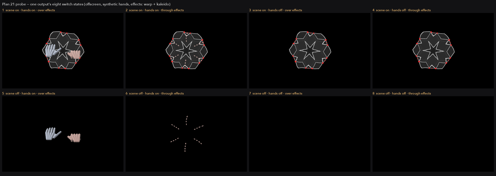
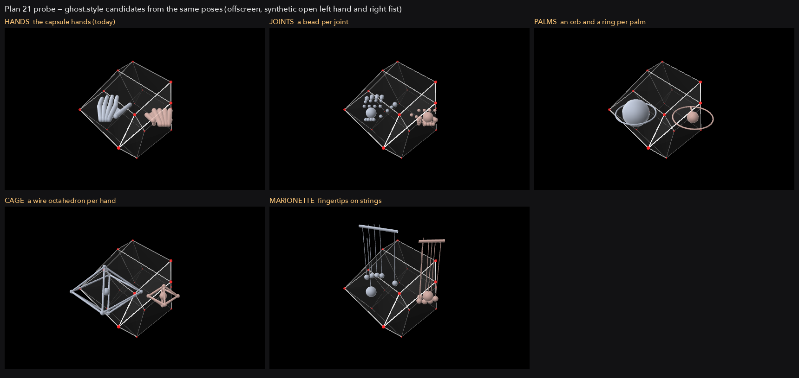

# Plan 21 — Outputs and the hands: a list of render outputs, the hands over or through the effects, the ghost hands finished

**From the Oct 3–4 session and the owner's answers of 2026-10-04**
([`15-21-roadmap.md`](15-21-roadmap.md) §4 "Plan 21", §5, §7; decisions 32
and 33 in `docs/DECISION-REGISTER.md`), **plus the owner's addition of
2026-10-04, made during the run**: per output, the hands are composited
either after the shader pipeline (undistorted, today) or before it (the
effects distort them too).

Written 2026-10-04 against `plan-20-integration` at 8345f4f (`finish-line`
with plans 15, 16 and plan 20's face target), reading
`origin/plan-18-integration` at 8c0e416 for `ghost.py`, `hands/core.py`
and `hands/panel.py` as plans 17 and 18 leave them. No code was changed.
Every row of §1 cites the function as it stands on 8345f4f. Six things
were measured on this laptop (Apple M3 Max, one built-in 120 Hz screen,
a temp `HYPERSPACE_HOME`; the scripts are not kept): the cost of each
pass, whether a frame routed through a texture is the same bytes, what a
second window's context sees of a texture, the frame rate with two
windows swapped per frame, whether the OUTPUT page's grid fits, and the
two picture sheets under
[`assets/21-outputs-and-the-hands/`](assets/21-outputs-and-the-hands/),
which are **offscreen renders from synthetic hands, made by a probe
script from the renderer's existing passes, not by the build**. Nobody
was available to answer questions: every fork is in §6 with the option
taken.

## HAND-OFF NOTES (2026-10-04, the plan's author stopped here)

The plan below is complete as a first draft: every section asked for is
written, and every finding, measurement and fork made so far is in it
(nothing is held only in these notes). What the next reader should know:

- **Not re-read after writing.** The document was written in one pass
  and not proof-read against the code a second time. The claims in §1
  and WP5 were each taken from the file as read; the test names in §5
  are proposals, not existing tests.
- **Not looked at:** `ENGINEERING.md`, `CHECKPOINT.md`, plan 14 and the
  body of `DECISION-REGISTER.md` beyond rows 31–33; `tests/test_app_boundary.py`,
  `test_overlay.py`, `test_placement.py`, `test_fx.py` beyond their
  names; `hands/panel.py` and `hands/core.py` on `plan-18-integration`
  beyond a grep for the box and the ghost rows; plans 19 and 20's
  unbuilt parts (the FX page, the look-back page), which may move
  `ui.py` under WP4. ARCHITECTURE §3 was not re-read for this plan; R2
  rests on its one-line statement in the task ("the render stack only
  reads") and on `Registry.apply` adopting raw writes as DECISIONS says.
- **Measured, and how:** all on this laptop (M3 Max, one 120 Hz screen),
  temp home, scripts in `/tmp/plan21probe/` (not kept in the repo).
  Pass costs are medians of 120 frames between `glFinish` calls on a
  standalone context with a 4-sample renderbuffer standing in for the
  window. The swap test used three small real GLFW windows on the one
  screen.
- **Not measured:** two physical screens (swap phase, tearing, mixed
  refresh rates, real fullscreen on two monitors, a monitor unplugged);
  the cost of `glFlush` itself; `skeleton()` on the SDK thread; whether
  framebuffer and vertex-array names are unusable across the share
  group on this driver (taken from the GL specification).
- **Unverified in R5:** that both reload hooks fire in one round was
  read from `hotreload.py` and `Renderer.on_reload`, not run.
- **The pictures** are from a probe that calls the renderer's existing
  passes in the order §2 gives; they show the design is reachable with
  today's passes, not that `draw_outputs` exists.
- **Still to do:** a second read for accuracy; the register rows for the
  forks (WP7 does it at build time); no PR is open.

## Scope in brief

**What you asked for on 2026-10-04, and what it takes.** Each output gets
a third switch beside "scene" and "hands": **hands through effects**. Off
(the default, today's picture): the hands are laid over the finished
frame and no effect touches them. On: the hands are laid onto the frame
*before* the effect chain runs, so warp, kaleido and the rest bend them
with the shape.

| | |
|---|---|
| Where the hands go in when the switch is on | After the look-back composite, before the first effect. The echoes and the dream still never hold the hands. |
| Where it is built | `render.py` (the frame order), `ghost.py` (the hands' layer split from its composite), a new `outputs.py`. About 150 lines of the plan's ~900. |
| Params | One toggle per output: `output.N.through`, label "Hands through effects". |
| Cost per frame at 1080p, measured | Nothing when every output agrees. One extra composite (about 0.5 ms) when an output wants the hands through the effects. One extra run of the effect chain (0.9 ms for four effects) only when the two outputs disagree. |
| With no effect on | The switch changes nothing: there is nothing to distort, so the hands are laid over as today. |
| Default | Off on every output. A rig with one output and default switches renders today's frame byte for byte. |
| Not built | The hands in the echoes or the dream (fork F1). The guide and its text labels distorted (they stay legible, fork F3). |

**The whole plan, in one screen.**

- **Outputs.** `config.toml` lists the render outputs (`[[output.screens]]`,
  two on the rig, four at most). Each is a window on its screen. With no
  list there is one output, exactly as today. The laptop keeps the
  control window.
- **Three switches and a dim per output**, on the OUTPUT page: scene,
  hands, hands through effects, dim. Eight switch states per output
  (below). On the rig that is 8 new params; on a one-output laptop, 3.
- **Rendered once, shared.** The scene is drawn once. The hands are
  drawn once into their own layer. The effect chain runs once per
  *distinct* input, so two outputs with the same switches share it.
- **The frame rate holds.** One output's swap waits for the screen; the
  others do not. Measured here with two windows: 121 fps on the 120 Hz
  screen; with both waiting, 60 to 81.
- **PR #78 reviewed.** Fourteen findings, two that must be fixed (a
  raising hands pass skips the master dim; the pass writes a parameter).
  Check 47 is finished as part of group Q.
- **`ghost.style`.** One enum picks what is drawn from the same hand
  data: HANDS, JOINTS, PALMS, and two fun ones, CAGE and MARIONETTE
  ([pictures](assets/21-outputs-and-the-hands/styles.png)).
- **Files.** New: `outputs.py`. Changed: `render.py`, `ghost.py`,
  `app.py`, `overlay.py`, `config.py`, `placement.py` (one argument),
  `watchdog.py`, `ui.py`, `hands/panel.py`, `hands/core.py`,
  `hotreload.py`.
- **Not built.** A picture of the outputs in the control window (words
  instead, fork F8). Live monitor and fullscreen switches for the second
  output (the config says, fork F10). Different content per output
  beyond the three switches. Overlay on any output but the first.

**The eight states of one output**
([offscreen render](assets/21-outputs-and-the-hands/eight-states.png),
effects warp + kaleido on):

| # | Scene | Hands | Through effects | What the output shows |
|---|---|---|---|---|
| 1 | on | on | off | The scene with its effects, the hands clean on top. **The default; today's frame.** |
| 2 | on | on | on | The scene and the hands, both through the effects. |
| 3 | on | off | off | The scene with its effects. |
| 4 | on | off | on | The same picture as 3. |
| 5 | off | on | off | The hands alone on black. |
| 6 | off | on | on | The hands alone, through the effects. |
| 7 | off | off | off | Black. |
| 8 | off | off | on | Black, the same as 7. |

Eight switch states, six different pictures: with the hands off, the
third switch has nothing to act on. The probe confirmed 3 = 4 and 7 = 8
byte for byte.



## 1. What the owner asked for and what it is

| # | Asked for | What the code does today | So |
|---|---|---|---|
| 1 | "Each a fullscreen window on its monitor **sharing the one GL context**" (roadmap §4) | GLFW gives every window its own context; `app._windows` makes the control window with `share=render_win`, and `main` already holds a second moderngl handle for it (`ui_gl`). A share group shares textures, buffers and programs; framebuffers and vertex arrays belong to one context (the GL specification; not probed, name collisions make a probe meaningless). | A second output cannot be drawn with the renderer's own vertex arrays. Each output after the first gets a small **presenter** in its own context (WP3). |
| 2 | "The scene with its effects is rendered once into a texture" | There is no texture of the finished frame. `Renderer._draw_frame` ends on the window: `fx.run(target, t)` when an effect is on, else `lb.composite(self.scene.tex, target, cover)`. | When two outputs share a picture, the pipeline's last pass goes to a frame texture and each output copies it. Measured: the copy is the same bytes (below). With one consumer it still writes straight to the window. |
| 3 | "Outputs of different size or aspect" | The look-back composite reads the scene with `texelFetch(u_scene, ivec2(gl_FragCoord.xy) - u_origin, 0)` (`lookback.POST_FS`): pixel for pixel, so its target must be the scene's size. `SceneTarget.ensure` takes the window's size. | One frame size, the first output's. Other outputs show that frame scaled (fork F5). |
| 4 | "The hands are rendered once into their own layer (as PR #78's ghost hands already do)" | `Ghost.draw(target, vp, t, opaque)` renders the layer **and** composites it in one call; the layer (`Ghost._tex`) is private and sized to the target's viewport (`_ensure`). | Split into `Ghost.layer` and `Ghost.composite`; `draw` stays as the two together (WP1). |
| 5 | "#78 draws through one call, `draw(poses, view_proj, eye)`" | True of `CapsuleHands.draw`. But the guide rides inside it: `s_rows += p.guide[0]`, `t_rows += p.guide[1]`. A replacement geometry would have to draw the guide too. | WP6 moves the guide's rows out of the geometry class before adding styles. |
| 6 | "Each output … times its own dim, times the master dim (`Renderer.dim_pass(target, vp, factor, opaque)` is the seam)" | `dim_pass` draws with `self._dim_vao`, a vertex array of the renderer's context. It serves the first output and any offscreen target; it cannot draw in another window's context. | The presenter carries its own dim (the same two shaders). The factor is `output.dim` × that output's dim, as planned. |
| 7 | "Six session params in all" | The roadmap counted scene, hands and dim for two outputs. The 2026-10-04 addition makes it four per output. The existing `output.*` params (`Output.register`: monitor, fullscreen, overlay, passthrough, bg, alpha, dim) are the one render window's. | 8 on the rig, 3 on a one-output rig (§3). The existing ids stay the first output's. |
| 8 | "The laptop screen is the control view" | The control window is imgui only. It has never shown the render. The one place it shows a render texture is the look-back page's thumbnails (`ui_lookback.py`, `imgui.image` on the atlas's GL name). | The OUTPUT page says in words what each output shows; no preview (fork F8). |
| 9 | "The shader pipeline" (the owner, 2026-10-04) | In `_draw_frame`'s order: the face picture (plan 20, before the scene pass), the scene pass, the cover mask, `lb.composite` (scene ⊕ echoes ⊕ dream), `lb.capture` (the echoes and the dream worker, from `scene.tex`), `fx.run` (the frame's effects), `ghost.draw`, `dim_pass`. | "Before" puts the hands between `lb.composite` and `fx.run` (fork F1). |
| 10 | "Never in the look-back history" (DECISIONS, 2026-10-04) | `lb.capture(self.scene.tex, …)` reads the scene texture, which the hands never touch. | Still true in every state: the hands go onto the chain's input, never onto `scene.tex`. |
| 11 | `windows.json`'s `render` is "a list, shaped for plan 21" | True of the file and of `placement.save`. `app._windows` reads `renders[0]` only and `_save_windows` writes `[render]`. | WP3 reads and writes one entry per output; the schema does not change. |
| 12 | "A render window that presents nothing for 2 s" (`watchdog.RenderWatch`) | One `info` callable, one window (`output.backend.window_state(render_win)`). | WP3: the stall is "no output presented"; one output of several going dark is a warning that names it. |
| 13 | `[[output.screens]]`, promised by plan 16 WP4 "Config" | Not built. `config.load` merges sections with `dict.update`, so an array of tables under `[output]` arrives as `cfg["output"]["screens"]`, a list of dicts, with no change to the loader. | WP3 reads it. |

Three measurements this section leans on:

- **A frame through a texture is the same bytes.** The pipeline's last
  pass into an RGBA8 texture, then a 1:1 `texelFetch` copy to the target,
  then the hands: identical to today's direct frame in all eight cases
  tried (0 and 4 samples, effects on and off, hands on and off).
- **A second context sees last frame's texture unless the first is
  flushed.** With no flush, window B showed the texture one frame late on
  199 of 200 frames. With `glFlush()` in the rendering context before
  switching: 0 of 200.
- **One vsynced swap, the rest not.** Three windows, 240 frames each:

  | Swap intervals | Rate on the 120 Hz screen |
  |---|---|
  | A waits, B does not (the design) | 121 fps |
  | both wait | 81 fps |
  | A does not, B waits | 89 fps |
  | both wait, B minimised | 60 fps |
  | A waits, B does not, B minimised or covered | 121 fps |

## 2. Work packages

"Outputs and the #78 review at once; styles after the review."

| WP | What | Size | After |
|---|---|---|---|
| 1 | The compose path: layers once, a picture per output, on one context; scene, hands and dim | M | 5 |
| 2 | Hands through effects: the second and third pipelines, the readout layer | S–M | 1 |
| 3 | The output list: config, windows, presenters, swaps, placement, the watch | M–L | 1 (signature only) |
| 4 | The params and the OUTPUT page | S | 1, 3 |
| 5 | PR #78's review findings | S–M | — |
| 6 | `ghost.style` | M | 5, 1 |
| 7 | Docs, decisions, hand checks, "As built" | S | all |

Merge order: 5, 1, 2, 3, 4, 6, 7. WP3 can be built beside WP1 and WP2
against the contract below. One PR per WP on `plan-21-integration`, each
with a demo.

**Shared files.**

| File | WP1 | WP2 | WP3 | WP4 | WP5 | WP6 |
|---|---|---|---|---|---|---|
| `render.py` | `draw_outputs`, `_draw_frame` | the pipelines | — | — | the guard round the hands (lands first) | — |
| `ghost.py` | `layer` / `composite` | the readout layer | — | — | `_ensure`, `_draw_tethers`, `on_reload` | styles, the guide out of the geometry |
| `outputs.py` (new) | `Switches`, `route`, `fit`, `View` | `route`'s through rows | `Presenter` | — | — | — |
| `app.py` | — | — | all of it | — | `_open_hands` note | — |
| `overlay.py` | — | — | `Output` per window | `register` | — | — |
| `ui.py` | — | — | — | `_page_output`, footer | — | — |
| `hands/panel.py` | — | — | — | — | the unmeasured-mode line | the style combo |
| `hotreload.py`, `tests/test_hotreload.py` | `outputs` in `MODULES` | — | targets | — | — | — |

No WP edits `lookback.py`, `fx.py`, `shaders/`, `preset.py`, `routing.py`,
`library.py` or any factory JSON.

### The frame as it will be

```text
ONCE PER FRAME, in the first output's context
 0  frame size = the first output's framebuffer size; scene.ensure; blank on units 0–3
 1  the face picture                      plan 20, unchanged
 2  the scene pass → scene.tex            unchanged
 3  scene.resolve, the cover mask         unchanged
 4  lookback.tick, pull; fx.tick; fx.opaque
 5  route every output (outputs.route)    → which pipelines this frame needs
 6  the hands' layer → ghost.tex          only if some output shows hands and a hand shows
    the readout layer → ghost.readout     only if the guide is on and a through pipeline runs

ONCE PER DISTINCT PIPELINE, in this order
 7a SCENE         lb.composite(scene) → [fx chain] → dst
 7b SCENE+HANDS   lb.composite(scene) → hands over → fx chain → dst      (only with an effect on)
 7c HANDS         clear to the ground → hands over → fx chain → dst      (only with an effect on)
    lb.capture(scene.tex) runs exactly once, after the first composite of the frame,
    or on its own when no output shows the scene: the echoes and the dream go on.
    dst = the output itself when it is the pipeline's only consumer, on this
    context, at the frame size; else a frame texture (RGBA8, frame size).

ONCE PER OUTPUT
 8  the picture: nothing (direct), or the frame texture copied 1:1, or scaled to fit;
    an output with no pipeline is cleared to the ground
 9  hands over effects: the hands' layer composited, in the same rect
10  the readout layer composited, when it is separate
11  dim: output.dim × this output's dim, when under 1
12  swap: the others first (they do not wait), the first output last (it waits)
```

What an output is given depends only on its switches, whether an effect
is on, and whether a hand shows. `outputs.route` is that table, pure
Python:

| Scene | Hands shown | Through, and an effect on | Pipeline | Hands composited after |
|---|---|---|---|---|
| on | no | — | SCENE | no |
| on | yes | no | SCENE | yes |
| on | yes | yes | SCENE+HANDS | no |
| off | no | — | none (the ground) | no |
| off | yes | no | none (the ground) | yes |
| off | yes | yes | HANDS | no |

"Hands shown" is the output's hands switch **and** `ghost.on` **and** a
hand visible this frame (fork F7). So with the hands away, or no effect
on, every output collapses to SCENE or the ground and nothing extra runs.

**How many pipelines.** Two outputs need at most two chain runs; the
default rig needs one. Four outputs need at most three.

| Glass | Projector | Chain runs |
|---|---|---|
| any state | the same state | 1 (0 if both scene off and not through) |
| scene, hands over | scene, no hands | 1 |
| scene, hands over | scene, hands through | 2 |
| scene, hands through | hands alone, through | 2 |
| scene, hands over | hands alone, over | 1 |

**The two outputs and the control view.**

```text
        config.toml                         the laptop (control view)
   [[output.screens]] #1  #2            ┌──────────────────────────────┐
                                        │ OUTPUT                       │
   ┌───────────────────────┐            │ master dim  ████████░░ 80%   │
   │ 1  GLASS  (paces)     │            │ 1 glass   ☑scene ☑hands ☐fx  │
   │  scene      [on]      │            │   dim ██████████ 100%        │
   │  hands      [on]      │            │   shows: scene + hands       │
   │  through fx [off]     │            │ 2 projector ☑scene ☐hands ☐fx│
   │  dim        100%      │            │   dim ██████░░░░ 60%         │
   │  → pipeline SCENE,    │            │   shows: scene · 48%         │
   │    hands after        │            │ paced by 1 · frame 1920×1080 │
   └───────────────────────┘            └──────────────────────────────┘
   ┌───────────────────────┐              no picture of the render here;
   │ 2  PROJECTOR          │              the footer says "output 2 black"
   │  scene      [on]      │              when an output shows nothing
   │  hands      [off]     │
   │  through fx [off]     │      scene ──► look-back ──► effects ──┬─► 1
   │  dim        60%       │      (once)   composite     (once)     └─► 2
   │  → pipeline SCENE     │      hands' layer (once) ─────────────────► 1
   └───────────────────────┘      master dim × own dim, last, per output
```

**Alpha.** On an opaque ground (every output but an overlay) every
composite leaves the target's alpha as it is, as `Ghost.draw` and
`dim_pass` do today, and `FxChain.run` writes alpha 1. In overlay the
hands add their coverage, before or after the chain, and the dim fades
colour and alpha (register row 41, unchanged). **The fade at the box's
edge** is in the hands' layer (premultiplied by each hand's fade), so it
is the same in every state. **`ghost.alpha`** is applied at the
composite, wherever that is.

### WP1 — The compose path

**What.** `Renderer.draw_outputs`, the hands' layer split from its
composite, and the per-output picture, all on one GL context with
offscreen targets standing in for windows. Scene, hands and dim
switches. No new window.

**Owns:** `render.py`, `ghost.py` (`Ghost.draw` and the targets),
new `outputs.py`, `hotreload.py` (`"outputs"` in `MODULES` before
`"render"`), `tests/test_outputs.py` (new), `tests/test_render.py`,
`tests/test_ghost.py`, `tests/test_hotreload.py`.
**Must not touch:** `app.py`, `overlay.py`, `ui.py`, `lookback.py`,
`fx.py`.

**Contracts.**

```python
# outputs.py — render stack: imports moderngl and glsl, nothing from app, ui or params
MAX_OUTPUTS = 4
SCENE, SCENE_HANDS, HANDS = 0, 1, 2          # pipeline keys, in run order

@dataclass
class Switches:                # what the output.N.* params write (WP4)
    scene: bool = True
    hands: bool = True
    through: bool = False      # hands through effects
    dim: float = 1.0

def route(sw: Switches, fx_active: bool, hands_visible: bool) -> tuple[int | None, bool]:
    """(pipeline key or None for the ground, hands composited after)."""

def fit(src: tuple[int, int], dst: tuple[int, int]) -> tuple[int, int, int, int]:
    """The rect (x, y, w, h) in dst that shows src whole, centred, aspect kept.
    Equal sizes give (0, 0, w, h)."""

@dataclass
class View:                    # one output, for one frame
    switches: Switches
    size: tuple[int, int]                       # its framebuffer, px
    target: moderngl.Framebuffer | None = None  # on the renderer's context
    presenter: "Presenter | None" = None        # WP3: another window's context
    bg_alpha: float = 1.0
    error: str = ""                             # set by draw_outputs, never raised

# render.py
class Renderer:
    def draw_outputs(self, s, w, h, dpr, views: list[View], t_now=None) -> None: ...
    stats: dict    # {"pipelines": [keys run], "chain_runs": n, "direct": bool}
    # draw(s, w, h, dpr, t_now) is unchanged: one default View on the bound framebuffer

# ghost.py
class Ghost:
    def layer(self, size, t) -> bool: ...          # render the hands' layer; False: nothing shows
    def composite(self, target, vp, opaque=True) -> None: ...
    tex: moderngl.Texture | None                   # the layer, premultiplied
    # draw(target, vp, t, opaque) stays: layer(vp's size) then composite
```

**Behaviour.**

- `views[0]` sets the frame size and the scene's sample count
  (`_samples_of(ctx, views[0].target)`).
- `draw_outputs` with one default `View` on `ctx.fbo` runs today's
  `_draw_frame` path: the last pass writes the target, `ghost.draw`,
  `dim_pass`. `Renderer.draw` calls it that way. This is what keeps
  today's frame by construction.
- The "direct" rule: a pipeline whose only consumer is a `View` with a
  `target` at the frame size writes its last pass into that target.
  Otherwise it writes a frame texture (`RGBA8`, `repeat` off, `NEAREST`
  for a 1:1 copy, `LINEAR` when any consumer scales), kept per key and
  resized with the frame.
- A copy to a target at the frame size uses `texelFetch`; a scaled one
  samples through `fit`'s rect, and the rest of the target is cleared to
  the ground.
- Hands after: `ghost.composite(target, fit rect, opaque)`.
- Dim: `dim_pass(target, full viewport, self.dim * view.switches.dim,
  opaque)` when the product is under 1.
- `lb.capture` runs once a frame whatever the switches. With the scene
  off everywhere the scene pass still runs: the echoes, the dream worker
  and the effects' clocks carry on, so switching the scene back on shows
  no gap. `FxState.advance_to(t)` already advances once however many
  times the chain runs.
- Every exit binds `views[0].target` again with its viewport and
  blending, a raise included (the 2026-09-29 rule). A `View` that raises
  records `view.error` and the loop goes to the next one.
- `Renderer.on_reload` drops the frame textures and the copy program;
  `getattr` guards as the dim's.

### WP2 — Hands through effects

**What.** Pipelines SCENE+HANDS and HANDS, and the readout layer.

**Owns:** `render.py` (step 7), `ghost.py` (the readout), `outputs.py`
(`route`), the tests of WP1. **Must not touch:** `fx.py`, `lookback.py`.

**Behaviour.**

- SCENE+HANDS: `buf = fx.begin(size)`; `lb.composite(scene.tex, buf,
  cover)`; `ghost.composite(buf, (0, 0, *size), opaque=fx.opaque)`;
  `fx.run(dst, t)`. The chain's first texture is RGBA16F; the composite
  blends into it as it does into a window.
- HANDS: `buf = fx.begin(size)`; clear to `(0, 0, 0, bg_alpha)`;
  `ghost.composite(buf, …)`; `fx.run(dst, t)`. No look-back: the echoes
  are the scene's, and the scene is off. A generator effect will light
  the ground here, where state 5 (hands over) shows none: with the scene
  off the effects exist only to act on the hands.
- With no effect on, `route` never returns these keys. The switch then
  changes nothing, and the OUTPUT page says "no effect on" beside it.
- **The readout** (the guide and the tethers' text labels) is never
  distorted (fork F3). While no through pipeline runs it is drawn into
  the hands' layer as today, bit for bit. While one runs it is drawn
  into a second texture, `Ghost.readout`: the hands depth-only first
  (colour mask off) so an ON HAND gauge is still hidden behind the palm,
  then the guide's spheres and tubes, then the tethers. Every output
  whose hands switch is on gets it composited after everything, before
  the dim.

### WP3 — The output list: config, windows, presenters, swaps

**What.** `[[output.screens]]`, one window per entry, a presenter per
window after the first, the swap order, placement, and the watch.

**Owns:** `app.py`, `config.py`, `overlay.py` (`Output` per window; no
param changes), `outputs.py` (`Presenter`), `placement.py` (one optional
argument), `watchdog.py`, `tests/test_app_boundary.py`,
`tests/test_config.py`, `tests/test_overlay.py`, `tests/test_placement.py`,
`tests/test_watchdog.py`. **Must not touch:** `render.py` beyond calling
`draw_outputs`, `ui.py`.

**Config.**

```toml
[output]
overlay = false            # rig-wide, as today; overlay is the first output's only
control_monitor = 0        # the laptop

[[output.screens]]         # output 1: sets the frame size and paces the loop
name = "glass"             # optional; the OUTPUT page's label (default: the screen's name)
monitor = 1
fullscreen = true
# optional launch values of this output's switches (defaults shown)
scene = true
hands = true
through = false
dim = 1.0

[[output.screens]]         # output 2
name = "projector"
monitor = 2
fullscreen = true
```

- No `screens` key: one output from the scalar `monitor` / `fullscreen`,
  as today. **An existing `config.toml` keeps working unedited.**
- `screens` present: it wins; scalar `monitor` / `fullscreen` are ignored
  with one note in `cfg["notes"]`. `on_start`, `passthrough`, `bg` and
  `alpha` stay scalar and are the first output's.
- More than `MAX_OUTPUTS` entries, or an entry that is not a table: the
  extras are dropped with a note.
- `monitor` is read through `placement.read`, as today. For output 1 an
  index no screen has is −1 with a note (today's rule). **For a later
  output an index no screen has means that output is not opened**, with
  a note on stderr and the SYSTEM page (fork F9). `monitor = -1` on a
  later output opens it as a plain window where it was last, for working
  on a two-output setup with one screen.
- Outputs are numbered by their place in the list, opened or not, so
  `output.2.*` always means the second entry.
- A `dim` under 0.1 in the config is raised to 0.1 with a note: the
  config cannot launch an output black.

**Windows.** `_windows` returns `(output_wins, ctrl_win)`. Output 1 is
created as today (4 samples, the transparent hint only with `[output]
overlay`). Later outputs: `share=output_wins[0]`, `SAMPLES 0`, never
transparent, `AUTO_ICONIFY` off, titled `Hyperspace — <name>`. Each gets
an `overlay.Output` (`allowed=False` after the first; only the first
registers params) whose `fullscreen` and `monitor` come from its entry
and whose `apply()` runs each frame. `placement.place("render", …)` is
called once per output with `renders[k]`; it gains an optional
`what: str = ""` used only in its notes ("output 2"). `_save_windows`
writes one rect per opened output, `None` for one not opened (the old
entry is kept, as for a minimised window).

`windows.json` as it already is:

```json
{"schema": "hyperspace.windows/1",
 "control": {"x": 2100, "y": 60, "w": 960, "h": 900, "screen": "Built-in Retina Display"},
 "render": [{"x": 1744, "y": 41, "w": 1280, "h": 820, "screen": "DELL U2720Q"},
            {"x": 3700, "y": 41, "w": 1280, "h": 820, "screen": "EPSON PJ"}]}
```

**The presenter.**

```python
class Presenter:
    """One output after the first: a moderngl handle on that window's
    context, its own copy / hands / dim programs and vertex arrays."""
    def __init__(self, ctx: moderngl.Context): ...
    def present(self, frame: int | None, frame_size, hands: int | None, readout: int | None,
                alpha: float, size, factor: float, bg_alpha: float = 1.0) -> None: ...
    def on_reload(self) -> None: ...
    def release(self) -> None: ...
```

`frame`, `hands` and `readout` are GL texture names from the renderer's
context, wrapped with `ctx.external_texture` (probed: it samples
correctly). `present` leaves the window's framebuffer bound.

**The frame in `app.draw_render`.**

1. Make output 1 current; the stranded-target check; `ctx.screen.use()`.
2. Build the `View`s: output 1 with `target=ctx.screen`, the others with
   their `presenter` and framebuffer size.
3. `renderer.draw_outputs(...)`. It draws output 1 whole and leaves the
   frame textures for the rest.
4. `glFlush()` in output 1's context. Without it a presenter shows last
   frame's texture (measured, §1).
5. For each other output, in a `try`: make it current, `present`, swap.
   Its swap interval is 0.
6. Make output 1 current and swap (`finally`, as today). Its interval is
   1: it paces the loop (fork F6).

A presenter that raises sets its output's `error` and the loop goes on:
a failing output cannot take the frame down. `Keys` polls every output
window; `Mouse` stays on output 1; the loop ends when any window is
closed. `Host` gains `outputs: list[Output]`; `Host.output` stays the
first. `close_all`, `_restart` and `HYPERSPACE_FRAMES` are unchanged in
meaning (the smoke run closes output 1). Reload targets gain each
further `Output`, its backend and each `Presenter`.

**The watch.** `RenderWatch.info` returns the first output's state with
`presentable` true when **any** output is presentable, so "no render
frame presented for 2 s" means no output showed one. Each output not
presentable for 2 s while another is, or whose present raised, is
`watch.warn("output 2 (projector): …")`, once per message, with its
window state in the log.

### WP4 — The params and the OUTPUT page

**Owns:** `overlay.py` (`register_switches`), `app.py` (one call, seeding
from the config), `ui.py` (`_page_output`, the footer),
`tests/test_overlay.py`, `tests/test_ui_shell.py`, `tests/test_params.py`.

**Params**, generated per opened output N (1-based), like the FX params:

| Id | Label | Kind | Default |
|---|---|---|---|
| `output.N.scene` | "Scene" | toggle | on |
| `output.N.hands` | "Hands" | toggle | on |
| `output.N.through` | "Hands through effects" | toggle | off |
| `output.N.dim` | "Dim" | continuous 0–1 | 1 — **registered only with two or more outputs** |

With several outputs the label is prefixed with the output's name
("Glass scene"). All are in group `output` (session), `persist=False`,
`modulatable=False`: rig settings, like `output.fullscreen` and
`output.dim` beside them (fork F4). A preset or a show never moves them,
undo does not watch them (`undo.watched` needs `persist`), a launch
takes them from the config, and they can be learned onto a desk button
like any toggle. Nothing is put on the desk by this plan.

**The page.** Under the master dim, one block per output, two or three
lines (measured: the page's content is 392 px wide; a one-line row with
a name, three ticks, a slider and a status needs more than that):

```text
1  glass        ☑ scene   ☑ hands   ☐ through effects
   dim  ██████████████░░░░  80%                    (two or more outputs)
   shows: scene + hands over the effects · 64%
```

- "shows:" is `route`'s answer in words, with the product of the two
  dims: "scene", "scene + hands over the effects", "scene + hands
  through the effects", "hands", "hands through the effects", "black —
  nothing switched on", "black — dim 0". In the warning colour when
  black.
- Beside "hands" when it can show nothing: "ghost hands are off (HANDS
  page)" or "no tracker". Beside "through effects" with no effect on:
  "no effect on".
- An output the config lists but that did not open: one disabled line,
  "2 projector — screen 2 is not connected".
- One line under the blocks: "paced by output 1 · frame 1920×1080", and
  an output's `error` in the warning colour.
- The existing rows (monitor, fullscreen, overlay and its three) follow,
  unchanged; they are the first output's.
- **The footer** (`ui.py`, where it prints `· dim 40%`): `· output 2
  black` while an output shows nothing for a reason other than the
  master dim, on every page.
- It fits: with four outputs drawn as six-column rows plus two lines,
  and overlay's rows showing, 307 px were left under the page at the
  control size. Three lines per output need about 65 px more than that
  probe used and still leave room.

### WP5 — PR #78, reviewed

PR #78 (Dillon's ghost hands; `ghost.py`, `hands/tape.py`,
`tools/hands_tape.py`, the skeleton in `hands/core.py`) was read whole,
its tape tool run (`synth`, `info`, `shots` all work on a temp home) and
its pass timed. It is careful work: all-or-nothing program builds, the
target bound on every exit, nothing touched when off. Findings, each
with its fix:

| # | Finding | Where | Fix |
|---|---|---|---|
| R1 | **A raising hands pass skips the master dim and fails the frame.** `_draw_frame` calls `self.ghost.draw(…)` unguarded and `dim_pass` after it. `Ghost.poses` has no guard: a skeleton with a ragged `digits` list (a hand-edited tape) raises in `pose()`, a font problem raises in `TetherLabels._label`. The crossfader at black would then show a full-bright frame. | `render.py::_draw_frame`, `ghost.py::poses`, `draw` | Guard the hands in `_draw_frame` as `_face_picture` is guarded: `Ghost.error` says why, the frame goes on to the dim. `Ghost.draw`'s `finally` also re-enables `BLEND` (today it relies on `Renderer.draw`'s). Test: a source whose skeleton is malformed leaves a dimmed frame and an error line. |
| R2 | **The render stack writes a parameter.** `_draw_tethers` sets `self.state.tethers = False` when the labels cannot build. `state.tethers` is what `ghost.tethers` reads; `Registry.apply` adopts a raw write as a new base. ARCHITECTURE §3: the render stack only reads. | `ghost.py::_draw_tethers` | A private `_labels_failed` flag; the param is left alone; the HANDS page shows `Ghost.error`. |
| R3 | `_ensure` is not all-or-nothing. It sets `self.size` and `self._tex` before the renderbuffers; if one of those raises, the next frame returns early (size and texture match) with `_fbo` `None` and raises every frame. | `ghost.py::_ensure` | Build into locals, assign at the end, release on failure, record `error`. |
| R4 | Cost. The hands' pass is 0.93 ms at 1920×1080 and 3.4 ms at 3024×1964 (two hands; 0.2 ms of it Python). The layer is the target's full size with 4× colour and depth. | `ghost.py::_ensure`, `SAMPLES` | None at 1080p, the rig's size. Noted for the laptop's own screen; a size cap is fork F11, not taken. |
| R5 | `Renderer.on_reload` calls `self.ghost.on_reload()`, and the reloader calls the same hook for the `Ghost` target (`app.main`'s target list): the programs can be rebuilt twice in one round, and are rebuilt on a `render.py` save that did not touch them. | `render.py::on_reload` | Remove the call from `Renderer.on_reload`. |
| R6 | The screentop and HMD bases (`ghost.MODES`) are guesses, as the author says. Both are proper rotations (determinant +1, by arithmetic), so neither mirrors by accident. Whether they are the right rotations can only be seen at the rig. | `ghost.py::MODES` | Check Q9. With a mode other than desktop the HANDS page says "ghost axes for this mode are unmeasured". |
| R7 | The bindings' names, flagged as assumed. Read against the pinned `leap` package (`leap/datatypes.py`): `Hand.thumb … pinky`, `.arm`, `.palm`; `Digit.metacarpal … distal` and `.bones`; `Bone.prev_joint`, `.next_joint`, `.width`, `.rotation`; `Quaternion.x y z w`; `Palm.position`, `.normal`, `.direction`, `.width`. All match `hands.core.skeleton`. | `hands/core.py::skeleton` | None. Not seen with a live camera (Q9). |
| R8 | `skeleton()` runs on the SDK thread for every tracking frame, ghost on or off. The author kept it (SDK objects must not outlive the callback). Its cost was not measured here. | `hands/core.py::_frame` | None. |
| R9 | No real tape exists: `tests/fixtures/` is not in the tree, so the replay test skips. | `tests/test_hands_tape.py` | Q9 records one. |
| R10 | A `[hands] tape` that is missing or malformed raises in `HandsIO.__init__`; `app._open_hands` prints to stderr and returns `None`. On the panel that is "no hands" with no reason. | `app.py::_open_hands` | Append the message to `cfg["notes"]` (the SYSTEM page). |
| R11 | The guide's rows are drawn by `CapsuleHands.draw` (§1 row 5). | `ghost.py` | WP6. |
| R12 | `ghost.on`, `.mirror`, `.guide` and `.tethers` are `modulatable` (the test asserts it). A performer's row on `ghost.mirror` would flip the hands with a hand's move. | `ghost.py::register` | `mirror`, `guide`, `tethers` and the new `style` become `modulatable=False`; `on` and `alpha` stay (the PR says they are meant to be learned). The test changes with it. |
| R13 | `pose()` falls back to `85.0`, a second copy of `hands.core.PALM_W`; `tape.STALE_S` is a second copy of core's (said in a comment). | `ghost.py`, `hands/tape.py` | `pose()` imports the constant lazily, as `box_of` does; the tape's stays (a leaf). |
| R14 | Check 47 has never been run; its (g) "effects never touch it" is now the default of a switch. | `11-hand-checks.md` | Q9 and Q4. |

**Owns:** `ghost.py` (the lines above), `render.py` (the guard and the
`on_reload` line), `app.py::_open_hands`, `hands/panel.py` (one line),
`tests/test_ghost.py`, `tests/test_render.py`.

### WP6 — `ghost.style`

**What.** One enum, `ghost.style`, picks what is drawn from the same
poses. Session, persisted, not modulatable, on the HANDS page under
"Ghost hands". It replaces nothing: it is the "swappable" of decision 33.



| Style | What is drawn | Reads |
|---|---|---|
| HANDS | The capsule hands, today's. The default. | joints, bone widths |
| JOINTS | A bead per joint, larger at the fingertips, one at the palm. | joints |
| PALMS | An orb per palm that swells as the hand opens, a ring in the palm's plane, a spoke where the fingers point. | palm frame, openness |
| CAGE | A wire octahedron round each hand: it turns with the palm and breathes with the grip. A small polytope in each hand. | palm frame, openness |
| MARIONETTE | A bead per fingertip, hung on strings from a bar above each hand. | fingertips |

"Openness" is the mean fingertip distance from the palm over the palm's
width, 0 for a fist, 1 open: computed from the pose, no new data and no
route.

**Contract.**

```python
STYLES = ["HANDS", "JOINTS", "PALMS", "CAGE", "MARIONETTE"]

class Geometry:                       # was CapsuleHands' drawing half
    def draw(self, poses, view_proj, eye, parts, extra=((), ())) -> None: ...

def hands_parts(p: HandPose) -> tuple[list, list, list]: ...      # CapsuleHands.parts, moved
def joints_parts(p), palms_parts(p), cage_parts(p), marionette_parts(p)
PARTS = (hands_parts, joints_parts, palms_parts, cage_parts, marionette_parts)
```

A style is a pure function from one `HandPose` to (spheres, tubes,
triangles): no GL, testable without a context. The guide's rows are
passed to `draw` as `extra` by `Ghost`, so no style knows the guide
exists. `CapsuleHands` stays as a name for `Geometry` drawing
`hands_parts`. A palm-only pose (no digits) draws a palm orb in every
style. The fade, the colours, the camera, the guide and the tethers are
the same in every style.

**Owns:** `ghost.py`, `hands/panel.py` (one combo), `tests/test_ghost.py`,
a `styles` command in `tools/hands_tape.py` (the demo sheet).

### WP7 — Docs, decisions, hand checks

**Owns** the shared documents and nothing else: `ARCHITECTURE.md` (§1
Render stack and Host rows, §2 the frame and "the ghost hands are the
frame's last pass"), `ENGINEERING.md`, `DECISIONS.md` (the two rows
below), `DECISION-REGISTER.md` (the forks of §6 as rows after 56),
`plans/README.md`, `CHECKPOINT.md`, `11-hand-checks.md` (group Q, check
47 marked as carried into Q9), `config.py`'s docstring is WP3's, and
this plan's §7.

The two DECISIONS rows this plan changes, and only these:

- **2026-09-18 "Two GLFW windows on one GL context; the render window
  has no imgui at all"** becomes superseded by: one control window and a
  list of render outputs, each its own window in one share group; **no
  imgui on any output** stands.
- **2026-10-04 "The ghost hands are the frame's last pass … never in the
  look-back history"** stays standing as the default of a per-output
  switch. With "hands through effects" on, that output's hands go in
  before the effect chain. "Never in the look-back history" stands in
  every state.

## 3. Parameter budget

| Added | Count | Replaces, or why nothing |
|---|---|---|
| `output.N.scene`, `.hands`, `.through` | 3 per output | Nothing: the owner's ask, per output. |
| `output.N.dim` | 1 per output, only with two or more | Nothing with two; with one output the master dim is that output's dim, so none is added. |
| `ghost.style` | 1 | Nothing: decision 33's "swappable". |
| Pages, menu items | 0 | The OUTPUT page gains a block per output. |
| On the desk | 0 | Unless the owner learns one. |

One output: 4 new params (3 switches, the style). The rig: 9. The
ceiling, four outputs: 17. They are generated in a loop for the outputs
the config opens, as `fx.declare` generates an effect's, so the registry
on a laptop never carries a projector's switches. The two fit and pacing
choices (forks F5, F6) are constants, not params.

## 4. What this plan does not change

- **The control model** (ARCHITECTURE §3). The render stack only reads:
  `outputs.Switches` is written by the registry and read by the
  renderer, and finding R2 removes the one write the hands made.
- **No imgui on any output.**
- **Rig settings never persist in a preset**; the new params are not in
  the show either.
- **Overlay only when the config asks** (decision 21), and only on the
  first output; every other output is created opaque.
- **`output.dim`**: the crossfader, never saved, 1 at launch, not
  modulatable, after everything on every output; in overlay it fades
  colour and alpha (rows 28, 40, 41).
- **`ghost.*` are session params, off by default**; the skeleton is
  display only; the interaction box frames the hands and a hand outside
  it fades (plan 18 rows 50–51, read from `ghost.box_of` on
  `plan-18-integration`).
- **A render frame binds its target explicitly** and puts it back on
  every exit.
- **Window placement** (row 48): the config beats the file, the file is
  written at the exits only, fullscreen is never remembered.
- **Effects are `.glsl` files**; no effect is edited. `lookback.py` and
  `fx.py` are not edited at all.
- **The face target** (plan 20): finished before the scene pass, known
  to nothing here. The scene pass still starts at (0, 0), which
  `u_pic_fb` assumes.

## 5. Exit criteria

### Headless: named tests

WP1 and WP2, `tests/test_outputs.py`, on an offscreen pair of targets:

- `test_one_default_output_is_todays_frame_byte_for_byte` (effects on and
  off, hands on and off, 0 and 4 samples, against `Renderer.draw` on the
  parent commit's path)
- `test_the_frame_through_a_texture_is_the_same_bytes`
- `test_each_of_the_eight_states_shows_its_picture` (states 3 = 4 and
  7 = 8; 1 holds undistorted hand pixels; 2 and 6 differ from 1 and 5
  where the hands are; 5 is hands on the ground)
- `test_two_outputs_with_the_same_switches_run_the_chain_once`
- `test_outputs_that_differ_run_one_chain_per_distinct_input`
  (`Renderer.stats`, the table of §2)
- `test_through_with_no_effect_on_is_hands_over`
- `test_through_with_no_hand_showing_runs_nothing_extra`
- `test_the_history_never_holds_the_hands_in_any_state`
- `test_capture_runs_once_a_frame_whatever_the_switches`
- `test_an_opaque_grounds_alpha_is_untouched_in_every_state`
- `test_overlay_adds_the_hands_coverage_before_or_after`
- `test_each_output_dims_by_master_times_its_own`
- `test_an_output_of_another_aspect_is_letterboxed_and_the_hands_stay_registered`
- `test_the_first_target_is_bound_after_a_view_raises`
- `test_the_guide_is_never_distorted`
- `test_route` (pure: every row of the route table)

WP3:

- `test_config.py::test_no_screens_list_is_one_output_as_today`,
  `::test_a_screens_list_wins_over_the_scalar_keys_with_a_note`,
  `::test_a_fifth_screen_is_dropped_with_a_note`,
  `::test_a_config_dim_cannot_launch_an_output_black`
- `test_app_boundary.py::test_one_window_per_listed_output`,
  `::test_a_later_output_whose_screen_is_absent_is_not_opened`,
  `::test_the_exits_save_one_rect_per_output`,
  `::test_only_the_first_output_waits_for_the_screen`,
  `::test_a_raising_presenter_does_not_stop_the_frame`,
  `::test_the_rendering_context_is_flushed_before_a_presenter`
- `test_watchdog.py::test_one_dark_output_of_two_is_a_warning_not_a_stall`,
  `::test_no_output_presenting_is_the_stall`

WP4:

- `test_overlay.py::test_the_output_switches_are_rig_settings`,
  `::test_one_output_has_no_dim_of_its_own`
- `test_ui_shell.py::test_every_page_fits_the_control_window` with four
  outputs, `::test_the_output_page_says_what_each_output_shows`,
  `::test_the_footer_names_a_black_output`

WP5: `test_render.py::test_a_raising_hands_pass_still_dims`,
`test_ghost.py::test_a_failed_label_build_writes_no_param`,
`::test_a_failed_target_build_is_all_or_nothing`.

WP6: `test_ghost.py::test_every_style_draws_from_the_same_poses`,
`::test_a_style_never_draws_the_guide`,
`::test_a_palm_only_hand_draws_in_every_style`,
`::test_hands_is_the_old_geometry_byte_for_byte`.

The whole suite green, `ruff` clean, `HYPERSPACE_FRAMES=120` exits clean
on a temp home with no `screens` list and with a two-entry list on one
screen (`monitor = -1` on both).

### At the machine

Group Q, in full in the appendix. Check 47 is finished as Q9.

## 6. Forks

Each was settled by the recommendation, for the owner to confirm or
overturn (register rows after 56, WP7).

### F1. Where "before" puts the hands

| Option | Consequence |
|---|---|
| **(a) After the look-back composite, before the first effect** | The effects distort the hands. The echoes and the dream never hold them: the 2026-10-04 row's "never in the history" stands. One history serves every output. |
| (b) Onto the scene before the look-back composite | The hands also trail in the echoes and feed the dream. The history is shared, so an output with hands off or "over" would still show hand echoes: the switches would stop being per output. Fixing that needs a second history and a second dream worker. |

**Taken: (a).** The owner said "the shader pipeline", and the effect
chain is the part that distorts. Cost to reverse: (b) for all outputs at
once is a few lines; (b) per output is a second look-back ring, M–L.

### F2. Is "hands through effects, scene off" a state

**Yes** (the owner counts eight): the hands alone through the effect
chain on the ground, with no echoes. The alternative, treating it as
hands over, would make two switch states the same picture for no reason.
Reverse: one row of `route`.

### F3. The guide and the tethers' labels

| Option | Consequence |
|---|---|
| (a) They follow the hands | Nothing to build. Text through kaleido cannot be read, and the guide exists to be read. |
| **(b) Always composited after** | Legible in every state. A second layer, drawn only while the guide is on and a through pipeline runs; otherwise today's single layer, bit for bit. |

**Taken: (b).** Reverse: delete the readout layer, S.

### F4. Are the switches saved

| Option | Consequence |
|---|---|
| (a) Session params saved in the show | A show made on the rig names `output.2.*` on a laptop that has no second output. A factory show would carry a rig's arrangement. |
| **(b) Rig settings: not saved, launch values from the config** | ⌘R and a relaunch come back to what `config.toml` says. A switch flipped at the party lasts until the restart. |

**Taken: (b)**, with optional `scene` / `hands` / `through` / `dim` keys
per screen. Per-output dim follows the same rule and the config cannot
set it under 0.1; the master stays 1 at launch. Reverse: flip `persist`,
S.

### F5. Outputs of another size or aspect

| Option | Consequence |
|---|---|
| **(a) Letterbox: the whole frame, centred, aspect kept** | Nothing cropped; the tethers' labels at the edges stay in view. Bars are black, which on a Pepper's Ghost glass is nothing at all. |
| (b) Cover: fill, crop the overhang | No bars; the frame's edges are lost on one output. |
| (c) Stretch | Circles become ovals. |
| (d) Render the scene per output at its own size | Each output pixel-exact; the scene, look-back and effects run per size, and the look-back history has one size. L. |

**Taken: (a)**, a constant. The frame is the first output's size; the
hands' layer has the frame's aspect and is laid in the same rect, so the
hands stay registered with the scene on every output. List the larger
screen first. Reverse to (b) or (c): `outputs.fit`, a few lines.

### F6. Swap timing

**Taken: the first output's swap waits for its screen, the others' do
not.** Measured here: 121 fps against 60–81 with two waiting swaps.
Reverse: one `swap_interval` call per output. Not measurable without a
second screen: tearing on a non-waiting fullscreen output (macOS
composites whole windows, so none is expected), two screens of
different refresh rates (the second repeats or drops frames), and real
fullscreen on two monitors.

### F7. `ghost.on` and the per-output hands switch

| Option | Consequence |
|---|---|
| **(a) Both: `ghost.on` is "the hands are drawn at all", the output's switch says where** | One-output rigs behave as today with the new switch left on. One learned button still takes the hands off everywhere. Two places can hide the hands; the OUTPUT page says which. |
| (b) The output switches replace `ghost.on` | One place. Breaks saved shows and learned rows on `ghost.on`; no single off. |

**Taken: (a).** Reverse: M (a migration).

### F8. What the control view shows

| Option | Consequence |
|---|---|
| **(a) Words: each output's "shows:" line, the footer naming a black output** | No GL in the control window beyond what there is. |
| (b) A small live picture per output | A true thumbnail needs each output's compose run again into a small texture (the hands-over and the dim are not in any shared texture). About 0.5 ms per output and a page that must still fit. |

**Taken: (a).** Reverse: S–M to add (b) later.

### F9. A listed screen that is not connected

**Taken: output 1 always opens (today's rule); a later output with an
index no screen has is not opened**, with a note. A third window landing
on the laptop over the controls is worse than a missing one. Reverse:
one branch in `_windows`.

### F10. Monitor and fullscreen for later outputs

**Taken: the config says; no live params.** `output.monitor` and
`output.fullscreen` stay the first output's. Adding them per output is
two more params each. Reverse: S.

### F11. A size cap on the hands' layer

Not taken. At 1080p the pass is under 1 ms. A cap would soften the hands
on a retina screen and end byte-identity there. Revisit if Q6 shows the
laptop's own screen dropping frames.

### F12. Which context renders

| Option | Consequence |
|---|---|
| **(a) The first output's (today's)** | One output is today's code path. The first output cannot be absent. |
| (b) A hidden window owns everything; every output is a presenter | Symmetric; every frame takes the texture road, and the scene's sample count stops following a window. |

**Taken: (a).** Reverse: M.

## 7. As built

*(empty)*

## Appendix — group Q for `11-hand-checks.md`

### Q. Plan 21 — outputs, the hands through effects, the ghost hands finished

The glass, the projector, the camera and the APC40. About 45 minutes.
First, headless: `uv run pytest -q tests/test_outputs.py tests/test_ghost.py
tests/test_app_boundary.py tests/test_overlay.py`. Back up the home
first. Run Q1 before editing `config.toml`.

**Q1. One output is as it was.**
With no `[[output.screens]]` in `config.toml`, launch. *Pass:* two
windows as before; the OUTPUT page shows one block, "1", with scene and
hands ticked, through effects unticked and no dim of its own; the
picture is as on the build before this plan; F5 (TRIP) with the ghost
hands on shows clean hands over a warped shape. *Fail:* `Renderer.draw_outputs`'
direct rule; `overlay.register_switches`.

**Q2. Two outputs open where the config says.**
Add two `[[output.screens]]` entries (glass first, `fullscreen = true`
on both, each its `monitor` index; `control_monitor` the laptop's).
Relaunch. *Pass:* the glass and the projector each go fullscreen with
the same picture, the control window is on the laptop, and the SYSTEM
page has no note. Quit and relaunch: the same. Set the second entry's
`monitor` to an index nothing has: only the glass opens, the OUTPUT page
says "2 … is not connected", the SYSTEM page says why. *Fail:*
`app._windows`, `placement.place`.

**Q3. The eight states, on each output.**
Ghost hands on, a hand in the box, F5. On the OUTPUT page walk output 1
through the table at the top of this plan, then output 2. *Pass:* each
state shows what its row says on that output only; the other output
does not change; the "shows:" line says what you see; with both
switches off the output is black and the footer says "output N black".
*Fail:* `outputs.route`; a change on the other output → the pipelines
are not keyed per output.

**Q4. Hands through effects.**
Glass: through effects on. Projector: off. F5, then F4 (WAKE). *Pass:*
on the glass the hands bend and recolour with the shape; on the
projector they are clean; **on neither do the hands leave echoes**;
with every effect off the two look the same and the page says "no
effect on". Turn the guide and tethers on: the labels are sharp on both.
*Fail:* hand echoes → the hands reached `scene.tex`; warped labels →
the readout layer.

**Q5. The dims.**
Crossfader to the middle: both outputs dim together. Output 2's own dim
to half: only the projector dims further, and its line shows the
product. Crossfader left: both black, the footer says `dim black`.
Relaunch: the master is full, each output's dim is what the config
says. *Pass* as described, and the glass stays opaque black, never
see-through. *Fail:* `Presenter.present`'s factor; `dim_pass`.

**Q6. The frame rate with both fullscreen.**
Both outputs fullscreen, F5, hands in the box, output 1 through effects
and output 2 not (two chain runs). *Pass:* the SYSTEM page's rate stays
at the glass's refresh rate; no tearing on the projector during a fast
rotation; no stall log entry after five minutes. Note both screens'
refresh rates. *Fail:* half rate → a second waiting swap
(`glfw.swap_interval`); tearing on the projector → fork F6, pace by
that output or let it wait too.

**Q7. Unplug the projector mid-run.**
Pull the projector's cable while it runs; wait ten seconds; plug it back.
*Pass:* the glass never stops; the control window's banner names output
2; the loop does not exit; after replugging the projector shows the
frame again or the banner says why not. *Fail:* the loop dies →
`draw_render`'s per-output `try`; the glass freezes → a presenter left
its framebuffer bound.

**Q8. Screens of different shape.**
If the two screens differ in aspect (or set the second entry
`fullscreen = false` and drag its window tall and narrow): *Pass:* the
second output shows the whole frame centred with black bars, circles
round, the hands on the same part of the shape as on the glass. *Fail:*
`outputs.fit`.

**Q9. The ghost hands follow the real ones** (check 47, finished here).
Run check 47 (a) to (f), (h) and (i) as written, on the glass. For (c),
tick **Ghost mirror** and look in the glass: note which setting the rig
wants and put it in the show. (g) is now Q4. If the rig ever runs
`screentop`, repeat (c) there: those axes are unmeasured and the HANDS
page says so. Then record the tape: `uv run python tools/hands_tape.py
record tests/fixtures/hands/rig.json --seconds 6` — both hands, open,
fist, pinches, in and out of the box — and commit it. *Fail:* as check
47's.

**Q10. The styles.**
HANDS page, **Ghost style**: step through HANDS, JOINTS, PALMS, CAGE,
MARIONETTE with both hands in the box. *Pass:* each follows the hands
with no lag; the cage and the orb open and close with your grip; a hand
leaving fades in every style; the guide looks the same in all five; the
frame rate does not change. Say which to keep. *Fail:* `ghost.PARTS`.

**Q11. Black is never a mystery.**
Untick everything on both outputs; drag output 2's dim to 0 with scene
on. *Pass:* each time the OUTPUT page says in words why that output is
black, and the footer names it from any page. *Fail:* `_page_output`'s
"shows:" line.
