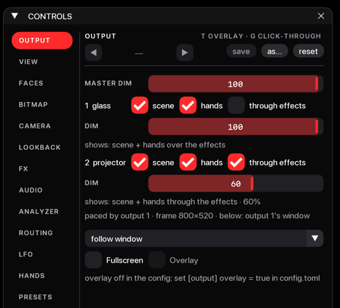
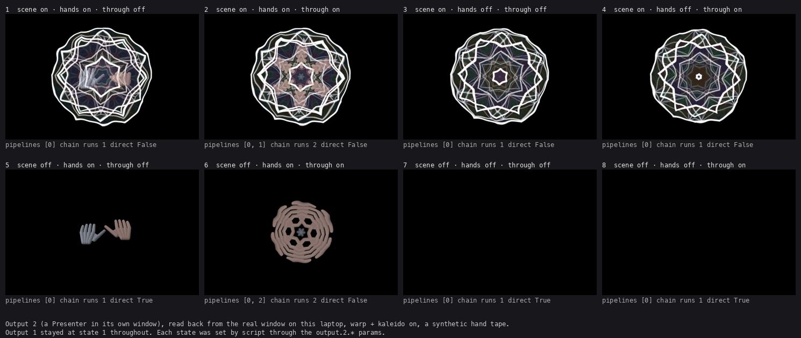
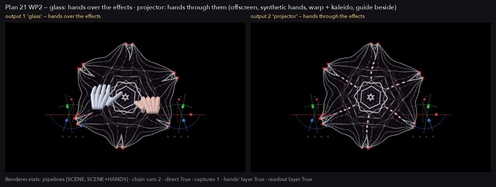
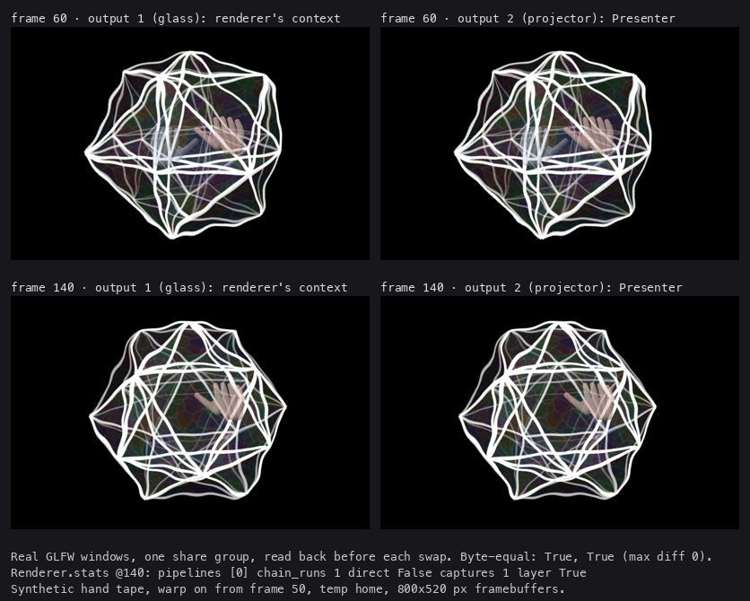
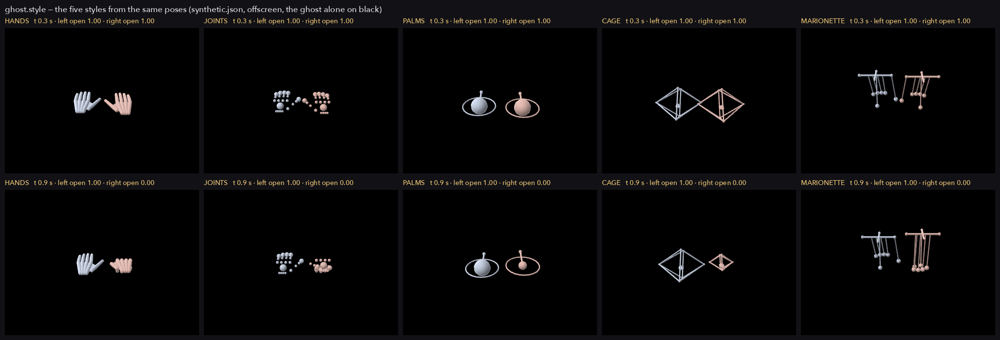
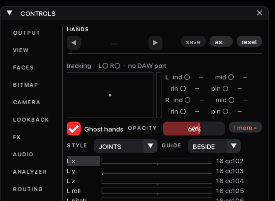

# Plan 21 — Outputs and the hands

This plan lets the app drive up to four render outputs (windows), each
on its own screen with its own switches — the scene on or off, the ghost
hands on or off, the hands over or through the effects, and its own dim
— from one frame drawn once. It also finished the ghost hands: their
failure paths are guarded, the hand settings cannot be ridden by a hand,
and the hands can be drawn in five styles.

Hand checks: [`11-hand-checks.md`](11-hand-checks.md) group Q, checks
99–112. Open decisions: [`DECISION-REGISTER.md`](../DECISION-REGISTER.md)
rows 79–88.

## What was built

### The output list

- **At the machine.** With no `[[output.screens]]` in `config.toml`
  there is one render window, exactly as before. With a list, each entry
  is one render window, opened on its screen in list order. Output 1
  sets the frame's size and paces the loop; the app quits when any
  output window or the control window closes. Keys work in every output
  window; the mouse acts on output 1 only. `windows.json` keeps one rect
  per output in config order (an output not opened keeps its old entry or
  is `null`); an old one-entry file still loads.
- **Code.** `config.SCREEN`, `config._screen`, `config._screens`,
  `config.screens`; `outputs.MAX_OUTPUTS = 4`, `outputs.Slot`,
  `outputs.Presenter`; `app._windows`, `app._later_output`,
  `app._open_presenters`, `app._draw_render`. A later output is an
  `overlay.Output` with no params of its own (overlay stays output 1's).
  `RenderWatch` stalls on "no output presented"; one output dark while
  another presents is a warning naming it; a presenter that raises is
  `output_failed`.
- **Tests.** `test_config.py::test_no_screens_list_is_one_output_as_today`,
  `::test_a_screens_list_wins_over_the_scalar_keys_with_a_note`,
  `::test_a_fifth_screen_is_dropped_with_a_note`,
  `::test_a_config_dim_cannot_launch_an_output_black`,
  `::test_a_ground_or_opacity_that_is_not_a_number_is_the_default_with_a_note`;
  `test_app_boundary.py::test_one_window_per_listed_output`,
  `::test_a_later_output_whose_screen_is_absent_is_not_opened`,
  `::test_the_exits_save_one_rect_per_output`,
  `::test_a_raising_presenter_does_not_stop_the_frame`;
  `test_watchdog.py::test_one_dark_output_of_two_is_a_warning_not_a_stall`.

`[[output.screens]]` keys and their defaults (`config.SCREEN`):

| Key | Default | Meaning |
|---|---|---|
| `name` | `""` | The label on the OUTPUT page and in notes. |
| `monitor` | `-1` | A screen index; −1 is a plain window where it was last. Output 1 always opens (an index no screen has becomes −1, with a note). **A later output whose index no connected screen has is not opened**, with a note and a line on the OUTPUT page. |
| `fullscreen` | `false` | Fullscreen on that screen. The OUTPUT page's monitor and fullscreen controls are output 1's only. |
| `scene` | `true` | Launch value of `output.N.scene`. |
| `hands` | `true` | Launch value of `output.N.hands`. |
| `through` | `false` | Launch value of `output.N.through`. |
| `dim` | `1.0` | Launch value of this output's own dim, times the master's. Under 0.1 is 0.1 and over 1 is 1, with a note. |

Every value of the wrong kind falls back to its default with a note; an
unknown key is a note; a fifth entry, an entry that is not a table, and
an empty or non-list `screens` are each dropped with a note. When the
list is there, `[output] monitor` / `fullscreen` are ignored (one note)
and output 1's entry is used. `overlay`, `on_start`, `passthrough`, `bg`
and `alpha` stay under `[output]` and are output 1's alone; `bg` or
`alpha` that is not a number is the default with a note.

### Per-output switches and the OUTPUT page

- **At the machine.** The OUTPUT page has, under Master dim, a block per
  listed output: its number and name and three ticks — **scene**,
  **hands**, **through effects** — then its **DIM** row, then one line
  only when there is something to say (a present error, "hands: ghost
  hands are off (HANDS page)", "hands: no tracker", "through: no effect
  on"), then "shows: …" in words, in the warning colour when the output
  is black. An output that did not open has a disabled line. With
  several outputs: "paced by output 1 · frame W×H · below: output 1's
  window". With one output there is no DIM of its own: the master dim is
  its dim (unless the config gave it a `dim` under 1). The footer on
  every page names a black output ("· output 2 black") for any reason but
  the master dim.
- **Code.** `overlay.register_switches`: `output.N.scene`, `.hands`,
  `.through` for each opened output N (its place in the list), and
  `output.N.dim` when the config lists two or more outputs or a lone
  entry sets `dim` under 1. Group `output`, labels "Scene" / "Hands" /
  "Hands through effects" (with several outputs the name comes first:
  "Glass scene"). `ui.Panel._output_blocks`, `ui.output_shows`.
- **Saved and not saved.** The `output.N.*` switches are
  `persist=False` and not modulatable: no preset, show or undo step holds
  them, and every launch and every ⌘R starts them from `config.toml`.
  They can be learned onto a desk button like any toggle.
- **Tests.** `test_overlay.py::test_the_output_switches_are_rig_settings`,
  `::test_one_output_has_no_dim_of_its_own`;
  `test_ui_shell.py::test_the_output_page_fits_with_four_outputs_and_overlays_rows`,
  `::test_the_output_page_says_what_each_output_shows`,
  `::test_the_footer_names_a_black_output`;
  `test_undo.py::test_the_output_switches_are_left_alone_by_undo_presets_and_shows`;
  `test_app_boundary.py::test_the_switches_are_registered_from_the_configs_launch_values`.



### The eight states per output

`outputs.route(switches, fx_active, hands_visible)`; "hands shown" is the
output's hands tick, and `ghost.on`, and a hand drawn this frame. The
words are `ui.output_shows`'. With an effect on and a hand shown:

| # | Scene | Hands | Through | Pipeline | Hands laid on after | "shows:" |
|---|---|---|---|---|---|---|
| 1 | on | on | off | SCENE | yes | scene + hands over the effects |
| 2 | on | on | on | SCENE+HANDS | no | scene + hands through the effects |
| 3 | on | off | off | SCENE | no | scene |
| 4 | on | off | on | SCENE | no | scene (same as 3) |
| 5 | off | on | off | none (the ground) | yes | hands |
| 6 | off | on | on | HANDS | no | hands through the effects |
| 7 | off | off | off | none | no | black — nothing switched on |
| 8 | off | off | on | none | no | black — nothing switched on (same as 7) |

With no effect on, or no hand shown, the through tick changes nothing
(2 looks like 1, 6 like 5). With the scene off and no hand shown the
output reads "black — the scene is off and no hand shows". While the
guide or tethers are on and some output sends the hands through an
effect, the guide and tethers' labels are drawn into a layer of their
own (`Ghost.readout`) and laid on every output whose hands tick is on,
so the effects never bend them.





### The frame, as `app._draw_render` and `Renderer.draw_outputs` run it

```text
app._draw_render
 1  output 1's context current; the stranded-framebuffer check; ctx.screen bound
 2  a View per output: output 1 on its window's framebuffer, each later opened
    output with its Presenter and its framebuffer size
 3  renderer.draw_outputs(...)  →  _draw_frame
      once:      the face picture; the scene pass; resolve; the cover; lookback.tick,
                 pull; fx.tick; fx.opaque
                 the hands' layer (Ghost.layer), only if some View's hands tick is on —
                 guarded; split into a readout layer only with an effect on, some
                 output through, and the guide or tethers on
                 route every View (after the layer: "a hand shown" needs it)
      per key:   SCENE, SCENE+HANDS, HANDS, in that order, each once — straight into
                 its View when that View is its only user at the frame size, else into
                 a frame texture; a pipeline that raises leaves its Views on their ground
      once:      lb.capture(scene) — after every pipeline; fx.state.advance_to(t)
                 when an effect is on and no chain ran
      per View:  the picture (nothing | 1:1 | scaled into fit()'s letterbox rect);
                 the hands after; the readout; the dim (master × its own) —
                 or, for a presenter View, a Handoff
      exit:      views[0].target bound with its rect and blending, a raise included
 4  glFlush, only when a later output exists
 5  each later output, in its own try: current, Presenter.present(handoff, size),
    swap; a raise → slot.error and watch.output_failed, the frame goes on
 6  finally: output 1 current and swapped
```

`Renderer.draw` is `draw_outputs` with one default `View` on the bound
framebuffer, so one output is the frame it always was. Output 1's swap
waits for its screen (swap interval 1); later outputs' do not
(interval 0, `app._open_presenters`).

### The presenter hand-off

A later output lives in its own GL context, which shares textures (not
framebuffers or vertex arrays) with the renderer's. `draw_outputs` leaves
it an `outputs.Handoff(frame, frame_size, rect, hands, readout, alpha,
factor, bg_alpha)`. `Presenter.present(handoff, size)` wraps each texture
by its GL name (`ctx.external_texture`) and, in its own context: clears
to `(0, 0, 0, bg_alpha)`; draws the frame into `rect` (1:1 or scaled);
lays the hands, then the readout, into `rect` at `alpha`; and multiplies
by `factor` when it is under 1. Nothing is built before the first
present; after a hot reload it rebuilds in its own context.

- **Tests.** `test_outputs.py::test_route`, `::test_fit`,
  `::test_one_default_output_is_todays_frame_byte_for_byte`,
  `::test_two_outputs_with_the_same_switches_run_the_chain_once`,
  `::test_each_of_the_eight_states_shows_its_picture`,
  `::test_capture_runs_once_a_frame_whatever_the_switches`,
  `::test_the_history_never_holds_the_hands_in_any_state`,
  `::test_two_pipelines_show_the_same_echoes`,
  `::test_four_outputs_need_at_most_three_chain_runs`,
  `::test_each_output_dims_by_master_times_its_own`,
  `::test_an_output_of_another_aspect_is_letterboxed_and_the_hands_stay_registered`,
  `::test_the_presenter_shows_what_a_target_view_shows`,
  `::test_the_presenter_rebuilds_after_a_reload_in_its_own_context`;
  `test_app_boundary.py::test_one_output_draws_the_view_renderer_draw_would`,
  `::test_the_rendering_context_is_flushed_before_a_presenter`.
- **Demo.** `tools/outputs_shots.py` (offscreen, synthetic hands).



### The ghost hands: guards, settings, styles

- **At the machine.** On the HANDS page, under the box, the **Ghost
  hands** tick; while it is on, **OPACITY** and a **more ▸** chip on its
  line, then **STYLE** and **GUIDE** on the next — two lines, each group
  wrapped to the next line rather than drawn over its neighbour when the
  panel is narrower. **more ▸** opens Mirror, Tethers (greyed until a
  guide is on) and the ghost's notes; while it holds a note the chip
  reads **! more ▸** in the warning colour and its hover says it. The
  **STYLE** combo: HANDS (the capsule hands, the default), JOINTS (a bead
  per joint), PALMS (an orb that grows as the hand opens, a ring, a spoke
  where the fingers point), CAGE (a wire octahedron that turns with the
  palm and grows with openness), MARIONETTE (fingertips on strings from a
  bar). Every style behaves like HANDS over and through effects; in the
  four new styles the guide is drawn on top. A hands pass that fails
  leaves the frame without hands, says why on the HANDS page (in **!
  more ▸**, or under the tick with the ghost off), and the dim still
  runs. With the ghost on in screentop or HMD mode **! more ▸** says
  those axes are unmeasured. A bad `[hands] tape` path is a note.
- **Code.** `ghost.STYLES`, `ghost.PARTS`, `ghost.style_parts`,
  `ghost.Geometry.draw` (`CapsuleHands` is the HANDS `Geometry`);
  `Ghost.layer`, `Ghost.composite`, `Ghost.composite_readout`,
  `Ghost.readout`, `Ghost.error`. `ghost.style` is a session param (saved
  with the show) and, like `ghost.mirror`, `ghost.guide` and
  `ghost.tethers`, not modulatable; `ghost.on` and `ghost.alpha` are
  modulatable. `Learn.learn_source` refuses a hand Learn onto a
  non-modulatable param in words ("… can't follow a hand (not
  modulatable) …") and makes no row; `Presets.load_doc` drops a saved
  route onto one with the note `dropped <source> → <target>: not
  modulatable`, without rewriting the file.
- **Tests.** `test_ghost.py::test_every_style_draws_from_the_same_poses`,
  `::test_hands_is_the_old_geometry_byte_for_byte`,
  `::test_a_palm_only_hand_draws_in_every_style`,
  `::test_the_params_are_session_off_by_default_and_learnable`,
  `::test_the_readout_layer_is_the_guide_apart_from_the_hands`,
  `::test_a_failed_target_build_is_all_or_nothing`;
  `test_outputs.py::test_every_style_behaves_as_the_hands_in_every_state`;
  `test_render.py::test_a_raising_hands_pass_still_dims`;
  `test_learn.py::test_a_hand_learn_onto_a_setting_is_refused_in_words`;
  `test_presets.py::test_a_saved_route_onto_a_setting_is_dropped_with_a_note`;
  `test_ui_shell.py::test_the_ghost_style_is_on_the_hands_page_while_the_ghost_is_on`,
  `::test_the_ghost_controls_never_overlap_or_run_off_the_page`,
  `::test_the_ghost_more_popup_has_mirror_and_tethers`,
  `::test_the_hands_page_fits_with_every_ghost_line`;
  `test_hands_tape.py::test_a_bad_tape_path_is_a_note_the_pages_show`.
- **Demo.** `tools/hands_tape.py styles` (offscreen, synthetic hands);
  `tools/ghost_row_shots.py` (the HANDS page from a hidden window, every
  ghost line showing, then **! more ▸** open).





## Not verified by a person

Nothing of this plan has met the glass, the projector, a second screen, a
real hand or the APC40; every picture above is an offscreen render or a
script's read-back. In particular:

- **Frame pacing with two screens has never been observed.** Scripted
  launches ran uncapped (about 270–410 fps) on the old code and the new
  alike, so whether output 1's swap paces the loop and whether later
  outputs tear is unknown (check 107).
- **A screen plugged in after launch is not used until a relaunch**
  (quit, or ⌘R): a later output that did not open stays closed, and
  output 1's −1 stays −1 (check 111, audit P6).
- **What happens when a screen is unplugged mid-run is unknown** beyond
  the watch's warning (check 112).
- The styles at distance with real hands (109), the OUTPUT page clicked,
  a switch learned onto the desk, real fullscreen on two monitors, mixed
  refresh rates, and hot reload of `outputs.py` under a live presenter.

The order to see them in is group Q; see also
[`../TESTING-GUIDE.md`](../TESTING-GUIDE.md).

## Known rough edges

- With no desk connected the app keeps looking for MIDI ports (every
  2 s five times, then every 10 s), and a CoreMIDI client refused during
  a look aborts the process in native code (audit R15).
- A screen plugged in after launch is not picked up (audit P6).
- A hot reload of `render.py` or `ghost.py` may build GL objects in the
  control window's context (audit V8).
- Openness for PALMS and CAGE is calibrated on synthetic hands only.
- Stale code comments: `render.py`'s "captured after the first composite
  of the scene" (the capture is after every pipeline); `ghost.py`'s
  module docstring and `ghost.on`'s tip ("after every effect", now only
  true with through off); `app._open_presenters`' docstring quoting
  "121 fps against 60–81"; `outputs.py`'s module docstring, which lists
  an output's switches without through; `Ghost.readout`'s docstring
  ("only while the guide is on").
