# Plan 22 — The flat shapes in 4D, the face patterns made usable

This plan ran in two streams. **Stream A** gave the seven shapes that
used to sit flat at w = 0 a way to keep their volume through every W
plane: six are lifted into the fourth dimension and the Heart stays 3D
with its W planes folded onto 3D ones. It also added a 26th shape, the
Klein bottle, built in 4D from the start. **Stream B** gave the eight
pattern inputs one meaning across every pattern, gave the FACES page a
module of its own, and prepared macro candidates to audition.

Hand checks: [`11-hand-checks.md`](11-hand-checks.md) group R, checks
113–119 (Stream A). Open decisions:
[`DECISION-REGISTER.md`](../DECISION-REGISTER.md) rows 89–97 (Stream A).
Branch `plan-22-integration`; the work packages were PRs #139 (A1), #143
(A2), #145 (A3), #142 (A5), and #140 (B1), #144 (B2), #141 (B5).

## Stream A — the flat shapes get real 4D extent

### Why they collapsed

Shapes 19–25 (Heart to Möbius strip, indices 18–24) were built by
`ring_prism` / `curve_prism` (Heart, Star), `polar_prism` (Rose),
`param_surface` (Torus, Möbius strip), `tube` (Trefoil knot) and
`spherical_surface` (Starfruit). All of them ended in `_mesh3`, which
placed every point at w = 0. A quarter turn of XW, YW or ZW carries a
whole axis into w, and the 4D→3D divide drops it, so at 90° and 270° of
each W plane the shape drew as a plane. The bass bands drive those three
planes (`bands.BANDS`: SUB → ZW, BASS → XW, MIDB → YW), so with music
playing it happened all the time.

`Shape.cells == 0` does not mean "3D": it means "a surface, not a
polytope". The Clifford torus (shape 18) has cells 0 and has always been
a native 4D surface; it never collapsed and was the reference to beat.

### The four-coordinate surface path (A1)

- **At the machine.** Nothing changes by itself: a shape built without a
  lift draws exactly what it drew before, vertex for vertex. A1 is the
  machinery A2 and A3 use.
- **Code.** Every builder takes an optional lift `w` of its own
  parameters and passes it down to `_mesh3`, which now takes 3- or
  4-tuples (a 3-tuple is placed at w = 0) and merges coincident points on
  every coordinate given:

  | Builder | Lift signature |
  |---|---|
  | `param_surface(fn, nu, nv, …, w=None)` | `w(u, v)`; `fn` may instead return four coordinates itself |
  | `spherical_surface(r_fn, …, w=None)` | `w(θ, φ)`; a pole stays one vertex only where `w` does not depend on θ there |
  | `ring_prism(pts, depth, …, w=None, t1=2π)` | `w(t, z)`: t = t1·k/n for outline point k, z = ±depth/2 the cap |
  | `curve_prism(xy_fn, …, w=None)`, `polar_prism(r_fn, …, w=None)` | `w(t, z)` / `w(θ, z)`, as `ring_prism` |
  | `tube(curve_fn, n, m, radius, w=None)` | `w(t, a)`: t along the curve, a = 2π·j/m round the tube (before the holonomy unwind) |

  `Shape.w` says how each shape fills the fourth dimension, one of
  `geometry.W_KINDS`: `native` (a 4-polytope or 4D surface: shapes 1–18),
  `flat` (a 3D shape at w = 0 — what shapes 19–25 were; no shape ships
  flat now, the tests use it to show the bug), `lift` (given w-extent by
  a lift) and `mask` (kept 3D; its W planes are folded). Any other value
  raises.
- **The W fold.** For a `mask` shape, `geometry.view_angles(i, ang)`
  returns a new angle list with each W plane's angle added onto a 3D
  plane (`W_REMAP`: XW → XZ, YW → YZ, ZW → XY) and the W planes at 0;
  for every other shape it returns `ang` itself.
  `Renderer.draw_scene` is the one call site. The integrator, `ang` and
  every `rot.*` param are untouched, so a rate route and a phase route
  on a W plane both land on the 3D plane. With the remap, SUB (ZW) rolls
  a masked shape in the screen plane, BASS (XW) spins it about y, and
  MIDB (YW) tumbles it about x. A masked shape's depth cue (the line
  fade, width and draw order, `pd`) reads its depth toward the 3D camera
  (`geometry.view_depth`: z after the camera's yaw and pitch) instead of
  w, which is 0 at every angle and would leave it at the cue's dimmest.
- **Measures.** `project3` (the rotated, divided 3D cloud the camera
  views), `volume_ratio` (the cloud's smallest singular value over its
  largest, centred: 1 a ball, 0 a plane or a line), `sweep_ratios(i,
  plane, steps=72, pose=None)`, `edge_on_share` and `sweep_edge_on` (the
  share of face area drawn at under a tenth of its 4D area), and
  `VOLUME_FLOOR = 0.15`. The sweeps go through `view_angles`, as the
  renderer does.
- **The floor.** Calibrated on the 18 shapes that already work, not
  picked. Each 4D shape's worst ratio through a full turn of each W
  plane, from rest and from `GENERIC_POSE`: cubic pyramid 0.30,
  4,8-duoprism 0.53, dodecahedral prism 0.64, 5-cell 0.65, tesseract
  0.94, Clifford torus 0.97, 24-cell 1.00, 120-cell and 600-cell 1.00.
  Single-plane sweeps reach the same worst case as 2000 random poses of
  all six planes. The floor is half the worst (the cubic pyramid), so a
  surface is never asked to be rounder than a polytope already is.
- **The turntable.** `tools/turntable.py` sweeps each W plane alone
  through a full turn, from rest and from `GENERIC_POSE`, and writes
  `<prefix>-ratios.json` / `.csv` (the minimum ratio and the maximum
  edge-on share per shape, plane and pass, with the angle) and, unless
  `--no-png`, one sheet per shape: three rows (XW, YW, ZW) of twelve
  tiles drawn by the real renderer offscreen, each labelled with its
  angle and ratio, red below the floor. Options: `--prefix`, `--shapes`
  (`18-24`, `17,21`), `--steps` (72 = 5°), `--frames`, `--no-png`.
- **Tests.** `tests/test_shapes4d.py`:
  `::test_every_shape_draws_what_it_drew_before_the_lift_existed`
  (a digest of every shape's V, E, faces, triangles and UVs, floats
  rounded to 1e-9, in `tests/golden/shape_digests.json`),
  `::test_mesh3_carries_a_fourth_coordinate_when_given_one`,
  `::test_a_lift_keeps_the_surface_and_its_faces_and_adds_w`,
  `::test_every_builder_takes_a_lift_of_its_own_parameters`,
  `::test_the_mobius_seam_welds_only_under_a_lift_that_agrees_across_it`,
  `::test_a_shape_says_how_it_fills_w`,
  `::test_no_shape_but_a_masked_one_has_its_angles_touched`,
  `::test_a_masked_shape_turns_in_3d_where_its_w_planes_would_have_turned_it`,
  `::test_the_renderer_draws_a_masked_shape_through_view_angles`,
  `::test_the_volume_ratio_reads_a_box_by_its_proportions`,
  `::test_the_edge_on_share_counts_the_face_area_turned_into_w`,
  `::test_project3_is_the_first_half_of_project_h`,
  `::test_a_flat_shape_collapses_at_a_quarter_turn_of_each_w_plane`,
  `::test_every_4d_shape_clears_the_volume_floor`,
  `::test_masking_a_flat_surface_lifts_it_over_the_floor`.

The golden traces cover shapes 1–18 (the 17 polytopes and the Clifford
torus) and none of the surfaces; all 18 stayed byte-exact, which is the
tripwire that the 4D shapes were not touched.

### The seven shapes (A2)

- **At the machine.** Step to any of shapes 19–25 and let the music
  turn it: none of them goes flat any more. The six lifted shapes tumble
  through the fourth dimension like the Clifford torus does — they bend,
  saddle and swap sides as XW, YW and ZW turn. The Heart turns as a solid
  heart prism in 3D, and the bass bands still move it. On the VIEW page
  a lifted shape's alias reads "4D lift · …"; the Heart keeps "3D · …".
- **Code.** Each builder's lift is in `geometry.py` (`_build_star`,
  `_build_rose`, `_build_torus3`, `_build_trefoil`, `_build_starfruit`,
  `_build_mobius`), with the rules that choose a lift written above
  `_build_heart`. `Shape("Heart", …, w="mask")`; the other six `w="lift"`.
  The Rose is a little deeper (0.12 → 0.16) and the Möbius band a little
  wider (0.45 → 0.55). `_face_xy` frames a non-planar polygon with more
  than four corners (the Star's caps, which its lift bends through w) by
  its least-squares plane; every planar face keeps the basis it had.
- **Tests.** `tests/test_shapes4d.py::test_a_lifted_or_masked_shape_keeps_its_volume_through_each_w_plane`
  (Stream A's acceptance, parametrised on `Shape.w`: every lifted or
  masked shape stays at or over the floor through each W plane, from
  rest and from a generic pose),
  `::test_a_lifted_or_masked_shape_never_turns_much_of_itself_edge_on`
  (at most 0.15 of the face area edge-on),
  `::test_every_shape_past_the_polytopes_is_lifted_or_masked` (so
  neither gate can pass on an empty list),
  `::test_a_lifted_cap_is_triangulated_over_its_own_outline`;
  `tests/test_shapes3d.py::test_shape3d_valid` (a lifted shape has
  w-extent, a masked one w = 0),
  `::test_shape3d_faces`, `::test_mobius_seam_merges`,
  `::test_rose_pinches_at_origin`.

The lift rules (the comment above `_build_heart`):

- **No linear part of x, y or z.** A lift such as w = x/2 only tilts the
  shape into another flat 3-space, which some W turn still flattens (on
  the Rose it still read 0.000).
- **Odd under each single-axis mirror of the shape.** At a quarter turn
  of a W plane, w takes that axis's place; a lift that is the same on
  both sides of the mirror folds the two halves onto each other, 2 to 1,
  into a sheet that neither the volume ratio nor the edge-on share sees
  (the torus under cos v read as a bowl, the starfruit under cos 2φ as a
  sombrero).
- **An extruded outline's lift depends on z.** Otherwise every wall,
  extruded along z alone, goes edge-on at once when ZW turns z away.
- **It agrees wherever the surface welds**: the poles, the Rose's pinch,
  the Möbius seam (w(2π, 1 − v) = w(0, v)).

A lift cannot make a shape fatter than its own 3D proportions: at rest
the divide drops w. That is why the Rose and the Möbius band changed
size.

| # | Shape | `Shape.w` | Lift (or change) | Min ratio XW / YW / ZW, before → after | Max edge-on, before → after | V / E / F / triangles |
|---|---|---|---|---|---|---|
| 19 | Heart | mask | — (W planes folded: XW → XZ, YW → YZ, ZW → XY) | 0.000 → 0.401 / 0.401 / 0.401 | 0.37 → 0.00 | 128 / 192 / 66 / 252 |
| 20 | Star | lift | w = 0.6·(z/h)·sin t, h = 0.175 | 0.000 → 0.310 / 0.309 / 0.310 | 0.46 → 0.14 | 20 / 30 / 12 / 36 |
| 21 | Rose | lift | w = z·(3 sin 4θ + sin 8θ); depth 0.12 → 0.16 | 0.000 → 0.157 / 0.157 / 0.157 | 0.56 → 0.05 | 186 / 285 / 96 / 192 |
| 22 | Torus | lift | w = 0.7·sin v·sin 2u | 0.000 → 0.432 / 0.431 / 0.432 | 0.14 → 0.03 | 512 / 1024 / 512 / 1024 |
| 23 | Trefoil knot | lift | w = 1.5·cos 3t | 0.000 → 0.656 / 0.658 / 0.656 | 0.11 → 0.02 | 576 / 1152 / 576 / 1152 |
| 24 | Starfruit | lift | w = 0.6·sin 2φ·sin 2θ | 0.000 → 0.456 / 0.490 / 0.459 | 0.22 → 0.03 | 522 / 1080 / 560 / 1040 |
| 25 | Möbius strip | lift | w = 0.5·sin 2u; width 0.45 → 0.55 | 0.000 → 0.163 / 0.179 / 0.179 | 0.21 → 0.08 | 320 / 576 / 256 / 512 |
| 26 | Klein bottle | lift | w = sin 2u + ½·sin v·cos 2u (new, A3) | — → 0.199 / 0.207 / 0.207 | — → 0.06 | 576 / 1152 / 576 / 1152 |

`#` is the slider number (index + 1). Ratios are the worst of the rest
and generic-pose sweeps, 72 steps, from
`assets/22-flat-shapes/after-ratios.csv`; "before" every one of the
seven read 0.000 at 90° and 270° in every W plane. V, E, faces and
triangles did not change for any of the seven; the Möbius seam, the
Rose's pinch and the Starfruit's poles still weld.

Why each:

- **Heart — masked.** Every lift tried read as a twisted ribbon or a
  bow-tie at XW / YW 60–120° and 240–300°; the best one,
  z·(sin t + 2 sin 2t + 2 sin 3t), reached ratio 0.376 and turned at most
  0.11 of its face area edge-on — inside both gates, so it was the look
  that ruled it out, not a number. Masked, it keeps its own 3D
  proportions (0.401) and turns as a solid heart prism.
- **Star — lifted.** Its two caps tip opposite ways in w round the
  outline. At XW 90° and 270° it becomes a box, a lantern of its walls.
- **Rose — lifted, and a little deeper.** It was a seventh flat shape the
  brief did not list; the orchestrator added it (the owner did not). Its
  own 3D ratio at depth 0.12 was 0.118, under the floor, and no lift can
  raise that at rest; depth 0.16 is the smallest change that clears it
  (0.157, a 5% margin).
- **Torus, Trefoil knot, Starfruit — lifted.** Clear the floor with room
  (0.43, 0.66, 0.46).
- **Möbius strip — lifted, and a little wider.** The band's thin y
  limits any lift (at width 0.45, the same lift, 0.5·sin 2u, keeps only
  0.134, XW from rest). The other way
  was to mask it at 0.45 (0.158, no geometry change); it was lifted so
  the strip is truly 4D beside the Klein bottle.

### The Klein bottle (A3)

- **At the machine.** Shape 26, after the Möbius strip: "KLEIN BOTTLE",
  "4D · one-sided bottle, no self-crossing", "576V 1152E · χ=0 · one
  side". In 3D a Klein bottle must pass through itself where its neck
  enters its body. Lifted into w, the neck passes beside the body and
  never through it, through every turn of every plane. The desk's cue
  knob, ← / →, the pad's LB / RB and the VIEW page's shape list all reach
  it and stop there; they read the shape count from `SHAPES`.
- **Code.** `geometry._klein_xyz(u, v)`, the classic "bottle"
  immersion, u ∈ [0, π], v ∈ [0, 2π); `_build_klein` lifts it by
  w = sin 2u + ½·sin v·cos 2u and centres it on its bounding box.
  sin 2u holds the two sheets that cross in 3D (the body at u ≈ 0.49,
  the neck at u ≈ 2.56) at least 1.56 apart in w, about 0.37 of the
  bottle's height of 4.2. ½·sin v·cos 2u is odd in v, so the z-mirror
  cannot fold the surface at a quarter turn of ZW. The seam u = π meets
  u = 0 with v flipped to π − v, where both terms agree, and welds by
  `kkey` as the Möbius strip's does. 37 × 16 samples give 36 × 16
  vertices. `Shape("Klein bottle", …, w="lift")`.
- **Numbers.** V 576, E 1152, F 576 quads, 1152 triangles; every edge on
  exactly two faces; V − E + F = 0. Its own 3D ratio is 0.231; through
  the W planes 0.199 / 0.207 / 0.207 (unlifted, 0.000 at 90°); max
  edge-on 0.04 / 0.06 / 0.06. Within the renderer's 600 V / 1200 E
  envelope.
- **Tests.** `tests/test_shapes3d.py::test_the_klein_bottle_is_appended_after_the_mobius_strip`,
  `::test_the_klein_bottle_seam_welds_into_a_closed_grid`,
  `::test_the_klein_bottle_crosses_itself_in_3d_and_not_in_4d`; the
  Stream A acceptance tests above take it in through `Shape.w`;
  `tests/test_golden.py::test_the_engineering_table_matches_the_code`
  (26 rows).

### The sheets

Each sheet is one shape: rows XW, YW, ZW, twelve tiles across a full
turn from rest, drawn offscreen by the real renderer with faces on. A
red label is a tile under the floor. Before, every flat shape went red
at 90° and 270° in every row. All of them, the 18 4D shapes included,
are in [`assets/22-flat-shapes/`](assets/22-flat-shapes/), with
`before-ratios.*` (shapes 1–25) and `after-ratios.*` (all 26).

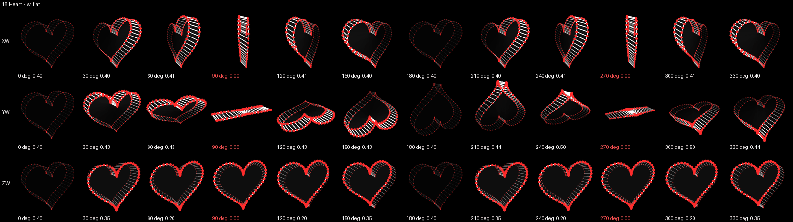
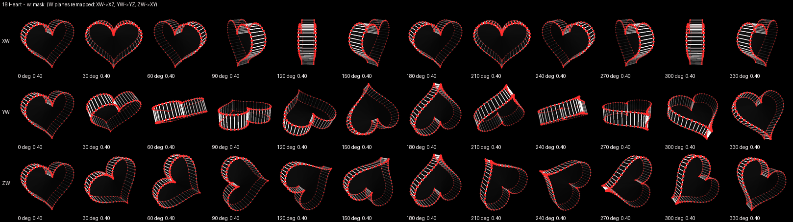
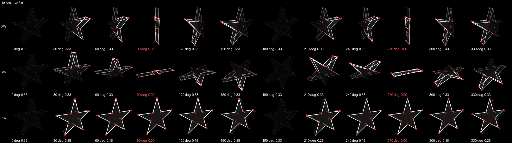
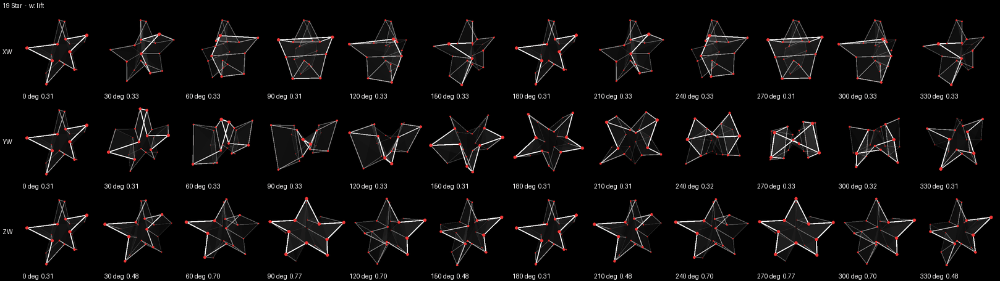
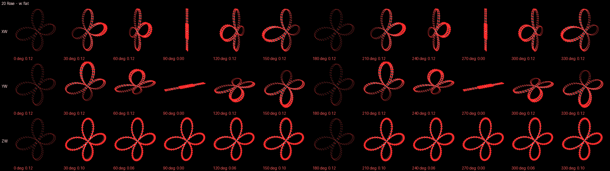
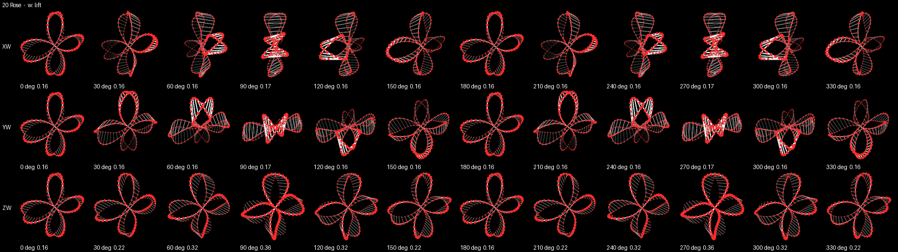
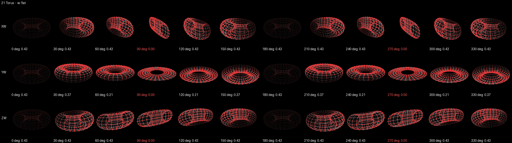
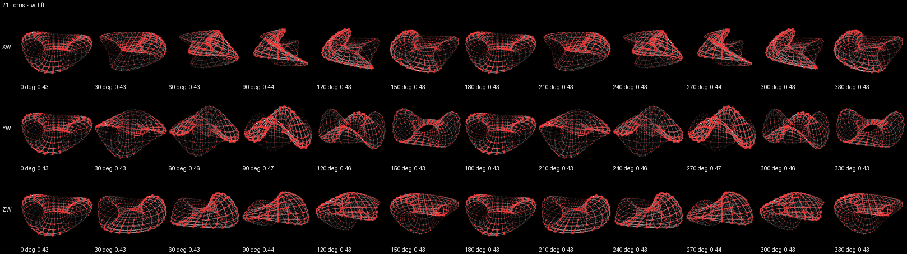
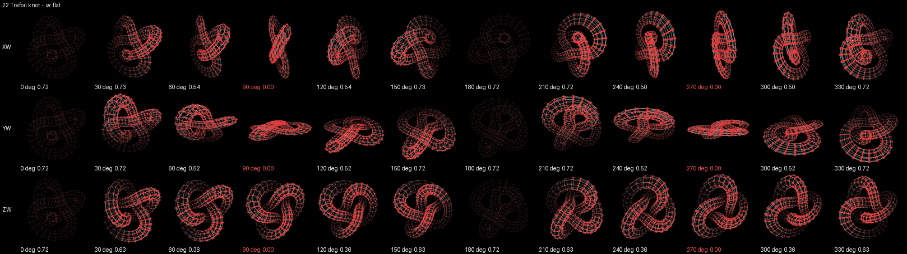
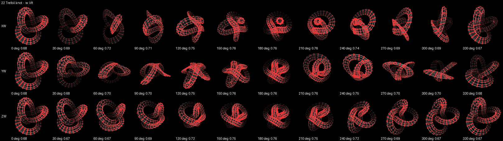
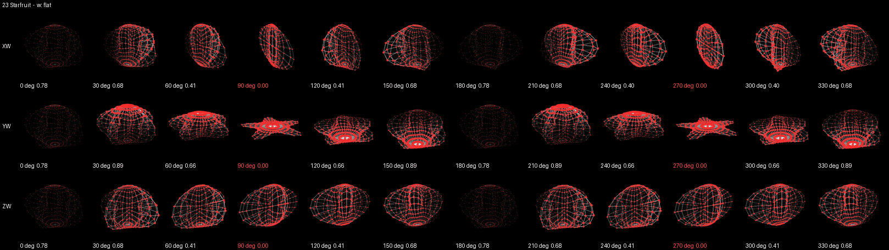
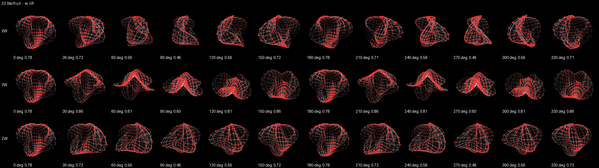
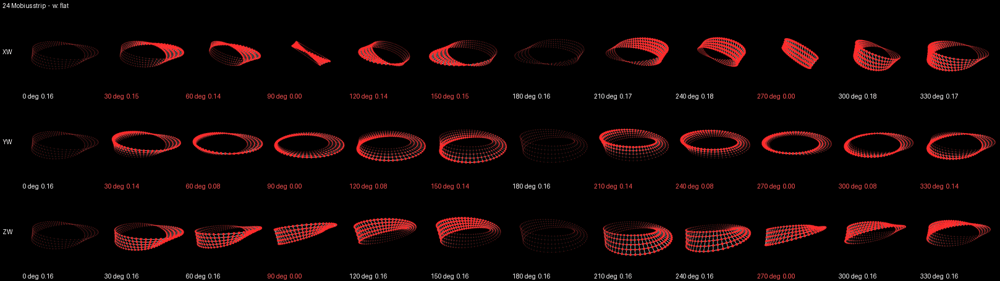
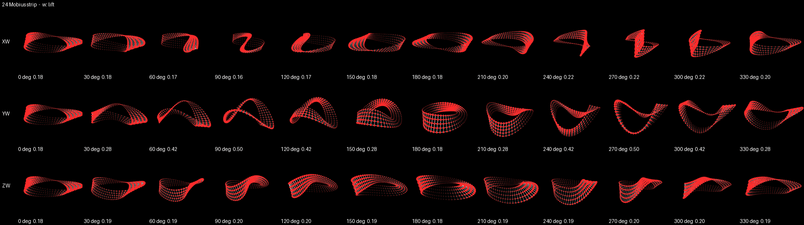
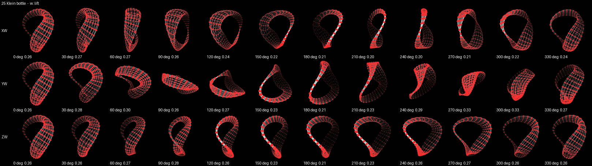
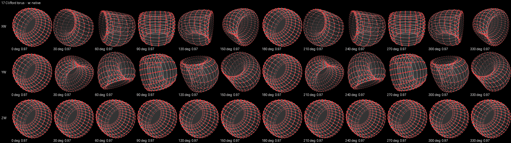

### The shortlist of new 4-polytopes (A5, deferred)

[`22-polytope-shortlist.md`](22-polytope-shortlist.md) ranks the
second-tier 4-polytopes by what each would cost to add. It is an
assessment only: nothing from it is in `SHAPES`, and the owner picks
what gets built in a later plan. It recommends the snub 24-cell, the
rectified 24-cell, the 5-cell family through one helper (bitruncated and
omnitruncated 5-cell first) and the grand antiprism. The star polytopes
all need explicit faces, and the four with pentagram faces would
stress `_mesh3`'s simple-planar-polygon assumption, the same weak spot
as the lifted Star's caps.

## Stream B — the face patterns made usable

*To be written by the Stream B docs work package (B4): the mod
convention per index (B1), the FACES page (B2), the patterns themselves
(B3), and the macro candidates
([`22-macro-candidates.md`](22-macro-candidates.md), B5). Its hand checks
continue group R after check 119; its register rows continue after
row 97.*

## Not verified by a person

Nothing of Stream A has been seen on the glass, the projector or with
music through the real analyzer; every picture above is an offscreen
render, and every number a sweep of one W plane at a time. In
particular:

- **Whether each lifted shape reads as a solid when it tumbles**: the
  volume ratio and the edge-on share were the gate, and a person has not
  looked (check 113).
- **Whether the masked Heart reads as moving under all three bass
  bands**: BASS (XW) becomes a spin about y, which turns the heart
  side-on; SUB (ZW) becomes a roll in the screen plane (check 114).
- **The Star's lantern, the Starfruit's ridges, the Rose's delicacy and
  the Möbius strip's width** are judgements, not measurements (check
  115).
- **Whether the Klein bottle reads as a bottle at rest.** To the
  orchestrator it read more like a curled horn or a loop than the
  textbook bottle (check 116).
- **The cue knob and the keys reaching shape 26** on the real desk
  (check 117).
- **The presets that show a changed shape** (check 118): factory
  `plasma-heart` (Heart), `spiral-silk` (Trefoil knot) and `inverse-halo`
  (Starfruit), and the owner's shared `hi-frek-variation-1` and
  `light-realm-variation-1` (Möbius strip).

The order to see them in is group R; see also
[`../TESTING-GUIDE.md`](../TESTING-GUIDE.md).

## Known rough edges

- **The W planes' readouts still count on a masked shape.** On the
  Heart, the VIEW page's XW key, `rot.phase.XW` and the ROUTING page go
  on showing XW turning while the picture turns in XZ; nothing on the
  page says the planes are folded.
- **BASS on a masked shape is a spin about y.** The remap sends XW to
  XZ. On the Heart that turns the heart side-on, which the sheet shows
  clearly; on a shape that is round about y (the Torus, the Starfruit),
  were one ever masked, it would barely show. The Hodge-dual remap
  (XW → YZ, YW → XZ, ZW → XY) was the other choice (row 90).
- **A lift cannot fatten a thin shape**, so the Rose (0.157) and the
  Möbius strip (0.163) clear the floor by little; both changed size to
  do it.
- **The Starfruit's five ridges are softened at rest** by the lift's
  perspective; the Star becomes a box at XW 90° and 270°.
- **The Klein bottle's neck is sparse at some angles** (36 × 16 grid).
- **The edge-on gate is a little under the 4D shapes' own worst.**
  `test_a_lifted_or_masked_shape_never_turns_much_of_itself_edge_on`
  holds every lifted or masked shape to 0.15; the cubic pyramid reaches
  0.155 and the 3,3-duoprism 0.167, so two polytopes would not pass it.
  The Star, at 0.139, is the gated shape closest to it.
- **`Shape.w == "flat"` is used by no shape.** It stays in `W_KINDS` so
  the tests can show the collapse and so a future 3D shape can be added
  honestly.
