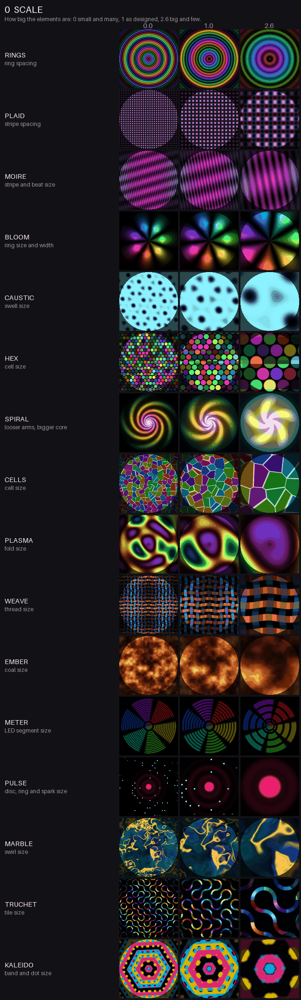
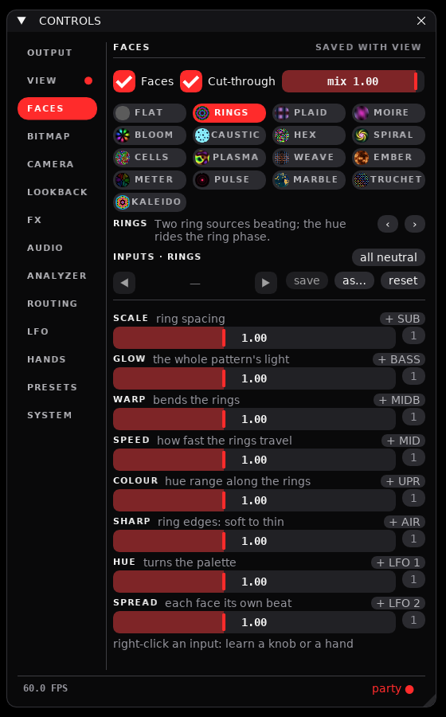
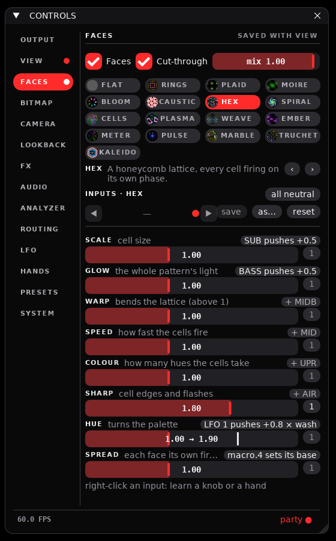
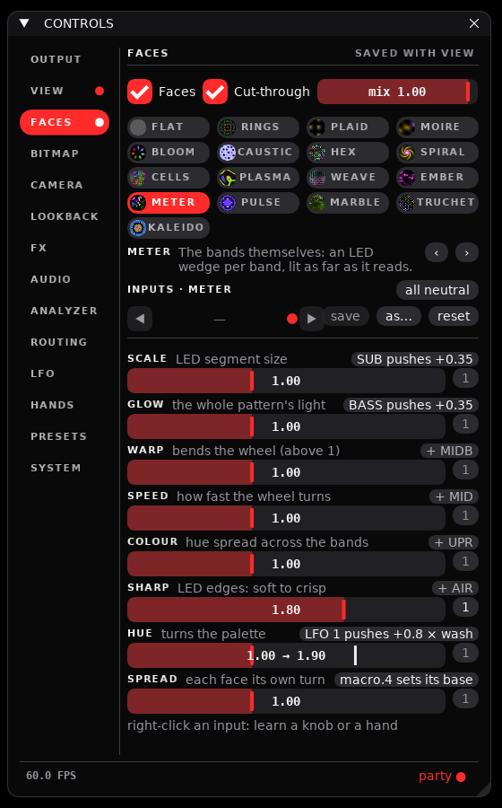
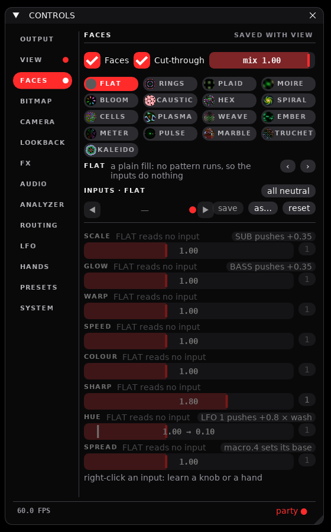
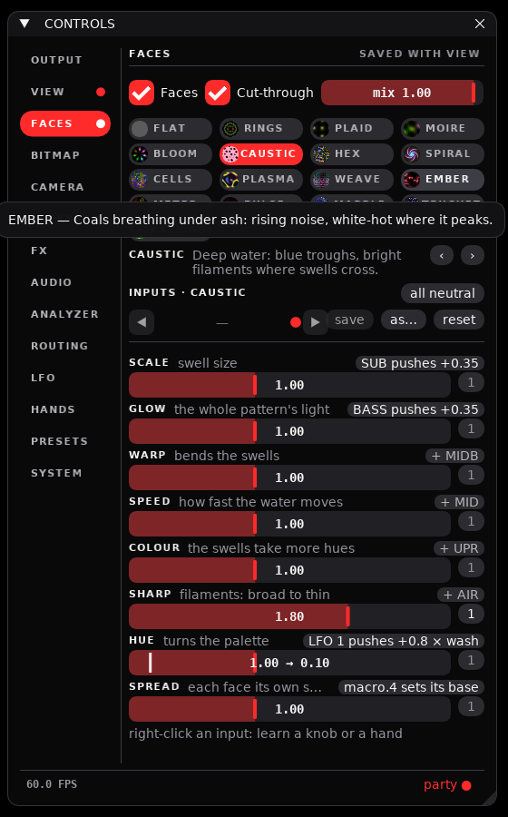
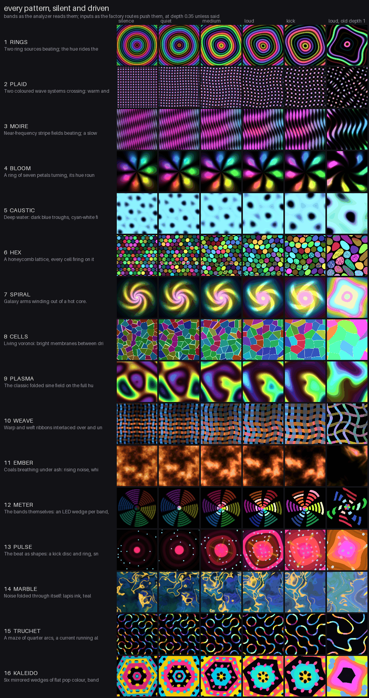

# Plan 22 — The flat shapes in 4D, the face patterns made usable

This plan ran in two streams. **Stream A** gave the seven shapes that
used to sit flat at w = 0 a way to keep their volume through every W
plane: six are lifted into the fourth dimension and the Heart stays 3D
with its W planes folded onto 3D ones. It also added a 26th shape, the
Klein bottle, built in 4D from the start. **Stream B** gave the eight
face-pattern inputs one meaning each across every pattern — SCALE, GLOW,
WARP, SPEED, COLOUR, SHARP, HUE, SPREAD — so one routing set reads the
same on every pattern; gave the FACES page a module of its own, a
browser of live swatches where each input says what it does and what
drives it; added five patterns (seventeen in all), two of which draw the
bands themselves; lowered the factory pattern routes to a depth that
reads on loud music; and prepared four presets of macro candidates for
the owner to audition.

Hand checks: [`11-hand-checks.md`](11-hand-checks.md) group R, checks
113–119 (Stream A) and 120–138 (Stream B). Open decisions:
[`DECISION-REGISTER.md`](../DECISION-REGISTER.md) rows 89–97 (Stream A)
and 98–108 (Stream B). Branch `plan-22-integration`; the work packages
were PRs #139 (A1), #143 (A2), #145 (A3), #142 (A5), and #140 (B1), #144
(B2), #147 (B3), #141 (B5).

## Stream A — the flat shapes get real 4D extent

### Why they collapsed

Shapes 19–25 (Heart to Möbius strip, indices 18–24) were built by
`ring_prism` / `curve_prism` (Heart, Star), `polar_prism` (Rose),
`param_surface` (Torus, Möbius strip), `tube` (Trefoil knot) and
`spherical_surface` (Starfruit). All of them ended in `_mesh3`, which
placed every point at w = 0. A quarter turn of XW, YW or ZW carries a
whole axis into w, and the 4D→3D divide drops it, so at 90° and 270° of
each W plane the shape drew as a plane. The bass bands drive those three
planes (`bands.BANDS`: SUB → ZW, BASS → XW, MIDB → YW), so with music
playing it happened all the time.

`Shape.cells == 0` does not mean "3D": it means "a surface, not a
polytope". The Clifford torus (shape 18) has cells 0 and has always been
a native 4D surface; it never collapsed and was the reference to beat.

### The four-coordinate surface path (A1)

- **At the machine.** Nothing changes by itself: a shape built without a
  lift draws exactly what it drew before, vertex for vertex. A1 is the
  machinery A2 and A3 use.
- **Code.** Every builder takes an optional lift `w` of its own
  parameters and passes it down to `_mesh3`, which now takes 3- or
  4-tuples (a 3-tuple is placed at w = 0) and merges coincident points on
  every coordinate given:

  | Builder | Lift signature |
  |---|---|
  | `param_surface(fn, nu, nv, …, w=None)` | `w(u, v)`; `fn` may instead return four coordinates itself |
  | `spherical_surface(r_fn, …, w=None)` | `w(θ, φ)`; a pole stays one vertex only where `w` does not depend on θ there |
  | `ring_prism(pts, depth, …, w=None, t1=2π)` | `w(t, z)`: t = t1·k/n for outline point k, z = ±depth/2 the cap |
  | `curve_prism(xy_fn, …, w=None)`, `polar_prism(r_fn, …, w=None)` | `w(t, z)` / `w(θ, z)`, as `ring_prism` |
  | `tube(curve_fn, n, m, radius, w=None)` | `w(t, a)`: t along the curve, a = 2π·j/m round the tube (before the holonomy unwind) |

  `Shape.w` says how each shape fills the fourth dimension, one of
  `geometry.W_KINDS`: `native` (a 4-polytope or 4D surface: shapes 1–18),
  `flat` (a 3D shape at w = 0 — what shapes 19–25 were; no shape ships
  flat now, the tests use it to show the bug), `lift` (given w-extent by
  a lift) and `mask` (kept 3D; its W planes are folded). Any other value
  raises.
- **The W fold.** For a `mask` shape, `geometry.view_angles(i, ang)`
  returns a new angle list with each W plane's angle added onto a 3D
  plane (`W_REMAP`: XW → XZ, YW → YZ, ZW → XY) and the W planes at 0;
  for every other shape it returns `ang` itself.
  `Renderer.draw_scene` is the one call site. The integrator, `ang` and
  every `rot.*` param are untouched, so a rate route and a phase route
  on a W plane both land on the 3D plane. With the remap, SUB (ZW) rolls
  a masked shape in the screen plane, BASS (XW) spins it about y, and
  MIDB (YW) tumbles it about x. A masked shape's depth cue (the line
  fade, width and draw order, `pd`) reads its depth toward the 3D camera
  (`geometry.view_depth`: z after the camera's yaw and pitch) instead of
  w, which is 0 at every angle and would leave it at the cue's dimmest.
- **Measures.** `project3` (the rotated, divided 3D cloud the camera
  views), `volume_ratio` (the cloud's smallest singular value over its
  largest, centred: 1 a ball, 0 a plane or a line), `sweep_ratios(i,
  plane, steps=72, pose=None)`, `edge_on_share` and `sweep_edge_on` (the
  share of face area drawn at under a tenth of its 4D area), and
  `VOLUME_FLOOR = 0.15`. The sweeps go through `view_angles`, as the
  renderer does.
- **The floor.** Calibrated on the 18 shapes that already work, not
  picked. Each 4D shape's worst ratio through a full turn of each W
  plane, from rest and from `GENERIC_POSE`: cubic pyramid 0.30,
  4,8-duoprism 0.53, dodecahedral prism 0.64, 5-cell 0.65, tesseract
  0.94, Clifford torus 0.97, 24-cell 1.00, 120-cell and 600-cell 1.00.
  Single-plane sweeps reach the same worst case as 2000 random poses of
  all six planes. The floor is half the worst (the cubic pyramid), so a
  surface is never asked to be rounder than a polytope already is.
- **The turntable.** `tools/turntable.py` sweeps each W plane alone
  through a full turn, from rest and from `GENERIC_POSE`, and writes
  `<prefix>-ratios.json` / `.csv` (the minimum ratio and the maximum
  edge-on share per shape, plane and pass, with the angle) and, unless
  `--no-png`, one sheet per shape: three rows (XW, YW, ZW) of twelve
  tiles drawn by the real renderer offscreen, each labelled with its
  angle and ratio, red below the floor. Options: `--prefix`, `--shapes`
  (`18-24`, `17,21`), `--steps` (72 = 5°), `--frames`, `--no-png`.
- **Tests.** `tests/test_shapes4d.py`:
  `::test_every_shape_draws_what_it_drew_before_the_lift_existed`
  (a digest of every shape's V, E, faces, triangles and UVs, floats
  rounded to 1e-9, in `tests/golden/shape_digests.json`),
  `::test_mesh3_carries_a_fourth_coordinate_when_given_one`,
  `::test_a_lift_keeps_the_surface_and_its_faces_and_adds_w`,
  `::test_every_builder_takes_a_lift_of_its_own_parameters`,
  `::test_the_mobius_seam_welds_only_under_a_lift_that_agrees_across_it`,
  `::test_a_shape_says_how_it_fills_w`,
  `::test_no_shape_but_a_masked_one_has_its_angles_touched`,
  `::test_a_masked_shape_turns_in_3d_where_its_w_planes_would_have_turned_it`,
  `::test_the_renderer_draws_a_masked_shape_through_view_angles`,
  `::test_the_volume_ratio_reads_a_box_by_its_proportions`,
  `::test_the_edge_on_share_counts_the_face_area_turned_into_w`,
  `::test_project3_is_the_first_half_of_project_h`,
  `::test_a_flat_shape_collapses_at_a_quarter_turn_of_each_w_plane`,
  `::test_every_4d_shape_clears_the_volume_floor`,
  `::test_masking_a_flat_surface_lifts_it_over_the_floor`.

The golden traces cover shapes 1–18 (the 17 polytopes and the Clifford
torus) and none of the surfaces; all 18 stayed byte-exact, which is the
tripwire that the 4D shapes were not touched.

### The seven shapes (A2)

- **At the machine.** Step to any of shapes 19–25 and let the music
  turn it: none of them goes flat any more. The six lifted shapes tumble
  through the fourth dimension like the Clifford torus does — they bend,
  saddle and swap sides as XW, YW and ZW turn. The Heart turns as a solid
  heart prism in 3D, and the bass bands still move it. On the VIEW page
  a lifted shape's alias reads "4D lift · …"; the Heart keeps "3D · …".
- **Code.** Each builder's lift is in `geometry.py` (`_build_star`,
  `_build_rose`, `_build_torus3`, `_build_trefoil`, `_build_starfruit`,
  `_build_mobius`), with the rules that choose a lift written above
  `_build_heart`. `Shape("Heart", …, w="mask")`; the other six `w="lift"`.
  The Rose is a little deeper (0.12 → 0.16) and the Möbius band a little
  wider (0.45 → 0.55). `_face_xy` frames a non-planar polygon with more
  than four corners (the Star's caps, which its lift bends through w) by
  its least-squares plane; every planar face keeps the basis it had.
- **Tests.** `tests/test_shapes4d.py::test_a_lifted_or_masked_shape_keeps_its_volume_through_each_w_plane`
  (Stream A's acceptance, parametrised on `Shape.w`: every lifted or
  masked shape stays at or over the floor through each W plane, from
  rest and from a generic pose),
  `::test_a_lifted_or_masked_shape_never_turns_much_of_itself_edge_on`
  (at most 0.15 of the face area edge-on),
  `::test_every_shape_past_the_polytopes_is_lifted_or_masked` (so
  neither gate can pass on an empty list),
  `::test_a_lifted_cap_is_triangulated_over_its_own_outline`;
  `tests/test_shapes3d.py::test_shape3d_valid` (a lifted shape has
  w-extent, a masked one w = 0),
  `::test_shape3d_faces`, `::test_mobius_seam_merges`,
  `::test_rose_pinches_at_origin`.

The lift rules (the comment above `_build_heart`):

- **No linear part of x, y or z.** A lift such as w = x/2 only tilts the
  shape into another flat 3-space, which some W turn still flattens (on
  the Rose it still read 0.000).
- **Odd under each single-axis mirror of the shape.** At a quarter turn
  of a W plane, w takes that axis's place; a lift that is the same on
  both sides of the mirror folds the two halves onto each other, 2 to 1,
  into a sheet that neither the volume ratio nor the edge-on share sees
  (the torus under cos v read as a bowl, the starfruit under cos 2φ as a
  sombrero).
- **An extruded outline's lift depends on z.** Otherwise every wall,
  extruded along z alone, goes edge-on at once when ZW turns z away.
- **It agrees wherever the surface welds**: the poles, the Rose's pinch,
  the Möbius seam (w(2π, 1 − v) = w(0, v)).

A lift cannot make a shape fatter than its own 3D proportions: at rest
the divide drops w. That is why the Rose and the Möbius band changed
size.

| # | Shape | `Shape.w` | Lift (or change) | Min ratio XW / YW / ZW, before → after | Max edge-on, before → after | V / E / F / triangles |
|---|---|---|---|---|---|---|
| 19 | Heart | mask | — (W planes folded: XW → XZ, YW → YZ, ZW → XY) | 0.000 → 0.401 / 0.401 / 0.401 | 0.37 → 0.00 | 128 / 192 / 66 / 252 |
| 20 | Star | lift | w = 0.6·(z/h)·sin t, h = 0.175 | 0.000 → 0.310 / 0.309 / 0.310 | 0.46 → 0.14 | 20 / 30 / 12 / 36 |
| 21 | Rose | lift | w = z·(3 sin 4θ + sin 8θ); depth 0.12 → 0.16 | 0.000 → 0.157 / 0.157 / 0.157 | 0.56 → 0.05 | 186 / 285 / 96 / 192 |
| 22 | Torus | lift | w = 0.7·sin v·sin 2u | 0.000 → 0.432 / 0.431 / 0.432 | 0.14 → 0.03 | 512 / 1024 / 512 / 1024 |
| 23 | Trefoil knot | lift | w = 1.5·cos 3t | 0.000 → 0.656 / 0.658 / 0.656 | 0.11 → 0.02 | 576 / 1152 / 576 / 1152 |
| 24 | Starfruit | lift | w = 0.6·sin 2φ·sin 2θ | 0.000 → 0.456 / 0.490 / 0.459 | 0.22 → 0.03 | 522 / 1080 / 560 / 1040 |
| 25 | Möbius strip | lift | w = 0.5·sin 2u; width 0.45 → 0.55 | 0.000 → 0.163 / 0.179 / 0.179 | 0.21 → 0.08 | 320 / 576 / 256 / 512 |
| 26 | Klein bottle | lift | w = sin 2u + ½·sin v·cos 2u (new, A3) | — → 0.199 / 0.207 / 0.207 | — → 0.06 | 576 / 1152 / 576 / 1152 |

`#` is the slider number (index + 1). Ratios are the worst of the rest
and generic-pose sweeps, 72 steps, from
`assets/22-flat-shapes/after-ratios.csv`; "before" every one of the
seven read 0.000 at 90° and 270° in every W plane. V, E, faces and
triangles did not change for any of the seven; the Möbius seam, the
Rose's pinch and the Starfruit's poles still weld.

Why each:

- **Heart — masked.** Every lift tried read as a twisted ribbon or a
  bow-tie at XW / YW 60–120° and 240–300°; the best one,
  z·(sin t + 2 sin 2t + 2 sin 3t), reached ratio 0.376 and turned at most
  0.11 of its face area edge-on — inside both gates, so it was the look
  that ruled it out, not a number. Masked, it keeps its own 3D
  proportions (0.401) and turns as a solid heart prism.
- **Star — lifted.** Its two caps tip opposite ways in w round the
  outline. At XW 90° and 270° it becomes a box, a lantern of its walls.
- **Rose — lifted, and a little deeper.** It was a seventh flat shape the
  brief did not list; the orchestrator added it (the owner did not). Its
  own 3D ratio at depth 0.12 was 0.118, under the floor, and no lift can
  raise that at rest; depth 0.16 is the smallest change that clears it
  (0.157, a 5% margin).
- **Torus, Trefoil knot, Starfruit — lifted.** Clear the floor with room
  (0.43, 0.66, 0.46).
- **Möbius strip — lifted, and a little wider.** The band's thin y
  limits any lift (at width 0.45, the same lift, 0.5·sin 2u, keeps only
  0.134, XW from rest). The other way
  was to mask it at 0.45 (0.158, no geometry change); it was lifted so
  the strip is truly 4D beside the Klein bottle.

### The Klein bottle (A3)

- **At the machine.** Shape 26, after the Möbius strip: "KLEIN BOTTLE",
  "4D · one-sided bottle, no self-crossing", "576V 1152E · χ=0 · one
  side". In 3D a Klein bottle must pass through itself where its neck
  enters its body. Lifted into w, the neck passes beside the body and
  never through it, through every turn of every plane. The desk's cue
  knob, ← / →, the pad's LB / RB and the VIEW page's shape list all reach
  it and stop there; they read the shape count from `SHAPES`.
- **Code.** `geometry._klein_xyz(u, v)`, the classic "bottle"
  immersion, u ∈ [0, π], v ∈ [0, 2π); `_build_klein` lifts it by
  w = sin 2u + ½·sin v·cos 2u and centres it on its bounding box.
  sin 2u holds the two sheets that cross in 3D (the body at u ≈ 0.49,
  the neck at u ≈ 2.56) at least 1.56 apart in w, about 0.37 of the
  bottle's height of 4.2. ½·sin v·cos 2u is odd in v, so the z-mirror
  cannot fold the surface at a quarter turn of ZW. The seam u = π meets
  u = 0 with v flipped to π − v, where both terms agree, and welds by
  `kkey` as the Möbius strip's does. 37 × 16 samples give 36 × 16
  vertices. `Shape("Klein bottle", …, w="lift")`.
- **Numbers.** V 576, E 1152, F 576 quads, 1152 triangles; every edge on
  exactly two faces; V − E + F = 0. Its own 3D ratio is 0.231; through
  the W planes 0.199 / 0.207 / 0.207 (unlifted, 0.000 at 90°); max
  edge-on 0.04 / 0.06 / 0.06. Within the renderer's 600 V / 1200 E
  envelope.
- **Tests.** `tests/test_shapes3d.py::test_the_klein_bottle_is_appended_after_the_mobius_strip`,
  `::test_the_klein_bottle_seam_welds_into_a_closed_grid`,
  `::test_the_klein_bottle_crosses_itself_in_3d_and_not_in_4d`; the
  Stream A acceptance tests above take it in through `Shape.w`;
  `tests/test_golden.py::test_the_engineering_table_matches_the_code`
  (26 rows).

### The sheets

Each sheet is one shape: rows XW, YW, ZW, twelve tiles across a full
turn from rest, drawn offscreen by the real renderer with faces on. A
red label is a tile under the floor. Before, every flat shape went red
at 90° and 270° in every row. All of them, the 18 4D shapes included,
are in [`assets/22-flat-shapes/`](assets/22-flat-shapes/), with
`before-ratios.*` (shapes 1–25) and `after-ratios.*` (all 26).

### The shortlist of new 4-polytopes (A5, deferred)

[`22-polytope-shortlist.md`](22-polytope-shortlist.md) ranks the
second-tier 4-polytopes by what each would cost to add. It is an
assessment only: nothing from it is in `SHAPES`, and the owner picks
what gets built in a later plan. It recommends the snub 24-cell, the
rectified 24-cell, the 5-cell family through one helper (bitruncated and
omnitruncated 5-cell first) and the grand antiprism. The star polytopes
all need explicit faces, and the four with pentagram faces would
stress `_mesh3`'s simple-planar-polygon assumption, the same weak spot
as the lifted Star's caps.

## Stream B — the face patterns made usable

### Why

`shaders/patterns.glsl` exposes eight inputs, `u_mod[8]`, the registry's
`pattern.mod.0`–`.7` (0–2.6, 1.0 the un-driven look), and the factory
routes put analyzer lane *i* on input *i*. Before this plan each of the
twelve modes used each index for something of its own: index 1 was a
phase speed in one mode and a falloff in another, index 3 an arm count
in one and a petal count in the next. No route meant the same thing on
two patterns. The FACES page was a dropdown and eight sliders named
"mod 0" to "mod 7", drawn inline in `ui.py`. The owner said no preset
had meaningful custom mod routing, so the inputs could be redesigned
with nothing to migrate.

### One meaning per input (B1)

- **At the machine.** Each input does the same kind of thing on every
  pattern. On the FACES page they are named; in ROUTING, Learn lines and
  the desk they read "Pattern scale", "Pattern glow" and so on. Routing
  a band to SCALE swells whatever pattern is on show. At all 1.0 every
  mode looks as it did (EMBER aside, below).
- **The convention.** 1.0 is always the design; the range is 0–2.6 and
  the ids are unchanged. The order is for the factory routes: lane *i*
  → input *i*, SUB BASS MIDB MID UPR AIR, slow and heavy to fast and
  bright.

  | k | Input | 0 | 1 | 2.6 | Why at this index |
  |---|---|---|---|---|---|
  | 0 | SCALE | small and many (features 0.59×) | as designed | big and few (2.3×) | lane 0, SUB: the slowest, heaviest band swells the whole picture |
  | 1 | GLOW | dim (alpha 0.3×) | as designed | bright and white-hot (alpha 2.4×, a third of the way to white) | lane 1, BASS: the kick flashes the faces |
  | 2 | WARP | straight | as designed | heavily warped | lane 2, MIDB: the low mids' body bends the geometry |
  | 3 | SPEED | frozen | as designed | 2.6 times as fast | lane 3, MID: the busiest band keeps the motion flowing with the music |
  | 4 | COLOUR | grey | as designed | more hues, stronger colour | lane 4, UPR: the snare and the presence flare the colour |
  | 5 | SHARP | soft and broad | as designed | thin and crisp | lane 5, AIR: bright sound, sharp image |
  | 6 | HUE | half a turn back round the wheel | as designed | four fifths of a turn on (half a turn per unit) | free for an LFO: a hue that follows a band flickers |
  | 7 | SPREAD | every face in unison | as designed | each face its own phase and colour | free for a macro or a knob: unison or scattered is a scene's choice |

- **`hyperspace/patterns.py` is the source of truth.** It is pure data
  and imports nothing: `INPUTS` (name, meaning, why), the index
  constants `SCALE` … `SPREAD`, `MODES` (each mode's name, one line
  about it, and what each input does in it — `""` where it reads none),
  `NAMES`, and `effect(mode, k)`, `ignores(mode)`, `label(k)` ("Pattern
  scale") and `tip(k)`. `params.PATTERNS` is `patterns.NAMES`; each
  `pattern.mod.k`'s label and tip come from the table, and
  `view.pattern`'s tip lists the names. The shader keeps its own copy of
  the convention — a header comment and named accessors — and the tests
  hold the two together.
- **The shader.** A mode reads its inputs only through `m_scale()` …
  `m_spread()` and the helpers built on them: `k_size()` (SCALE as a
  size factor), `warp(p, own)`, `sharpen(v)` and `k_edge()` (SHARP),
  `face_rad`, `face_turn`, `face_gold` and `face_k1` (SPREAD),
  `spread_hue(col, x)` (COLOUR's extra hues). GLOW, HUE and COLOUR's
  grey end are one `finish()` laid over every mode, and every term of it
  is the identity at 1.0. The `pattern(int mode, vec2 uv, float fid)`
  contract is unchanged; the mode bodies are in `design()`.
- **SPEED is an integrated clock.** The renderer folds SPEED into the
  patterns' clock, `u_ptime` (`Renderer._pattern_clock`): it advances by
  the wall time since the last frame times SPEED. `t × SPEED` would jump
  every pattern's phase by `t × ΔSPEED` whenever SPEED moved, minutes
  into a set; integrated, a lane on SPEED changes how fast a pattern
  goes, never where it is. `u_time` is still uploaded and no mode reads
  it.
- **Shaping choices.** A design that is straight at 1.0 (PLAID, MOIRE,
  BLOOM's ring, HEX, and the new METER, PULSE, TRUCHET and KALEIDO)
  stays straight from WARP 0 to 1 and bends only above 1; a design whose faces play in unison (PLAID, WEAVE) stays in step
  from SPREAD 0 to 1 and parts only above. GLOW never goes below 30% of
  the design's light, so a route on a base of 0 does not make the faces
  vanish. BLOOM keeps seven petals and SPIRAL five arms: an audio-driven
  count flickered. FLAT reads no input.
- **Tools.** `tools/pattern_sheet.py` draws a sheet per mode
  (`mode-NN-*`), a sheet per input across every mode (`input-K-*`) and
  the twelve old modes as they were (`before-NN-*`), into
  `assets/22-face-patterns/`. `tools/check_glsl.py` compiles the face,
  seed and tile shaders with the Khronos reference compiler,
  `glslangValidator`.
- **Tests.** `tests/test_patterns.py::test_every_mode_says_what_each_of_the_eight_inputs_does`,
  `::test_the_inputs_have_short_distinct_capital_names_and_say_what_they_mean`,
  `::test_only_flat_ignores_an_input`,
  `::test_the_registry_labels_and_tips_come_from_the_table`,
  `::test_the_factory_routes_put_lane_i_on_input_i`,
  `::test_the_shader_names_each_input_at_its_index`,
  `::test_the_modes_read_the_inputs_only_by_name`,
  `::test_the_shader_has_a_case_for_every_mode_in_the_table`,
  `::test_the_face_shaders_pass_the_reference_compiler` (skipped without
  `glslangValidator`), `::test_every_input_moves_every_mode_from_1_to_2_6`,
  `::test_flat_reads_no_input`, `::test_glow_brightens_every_mode_steadily`,
  `::test_colour_at_0_is_grey_on_every_mode`,
  `::test_spread_at_0_plays_every_face_in_unison`,
  `::test_speed_at_0_is_frozen`,
  `::test_hue_turns_the_palette_and_keeps_the_shape`,
  `::test_moving_speed_changes_the_rate_and_never_jumps_the_clock`.

The other seven input sheets, a sheet per mode and the old modes as they
were are in [`assets/22-face-patterns/`](assets/22-face-patterns/).

### The FACES page (B2, tightened in B3)

`hyperspace/ui_patterns.py`, alongside `ui_fx.py`, draws the page
(`ui.PAGES`' "faces"; `ui.py` keeps only the call). Top to bottom:

1. **FACES** — the Faces and Cut-through ticks and the pattern mix.
2. **The patterns** — every mode as a chip with a small live swatch,
   four to a row (seventeen: five rows); the one on show is solid red.
   A chip's hover is the mode's one line; a click shows it (one undo
   step); a right-click is `view.pattern`'s menu, so a knob can be
   learned to step the patterns.
3. **The mode on show** — its name and its line, with ‹ › at the right
   end (they step round the ends). In the line's place, so the page
   grows no taller: the GLSL error while `patterns.glsl` does not
   compile (the last good version keeps drawing; the full text on
   hover), or "Faces is off" with a **faces on** chip.
4. **INPUTS · <MODE>** with **all neutral** at its right (every base
   back to 1.0, one undo step, nothing when nothing moves), then the
   pattern group's preset strip.
5. **Eight inputs, two lines each.** The first: the input's name, what
   it does *in this mode* (`patterns.effect`), and at the right what
   drives it, in the router's words — "SUB pushes +0.35", "LFO 1 pushes
   +0.5 × wash" (a macro, here "wash", scaling it), "K3 sets it", "macro.4 sets its
   base", "(off)" — a link that opens ROUTING filtered to that input. An
   input nothing drives offers **+ SUB** … **+ AIR** for inputs 0–5,
   **+ LFO 1** for HUE and **+ LFO 2** for SPREAD: a click adds a push
   route from that source at the factory depth (`routing.PATTERN_DEPTH`)
   into the loaded preset and stays on FACES. The second line: the
   slider (base → effective while a source rides it, a white bar at the
   effective value) and a **1** chip that puts the base back to 1.0. On
   FLAT every row says "FLAT reads no input", dimmed but live.
6. A faint line: "right-click an input: learn a knob or a hand".

- **The swatches** are the renderer's. While a page asks
  (`Renderer.want_swatches`, and for `SWATCH_HOLD` = 30 frames after),
  it draws one mode's 64² swatch a frame, round robin, on the patterns'
  live clock and the current inputs, at the start of `draw_outputs`
  inside its `try/finally`. A failure sets `swatch_error` and never costs
  the frame; with no page asking nothing is drawn, and the frame's own
  pixels are the same either way. The render stack still writes no
  param.
- **Fit: UNVERIFIED.** In this container's font metrics the worst case
  has no scroll and 18 px of height to spare. The tallest case is a
  mode's own about line wrapping (Faces on, no error), not the GLSL
  error or Faces off, which take that line's place: the review found the
  first fit test measured only those, and the real worst case (FLAT and
  CAUSTIC wrapping to three lines) left 2 px. FLAT's note and CAUSTIC's
  about were shortened so every mode is two lines, and the test now
  sweeps all three states on every mode. Those metrics are not the
  Mac's: test_fx's own two fit tests fail here by 18 px. The page has to
  be seen on the Mac (check 120).
- **Tests.** `tests/test_ui_patterns.py`, 27 tests, among them
  `::test_the_faces_page_is_in_pages_and_draws_this_module`,
  `::test_every_mode_has_a_chip_and_its_line`,
  `::test_prev_and_next_step_round_the_modes`,
  `::test_the_eight_rows_are_named_and_say_what_each_does_in_this_mode`,
  `::test_a_routed_input_shows_its_source_and_a_click_opens_routing`,
  `::test_the_driver_line_names_the_macro_desk_and_base_subscribers`,
  `::test_an_undriven_input_offers_the_conventions_source_and_stays_here`,
  `::test_neutral_puts_one_input_back_and_all_neutral_every_one`,
  `::test_the_page_fits_with_every_row_driven_and_flat_or_the_longest_mode`,
  `::test_swatches_draw_only_while_the_page_asks_and_leave_the_frame_as_it_was`;
  `tests/test_patterns.py::test_every_phrase_fits_a_faces_row`.
- **Shots.** `tools/faces_page_shots.py` (a hidden real window).

The B2 shots of the page before B3 tightened it (`b2-*.png`) are in the
same folder.

### Five new patterns (B3)

Appended after EMBER, so indices 0–11 and every preset's pattern stay
where they were; the twelve old modes' code and art are unchanged. Each
new mode honours all eight inputs and has its line and eight phrases in
`patterns.py`.

| # | Mode | For | What it is | Cost × FLAT, 600-cell / 120-cell |
|---|---|---|---|---|
| 12 | METER | seeing the audio | A radial LED equaliser on black: a wedge per band, SUB at twelve o'clock and the rest clockwise, slowly turning; red to violet, lit out from the hub as far as the band reads, the top segment white-hot. In silence the empty tracks show dim. | 2.66 / 1.71 |
| 13 | PULSE | seeing the kicks | The kick swells a hot magenta disc in a speaker cone of grooves and throws a ring; the snare shoots four yellow rays; the hats sparkle ice-cyan points. In silence an idle heartbeat at SPEED, gone as soon as any band moves. | 2.97 / 1.88 |
| 14 | MARBLE | generative depth | Noise folded through itself twice: lapis ink, teal currents, gold veins. WARP is how far the noise folds (0: plain clouds). | **4.19** / 2.42 |
| 15 | TRUCHET | generative depth | A maze of quarter arcs, tiles flipping now and then, a current along the paths; a neon gradient on a deep navy checker. | 2.73 / 1.75 |
| 16 | KALEIDO | bold colour | Six mirrored wedges of flat pop colour (magenta, yellow, cyan, ink) in bands and dots, hard-edged, turning. Always six-fold: the shader does not know a face's sides. | 2.47 / 1.61 |

The old twelve cost 2.0–3.1× FLAT on the 600-cell (CELLS the most,
3.13×). The numbers are `tools/pattern_cost.py`'s, offscreen at
1280×720 on llvmpipe (`assets/22-face-patterns/b3-cost.txt`): ratios
only, not the Mac's milliseconds.

- **METER and PULSE draw the bands themselves.** The app hands the
  renderer the analyzer's lanes every frame (`app._bands`: out / CEIL,
  as a route reads them; `()` with the analyzer off; it never raises),
  the way it hands over the dim. The face shaders read them as
  `u_levels[8]` and `u_nlevels` through `band(i)`. It is a read-only
  render input, never a param. Only these two modes read it; every
  other mode is moved by the music only through its routed inputs, and
  draws the same with or without the bands. Their content ignores the
  routes by design; the inputs style them as any mode.
- **The browser** became seventeen chips in five rows, 24 px tall, 4 px
  apart, with ‹ › moved to the line under the grid that names the mode.
- **Tests.** `tests/test_patterns.py::test_only_meter_and_pulse_read_the_bands_and_they_show_them`,
  `::test_new_modes_are_appended_so_preset_indices_keep_their_patterns`,
  and the per-input, fit and row tests above, now over all seventeen.

### The factory pattern routes at depth 0.35 (B3)

At depth 1 a band reading 0.6 or more pinned its input at 2.6, so with
loud music every input sat at its extreme on every pattern (EMBER went
black; SPIRAL, CELLS and KALEIDO blew out). `routing.PATTERN_DEPTH =
0.35`: a push moves an input by depth × u of its 0–2.6 range, with
u = out / CEIL and CEIL = 2.6, so on the input's own scale it rises by
0.35 × out. On the base of 1:

| The band | out | The input |
|---|---|---|
| quiet | 0.3–0.4 | ≈ 1.1 |
| at nominal | 1.0 | 1.35 |
| a kick | ≈ 2.45 | ≈ 1.86 |

At 0.3 quiet music barely differed from silence; at 0.4 EMBER and SPIRAL
blew out on kicks. 0.35 leaves room for a macro: INTENSITY's × 1.8 is
depth 0.63 and DROP's × 2.2 is 0.77, which reach 2.6 only on
transients.

- `routing.legacy6_routes` pushes the six pattern rows at
  `PATTERN_DEPTH`; the six rate rows keep `ROT_DEPTH` and the reference's
  parity. The FACES page's "+ source" offers use the same constant
  (`ui_patterns.ROUTE_DEPTH`).
- **The house presets are generated now.** The eight house moods
  (`preset.HOUSE`: big-blue-wave, ember-orbit, hex-engine, inverse-halo,
  plasma-heart, spiral-silk, strobe-cage, woven-lattice) are
  `FACTORY_PRESETS` entries whose routes come from code, as the party
  presets' do; their values and notes stay data. Before, their lane rows
  were data pinned to the code by a test, and a change of depth would
  not have reached them. Eighteen factory files were regenerated
  (`uv run python -m hyperspace.preset`): only the six pattern rows'
  depth, and `legacy6`'s pattern bases and note.
- **`legacy6`** keeps its rate bases at 0 and stays the anchor of the
  reference's rotation parity; its pattern inputs now sit at 1 with the
  lanes at the factory depth, so it no longer reproduces the reference's
  pattern drive (`out` raw on 0).
- **The owner's own presets were not edited.** Sixteen of the seventeen
  in `shared/dan-2026-10-04/presets/` carry six depth-1 pattern routes;
  eleven of those have faces off, and three would visibly change with
  faces on (one SPIRAL, two PLASMA).
- **Tests.** `tests/test_patterns.py::test_the_factory_depth_reads_on_loud_music_and_never_pins_an_input`;
  the legacy6 parity tests in `tests/test_routing.py` now expect
  1 + `PATTERN_DEPTH` × out on the pattern inputs, with their rate
  assertions untouched.

### Macro candidates to audition (B5)

Four presets of macro configurations, **prepared, not judged**: which
macros feel right is a listening session with the owner.
[`22-macro-candidates.md`](22-macro-candidates.md) is the audition
sheet, with a line per macro on what it is meant to do and its
subscribers.

- **Where.** `shared/plan-22-macro-candidates/presets/`
  (`macro-performance`, `macro-streams`, `macro-intensity`,
  `macro-breakdown-drop`), not the factory folder, whose list of 23 the
  generator and `tests/test_presets.py` pin. Install with
  `uv run python tools/shared_presets.py install shared/plan-22-macro-candidates`:
  it copies into the home and never writes over a file; the presets
  then show on PRESETS, in no bank slot.
- **What they share.** One scene (the 24-cell, CELLS, all six planes,
  the legacy6 lane routes with the pattern rows at 0.35, LFO 1 on HUE,
  LFO 2 on SPREAD, a light FX chain), so a difference comes from the
  macros. The macros sit on the APC40's device knobs D1–D8 (or the
  ROUTING page's macro sliders) and rest at noon, BREAKDOWN and DROP at
  zero; resting lands the file's own values.
- **Per-band gain** is depth subscribers on the lane routes: the
  analyzer's band gains, attack and gate are session params (D9) and a
  base subscriber on one is dropped at load.
- **After B3** their six lane → pattern rows were set to 0.35; the
  macros' multipliers were not changed, so their range sits lower than
  when they were written.
- **Tests.** `tests/test_macro_candidates.py` (each installs through the
  real tool, loads with no note and every row kept, its subscribers
  name real params or its own routes, and turning a macro moves its
  bases and scales its routes).

## Not verified by a person

Nothing of Stream A has been seen on the glass, the projector or with
music through the real analyzer; every picture above is an offscreen
render, and every number a sweep of one W plane at a time. In
particular:

- **Whether each lifted shape reads as a solid when it tumbles**: the
  volume ratio and the edge-on share were the gate, and a person has not
  looked (check 113).
- **Whether the masked Heart reads as moving under all three bass
  bands**: BASS (XW) becomes a spin about y, which turns the heart
  side-on; SUB (ZW) becomes a roll in the screen plane (check 114).
- **The Star's lantern, the Starfruit's ridges, the Rose's delicacy and
  the Möbius strip's width** are judgements, not measurements (check
  115).
- **Whether the Klein bottle reads as a bottle at rest.** To the
  orchestrator it read more like a curled horn or a loop than the
  textbook bottle (check 116).
- **The cue knob and the keys reaching shape 26** on the real desk
  (check 117).
- **The presets that show a changed shape** (check 118): factory
  `plasma-heart` (Heart), `spiral-silk` (Trefoil knot) and `inverse-halo`
  (Starfruit), and the owner's shared `hi-frek-variation-1` and
  `light-realm-variation-1` (Möbius strip).

Nothing of Stream B has been seen on the Mac, the glass or the
projector, or heard with real music through the real analyzer: the
pictures are offscreen renders and a hidden window in this container, on
Mesa's software GL. In particular:

- **The FACES page's fit on the Mac** (check 120). In this container's
  font metrics it has 18 px spare at the worst case; the same metrics put
  test_fx's own two fit tests 18 px over, so neither number says
  anything about the Mac.
- **`patterns.glsl` on Apple's GL compiler** (check 121). Mesa and the
  Khronos `glslangValidator` accept every mode; neither is Apple's.
- **One routing set on every pattern with music** (check 122): the
  convention was checked a pixel at a time, not by eye and ear.
- **SPEED under audio for a long set** (check 123), HUE on an LFO and
  SPREAD on a knob on a big shape (124).
- **A first-time user on FACES** (125), the swatches' legibility and
  cost on the Mac (126), "+ SUB" and its undo (127), "all neutral" (128).
- **METER and PULSE with real music on the rig** (129), **MARBLE's cost
  on the Mac's GPU** (130), **KALEIDO and TRUCHET as art** (131).
- **The factory presets at depth 0.35 with music** (132): tuned on
  synthetic band levels.
- **The macro candidates.** None has been turned by a person; the
  listening session is checks 133–136.

The order to see them in is group R; see also
[`../TESTING-GUIDE.md`](../TESTING-GUIDE.md).

## Known rough edges

- **The W planes' readouts still count on a masked shape.** On the
  Heart, the VIEW page's XW key, `rot.phase.XW` and the ROUTING page go
  on showing XW turning while the picture turns in XZ; nothing on the
  page says the planes are folded.
- **BASS on a masked shape is a spin about y.** The remap sends XW to
  XZ. On the Heart that turns the heart side-on, which the sheet shows
  clearly; on a shape that is round about y (the Torus, the Starfruit),
  were one ever masked, it would barely show. The Hodge-dual remap
  (XW → YZ, YW → XZ, ZW → XY) was the other choice (row 90).
- **4D depth does nothing on a masked shape.** Its w is 0 at every
  angle, so the 4D divide leaves it as it is: ↑ / ↓ and TUMBLE's D1 move
  nothing on the Heart.
- **A lift cannot fatten a thin shape**, so the Rose (0.157) and the
  Möbius strip (0.163) clear the floor by little; both changed size to
  do it.
- **The Starfruit's five ridges are softened at rest** by the lift's
  perspective; the Star becomes a box at XW 90° and 270°.
- **The Klein bottle's neck is sparse at some angles** (36 × 16 grid).
- **The edge-on gate is a little under the 4D shapes' own worst.**
  `test_a_lifted_or_masked_shape_never_turns_much_of_itself_edge_on`
  holds every lifted or masked shape to 0.15; the cubic pyramid reaches
  0.155 and the 3,3-duoprism 0.167, so two polytopes would not pass it.
  The Star, at 0.139, is the gated shape closest to it.
- **`Shape.w == "flat"` is used by no shape.** It stays in `W_KINDS` so
  the tests can show the collapse and so a future 3D shape can be added
  honestly.
- **The FACES page's fit is UNVERIFIED** on the Mac: 18 px spare in this
  container's metrics, which also put test_fx's fit tests 18 px over
  (check 120).
- **Apple's GL compiler has not seen `patterns.glsl`**; Mesa and
  `glslangValidator` are the only nets (check 121).
- **MARBLE is the most expensive pattern**: 4.19× FLAT on the 600-cell
  in software GL, against CELLS' 3.13×, the dearest before. Its cost on
  the Mac is unknown (check 130).
- **The owner's sixteen depth-1 presets.** Sixteen of the seventeen in
  `shared/dan-2026-10-04/presets/` still push the pattern inputs at
  depth 1, where a loud band pins them; with faces on, three would
  change visibly (one SPIRAL, two PLASMA). They were not edited: re-save
  them at 0.35 or not (check 132).
- **The PRESETS page does not show a preset's note**, so the macro
  candidates' one-line intents are only in their files and the audition
  sheet.
- **The pattern group's preset strip draws its dirty dot over its ▶
  chip** at the FACES page's width (`ui_presets.strip`, not the page's
  code).
- **`legacy6` in silence stands still.** Its rate bases are 0, so the
  planes do not turn until the music drives them; its pattern inputs now
  sit at 1, as designed (before B3 they sat at 0: small, dim, straight,
  frozen and grey), and it shows FLAT unless a pattern is picked
  (check 137).
- **`u_time` is still uploaded but no mode reads it**: the patterns
  read `u_ptime`.
- **WARP and SPREAD do nothing from 0 to 1 on straight and unison
  designs**, so a route on a base of 0 moves nothing until it passes 1.
  WARP 2.6 on HEX may be too strong (check 138).
- **SHARP at 0 and GLOW at 2.6 both brighten**, in different ways.
- **EMBER is not pixel-identical at all-1.0 on faces other than face
  0**: its per-face noise offset is bounded now, so it is the same look,
  not the same pixels.
- **"+ LFO 1" can look inert**: an LFO at depth 0 drives nothing.
- **Shared bases in two candidates**: MACRO INTENSITY's 1 and 3 and
  MACRO BREAKDOWN DROP's 1 and 2/3 set the same bases; the last turned
  wins.
- **The pattern clock loses float32 precision after many hours.**
  `u_ptime` is integrated and never wraps (the modes' frequencies share
  no period, so a wrap would jump). The hash-noise modes show it first:
  EMBER's motion stops after about 12 h at SPEED 1 (sooner with SPEED
  above 1, which the factory MID lane gives it), and MARBLE's texture
  coarsens by about 12 h; the other modes measured fine to 36 h. EMBER
  had the same limit on `u_time` before plan 22. Wrapping the noise
  lattice would fix it but changes EMBER's look; the owner decides.
- **party-faces' right-hand roll drives WARP.** Rolled one way it bends
  the HEX cells; rolled the other it does nothing, because HEX is
  straight from 0 to 1. Retarget it to SCALE or keep it: the owner's
  call.
- **A schema-1 project migrated from now on** carries the factory pattern
  rows at 0.35, not the depth-1 rows shipped before plan 13 (only an
  unmigrated old home meets this).
- **An out-of-range `view.pattern`** (from an older or newer build's
  preset) draws as FLAT and FACES shows FLAT lit; it never crashes. An
  out-of-range `view.shape` is worse: `Registry.restore` sets an enum
  without a clamp and `geom()` raises every frame. That predates plan
  22; plan 22's shape 26 makes it reachable by loading a Klein-bottle
  preset on an older build.
- **`Renderer.swatch_error` is set but shown nowhere** on the page.
