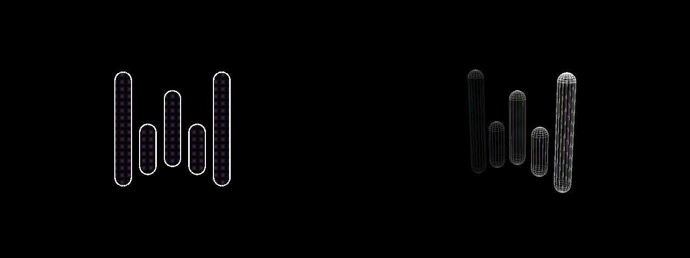

# Plan 28 — the catalog, scenes and the 3D switch (art-direction spike)

**Status: spike, built as a proof of concept.** Three directions explored
with as little new surface as possible: no new page, one new toggle, and
everything else reached through the existing **Shape** menu.

1. **Several shapes in one frame.** A *scene* is a shape whose geometry is
   other shapes, sharing a centre: a sphere round a hypercube round a
   star. Each layer keeps its own scale, weights, colour and spin.
2. **The third dimension.** A catalog of closed 3D solids, and a **3D**
   switch that takes the fourth dimension out of any shape.
3. **Mathematical toys.** Geometric diagrams as shapes: the Hopf
   fibration, an armillary sphere, a geodesic sphere, the Sierpinski
   tetrahedron, a Lissajous knot, a loxodrome, Kepler's nested solids.

Pictures and the demo video: [`assets/28-catalog/`](assets/28-catalog/)
(`demo.mp4`, `catalog.png`, `scene-*.png`, `three-d-*.png`,
`shortlist-polytopes.png` — every shape from plan 22's shortlist), redrawn by
`tools/catalog_demo.py`; the GIFs are cuts of `demo.mp4` (ffmpeg), and
`view-page.png`, `view-menu-4d.png` and `view-menu-3d.png` (the Shape
menu, grouped by kind) and `view-3d-shape.png` (a
3D shape: "3D" in the header, the W keys dimmed) are the VIEW page from a
hidden real window.

## What was built

**73 shapes, appended** after the Klein bottle (index is identity), each
with a `Shape.family`. The V/E table is ENGINEERING §1.

| Family | Shapes |
|---|---|
| Platonic solids | tetrahedron, cube, octahedron, dodecahedron, icosahedron |
| Archimedean solids | cuboctahedron, truncated octahedron, rhombicuboctahedron, snub cube, icosidodecahedron, truncated icosahedron |
| Catalan solids | rhombic dodecahedron, rhombic triacontahedron |
| Star polyhedra | small and great stellated dodecahedron (Kepler–Poinsot), Moravian star, starburst |
| Compounds | stella octangula, five tetrahedra, five cubes, cube + octahedron, dodecahedron + icosahedron |
| Mathematical toys | armillary sphere, geodesic sphere, Sierpinski tetrahedron, Lissajous knot, loxodrome, orbit |
| 4D: 5-cell family | truncated, cantellated, runcinated, bitruncated, cantitruncated, runcitruncated, omnitruncated 5-cell |
| 4D: tesseract family | rectified tesseract, truncated 16-cell, cantellated, runcinated, bitruncated, cantitruncated, runcitruncated and omnitruncated tesseract, runcitruncated 16-cell |
| 4D: 24-cell family | snub, rectified, truncated, cantellated, runcinated, bitruncated, cantitruncated 24-cell |
| 4D: 600-cell family | grand antiprism, rectified 600-cell |
| 4D: Catalan duals | disphenoidal 288-cell, dual runcinated 5-cell |
| 4D: star polychora | grand 600-cell, great 120-cell (faces); small stellated and great grand stellated 120-cell (lines only) |
| 4D: prisms | 3,4-, 5,5-, 3,8-, 5,10-, 8,8-duoprism; pentagonal, heptagonal, octagonal antiprism prisms; icosidodecahedral and truncated icosahedral prisms |
| 4D: surfaces and fibrations | Hopf fibration (beside the Clifford torus) |
| Scenes | Celestial tesseract (4D), Celestial cube, Mysterium Cosmographicum |

**The Shape menu, grouped by kind.** Every shape now has a family —
the 26 older ones too (regular polytopes, the 5-cell family, prisms and
pyramids, surfaces …) — and `geometry.MENU` orders the families into
three sections: 4D, 3D and Scenes. Within a family, index order; the
index stays the identity, so no preset moves.

- **4D or 3D, honestly** (`Shape.dims`; the owner's call after the first
  review, replacing plan 22's lifts and masks). A 4D shape has real
  w-extent and every plane turns it. A 3D shape — the trig family, Heart
  to Klein bottle, and the catalog's solids and toys — sits at w = 0 with
  nothing invented, and the W planes, with whatever drives them, do
  nothing to it (`geometry.view_angles`). The Shape menu is grouped by kind (below); the VIEW header says which; the W keys dim
  while they can do nothing. Convex solids get their faces from the
  polytope extraction unchanged; stars and compounds bring their own.
- **A star is drawn as what is seen.** A Kepler–Poinsot star's faces are
  {5/2} pentagrams that cross each other; what shows is each pentagram's
  five tips (`geometry._pentagram_tips`), the inner pentagon buried. So the
  face pipeline keeps getting simple triangles, and V − E + F = 2.
- **A curve draws no points** (`geom()["curve"]`): a toy drawn as a curve
  has samples, not corners, and red dots on every sample buried it.
- **Scenes** (`geometry.Layer`, `Shape.layers`, `geometry.shape_view`).
  The renderer projects through `shape_view`: one shape is the old path
  to the bit (`tests/test_catalog.py::test_a_shape_that_is_not_a_scene_is_drawn_as_before`);
  a scene projects each layer at its own shape's angles (a 3D layer has
  no W turn), times its spin. A scene's edges carry their layer's colour, width,
  weight and line density; its points and faces their layer's weight. The
  line and point buffers gained a colour per vertex (white and red, as
  before, for every shape that is not a tinted layer).
- **The 3D switch**: `view.three_d`, "3D" on the VIEW page, beside Faces.
  It holds a 4D shape's 4D pose and turns it as a rigid 3D body; the W
  planes stop. On the frame it changes, `ViewState.integrate` folds the
  pose into `ViewState.body` (a 4×4 turn applied before the angles), so
  the shape is exactly where it was on either side: no jump going on or
  off. (Holding the W angles alone does not work: the engine turns the 3D
  planes before the W planes, so a 3D turn under held W angles still
  moves w.) A 3D shape is the same either way.

### The scenes

- **Celestial tesseract** (4D): the Hopf fibration in ice blue (the
  3-sphere the tesseract is inscribed in, its fibres turning at 0.4×),
  the tesseract with faces, and a gold small stellated dodecahedron at
  0.62 counter-turning (−0.7×) in 3D. Its twelve points reach past the
  tesseract's inner cube (`::test_the_star_pokes_through_the_tesseract`)
  and slide through its cells as it tumbles.
- **Celestial cube** (3D): the armillary sphere, a cube with faces, and a
  gold great stellated dodecahedron at 0.82 whose twelve off-axis points
  break out through the cube's faces.
- **Mysterium Cosmographicum**: Kepler's 1596 model — the five Platonic
  solids nested between six planetary spheres, each radius set by the
  solid's insphere over its circumsphere; the orbits are tinted per
  planet and the inner shells turn faster. Mercury is 0.07 of Saturn, so
  it wants the zoom (the demo flies in to 6.5×).

## What changed on the factory presets

Three factory presets sit on a 3D shape: `plasma-heart` (Heart, XZ YZ
YW), `spiral-silk` (Torus, YZ XW), `inverse-halo` (Starfruit, XZ XW YW).
Each keeps a 3D plane, so each still turns; their W planes and the bass
routes on them no longer move the shape. They were left as they are.

## Stacked on it: a vector subject (the Flow mark)

A first subject read from a vector source instead of a formula. The
Wispr Flow mark is five pill-shaped bars, taken from the paths of
wisprflow.ai's own SVG (`geometry.FLOW_BARS`). It comes in two forms,
3D shapes in a family of their own (Vector marks), appended after the
prisms:

- **Flow mark** (100) is the mark as drawn: five stadium outlines in one
  plane, one face each. Its face UVs are the mark's own plane, so a face
  pattern or a bitmap reads as one picture through the five bars.
- **Flow capsules** (101) lifts each bar into a capsule. Its face UVs
  wrap each bar (u round it, v along it), so a pattern turns with the bar
  instead of tiling every quad.

The renderer needed one change: a plane figure has no depth of its own,
so its depth cue now spans the unit sphere back from its nearest point
(`"flat"`). Face-on it draws at full weight, and a tilt dims its far
side. Neither form draws points.

[`flow-demo.mp4`](assets/28-catalog/flow-demo.mp4) (45 s, `tools/flow_demo.py`, the real
renderer offscreen) shows the mark face-on and turning, eight face patterns
through it, the capsules turning with BLOOM wrapped round each bar, and a
rippling field of nine marks.

`prototypes/subjects/` (repository root) is a browser prototype of where
this could go next: a flat ↔ capsule depth slider, physical materials
(clay, chrome, glass, pearl), toon, halftone and plasma shaders,
textures mapped across the mark or per bar, and bars that stretch with
audio. Any SVG can be loaded there as a source.

## What it does not do (yet)

- **No scene editor.** Scenes are code (`geometry.SHAPES`); a layer list in
  a preset would be the obvious next step if the direction holds.
- **Faces do not occlude lines.** The faces stay translucent fills under
  the whole wireframe, so a star's points "shine through" a cube's faces
  by being drawn over them, not by passing through a surface. Interleaving
  faces and lines by depth would sell it harder.
- **A scene's 3D switch hold is the view's.** `ViewState.body` is one
  turn for the whole view, so a scene layer with a spin other than 1
  moves a little as the switch goes on or off.
- **The scene's depth cue mixes kinds.** A 4D layer cues on w, a 3D
  layer on its depth to the 3D camera; the painter's sort runs over both.
- **The Shape menu is long** (101 entries), though grouped. The shortlist
  shapes were added so the owner can judge them by eye; most will
  probably go.
- **The rectified 600-cell's faces take about 8 s to build** the first
  time they are drawn (the frame stalls once).
- **Two star polychora are lines only.** A {5/2} pentagram face needs
  its crossing points as vertices, which the face pipeline does not have.
- **Zooming thickens the lines.** Line width scales with the camera's zoom,
  as it always has, so Kepler's inner shells at 6.5× draw chunky. A
  scene may want its widths in world units.
- **Not judged at the machine.** Brightness and widths were tuned on
  offscreen software-GL renders; the look on the projector is unchecked.

`demo.mp4` was last drawn before shapes 65–99 were added; the contact
sheets show them. `tools/catalog_demo.py` tours them all when rerun.

## Checks

`tests/test_catalog.py` — textbook V/E/F for every solid, regularity of
the Platonic solids, every star closed like a sphere, compounds sharing
corners, dual compounds crossing at edge midpoints, the Hopf fibres great
circles on S³, a scene's rows its layers', each layer at its own angles,
the star reaching past the tesseract's inner cube. `test_shapes4d` —
every 3D shape at w = 0, the W planes leaving it alone (in the renderer
too), 4D shapes untouched, the 3D switch never jumping and turning
rigidly, every 4D shape over the volume floor. The shape digests gained
the new rows, and the seven shapes plan 22 had lifted were re-recorded
at w = 0 (`tests/golden/shape_digests.json`); no polytope's row moved.
The Flow tests check the bars against the SVG, the mark's one-picture
UVs, the capsules' wrap, and the flat cue's full weight face-on
(`tests/test_render.py`).
