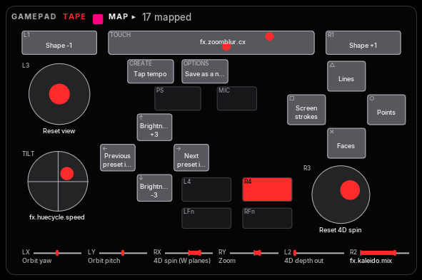

# Plan 42 — any controller in any role; the DualSense Edge

**Built** on `plan-42-controllers` (2026-11-01), the day before
Dillon's DualSense Edge arrives, from published sources alone. Two layers,
as Dillon asked: **a foundation** in the app (pads/, the pad device,
the probe), and **an exploration** over it (the browser lab,
`prototypes/edge-lab/`; the on-screen pad drawn for the pad in hand; two
example patches). Decisions D1–D10 are recommendations built as written,
pending the owner (register rows 544–553). Hand checks 407–415, group AP,
are tomorrow's — the first with the controller.

## The ask (Dillon, 2026-11-01)

- "A strong foundation to get started and explore", then "an
  exploratory artifact to illustrate capabilities and ideas as a layer".
- **Bluetooth, not just USB — very important.**
- "Control communication … modular and extensible, so that we maintain
  the ability to support Xbox, Edge, Leap, USB controller, etc simply."
- "You should be able to choose which controller is on which role. But
  you shouldn't get too hard-coded with this."
- The three ideas Dillon picked from the preset survey: **4** the
  touchpad sets the zoom burst's centre (pinch zooms, twist turns in 4D);
  **5** shake to hit (an envelope on a jolt or a back button); **7**
  feedback through the pad (the light bar follows the palette, rumble on
  the beat, a trigger stiffening as its effect saturates).

## What the shared library said (107 presets, 2026-11-01)

37 presets route the pad, almost all as **effect throttles on the
triggers** (RT → `fx.kaleido.mix` in 26, LT → `fx.deconverge.mix` in 16,
the 10/30 show's with spring motion). 74 route the hands, mostly **hand
orientation onto rotation phase** (left roll / pitch / yaw →
`rot.phase.XY` / `YZ` / `XZ` in 55). The macros (BREAKDOWN, DROP,
INTENSITY) live on the APC40's knobs only; envelopes are in two presets.
No preset has a pad button row (the pad's buttons are the session's).

## What the Edge sends — and what GLFW cannot see

Settled from SDL, Linux and the Edge's own descriptor dumps, pinned with
line numbers in [`assets/42-controllers/sony-hid.md`](assets/42-controllers/sony-hid.md):
over USB the face reaches GLFW's raw arrays (in an order of its own: the
Xbox map would fire `pad:SHARE` on D-pad up); over Bluetooth the pad
switches to report 0x31 as soon as a feature report is read, all of it
vendor-defined, so GLFW freezes; the back buttons, the Fn buttons, the
touch points and the motion sensors are vendor bytes on both links, and
every output (light bar, player and mic lights, rumble, trigger
resistance) is a vendor report GLFW has no call for.

## The foundation

```
        a [[devices]] gamepad entry  ── controller = "edge" | "sony" | "xbox" | "054c:0df2" | "any"
                   │
             gamepad.Pad  ── one vocabulary: pad:A … pad:LP, hat:, axis:, touch:, motion:, Effects out
     ┌────────┬────┴─────┬─────────┐
   tape      hid       glfw       usb
 (a recorded (pads/hid: (Xbox map, (libusb
  session)    USB + BT)  Sony map)  360 pad)
```

Each poll a pad entry reads, in that order: its tape (and nothing else);
a joystick it already reads (plugging a pad in mid-show moves no one); a
Sony pad the hub lends it (macOS shows the same pad to GLFW over USB and
Bluetooth — without its extras — so hid comes first, and no other entry
may then read it through GLFW); the next free GLFW joystick its
``controller =`` matches; the libusb reader.

- **`pads/models.py`** — a `Model` per kind of controller (USB ids,
  family, road, caps, its own glyphs); `matches(spec, model)` is the
  ``controller =`` rule. A new controller is a `Model` (and a driver if
  no road reads it).
- **`pads/sony.py`** — the report format, bytes ↔ values: input over USB,
  BT full and BT simple into the pad's vocabulary; calibration (feature
  0x05) and the update version (0x20); output reports with the BT CRC;
  the official trigger effects only. Checked against the spec's real
  calibration dump, a real BT feature CRC and its computed vectors.
- **`pads/gesture.py`** — the `touch:` and `motion:` lanes: position,
  pinch, twist, tap; tilt from gravity, yaw from the gyro leaking home,
  spin, shake, energy.
- **`pads/hid.py`** — the hidapi road: a reader thread per pad (calibrates,
  switches BT to the full report, keeps the newest report and decodes it
  once a frame, writes outputs only on change at ≤ 60 Hz after Linux's
  LED take-over, learns which USB output length macOS takes); the hub
  that lends pads to entries in list order; tapes (`Recorder`, `TapePad`).
- **`gamepad.Pad`** reads the four roads into one state; the touchpad's
  click and the Edge's back and Fn buttons are `pad:TOUCH`, `pad:LP` /
  `RP`, `pad:LFN` / `RFN`; Learn pad lands them, a finger drag, a pinch, a
  twist, a tap, a tilt and a shake.
- **`devices.PadDevice`** feeds `touch` and `motion` beside `axis` (an
  entry that may read a Sony pad), lists its extras on GRAPH, and has
  **sink ports** for the outputs: `<role>:0` light bar hue, `1` level,
  `2` whiteness, `3` rumble heavy, `4` rumble light, `5` left trigger
  resistance, `6` right, `7` player lights (a meter), `8` mic light. With
  no row on a channel the pad shows its identity — ``light =`` /
  ``player =``, else the colour and number of its place in the list.
- **Config**: ``controller``, ``hid``, ``light``, ``player``, ``tape``
  on a gamepad entry (`config._pad_keys` checks them).
- **`tools/hid_probe.py`** — list, watch live, record a tape, and the
  guided checks that write `edge-findings.json`.

## The exploration

- **The browser lab** (`prototypes/edge-lab/`): Chrome's WebHID reads the
  Edge over USB or Bluetooth with nothing installed — every control
  live, three readouts to compare for the app's on-screen pad, ideas
  4/5/7 on a small visual, the feedback outputs by hand, the same guided
  checks, and tapes in the app's format. A simulator stands in today.
- **The on-screen pad** draws the pad in hand: an Edge's ✕○□△, L1/R1,
  CREATE/OPTIONS/PS/MIC, its touchpad with each finger on it, a tilt
  bubble that flashes on a shake, L4/R4 and the Fn buttons, the light
  bar's colour in the header. The Xbox face is as it was.
  
- **Example patches** (`assets/42-controllers/patches/`, copy into the
  library's `patches/` and spawn from GRAPH): `touch-burst` (idea 4: the
  zoom burst follows the finger, pinch bursts harder) and `shake-hit`
  (idea 5: envelope 6 fired by a shake flashes and punches in). Zoom and
  4D twist on the touchpad are a Learn each (a patch may only drive its
  own params, D5 of plan 40).
- **Idea 7** is sink rows, the session's (`bindings.json`): right-click a
  param → Learn sink ▸ `<role>:<channel>` — `fx.kaleido.mix` → `edge:6`
  (the right trigger stiffens as the kaleidoscope saturates), a palette
  hue → `edge:0`, and on ROUTING's sinks `lane:0` → `edge:3` (the heavy
  motor on the sub band).

## Decisions (pending the owner)

| D | Recommended and built | Register |
|---|---|---|
| D1 | Sony pads are read over **hidapi**, on both links; GLFW reads them only where hidapi cannot load (USB, through a Sony map) | 544 |
| D2 | **One vocabulary**: a DualSense's buttons take the Xbox names by position (✕ is `pad:A`, Create `VIEW`, mic `SHARE`), the extras new names at indices no GLFW pad reaches | 545 |
| D3 | **``controller =``** on each gamepad entry picks which pads it may take (any, a model, a family, a USB id); entries pick in list order | 546 |
| D4 | The touchpad and the sensors are **schemes of their own**, `touch:` and `motion:` (not more `axis` lanes); a finger that is not down, or a pad without them, reads not live | 547 |
| D5 | The outputs are **sink ports** on the pad's role, nine channels; with no row the pad shows its **identity** (colour and player number by its place) | 548 |
| D6 | Trigger resistance uses the **official effects only** (Off, Feedback, Vibration) — never the debug modes | 549 |
| D7 | hidapi opens the pad **exclusively** (its default): the OS and GLFW leave it to us; the probe can ask for shared opens | 550 |
| D8 | A **pad tape** (`hyperspace.padtape/1`: raw reports with times) is the one recording format — the probe, the lab, a pad entry's ``tape =`` and the tests | 551 |
| D9 | The on-screen pad draws **the model's own face**, its extras in the room the Xbox face leaves | 552 |
| D10 | The browser lab is a **prototype**, beside the app, not in it | 553 |

## What the controller said (2026-11-02)

Dillon's Edge (update 0x0217), the probe's guided checks over USB and
over Bluetooth on macOS — [`assets/42-controllers/edge-usb.json`](assets/42-controllers/edge-usb.json),
[`edge-bt.json`](assets/42-controllers/edge-bt.json) (the Bluetooth address
taken out), half a second of each step kept as test bytes
(`tests/fixtures/pads/edge-bt-excerpt.jsonl`, `tests/test_pads_real.py`):

| Asked | Answer |
|---|---|
| Does Bluetooth give the full report? | Yes: one simple report at connect, then only 0x31 (78 B, tag 1, every CRC good) once the calibration is read |
| The rate | USB 1000 reports/s; **Bluetooth about 64/s, evenly every ~15 ms** — the pad or macOS paces it, not the reader (one drained burst in 20 000) |
| The back and Fn buttons, default profile | Their own bits: L4 `p9 0x40`, R4 `0x80`, left Fn `0x10` |
| Does holding Fn hide the face? | **Yes**: Fn + ✕ reads Fn alone (the firmware keeps Fn combos for profiles). A row may use Fn alone, never in a combination |
| A profile that remaps a back button | Not asked: profiles are made on a PS5 |
| The sensors' axes and signs | SDL's reading holds (`gesture.AxisMap`'s default), on both links |
| The touchpad | 0–1919 × 0–1079: Linux's 1080, not SDL's 1070 |
| The outputs | The light bar, player lights, rumble, R2's resistance and the mic light all obey, over USB **and** Bluetooth; Linux's take-over is enough on macOS (no SDL reset) |
| The USB output length | 64 bytes, the descriptor's, at once |
| Calibration | Read on both links, believable, the same on each |
| The sticks at rest | Within 0.035 of centre, jitter under 0.01 — far inside the 0.18 deadzone |
| Lying on a table | The Edge rests on its grips, about 11° nose-down: `motion:pitch` reads ≈ 0.40 there, not 0.5 |

Still to see in the app: hand checks 407–415.

## Tomorrow

1. `git pull`, `uv sync` (hidapi), plug the Edge in by USB.
2. `uv run python tools/hid_probe.py --check --record edge-usb.jsonl
   --out edge-usb.json`, then pair over Bluetooth (Create + PS until the
   light flashes; System Settings ▸ Bluetooth) and again with
   `edge-bt.*`. Or the lab: `cd prototypes/edge-lab && python3 -m
   http.server`, Chrome at http://localhost:8000.
3. Commit the four files under `docs/plans/assets/42-controllers/`; the
   next build corrects what they contradict.
4. The hand checks, group AP (407–415).

## Not in this plan

- An in-app editor for which pad is which role (config is edited live,
  `config.toml` is re-read): a SYSTEM-page control if the config proves
  clumsy.
- The microphone and the speaker; the haptic voice-coil audio; the
  unofficial trigger effects.
- Joy-Cons (the brief lists them; no code reads them yet): a `Model` and
  a driver on this same road.
