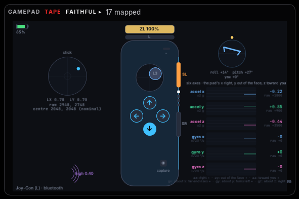
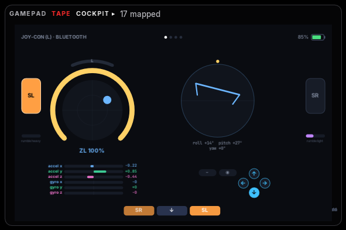
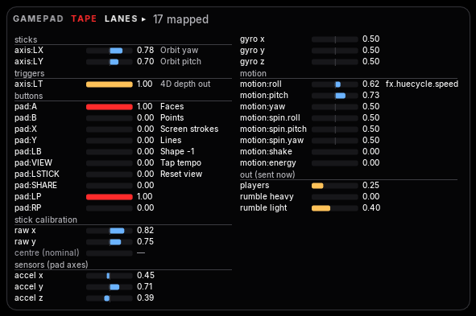
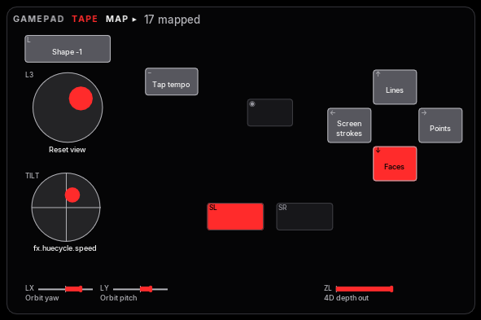

# Plan 46 — the Joy-Con, one per role, as a six-axis totem

**Built** on `worktree-joycon` (2026-11-02), the day the owner paired a
Joy-Con (L) over Bluetooth, as an extension of plan 42's road: a second
codec beside the Sony one, three models, the probe's checks for them.
Decisions D1–D6 are recommendations built as written, pending the owner
(register rows 565–570). Hand checks 424–429, group AV, are the first
with the controller in the app.

## The ask (the owner, 2026-11-02)

- "Start with one Joy-Con per role because I only have one Joy-Con."
- "Held more like a Wii Remote than a game pad … a kinetic controller
  … the important part of the Joy-Con is the 6-axis IMU."
- "Show up as individual game pads … only one stick or one set of pad
  buttons."
- "Calibrating drift is something I do want to do."
- "Its own isolated work … extend Dillon's work here and make this thing
  work with Joy-Cons as well."

## What the hardware said before the build (2026-11-02)

The owner's Joy-Con (L), paired over Bluetooth on the Mac, through the
hidapi wheel plan 42 added: hidapi lists it as Nintendo `057e:2006`,
usage page 1 / usage 5, bus type 2 (Bluetooth), and opens it. It sends
**nothing** until the host asks; subcommand `0x03 0x30` switches it to
report 0x30 at about **62 a second** (the same ~15 ms pacing as the Edge
over Bluetooth), each with three six-axis samples once subcommand
`0x40 0x01` turns the sensors on. Flat on its back the accelerometer's
z read ≈ +1 g (4208 counts at 4096 per g): z is up out of the face. Its
battery byte read `0x4e`: **low**. The Joy-Con then went to sleep (a
Joy-Con does, idle, and only a press of one of its buttons brings it
back), so the build below ran against a fake first.

## What the controller said (2026-11-02, the probe)

The owner ran `tools/hid_probe.py --controller joycon-l --check --record`
on the real Joy-Con (L) over Bluetooth (hand check 425):
[`assets/46-joycon/joycon-findings.json`](assets/46-joycon/joycon-findings.json)
(the Bluetooth address taken out); half a second of each step kept as
test bytes (`tests/fixtures/pads/joycon-bt-excerpt.jsonl`, cut by
`tools/pad_tape_excerpt.py`; `tests/test_pads_joycon_real.py`).

| Asked | Answer |
|---|---|
| The link | Bluetooth, report 0x30 (49 B) at 60/s; the flash's 0x21 replies only during the connect sequence |
| The flash | Four records answered: the factory stick (`0x603d`) and sensor (`0x6020`) calibrations; the user records (`0x8010`, `0x8026`) blank — the Switch never wrote one. Gyro 0.061 deg/s a count, accel 4096 counts a g, as the notes say |
| The stick | Factory centre (2003, 1968), reach 1348 / 1147 right / left and 1134 / 1179 up / down; **recentred** at connect; reach 0.99 / 1.0 / 1.0 / 0.98 each way; at rest −0.02 (far inside the 0.18 deadzone) |
| Every button | ↓ `A`, ↑ `Y`, → `B`, ← `X`, SL `LP`, SR `RP`, L `LB`, ZL `axis:LT`, − `VIEW`, capture `SHARE`, the click `LSTICK` — **all eleven as built** (byte 5 bits 0x01 / 0x02 / 0x04 / 0x08 / 0x20 / 0x10 / 0x40 / 0x80; byte 4 0x01 / 0x20 / 0x08) |
| The sensors' axes | Flat: z +1 g; right side down → +y; far end up → +x; a turn right → −z gyro: the proposed map `[[1, −1], [2, 1], [0, −1]]`, yaw `[2, 1]` — **the built `AXIS_MAP` holds** (D5 settled) |
| The outputs | Three player lights, rumble low, rumble high, and the stop: each seen |
| Battery | 50 % ("low") |

Nothing in the codec needed a change.

## What was built

```
      a [[devices]] gamepad entry ── controller = "joycon-l" | "joycon-r" | "procon" | "nintendo" | …
                   │
             gamepad.Pad ── the one vocabulary; a model says which controls it has
                   │
              pads/hid.py ── HidPad reads any model whose road is hid, through its codec:
             ┌─────┴─────┐
         pads/sony    pads/nintendo   (decode, Calibration, setup, output_reports)
```

- **`pads/models.py`** — `NINTENDO_VID`; `joycon-l` (`057e:2006`),
  `joycon-r` (`2007`) and `procon` (`2009`, the Pro Controller: the same
  protocol with the whole face, no hand has checked one) in `MODELS`;
  `HID_IDS` (vendor → the product ids the road opens) and
  `HID_FAMILIES`; `may_be_hid` in place of `may_be_sony` (kept as an
  alias). A `Model` now also says **which canonical controls it has**
  (`controls`, `has_control`): a single Joy-Con is one stick, four face
  buttons, a shoulder, a trigger, SL / SR, two of the middle buttons —
  no right stick, no D-pad. Its glyphs are its own face's (↓ → ← ↑, L,
  ZL, SL, SR, −, ◉).
- **`pads/nintendo.py`** — the codec. Input: report 0x30 (the timer,
  the battery nibble, three button bytes, both sticks as packed 12-bit
  pairs, three sensor samples — the app reads the newest) into the
  `Frame` every pad shares, **by position for the Wii-Remote hold**
  (D2); 0x21 (a subcommand's reply) is kept but decodes to nothing, so
  the last frame stands; 0x3F (before the mode is set) gives the face
  only. Calibration: the stick's centre and reach each way from the
  flash (`StickCal`; the user's record over the factory's), the
  sensors' origin and sensitivity likewise (g = (raw − origin) × 4 /
  (sens − origin); deg/s = … × 936 / …), nominal when nothing was read;
  `recentre` takes the stick's resting reading at connect as its
  centre when the stick is near enough to rest and not being held (D4).
  Output: HD rumble (a low band at 160 Hz and a high band at 320 Hz,
  each a frequency and an amplitude in four bytes a side, from the
  notes' encoding) and the four player lights, from the same `Effects`
  every pad's sink rows make; the light bar, the triggers and the mic
  mean nothing and are left out. `setup` is the connect sequence: the
  full report mode, sensors on, vibration on, the flash records read
  through subcommand 0x10 (two tries each, 0.6 s), the stick watched for
  30 reports, the calibration recentred. `AXIS_MAP` is the sensors'
  axes for the hold (D5).
- **`pads/hid.py`** — `pad_devices` enumerates every vendor in
  `HID_IDS` (`sony_devices` kept as an alias); `codec_for(model)`;
  `HidPad` carries `codec`, `nintendo`, `kind`, `axis_map`, `flash`,
  `recentred`, decodes through its codec, runs `nintendo.setup` in
  place of the Sony feature reads, writes a Joy-Con's reports with no
  take-over and **resends rumble every 50 ms while it is on** (a
  Joy-Con stops otherwise, as Linux's driver knows), and calms it on
  the way out. `TapePad` reads a Joy-Con tape through the same codec,
  the last frame standing over a reply.
- **`gamepad.Pad`** — the motion step takes the reader's own axis map
  unless the pad's was overridden; `buttons_named` and `layout_for`
  (the on-screen pad) keep only the controls the model has; `_hub`
  opens the road for any hid family.
- **`devices.PadDevice`** — `schemes_for` through `may_be_hid`; `sources`
  lists only the axes, buttons and hat directions the model has; `sinks`
  lists only the channels the model's outputs cover (`SINK_CAP`: a
  Joy-Con shows rumble heavy / light and the player lights; the
  channel numbers never move). `config.toml`'s `[gamepad]` comment names
  the new words; `hotreload` reloads `pads.nintendo` after `pads.sony`.
- **`tools/hid_probe.py`** — lists and picks any pad the road reads;
  the motion readout applies the pad's axis map; `--check` on a Joy-Con
  runs **its** steps (`check_joycon`): the link and the flash (every
  record's bytes, the calibration, whether it recentred), each button
  held in turn against the name the vocabulary gives it (✓ / ✗), the
  stick's reach each way and its rest, the sensors in the hold (flat,
  right side down, far end up, a turn right — and whether the built
  `AXIS_MAP` holds, else the proposed one), rumble low, rumble high, the
  player lights, rumble stopping. Findings go to `joycon-findings.json`.
- **Tests** — `tests/test_pads_nintendo.py` (15): the buttons by
  position for (L), (R) and the Pro; the newest sample and the battery;
  the flash calibration, the user record, the fallbacks; recentre on a
  drifted rest and not on a held stick; the rumble bytes against the
  notes' maxima and the lights; the reader's connect sequence on a fake
  Joy-Con (silent until the mode is set, answering flash reads); outputs
  on change and the rumble refresh; the hub lending by `controller =`;
  a Joy-Con tape; the pad's one stick and its motion through its own
  axes; the device's ports and two outputs; the on-screen layout.

## Decisions (pending the owner)

| D | Recommended and built | Register |
|---|---|---|
| D1 | **One Joy-Con per entry**, each its own role; a pair as one pad is not built (the owner has one; two people, two Joy-Cons, two roles) | 565 |
| D2 | **The Wii-Remote hold is the vocabulary's frame**: its one stick is the left stick (`axis:LX` / `LY`, click `pad:LSTICK`), the (L)'s arrows the face by where they sit (↓ `A`, → `B`, ← `X`, ↑ `Y`), SL / SR the back pair `LP` / `RP`, L / ZL `LB` + `axis:LT` ((R): R / ZR `RB` + `RT`), − `VIEW`, + `MENU`, capture `SHARE`, HOME `GUIDE`; no `hat:` | 566 |
| D3 | **A model says which controls it has** (`Model.controls`): the device's ports, Learn's names, the on-screen pad and the sink ports show only those — a Joy-Con is one stick and a few buttons everywhere, not a dark Xbox face | 567 |
| D4 | **Drift is calibrated from the flash and the rest**: the Switch's user record over the factory's, then the stick's own resting reading at connect becomes its centre when it sits within 0.3 of centre and moves less than 0.1 meanwhile; no config key, no stored file | 568 |
| D5 | **The sensors' axes are the codec's, per side** (`nintendo.axis_map_for`: the chip's x along the long axis toward the shoulder end, y across, z up out of the face; the hold points the shoulder end away) — the (L)'s map **checked by the probe** (the proposed map equalled it, 2026-11-02); the (R)'s is the (L)'s with y and z negated, as Linux's hid-nintendo reads its chip, and the Pro Controller's the (L)'s — both **unverified** (`VERIFIED_MAPS`), the probe's tilt step says | 569 |
| D6 | **The lab is the app's pad window, not a browser page** (the owner, 2026-11-02: "if we can see the Joy-Con in the app with the same level of detail as the Edge, we should just do that"): Faithful draws the Joy-Con upright as a hand holds it, with the stick's well, its raw reading and the centre in use on one side and the tilt with the sensors' numbers on the other; Cockpit one dial and the tilt big; Lanes only the lanes it has, plus its stick calibration and sensors; no `prototypes/joycon-lab/` | 570 |

## The lab in the app (D6)

The pad window's four readouts (SYSTEM ▸ Pad diagram; click the view's
name to step through them), drawn from a tape by `tools/pad_shots.py`:

| Faithful | Cockpit |
|---|---|
|  |  |

| Lanes | Map |
|---|---|
|  |  |

- **Faithful** (`ui_pad_lab._faithful_joycon`): the Joy-Con upright, the
  trigger and the shoulder along its top edge, − (+) by the rail, the
  stick and the four face buttons, capture (HOME), SL and SR on the rail
  with the four player lights between them; on the left the stick's well
  with the deadzone ring, the dot grey inside it, `LX` / `LY`, the raw
  12-bit reading and the centre in use with where it came from (`rest`,
  `user`, `flash`, `nominal`); on the right the tilt, big, and the
  accelerometer in g and the gyro in deg/s in the pad's axes — what a
  calibration needs at a glance. The (R) mirrors it: its face above its
  stick, + and HOME.
- **Cockpit** (`_cockpit_joycon`): one dial (the trigger's arc, the
  shoulder's cap, the stick's trail), the tilt big beside it, the two
  middle buttons it has, the face cluster, SL and SR loud on the edges,
  the rumble meters, the ticker.
- **Lanes**: the sticks, triggers, buttons and D-pad rows only where the
  model has the control; two new groups, `stick calibration` (raw x, raw
  y, the centre) and `sensors (pad axes)`, for any pad whose reader has
  a calibration; `out (sent now)` lists the channels the pad has (four
  player lights on a Joy-Con).
- **Map**: `gamepad.layout_for` already drops what the model lacks.

The `Reading` (`ui_pad_views`) carries `sensors`, `stick_raw`,
`stick_centre` and `centre_from` from the pad's reader; `sony.Frame`
gained `raw_sticks` for it (empty on a Sony pad).

## On another Mac

1. This build: `git fetch && git checkout worktree-joycon` (or `main` once
   merged), `uv sync` (nothing new: hidapi came with plan 42), then quit
   and relaunch — not a hot reload (the road's module list changed).
2. Pair the Joy-Con: hold the small round **sync** button on its rail
   until the player lights run, then System Settings ▸ Bluetooth ▸
   "Joy-Con (L)". A Joy-Con that went to sleep comes back when any of
   its buttons is pressed; the host cannot wake it.
3. `config.toml`: with no `[[devices]]` list the default pad entry is
   `controller = "any"` with `hid` on — it takes the Joy-Con as the main
   pad with no change. To pin it, or beside an Edge:
   ```toml
   [[devices]]
   role = "joy"
   kind = "gamepad"
   controller = "joycon-l"
   ```
4. Close what could hold it (the browser lab's tab, Steam): the app
   opens it exclusively. If macOS asks for Input Monitoring, allow it.
5. First, at the machine: `uv run python tools/hid_probe.py --controller
   joycon-l --check --record joycon-check.jsonl`, and commit
   `joycon-findings.json` and a slice of the tape under
   `docs/plans/assets/46-joycon/` and `tests/fixtures/pads/` (hand
   check 425). The battery read low: charge it on a Switch or a grip.

## To revisit

- **The sensors' signs** (D5): the probe's tilt step proposes the map; a
  change is one tuple in `pads/nintendo.py`.
- **The simple report's button bits** (`_SIMPLE_L` / `_SIMPLE_R`): from
  the notes, never seen — the mode switch makes them moot within the
  first report.
- **The Pro Controller** (`procon`): decoded by the same codec, unseen;
  the pad window draws it on the Xbox body with its own glyphs.
- **Two Joy-Cons as one pad** (D1), when a second one is here.
- **The (R)'s HOME light** (subcommand 0x38): a tenth sink channel, or
  the mic channel's meaning on a Joy-Con.
- **USB** (a charging grip, a Pro Controller by cable): the same reports
  over USB after a 0x80 handshake `setup` does not send — so
  `hid.pad_devices` leaves a Nintendo pad on a USB bus to GLFW rather
  than seize it and read nothing; the handshake is the work.

## After the review (2026-11-02)

An independent code review of the PR found ten things; what changed:

- **Rumble rides the reply-free 0x10 report.** The 50 ms refresh had
  gone out as a 0x30 subcommand, and every subcommand draws a 0x21
  reply that could stand as the newest report in the drain-newest-wins
  read loop — stick and motion read jittery while rumbling. Now the
  rumble is `rumble_report` (0x10) on change and on refresh, and the
  player lights are a subcommand only when they change (`nintendo.write`).
- **The sensors' map is per side** (D5): `axis_map_for(kind)`, the (R)'s
  and the Pro's from the sources and marked unverified.
- **Setup waits for each ack** (`acked`): the full report mode, the
  sensors and rumble are each sent again up to `SETUP_TRIES` until the
  pad's 0x21 acknowledges; what never acks is in the reader's note.
- **A Nintendo pad over USB is left to GLFW** until the 0x80 handshake is
  built (`hid.pad_devices`).
- **One codec surface**: `accepts`, `decode_frame`, `setup`, `write`,
  `calm` on both `sony` and `nintendo`; `HidPad` and `TapePad` no longer
  branch on the family. The Sony path moved into `sony.py` unchanged
  (its tests are the proof).
- **One axis-map rule** (`gesture.axis_map_of`): the pad's override
  unless it is the default, else the reader's own, else the default —
  the app, the pad window and the probe all ask it.
- The high rumble band is held at or above 80 Hz (its lowest code), so
  a low frequency can no longer corrupt the amplitude byte; the Lanes
  view's raw stick bars run over the calibration's reach, not a fixed
  1400; `decode` reads a per-kind table.
- The branch's history holds the raw probe files for one commit (the
  owner's Bluetooth address among them); the squash merge keeps them
  out of `main`.

A second pass found ten more; what changed:

- **The (R)'s face reads by position** (D2, as the (L)'s and the module
  promised): its B, the bottom button, is `pad:A`; its A `pad:B`; its Y
  `pad:X`; its X `pad:Y` — the glyphs keep its letters; the simple
  report likewise, and its stick's click is byte 2's 0x08 (0x04 is the
  left stick's). The probe's (R) prompts name the position.
- **A recentred stick still reaches ±1**: the reach each way shifts with
  the centre (`recentre`), so the probe's 0.99 / 0.976 become 1.0.
- **The low rumble band keeps its half-step** (an odd amplitude code's
  0x80 flag in the band's first byte) and its frequency code stops at
  0x7F (`LOW_BAND_MAX_HZ`).
- **`close()` cuts a connect sequence short**: every wait in `setup`
  checks the reader is alive, so a pad that never answers cannot hold a
  restart for 12 s.
- **A Nintendo pad is never seized on a guess about its bus**
  (`hid._on_usb`): hidapi's `bus_type` where it says, else the interface
  number (USB has one, Bluetooth reports −1), else USB.
- **An axis map set on the pad always wins** (`gesture.axis_map_of`):
  `Pad.axis_map` is None until set, so the identity set on purpose can
  override a Joy-Con's built map.
- The reader's per-codec state is declared (`_sent_leds`, `_frame`); the
  Lanes view takes its sensor scales from the lab's `ACCEL_FS` /
  `GYRO_FS`; `.gitignore` keeps only the probe's two output names.

## Not in this plan

- The browser lab (`prototypes/edge-lab/`) is untouched (D6).
- Pairing two Joy-Cons into one pad; the IR camera; NFC; the HD rumble
  as audio.
