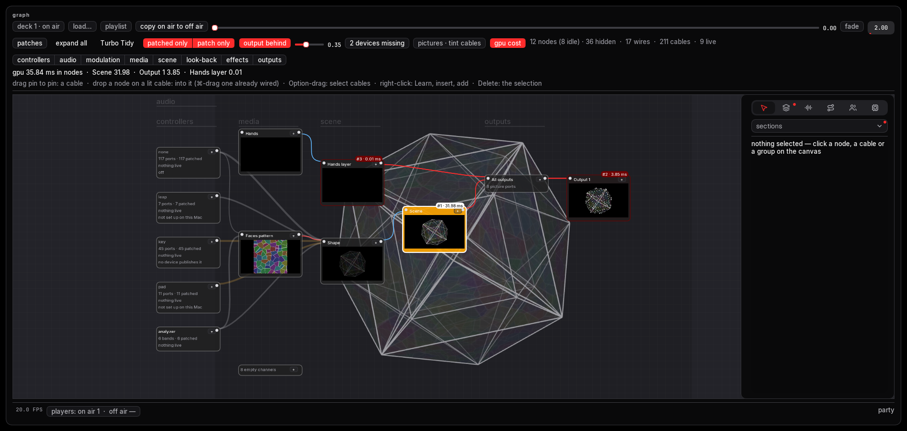

# Plan 84 — GRAPH: GPU cost at a glance

**Built** 2026-11-22 on `claude/serene-keller-5kiq34`, one item of the post-install wave
([`66-post-install.md`](https://github.com/cutaiar/hyperspace/blob/plans/66-post-install/hyperspace-python/docs/plans/66-post-install.md)
§1, renumbered from 71 on 2026-11-22 by `66-launch.md`). Register rows 1040–1045, hand checks 840–845
(group FE). Draft PR to `main`; the owner merges.

## Why

Hovering a node on GRAPH already says its GPU time per frame (plan 37 C2: `graphview.picture_hover`, the
SYSTEM page's rolling median from `render.PassTimer`). That is how Rugged Doctor was caught at the 60 FPS
floor with only a couple of effects, but it meant hovering every node in turn. The bottleneck should be
visible at a glance.

## What was built

### The chip

**gpu cost** on GRAPH's head, after **pictures · tint cables**, off by default. It is page state like the
tint chip: never saved in a loadable patch or a show, never an undo step
(`tests/test_gpu_cost.py::test_the_chip_reaches_neither_the_loadable_nor_the_show`). Lit:

- **Every render node is marked by its GPU time.** Its border leans up a hot ramp from black through deep
  red, orange and yellow to white (`ui_graph.heat_rgb`; every step brighter than the last, so it reads as
  black to white for someone who cannot tell red from green). The border also widens from 1.5 to 4 canvas
  units. The node's ground leans up the same ramp, at most `COST_FILL` (55 %) of the way, so its words stay
  legible.
- **A badge on its top edge** gives its time, "#1 · 2.10 ms" for the three costliest and "0.42 ms" for the
  rest. It is drawn over the node, outside its layout, so lighting the chip moves nothing.
- **The head's line** shows the frame's total over its timed nodes and the three costliest by label, for
  example "gpu 35.84 ms in nodes · Scene 31.98 · Output 1 3.85 · Hands layer 0.01". With no timer queries
  on the context it shows the timer's note instead (`ui_graph.cost_line`).

### Ranked within the frame, eased over a second

- **Heat** is a node's share of the costliest node's time, so the costliest is white whatever its time
  (`ui_graph.rank_costs`). Rank breaks ties by name, so two nodes of equal cost never swap.
- I chose share over a percentile rank. With one 10 ms node and four 0.1 ms ones, share draws one white
  node and four dark ones, which is the truth. A percentile rank would draw an even gradient.
- **Smoothing** has two layers. `PassTimer`'s median over 60 frames already rejects a spike. The page eases
  each node's median with a time constant of `COST_TAU` (1 s): `1 − e^(−dt/τ)` a frame, the same at 30,
  60 or 120 FPS (`ui_graph.ease_costs`).
- A node new to the timer starts at its own time, not from 0, which would rank it cheap for a second.

### Made nothing, not free

A node that made nothing this frame shows a grey "made nothing" badge and a thin grey border, not "0 ms".
The renderer says what each node made (`render.gpu_made`), using the rule `Graph.evaluate` runs by, from
what the frame already settled (`Graph.pulled`, `Graph.timed_in`):

| A canvas render node … | Its mark |
| --- | --- |
| that ran a timed pass this frame (`gpu_ran`) | its eased time, rank and heat |
| that ran with no pass of its own (`gpu_free`): a switch, a delay's read, the pattern, a see-through geometry | none: its time is its consumer's (the scene's, the write's) |
| that the frame built but ran nothing for: an effect switched off, a branch behind a switch's unpicked input | **made nothing** |
| that the frame did not build: unreached, drawn faint (row 349) | **made nothing** |
| not a node of the frame: the modulation side, the camera | none |

"Ran" is what asked the timer for a query this frame (`PassTimer.watch`, a set kept only while the chip
is lit), not the list of names the timer reports. A segment switched off is still on that list, with a
median of 0, but runs no pass, so it says "made nothing". A pass inside another's query (an effect in a
delay's write) asks too, so it counts as ran.

A pass timed under a name no canvas node carries is added to the node it belongs to (`render.gpu_made`'s
`gpu_owner`, `ui_graph.fold_owners`): a delay's write to its delay, a look-back's capture to its
look-back. So the head's line never names a pass that no badge shows. The easing belongs to the renderer
it reads: switching the panel to the other deck starts it again from that deck's times.

A node that made nothing drops out of the easing and comes back at its own time. A node that ran but whose
median has not been read back yet (the timer reads `LAG` = 3 frames late) shows no badge for those frames.

### It costs nothing when off

- **The renderer is asked a frame at a time.** While the chip is lit, the page sets `Renderer.gpu_watch`
  every frame. `_draw_frame` reads it, clears it, and only then adds `gpu_ran`, `gpu_free` and `gpu_built`
  to `stats`. This is the `media_watch` pattern: a chip turned off, or a page no longer drawn, stops the
  extra work after one frame (`::test_unasked_the_renderer_says_nothing_more`,
  `::test_asked_it_says_what_each_node_made_for_one_frame`).
- **Nothing is timed, drawn or read back on the GPU** for this. The times are the timer's own medians,
  which the renderer kept before plan 84. The outputs are the same bytes asked or not
  (`::test_the_outputs_are_the_same_bytes_asked_or_not`).
- **Off, the page pushes no style and draws no badge.** A frame with the chip off makes the same
  node-editor pushes as a frame with the marks removed altogether
  (`::test_off_it_asks_nothing_and_draws_nothing_extra`).

## Known limits

- **A node timed inside another's query** reads 0. GL allows one time query at a time, so an effect painted
  inside a delay's write is timed under `delay(write)` (`PassTimer.time`, ruling R5). The effect shows
  0.00 ms and its time is on the write. The renderer cannot split that time; the hover says the same.
- **The total** is the sum of the timed nodes. It is not the whole frame: the control window, the
  presenters' copies and the thumbnails are not graph nodes.
- **Off the rig the numbers mean nothing.** Mesa's software rasteriser drew the screens here (the Scene
  at about 30 ms). The marks and the rule are right there; the times are for the rig (hand check 840).

## Not built: thumbnails for unwired picture nodes other than effects (the stretch)

Plan 65 (§3) gave an unreached effect or copy a thumbnail made beside the graph: its input, or the test
card, put through it at a thumbnail's size (`render.unwired_through`). The other picture nodes that can be
unreached are not built here (row 1045), for these reasons:

- **A switch** could be shown faithfully for free: its picked input's picture when the frame made it.
  It is rarely left unreached.
- **A composite, a resize, a delay, a look-back or an echo** would each need its own pass beside the graph:
  - a composite: its blend at a thumbnail's size over two inputs;
  - a resize: its fit;
  - a delay, a look-back or an echo: a history it does not hold while unreached (plan 34 L: no buffer for
    a parked node).

  Faking them with their input would put a picture on the canvas that the node would not make.
- **The change belongs in `render.thumb_source`**, outside this item's files. I didn't build half of it
  there. Row 1045 lists the options; the owner chose (c), leave them (2026-11-23).

All of these would stay unbuilt, as row 349 says, and count against `UNWIRED_PER_FRAME`.

## Screens

Captured with `uv run python tools/app_driver.py tools/drive_gpu_cost.py --out <dir>` in the real app
under Xvfb:

- [`assets/84-gpu-cost/off.png`](assets/84-gpu-cost/off.png): the party show on GRAPH, the chip off.
- [`assets/84-gpu-cost/lit.png`](assets/84-gpu-cost/lit.png): the chip lit. The Scene is #1, white-hot;
  Output 1 is #2; the Hands layer is #3. Shape, Hands and the Faces pattern have no badge, because their
  time is the scene's. The head's line gives the total and the three costliest.
- [`assets/84-gpu-cost/effects.png`](assets/84-gpu-cost/effects.png): Bloom on the scene's cable, ranked
  with the rest. Kaleidoscope, added on no wire, is faint and says "made nothing".
- [`assets/84-gpu-cost/bloom-off.png`](assets/84-gpu-cost/bloom-off.png): Bloom switched off. With no value
  cable on it, it goes onto the effects area's idle line ("1 off effect", review round 1), so it isn't drawn.
  It leaves the head's line, and the Scene is #1 again. Opened from that line, it says "made nothing".

## Restart or hot reload

Hot reload is enough. `ui_graph` and `render` are reload targets already, the new page state is made by
`setdefault`, and the renderer reads `gpu_watch` through `getattr`. No module is added, and no saved id,
key or schema changes.
