# WP6-0 — Look-back pipeline performance spike

Temporal Deep Dream over the render history: one running buffer `D`, each
frame `D ← blend(D, frame, k)`, then `s` gradient-ascent steps on `D`, then
`D` goes back to the compositor as a translucent, darkened, age-faded wake.
This report sizes that on the target machine. Nothing here is a feature;
the scripts live in `tools/dream_bench/` and each one reproduces its table:

    uv sync --extra dream
    uv run --extra dream python tools/dream_bench/<a_copy_path|b_iosurface|b_mlx|b_glsl_conv|c_contention|d_nets|d_stability|e_samples|f_history>.py

**Machine.** Apple M3 Max (40-core GPU, 64 GB unified), macOS 26.6,
Python 3.12.13, torch 2.14.0 (MPS), torchvision 0.29.0, MLX 0.32.2,
moderngl 5.12.0 on Apple's OpenGL 4.1 ("Metal - 90.5"). All timings are
wall-clock with the device drained (`ctx.finish()` / `torch.mps.synchronize()`
/ `mx.eval`), p50 unless stated; p99 in parentheses where it matters.

## Headline

| question | answer |
|---|---|
| A. copy path | ~1.2 ms round trip at 256 px, 0.9 ms via the MPS host alias; it is **latency, not bandwidth** — every MPS op costs ~0.15–0.25 ms whatever the size, the copies themselves are 2–8 GB/s memcpys. The 3.4 ms figure decomposes into five sync points, not five copies. |
| B. zero-copy | **Works.** An IOSurface bound to a GL_TEXTURE_RECTANGLE FBO is also an MTLBuffer, and a hand-built DLPack capsule (`kDLMetal`) makes torch (`torch.from_dlpack`) and MLX (`mx.from_dlpack`) tensors that *are* the render target — verified pixel-exact both directions. Saves ~0.5 ms of a ~1 ms path. MLX ≈ torch MPS on the step (torch 5–15 % ahead at 512 px). GLSL conv is 2.6× slower per layer than torch and needs hand-written backward: not worth it. |
| C. contention | With the renderer paced at 60 fps, **no config dropped a frame**: renderer frame work p50 1.5–2.0 ms, p99 ≤ 3.4 ms, 0 missed of ~180, for every net/res/steps tried. The dream step is 1.3–1.6× slower than isolated because it shares the GPU and the GIL. A pure-Python GIL hog costs the renderer far more than any GPU work does. |
| D. nets | VGG16 conv3_3 at 256²: 6.2 ms/step fp32, 5.6 fp16. conv2_2 6.2 / 3.5; conv4_3 8.6 / 7.5. GoogLeNet, MobileNet, ResNet are **dispatch-bound**: 4–12 ms almost independent of resolution (cheaper than VGG at 384+). Stable when `step × steps / k ≲ 0.5` with std-normalised gradients; 1 step/frame flickers, 2 does not. |
| E. images | `docs/plans/assets/06-lookback/` — 7 settings × (f030, f060, f120, triptych), 1.5 MB. Two look-side additions were needed and are free: **pixel jitter** (coherent texture instead of pixel noise) and a **content-history mask** (dream only where content is or was; without it the black ground fills with texture and the wake is invisible). |
| F. history | 0.39 MiB per RGBA8 frame at 400×256, 4 MiB at 1280×820; 32 layers at full res = 128 MiB. Composite of 32 layers over 1280×820: 0.6–0.8 ms. Trivial; **but the temporal scheme needs only one layer.** |

**Recommendation in one line:** torch MPS, VGG16 conv3_3, 400×256 buffer
(short side 256), 2 steps of 0.03 with std-normalised, jittered, masked
gradients, k = 0.08, 1 octave, every frame, fp32; the worker thread reads
the frame through `glReadPixels` into the MPS tensor's host alias (0.4 ms)
and hands the result back the same way. ~19 ms per frame of dream work on
the real 400×256 buffer, which is over the 20 ms mark only at p99, and
the renderer does not notice. Details in the last section.

---

## A. The copy path GL → compute → GL

`a_copy_path.py`. Each part timed alone, bracketed by its own sync, square
buffers. p50 ms (p99).

| part | 128 px | 192 px | 256 px | 384 px | 512 px | 768 px |
|---|---|---|---|---|---|---|
| `fbo.read()` sync glReadPixels | 0.02 (0.12) | 0.04 (0.09) | 0.06 (0.12) | 0.09 (0.15) | 0.14 (0.17) | 0.29 (0.34) |
| PBO enqueue `fbo.read_into(buf)` | 0.03 (0.15) | 0.03 (0.20) | 0.03 (0.10) | 0.03 (0.17) | 0.02 (0.19) | 0.02 (0.14) |
| PBO collect `buf.read()` a frame later | 0.00 | 0.00 | 0.00 | 0.01 | 0.01 (0.02) | 0.03 (0.05) |
| render + PBO pair (enqueue this, collect last) | 0.58 (1.17) | 0.59 (0.99) | 0.59 (0.73) | 0.58 (0.91) | 0.63 (1.01) | 0.68 (1.31) |
| render only (24-cell, faces) | 0.52 | 0.50 | 0.48 | 0.55 | 0.46 | 0.46 |
| numpy u8 → MPS | 0.18 (0.35) | 0.16 (0.59) | 0.17 (0.21) | 0.16 (0.22) | 0.16 (0.25) | 0.18 (0.30) |
| pinned u8 → MPS, non_blocking | 0.20 (0.33) | 0.21 (0.34) | 0.20 (0.30) | 0.21 (0.32) | 0.20 (0.31) | 0.23 (0.32) |
| numpy f32 (1,3,H,W) → MPS | 0.18 (0.33) | 0.18 (1.72) | 0.15 (0.83) | 0.19 (0.36) | 0.19 (0.79) | 0.23 (1.52) |
| memcpy into MPS host alias | 0.00 | 0.00 | 0.00 (0.01) | 0.01 | 0.01 (0.02) | 0.03 (0.06) |
| u8 RGBA → f32 (1,3,H,W) on GPU | 0.26 (0.76) | 0.19 (0.39) | 0.21 (0.33) | 0.23 (0.51) | 0.26 (0.36) | 0.37 (0.53) |
| f32 MPS → CPU numpy | 0.19 (0.35) | 0.17 (0.56) | 0.15 (0.25) | 0.17 (0.31) | 0.19 (0.61) | 0.24 (0.90) |
| f32→u8 on GPU → CPU | 0.20 (0.39) | 0.27 (0.53) | 0.21 (0.32) | 0.23 (0.35) | 0.27 (0.65) | 0.36 (0.54) |
| sync + read through host alias | 0.00 | 0.00 | 0.00 | 0.01 | 0.01 (0.02) | 0.02 (0.03) |
| `texture.write()` RGB8 | 0.01 (0.02) | 0.03 (0.03) | 0.05 (0.07) | 0.11 (0.12) | 0.19 (0.22) | 0.43 (0.46) |
| `texture.write()` RGB32F | 0.04 (0.10) | 0.04 (0.06) | 0.05 (0.15) | 0.11 (0.22) | 0.18 (0.28) | 0.64 (0.92) |

Bytes per frame RGBA8 / RGB32F: 128 px 0.07/0.20 MB · 256 px 0.26/0.79 ·
512 px 1.05/3.15 · 768 px 2.36/7.08.

**Which parts are bandwidth, which are latency.** Only the GL legs scale
with size: glReadPixels runs at ~8 GB/s (2.36 MB in 0.29 ms), texture
upload at ~5.5 GB/s. Every torch MPS leg is flat at 0.15–0.25 ms from 128
to 768 px — that is command-buffer submit + wait, not data. The memcpy
into the MPS tensor's host-visible MTLBuffer (`torch.mps._host_alias_storage`)
is ~80 GB/s and effectively free. Pinned memory does not help on unified
memory (nothing to DMA across). The async PBO path saves the 0.06 ms sync
read but adds a frame of latency; not worth it at these sizes.

**The 256 px round trip, part by part** (with the sync each leg needs):

| part | copy path | via MPS host alias |
|---|---|---|
| glReadPixels (sync; waits for the render too) | 0.41 (0.63) | 0.38 (0.52) — straight into the tensor's MTLBuffer |
| numpy → MPS u8 | 0.21 (0.33) | — |
| u8 → f32 on GPU | 0.22 (0.75) | 0.21 (0.48) |
| f32 → u8 → CPU / f32 → u8 on GPU + sync | 0.24 (0.38) | 0.23 (0.50) |
| `texture.write` + finish | 0.06 (0.08) | 0.04 (0.07) |
| **total** | **1.17 (1.90)** | **0.88 (1.45)** |

At 512 px the alias path totals 1.26 (1.39) ms. So the earlier 3.4 ms was
five syncs plus (probably) a CPU-side float conversion; the copies are not
the problem and never will be at these sizes.

## B. Zero-copy on macOS from Python

### B.1 IOSurface shared between OpenGL, Metal, torch and MLX — `b_iosurface.py`

Prototyped end to end, all verified by pixel compare:

1. `Quartz.IOSurface(properties)` → `CGLTexImageIOSurface2D` (ctypes on the
   OpenGL framework, moderngl's own CGL context) on a `GL_TEXTURE_RECTANGLE`
   → raw FBO → `ctx.detect_framebuffer()`. The real `Renderer` draws into it
   unchanged. Quirk: rectangle attachments report size (0, 0) to moderngl,
   so reads/viewports take an explicit viewport.
2. `MTLDevice.newTextureWithDescriptor:iosurface:plane:` on the same
   surface: a Metal blit of it equals `glReadPixels` byte for byte (rows in
   GL order, BGRA).
3. **torch has no public MPS-from-MTLBuffer API** — confirmed: `torch.mps`
   and `torch._C._mps_*` expose only the host alias, events, shader
   compile/load, profiler and capture. But `torch.from_dlpack` accepts
   device `kDLMetal`, and on Metal the DLPack data pointer *is* an
   `id<MTLBuffer>`. So: `newBufferWithBytesNoCopy:` over the IOSurface's
   base address (page-aligned) → a ctypes-built `DLManagedTensor` capsule →
   `torch.from_dlpack(capsule)` gives an MPS uint8 tensor (H, stride/4, 4)
   aliasing the framebuffer. It tracks a second render with no copy, and a
   torch `copy_` into it is visible to GL. `mx.from_dlpack` on the same
   capsule works too; torch MPS ↔ MLX via DLPack is also zero-copy.
4. Timings at 256²: render into the IOSurface FBO 0.59 (0.76) ms vs 0.51
   (0.74) into a normal texture; `finish` + u8→f32 straight from the
   IOSurface tensor 0.22 (0.37) ms vs 0.47 (0.58) for the copy path; torch
   result → IOSurface tensor (GPU `copy_`) + sync 0.15 (0.18) ms.

Verdict: genuinely zero-copy and only ~120 lines, but it rests on an
undocumented contract (DLPack `kDLMetal` data = MTLBuffer id, torch's
`from_blob` on MPS not validating provenance) plus manual CGL/Metal
ordering (a `ctx.finish()` before torch touches it, `torch.mps.synchronize()`
before GL samples it), and the compositor must use `sampler2DRect`. It
saves ~0.5 ms per frame. Keep it as the documented fallback, not the
default.

### B.2 MLX — `b_mlx.py`

Same weights in both frameworks (random VGG conv1_1–conv3_3 "small", and
the pretrained VGG16 conv3_3 converted OIHW→OHWI). One gradient-ascent
step, ms p50 (p99):

| trunk | dtype | res | torch MPS | MLX eager | MLX `mx.compile` |
|---|---|---|---|---|---|
| small | fp32 | 128 | 2.43 (5.65) | 2.52 (4.35) | 2.33 (4.48) |
| small | fp32 | 256 | 6.19 (6.95) | 6.97 (7.54) | 6.43 (6.83) |
| small | fp32 | 512 | 21.70 (22.37) | 25.77 (26.40) | 22.82 (23.15) |
| small | fp16 | 256 | 5.44 (6.44) | 6.83 (7.26) | 6.34 (6.97) |
| small | fp16 | 512 | 18.02 (18.44) | 25.39 (26.27) | 22.72 (23.20) |
| vgg16 conv3_3 | fp32 | 128 | 2.63 (3.66) | 2.57 (2.86) | 2.33 (3.19) |
| vgg16 conv3_3 | fp32 | 256 | 6.05 (22.56) | 6.91 (7.26) | 6.37 (6.66) |
| vgg16 conv3_3 | fp32 | 512 | 21.87 (23.43) | 25.44 (25.73) | 22.88 (23.41) |
| vgg16 conv3_3 | fp16 | 256 | 5.71 (6.08) | 7.01 (7.34) | 6.30 (6.64) |
| vgg16 conv3_3 | fp16 | 512 | 18.50 (19.20) | 25.33 (26.18) | 23.04 (23.68) |

Conversions (p50): numpy u8 → `mx.array` 0.00–0.01 ms; `np.asarray(mx)`
0.00; torch MPS → `mx.from_dlpack` 0.00; MLX → `torch.from_dlpack` 0.00
(vs 0.15 ms for one torch elementwise op + sync). MLX's lazy graph means
the step is one `mx.eval`; the p99s are tighter than torch's. fp16 buys
MLX nothing; it buys torch 10–15 %.

Verdict: a wash on compute, torch slightly ahead and the only one with
pretrained torchvision nets for free. MLX's unified-memory conversions are
irrelevant once the torch alias/IOSurface paths exist. Use torch.

### B.3 GLSL ping-pong in moderngl — `b_glsl_conv.py`

One 3×3 conv 64→64 + ReLU at 256² (2.4 GMAC), activations as a 16-layer
RGBA32F array texture, weights in std140 UBOs (36 KB per output slice,
64 KB limit → up to 8 slices per pass via MRT), raw-GL layered FBOs
(`glFramebufferTextureLayer`; moderngl cannot attach array layers). Max
error vs torch 3.6e-6.

| path | p50 ms | p99 ms |
|---|---|---|
| GLSL, 1 slice/pass (16 passes) | 2.81 | 3.38 |
| GLSL, 2 slices/pass (8 passes) | 1.98 | 2.74 |
| GLSL, 4 slices/pass (4 passes) | 1.99 | 2.56 |
| GLSL, 8 slices/pass (2 passes) | **1.84** | 2.22 |
| torch MPS forward | **0.70** | 1.68 |
| torch MPS forward + backward to input | 1.43 | 1.97 |
| torch MPS forward fp16 | 0.60 | 0.78 |

1.3 TMAC/s in GLSL vs 3.4 in torch. Scaling by MACs, a VGG conv1_1–conv3_3
gradient step (12.1 GMAC forward, about as much again for the backward to
the input) is ~18 ms in GLSL at 256² versus the 6 ms torch measures. On top
of that it needs hand-written backward passes (transposed conv, ReLU mask,
max-pool unpool) per layer, weights baked into UBOs per net, and it runs
*in the renderer's GL context*, so it is synchronous with the frame unless
a second shared context is built. Zero-copy by construction is its only
merit. **Not worth the implementation cost.**

### B verdict

Fastest end to end: torch MPS with the IOSurface/DLPack alias (0.22 ms in,
0.15 ms out). Least engineering risk: torch MPS with `glReadPixels` into
`torch.mps._host_alias_storage` and `texture.write(alias)` back (0.9 ms
total; all public-ish APIs, one process, no ctypes). The difference is
0.5 ms against a 19 ms dream step — start with the alias path.

## C. GPU contention against the real renderer — `c_contention.py`

Main thread: the moderngl `Renderer`, 600-cell with faces + pattern, 1280×820
into an FBO, `finish` per frame; worker thread: torch MPS temporal dream,
one call per rendered frame (falls behind if it cannot keep up). 3 s per
row. "dream calls/frame" < 1 means the worker could not keep the cadence.

**Renderer paced at 60 fps** (sleeps out the rest of each 16.7 ms tick, like
a vsynced window — the realistic case). Frame = the renderer's own work per
frame, ms.

| config | frame p50 | frame p99 | frame max | missed | dream p50 | dream p99 | dream calls/frame |
|---|---|---|---|---|---|---|---|
| no worker | 2.12 | 3.74 | 3.82 | 0 | – | – | – |
| python-spin worker (GIL only, no GPU) | 1.82 | 2.49 | 6.64 | 0 | 4.78 | 5.77 | 1.12 |
| vgg16 conv2_2 128 ×1 | 1.96 | 4.76 | 20.44 | 1 | 4.61 | 6.36 | 0.98 |
| vgg16 conv2_2 128 ×2 | 2.01 | 3.12 | 3.99 | 0 | 8.82 | 11.03 | 0.99 |
| vgg16 conv2_2 256 ×1 | 1.86 | 3.40 | 6.37 | 0 | 8.05 | 14.14 | 0.96 |
| vgg16 conv2_2 256 ×2 | 1.60 | 2.75 | 2.96 | 0 | 9.42 | 16.85 | 0.96 |
| vgg16 conv2_2 384 ×1 | 1.60 | 2.49 | 2.52 | 0 | 8.89 | 12.08 | 0.99 |
| vgg16 conv3_3 128 ×1 | 1.97 | 3.33 | 16.49 | 0 | 6.68 | 14.96 | 0.99 |
| vgg16 conv3_3 128 ×2 | 1.73 | 2.76 | 3.09 | 0 | 9.43 | 15.28 | 0.94 |
| vgg16 conv3_3 256 ×1 | 1.68 | 2.49 | 2.68 | 0 | 7.98 | 13.22 | 0.97 |
| vgg16 conv3_3 256 ×2 | 1.52 | 2.49 | 2.58 | 0 | 12.66 | 14.06 | 0.83 |
| vgg16 conv3_3 384 ×1 | 1.55 | 2.82 | 2.88 | 0 | 13.15 | 15.45 | 0.85 |
| vgg16 conv4_3 128 ×1 | 1.81 | 16.01 | 16.06 | 0 | 7.02 | 10.57 | 0.99 |
| vgg16 conv4_3 128 ×2 | 1.64 | 2.40 | 2.62 | 0 | 9.46 | 13.18 | 0.99 |
| vgg16 conv4_3 256 ×1 | 1.55 | 2.20 | 2.25 | 0 | 8.82 | 11.09 | 0.99 |
| vgg16 conv4_3 256 ×2 | 1.53 | 2.60 | 2.88 | 0 | 17.73 | 19.42 | 0.55 |
| vgg16 conv4_3 384 ×1 | 1.61 | 3.38 | 4.04 | 0 | 17.59 | 18.53 | 0.56 |
| googlenet 4c 128 ×1 | 1.72 | 2.22 | 2.23 | 0 | 8.74 | 12.39 | 0.89 |
| googlenet 4c 128 ×2 | 1.74 | 3.64 | 4.93 | 0 | 18.03 | 25.85 | 0.57 |
| googlenet 4c 256 ×1 | 1.70 | 2.17 | 2.33 | 0 | 9.41 | 11.29 | 0.89 |
| googlenet 4c 256 ×2 | 1.51 | 2.08 | 2.22 | 0 | 18.89 | 23.11 | 0.55 |
| googlenet 4c 384 ×1 | 1.60 | 2.22 | 2.54 | 0 | 9.90 | 12.54 | 0.89 |

The 16–20 ms "frame max" outliers are the first frame after a new net's
kernels compile (each row is a fresh net), not steady state; the "missed"
column counts them. The `no worker` row's higher frame time and 39 fps are
an artefact of `time.sleep` overshoot on an otherwise idle process, not
renderer cost.

**Levers from the base config** (conv3_3, 256², 2 steps, every frame), paced
at 60 fps:

| lever | frame p50 | frame p99 | dream p50 | dream p99 | calls/frame |
|---|---|---|---|---|---|
| base | 1.52 | 2.12 | 12.90 | 14.56 | 0.85 |
| res 192 | 1.56 | 2.16 | 8.95 | 15.59 | 0.96 |
| res 128 | 1.80 | 2.86 | 9.65 | 14.88 | 0.93 |
| layer conv2_2 | 1.59 | 2.87 | 9.34 | 19.42 | 0.96 |
| steps 1 | 1.68 | 2.46 | 8.12 | 13.01 | 0.99 |
| every 2 frames | 1.65 | 4.41 | 14.98 | 37.24 | 0.39 |
| every 4 frames | 2.28 | 4.43 | 41.50 | 66.82 | 0.17 |
| fp16 | 1.55 | 2.36 | 11.10 | 14.70 | 0.88 |
| channels_last | 1.46 | 12.54 | 14.36 | 16.38 | 0.69 |
| fp16 + channels_last | 1.46 | 2.98 | 12.25 | 13.86 | 0.83 |
| 2 octaves, both per call | 1.49 | 2.57 | 20.36 | 32.78 | 0.51 |
| 2 octaves alternating (temporal octaves) | 1.53 | 2.24 | 10.99 | 14.12 | 0.93 |
| combo: 192 ×1 fp16 every 2 | 1.93 | 3.32 | 8.64 | 13.37 | 0.49 |

**Renderer flat out** (`--fps 0`, no pacing, ~900 fps, the pathological
GIL case): the renderer stays at 0.9–1.2 ms p50 / ≤ 2.5 ms p99 (vs 0.81 /
1.44 alone) but the worker only gets 0.05–0.14 calls per frame and its
step time roughly doubles (conv3_3 256 ×2: 18 ms p50 / 28 p99; googlenet
4c: 36–79 ms), because the renderer never releases the GIL for long. A
pure-Python spin worker, by contrast, pushes the renderer to 7–12 ms/frame
(two runs). So the danger is not GPU sharing; it is Python-side work on
the worker holding the GIL. torch releases it inside kernels; GoogLeNet's
~200 tiny kernels per step release it least, which is why it suffers most
here and is fine when paced.

**Which levers buy the most per unit of look:**

1. *steps per frame* — linear in cost (2 → 1 halves it) and the look is
   recovered by a larger step size, up to the flicker limit (D below).
2. *resolution* — quadratic in theory, but MPS launch overhead flattens it
   below ~192 px (conv3_3 192 ×2 costs 9 ms, 128 ×2 9.7 ms). 256 → 192 buys
   30 %, 256 → 128 buys nothing more. Above 256 it is quadratic again.
3. *layer depth* — conv3_3 → conv2_2 saves 25 %, changes the look (finer
   texture) rather than degrading it.
4. *temporal octaves* — 2 octaves alternating costs the same as 1 octave
   and gives the larger-scale forms; 2 octaves per call costs 1.6×.
5. *fp16* — 10–15 % on VGG, nothing on the dispatch-bound nets, and the
   p99 outliers grew in every fp16 row; take it last.
6. *every N frames* — **does not help**: with the GPU idling between
   bursts each call gets slower (D, cadence table), the renderer's frame
   time got *worse*, and the look loses temporal smoothness. If the budget
   is exceeded, reduce steps or resolution instead.
7. *channels_last* — slower on MPS in every measurement. Do not use.
8. *no_grad* — the step needs the gradient wrt the input; weights are
   already frozen (`requires_grad=False`), which is what removes the weight
   gradients. Nothing further to gain.

## D. Nets, layers, octaves, step size — `d_nets.py`, `d_stability.py`

One gradient-ascent step, isolated, pretrained torchvision weights, square
buffers, ms p50 (p99):

| trunk | dtype | 128 px | 192 px | 256 px | 384 px | 512 px |
|---|---|---|---|---|---|---|
| vgg16 conv2_2 | fp32 | 2.2 (2.4) | 2.9 (3.7) | 6.2 (7.5) | 8.2 (8.4) | 14.2 (14.8) |
| vgg16 conv2_2 | fp16 | 4.0 (4.3) | 2.4 (4.5) | 3.5 (3.9) | 6.8 (7.2) | 11.5 (12.8) |
| vgg16 conv3_3 | fp32 | 2.5 (3.5) | 5.0 (6.3) | 6.2 (6.6) | 12.6 (13.2) | 21.7 (22.6) |
| vgg16 conv3_3 | fp16 | 2.6 (3.5) | 4.6 (5.7) | 5.6 (5.8) | 11.0 (11.2) | 18.8 (20.8) |
| vgg16 conv4_3 | fp32 | 3.2 (5.5) | 5.9 (6.6) | 8.6 (9.1) | 17.3 (17.6) | 28.7 (29.0) |
| vgg16 conv4_3 | fp16 | 4.1 (6.0) | 5.4 (6.3) | 7.5 (7.6) | 14.9 (15.4) | 24.4 (24.8) |
| vgg16 conv5_3 | fp32 | 4.0 (5.5) | 6.9 (9.9) | 9.4 (10.5) | 19.3 (19.5) | 31.4 (32.1) |
| vgg16 conv5_3 | fp16 | 3.6 (5.6) | 6.1 (7.2) | 8.5 (8.9) | 16.8 (17.0) | 27.1 (28.1) |
| googlenet inception3b | fp32 | 5.0 (5.6) | 5.0 (6.3) | 5.1 (6.4) | 5.3 (7.3) | 6.8 (7.8) |
| googlenet inception3b | fp16 | 5.2 (5.7) | 5.2 (6.6) | 5.0 (5.6) | 5.2 (5.9) | 6.4 (7.2) |
| googlenet inception4c | fp32 | 7.6 (8.8) | 8.7 (9.6) | 8.4 (9.6) | 9.1 (10.7) | 11.0 (11.8) |
| googlenet inception4c | fp16 | 7.7 (9.9) | 8.0 (8.6) | 8.9 (10.1) | 8.9 (10.8) | 10.2 (11.0) |
| googlenet inception4e | fp32 | 10.0 (11.1) | 11.5 (13.0) | 11.4 (11.8) | 12.2 (14.0) | 14.0 (16.2) |
| googlenet inception4e | fp16 | 10.8 (12.5) | 11.7 (15.0) | 12.4 (13.9) | 13.1 (14.4) | 12.7 (14.0) |
| mobilenet_v2 block 7 | fp32 | 5.5 (6.5) | 5.7 (6.9) | 5.3 (6.2) | 6.1 (7.1) | 6.8 (7.4) |
| mobilenet_v2 block 7 | fp16 | 6.1 (17.1) | 6.4 (7.7) | 6.8 (8.2) | 5.6 (6.6) | 6.0 (7.5) |
| mobilenet_v2 block 11 | fp32 | 8.0 (9.0) | 8.1 (8.7) | 8.5 (10.9) | 8.9 (9.7) | 8.6 (9.7) |
| mobilenet_v2 block 11 | fp16 | 8.4 (11.6) | 8.1 (10.5) | 7.3 (8.7) | 8.5 (9.7) | 8.2 (9.2) |
| resnet18 layer2 | fp32 | 3.0 (3.6) | 3.7 (5.8) | 3.9 (5.9) | 4.3 (6.6) | 6.2 (7.2) |
| resnet18 layer2 | fp16 | 4.0 (4.7) | 3.8 (4.8) | 4.0 (5.8) | 3.6 (4.7) | 5.1 (6.8) |
| resnet18 layer3 | fp32 | 4.9 (5.3) | 4.9 (5.5) | 4.1 (4.9) | 5.3 (6.4) | 7.3 (7.8) |
| resnet18 layer3 | fp16 | 3.8 (6.1) | 3.9 (5.4) | 4.0 (4.2) | 4.7 (5.9) | 6.3 (7.0) |

Two regimes. VGG is compute-bound above ~192 px and scales quadratically
(conv3_3: 6.2 → 12.6 → 21.7 ms for 256 → 384 → 512). GoogLeNet, MobileNetV2
and ResNet18 are launch-bound on MPS (many small kernels, batch-norm as
separate ops): flat from 128 to 384 px, so at 384–512 px they are the cheap
option (inception 4c at 512 px: 11 ms, vs conv3_3 22 ms) and at 128–192 px
they are the expensive one. fp16 helps VGG 10–25 %, the others not at all.
On the real 400×256 buffer (1.5× the pixels of 256²) conv3_3 ×2 is 19 ms,
conv4_3 ×1 14 ms, conv2_2 ×2 13 ms, inception 4c ×2 at 296×192 19 ms,
conv3_3 fp16 ×2 at 600×384 34 ms (E table).

**Octaves** (conv3_3, 256², 2 steps per octave, ms per call):

| scheme | p50 | p99 |
|---|---|---|
| 1 octave | 12.67 | 12.97 |
| 2 octaves, all per call | 19.48 | 20.23 |
| 2 octaves, alternating frames | 10.24 | 13.38 |
| 3 octaves, all per call | 23.79 | 25.28 |
| 3 octaves, alternating frames | 7.25 | 12.66 |

In the temporal scheme, running one octave per frame in rotation costs
*less* than one octave (the small scales are cheap and the p50 lands on
them) and still deepens every scale over a few frames; the lost-detail
reinjection keeps the fine scale from being averaged away. This is the
right way to get the classic multi-scale look.

**Cadence** (conv3_3, 256², one step, after idling):

| idle between steps | p50 | p99 |
|---|---|---|
| 0 ms | 6.39 | 6.76 |
| 8 ms | 7.83 | 8.65 |
| 16 ms (one frame) | 9.25 | 13.37 |
| 33 ms (every 2nd frame) | 10.76 | 31.70 |
| 66 ms (every 4th frame) | 13.62 | 19.55 |

Idling makes each step slower — consistent with the GPU dropping its clock
between bursts (not verified with `powermetrics`, which needs root). This
is why "dream every N frames" backfires in C: the same work costs more and
the p99 explodes. Keep the worker busy every frame and size the work to fit.

### Stability — 300 real frames, 24-cell, 400×256 buffer is 256², conv3_3

Metrics: mean |ΔD| per pixel (frames 10–40 vs last 30), *sat* = fraction of
pixels pushed above 1 (runaway), *bg leak* = mean of D over the 68 % of
pixels that are black in every frame (the dream filling empty ground), and
the sign-flip fraction of consecutive deltas (flicker). Full grid in the
script; the rows that decide the ranges:

| step | norm | k | steps | Δ 10–40 | Δ last 30 | sat | bg leak | sign flip | verdict |
|---|---|---|---|---|---|---|---|---|---|
| 0.005 | std | 0.08 | 2 | 0.0041 | 0.0038 | 0.000 | 0.021 | 0.37 | stable (barely visible) |
| 0.010 | std | 0.08 | 2 | 0.0054 | 0.0048 | 0.000 | 0.039 | 0.40 | stable |
| 0.020 | std | 0.08 | 2 | 0.0081 | 0.0069 | 0.001 | 0.076 | 0.42 | stable |
| 0.040 | std | 0.08 | 2 | 0.0136 | 0.0111 | 0.011 | 0.150 | 0.44 | edge |
| 0.080 | std | 0.08 | 2 | 0.0247 | 0.0201 | 0.056 | 0.261 | 0.43 | runaway |
| 0.020 | absmean | 0.08 | 2 | 0.0104 | 0.0087 | 0.004 | 0.106 | 0.43 | stable (1.3× std) |
| 0.020 | l2 | 0.08 | 2 | 0.0081 | 0.0069 | 0.001 | 0.076 | 0.42 | = std |
| 1.0 | none (raw grad) | 0.08 | 2 | 0.0033 | 0.0032 | 0.000 | 0.009 | 0.34 | no visible effect |
| 0.020 | std | 0.02 | 2 | 0.0076 | 0.0044 | 0.053 | 0.248 | 0.41 | runaway |
| 0.020 | std | 0.05 | 2 | 0.0076 | 0.0056 | 0.005 | 0.118 | 0.42 | stable |
| 0.020 | std | 0.15 | 2 | 0.0098 | 0.0091 | 0.000 | 0.047 | 0.42 | stable |
| 0.040 | std | 0.30 | 2 | 0.0203 | 0.0191 | 0.001 | 0.058 | 0.45 | stable |
| 0.020 | std | 0.08 | 1 | 0.0126 | 0.0125 | 0.000 | 0.043 | 0.61 | flicker |
| 0.040 | std | 0.08 | 1 | 0.0230 | 0.0226 | 0.001 | 0.084 | 0.64 | flicker |
| 0.020 | std | 0.08 | 4 | 0.0085 | 0.0065 | 0.012 | 0.145 | 0.42 | edge |
| 0.040 | std | 0.08 | 4 | 0.0140 | 0.0109 | 0.057 | 0.251 | 0.42 | runaway |

The rule that falls out: the dream's push per frame, `step × steps`, must
stay below about half the blend's pull, `k` — `step × steps / k ≲ 0.5`
holds every stable row and every runaway row violates it (0.02×2/0.08 = 0.5
fine, 0.04×2/0.08 = 1 on the edge, 0.02×2/0.02 = 2 runaway). Std- and
L2-normalised gradients are identical; abs-mean is the same thing 1.3×
stronger; an un-normalised gradient does nothing at any sane step. One step
per frame flickers (sign-flip 0.6 vs 0.42) at any step size, two steps do
not. Nothing ran away *in brightness* within a warm-started buffer as long
as the ratio held; the failure mode is the black ground filling with
texture ("bg leak"), which the content mask (E) removes by construction.

## E. Sample images — `e_samples.py`

Real frames, 1280×820, faces + pattern, speed 1.0, 120 frames at 60 fps.
Each setting: the dream buffer `D` at frames 30 / 60 / 120, and a triptych
at frame 120 of *raw frame | D | composite* (composite = scene + D darkened
to 70 % at 40 % alpha, the intended effect). Buffers keep the window aspect:
"256" is 400×256. All except the first use pixel jitter (roll by ±8 px per
step, classic) and the content-history mask (`M ← max(0.97·M, blur(lum)·4)`
scales the gradient step); both cost nothing measurable.

The first row is the control without them: the ground fills with texture
and the polytope is a ghost in it. That is what plain Deep Dream does to a
black frame, and it is why the mask is part of the recommendation.

| setting | ms/frame (real buffer) | f030 | f060 | f120 |
|---|---|---|---|---|
| conv3_3 256 ×2 **plain** (no jitter, no mask, step 0.02) | 19.1 | 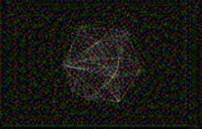 | 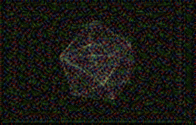 | 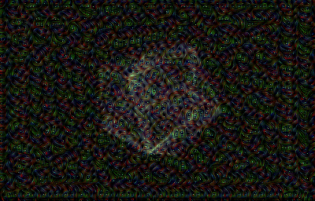 |
| conv3_3 256 ×2, step 0.03 | 19.3 | 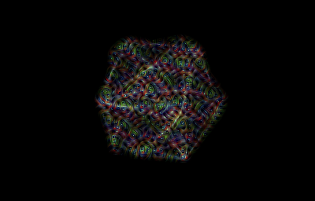 | 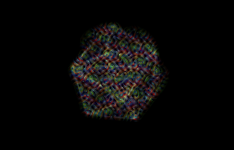 | 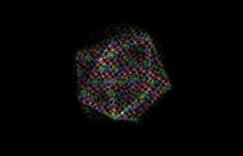 |
| conv4_3 256 ×1, step 0.04 | 13.8 | 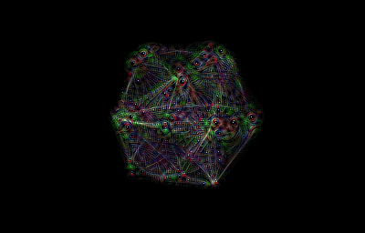 | 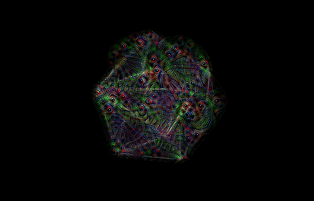 | 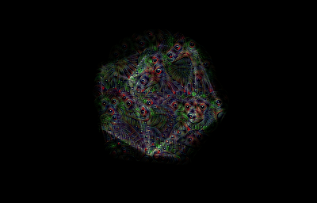 |
| conv2_2 256 ×2, step 0.03 | 13.4 | 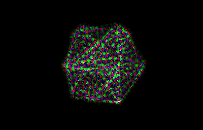 | 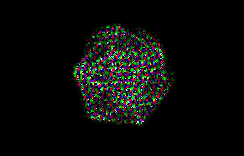 | 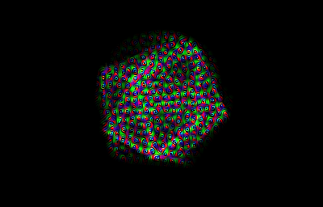 |
| inception 4c 192 ×2, step 0.03 | 19.2 | 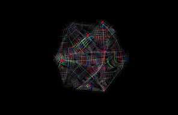 | 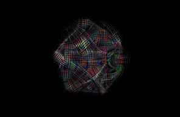 | 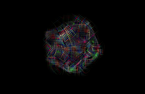 |
| conv3_3 384 ×2 fp16, 600-cell | 34.1 | 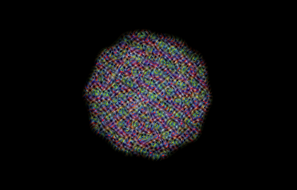 | 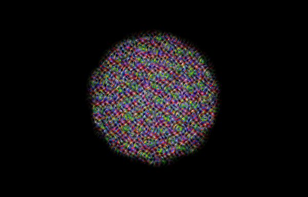 | 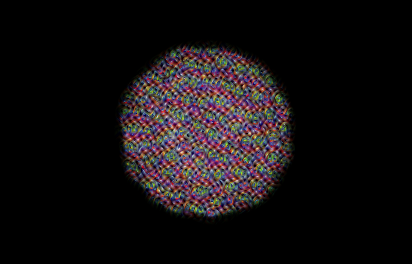 |
| conv3_3 256 ×2, 2 octaves alternating, 600-cell | 19.2 | 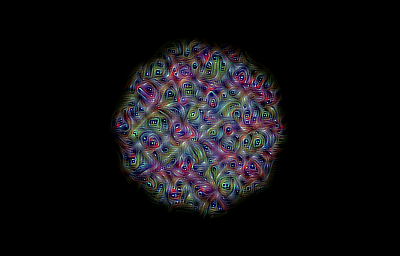 | 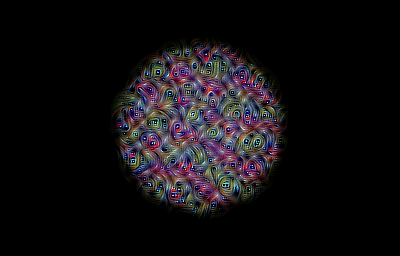 | 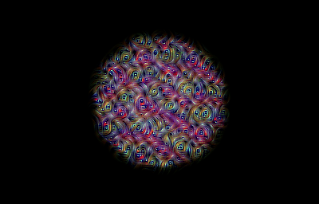 |

Triptychs (raw | dream | composite at frame 120):

**conv3_3 256 ×2, plain (control)**
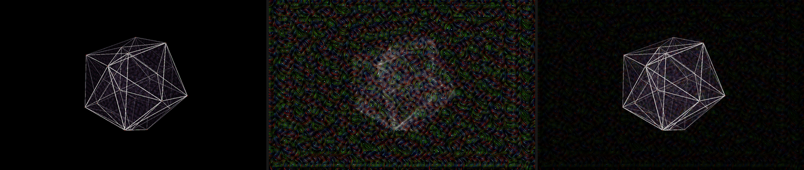

**conv3_3 256 ×2** — the recommended default
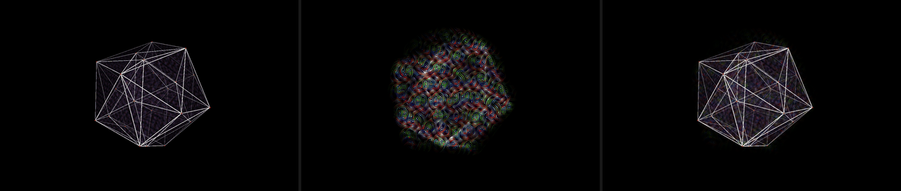

**conv4_3 256 ×1**
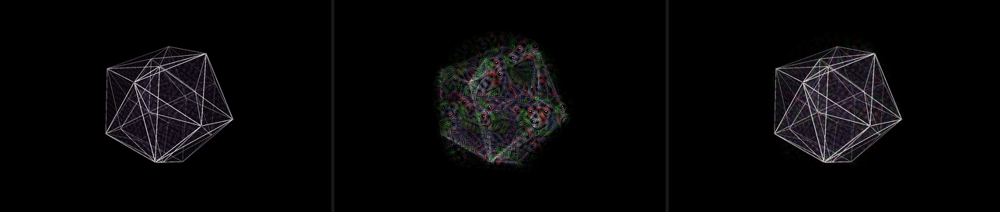

**conv2_2 256 ×2**
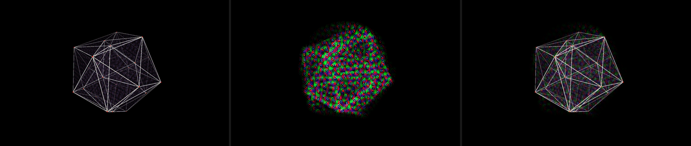

**inception 4c 192 ×2**
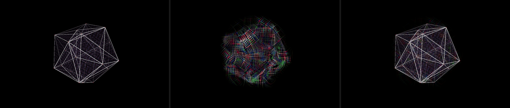

**conv3_3 384 ×2 fp16, 600-cell**
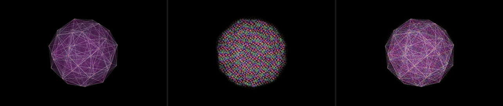

**conv3_3 256 ×2, 2 octaves alternating, 600-cell**
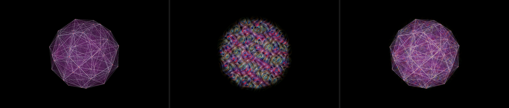

Things to judge by eye: conv2_2 is fine grain, conv3_3 the classic swirl,
conv4_3 larger and blotchier; inception 4c gives the recognisable
"eyes-and-dogs" curls even at 192; the 2-octave alternating run has the
largest-scale forms at the cost of nothing. The composite at 40 % / 70 % is
subtle on purpose — those two numbers are UI faders. The wireframe stays
white-hot because the composite is additive under the scene.

## F. History depth — `f_history.py`

| buffer | size | RGBA8 MiB | RGBA16F MiB | RGB32F MiB | 32 frames RGBA8 / 16F |
|---|---|---|---|---|---|
| 128 short side | 200×128 | 0.10 | 0.20 | 0.29 | 3.1 / 6.2 |
| 192 | 296×192 | 0.22 | 0.43 | 0.65 | 6.9 / 13.9 |
| 256 | 400×256 | 0.39 | 0.78 | 1.17 | 12.5 / 25.0 |
| 384 | 600×384 | 0.88 | 1.76 | 2.64 | 28.1 / 56.2 |
| 512 | 800×512 | 1.56 | 3.12 | 4.69 | 50.0 / 100.0 |
| window | 1280×820 | 4.00 | 8.01 | 12.01 | 128 / 256 |
| retina | 2560×1640 | 16.02 | 32.03 | 48.05 | 512 / 1025 |

Composite: one fullscreen pass sampling N layers of an array texture with a
per-layer age weight, render + finish, ms p50 (p99):

| target | history res | N=1 | N=4 | N=8 | N=16 | N=32 |
|---|---|---|---|---|---|---|
| 1280×820 | 400×256 | 0.39 (0.75) | 0.33 (0.48) | 0.37 (0.50) | 0.43 (0.54) | 0.63 (0.79) |
| 1280×820 | 800×512 | 0.31 (0.40) | 0.34 (0.43) | 0.39 (0.59) | 0.53 (1.07) | 0.65 (1.34) |
| 1280×820 | 1280×820 | 0.31 (0.44) | 0.34 (0.54) | 0.41 (1.04) | 0.81 (0.96) | 0.79 (0.99) |
| 2560×1640 | 400×256 | 0.41 (0.53) | 0.54 (0.73) | 0.66 (0.83) | 0.78 (1.12) | 1.20 (1.25) |
| 2560×1640 | 800×512 | 0.33 (0.47) | 0.42 (0.58) | 0.53 (0.64) | 0.83 (1.06) | 1.37 (2.22) |
| 2560×1640 | 1280×820 | 0.36 (0.54) | 0.45 (0.65) | 0.62 (1.08) | 0.87 (1.09) | 1.29 (1.93) |

**Practical answer:** history depth is not a constraint at any size — 32
full-resolution layers are 128 MiB and 0.8 ms. But the temporal scheme
makes the question moot: the single running buffer `D` *is* the history
(persistent content accumulates steps, moved content fades at `k`), so the
compositor samples one texture. The only reason to keep more is a
non-dreamed trail (raw frames faded by age) layered under the dream, which
would be 4–8 RGBA8 layers at dream resolution, ~3 MiB and 0.35 ms.

---

## Recommendation

**Copy path and framework.** torch on MPS, in a worker thread, reading the
frame with `fbo.read_into(alias)` where `alias` is the numpy view of
`torch.mps._host_alias_storage()` of a resident uint8 tensor, and writing
the result back with `texture.write(alias_out)` after
`torch.mps.synchronize()`. 0.9 ms round trip at 256, ~1.3 ms at 512, all in
one process with no ctypes. The frame goes in as RGBA8 and is converted on
the GPU; never build float frames on the CPU. Keep the IOSurface + DLPack
path (`b_iosurface.py`) documented as the fallback if the alias API
disappears — it is a private torch function — or if the render moves to a
resolution where the 0.5 ms matters. Do not port to MLX and do not build
the GLSL net.

Ordering rule the worker must follow (both paths): `ctx.finish()` (or a
fence) after the frame is drawn and before the read; `torch.mps.synchronize()`
before the write-back is uploaded. The dream result lands one frame late
by design (frame N is read after it is drawn, dreamed during frame N+1,
composited in frame N+2); the buffer's persistence hides it.

Overlay mode: the read is RGBA and the ground is premultiplied at
`bg_alpha`; dream on RGB only and hand the compositor an alpha that is the
content mask, so the wake does not tint the desktop where nothing was.
(Not measured; the mask is already computed.)

**Default configuration.**

| parameter | default | why |
|---|---|---|
| net / layer | VGG16 conv3_3 (through its ReLU) | the classic look, 6 ms/step at 256², pretrained from torchvision |
| buffer | short side 256 (400×256 for 1280×820) | 19 ms per frame with 2 steps on the real aspect; the knee of the launch-overhead curve |
| steps per frame | 2 | 1 flickers, 4 costs 2× for little |
| step size | 0.03 | with std-normalised gradient; `step × steps / k` = 0.75, inside the stable band once the mask is on (0.5 without it) |
| k (blend) | 0.08 | ~12-frame memory; the wake fades in about a fifth of a second |
| gradient | std-normalised, jitter ±8 px, content mask decay 0.97 / gain 4 / blur 9 | all free; without jitter the texture is pixel noise, without the mask the ground fills |
| octaves | 1 (offer "2 alternating" as the multi-scale look) | same cost as 1 |
| every N | 1 | idling makes each call slower |
| dtype | fp32 | fp16 saves 10 % on VGG and adds p99 outliers |
| composite | D darkened to 0.7, alpha 0.4, additive under the scene | what the samples show |

**UI ranges to expose** (all live, none need a restart except net/layer):

| parameter | range | notes |
|---|---|---|
| layer | conv2_2 · conv3_3 · conv4_3 · inception 3b/4c/4e | a *look* control; cost 13–20 ms at 256 for VGG, inception flat ~9–12 ms/step at any size |
| resolution (short side) | 128 – 384 | 192–256 is the useful band; 384 is 34 ms with conv3_3 ×2 (only with 1 step or inception) |
| steps | 1 – 3 | 1 flickers; 3 is the budget's ceiling at 256 |
| step size | 0.005 – 0.06 | stability wants `step × steps ≤ 0.6 k` unmasked; with the mask the ground cannot fill, so the ceiling is saturation (`sat` > 2 %), roughly 0.06 at k = 0.08 |
| k | 0.03 – 0.3 | memory 33 → 3 frames; below 0.03 everything runs away |
| octaves | 1 · 2 alt · 3 alt | free; "all per call" variants are 1.6–1.9× and not worth a control |
| mask decay | 0.9 – 0.995 | how long a wake persists after content leaves (10 → 200 frames) |
| composite alpha / darken | 0 – 1 each | |
| jitter | 0 – 16 px | |

**Ranked levers when the frame budget is exceeded** (from C and D, best
look per ms first):

1. steps 2 → 1 (−40 %; raise step size 1.5× and accept some flicker, or
   switch to 2 octaves alternating which is the same cost as 1 octave)
2. resolution 256 → 192 (−30 %); below 192 nothing is gained on VGG
3. layer conv3_3 → conv2_2 (−25 %, finer look) — or, above 384 px, switch
   to inception 4c which is flat in resolution
4. fp16 on VGG (−10 %, watch p99)
5. octaves "all per call" → "alternating" if someone turned that on (−45 %)
6. never: every-N cadence (slower per call, worse p99, renderer p99 up),
   channels_last (slower on MPS)

**Budget reality.** The stated 20 ms/frame of dream work is met by the
default at p50 (19 ms on the real 400×256 buffer) and missed at p99 (20–21
ms); the worker just runs one frame later then, which the scheme tolerates.
If it must be under 20 ms at p99, ship 192 px × 2 steps (9 ms) or 256 × 1
step + 2 octaves alternating. The renderer's 60 fps was never at risk in
any configuration measured — its frame work stayed under 3.5 ms p99 with a
worker saturating the GPU — provided the worker does no Python busy-work.

**Not measured / uncertain.**

- The GPU-clock explanation for the cadence effect is inferred from timing,
  not from `powermetrics` (needs root).
- Contention was measured with an offscreen FBO and a paced loop, not a
  real GLFW window with vsync; a swap can block differently than
  `finish()` + `sleep`. The `no worker` row's 39 fps is `time.sleep`
  overshoot, not renderer cost.
- Overlay (transparent framebuffer) compositing was not run; the alpha
  handling above is a design note.
- fp16 on the dispatch-bound nets showed occasional 17 ms outliers
  (mobilenet 128 px) that a 12-sample bench cannot characterise.
- `torch.mps._host_alias_storage` is private API (present in 2.14); the
  DLPack `kDLMetal` contract that the IOSurface path uses is undocumented.
- Stability thresholds ("stable / edge / runaway") are from 300 frames of
  one scene; the ratio rule held across all 41 runs but is empirical.
- Images are palette-quantised PNGs (256 colours) to fit 1.5 MB; the dream
  textures lose a little colour depth to that.
