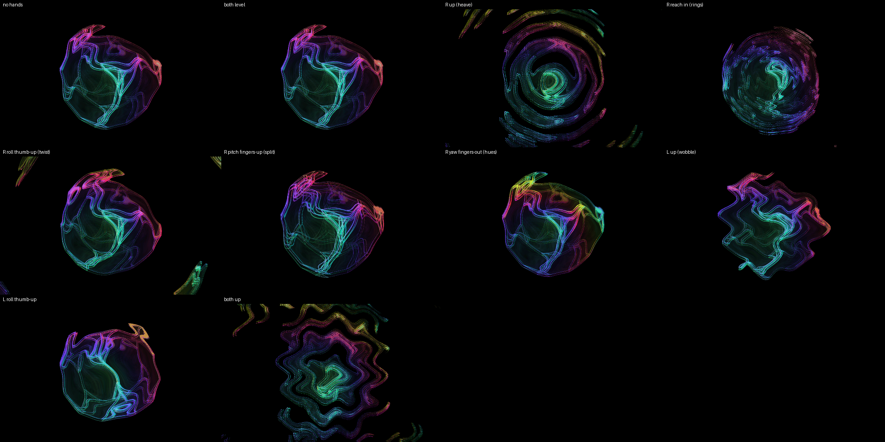

# ACID — Minecraft's acid

*The truncated tesseract in white lines over faint rings, and the frame
itself on acid: it heaves, rolls, shivers, splits into rainbow fringes and
cycles through the rainbow. Your right hand plays the acid; your left
hand holds the object and shakes the picture.*

Effects on: **acid** (heave, roll, breathe), **wobble**, **deconverge**
(the colour split), **hue cycle** — the `acid` FX module preset.

## Your hands

**Right hand — the acid.**
- Raise the hand: the frame heaves up and down, more the higher you go —
  at the top it rings out in waves from the centre.
- Reach in: the rings tighten. Pull back: they open into one slow swell.
- Roll your palm: the frame rolls about the centre, one way or the other
  (level = the scene's roll).
- Tip your fingers up: the colours split into fringes; down: they close.
- Turn your fingers out: the rainbow bands tighten; in: one colour at a
  time.

**Left hand — the object and the shiver.**
- Roll, tip and turn your palm: the object turns with it (up to 45°).
- Raise the hand: the whole picture shivers like heat over a road.

Nothing to pinch. A hand out of the box changes nothing.

## The desk

- Device knobs 1–8: FX mix · Acid bend · Acid twist · Acid reach · Acid
  breathe · Wobble amount · Deconverge amount · Hue cycle spread — each
  ring shows its base. (With SHIFT latched they are the band strip; press
  SHIFT again to get them back. F6 puts every one back where it was.)
- Track knobs as on every preset: brightness, speed, … zoom on 8.

## To load

1. PRESETS page → show ▾ → **party**, if it is not the open show.
2. Press **F6**, or clip row 1's sixth pad — ACID: the look, the hands
   and the desk in one step.
