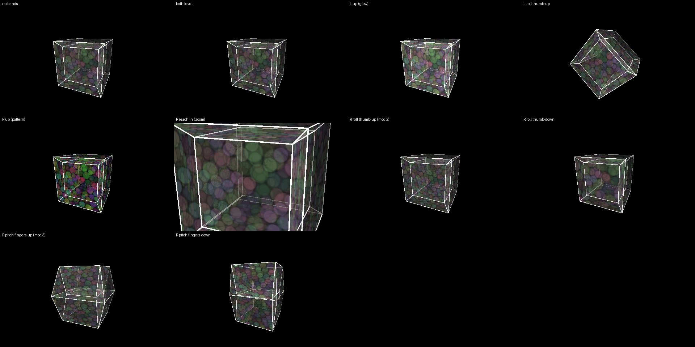

# FACES — the lit faces

*A tesseract with glowing honeycomb faces, passing through itself. Your
left hand holds it; your right hand lights and shapes the faces.*

## Your hands

**Left hand — hold the object.**
- Roll your palm: it rolls. Tip your fingers: it tips. Turn them out: it turns.
- Raise the hand: the faces glow brighter, up to the stop.
- Level, nothing; out of the box, it eases back.

**Right hand — the faces.**
- Raise the hand: the honeycomb pattern comes in (bottom = plain white
  faces, top = the full pattern).
- Reach in: the camera goes in close, the faces fill the screen. Pull back:
  it shrinks away.
- Roll your palm: thumb up makes the cells finer, thumb down coarser.
- Tip your fingers up: you look down onto it from above.

Nothing to pinch. A hand out of the box changes nothing.

## The desk

- Track knob 1: base brightness (the left hand adds to it). Knob 4: base
  pattern mix (the right hand adds to it). Knob 8: zoom.
- Clip rows 4 and 5: the shape. The pattern itself is on the VIEW page
  (HEX is set).

## To load

1. PRESETS page → project → load ▾ → **party** (once per night; if it is
   not listed, copy `hyperspace/library/projects/party.hyp.json` into
   `~/Hyperspace/projects/` first).
2. Press **F2** — the FACES scene.
3. ROUTING page → strip → **party-faces**.
