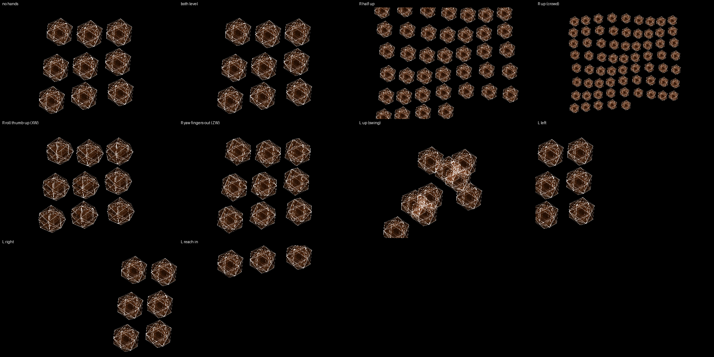

# FIELD — the crowd of copies

*Nine objects orbiting on ember faces. Your right hand fills the room
with them; your left hand flies over the field.*

## Your hands

**Right hand — how many.**
- Raise the hand: more copies — nine at the bottom, forty halfway,
  nearly seventy at the top. The camera pulls back by itself so they all
  stay on screen, and they brighten a little so the small ones still read.
- Roll your palm, or turn your fingers out: every copy turns in 4D at once.

**Left hand — fly.**
- Move it left or right: the whole field slides with your hand.
- Reach in: the field moves up and away. Pull back: it comes down toward you.
- Raise the hand: the copies swing further on their orbits (past halfway
  they start to cross each other).

Nothing to pinch. A hand out of the box changes nothing.

## The desk

- Track knob 3: base number of copies. Knob 5: base swing. Knob 6: how
  fast they orbit. Knob 8: zoom.
- Clip row 3, buttons 5–8: STILL · ORBIT · WAVE · RIPPLE (ORBIT is set).
- Clip rows 4 and 5: the shape.

## To load

1. PRESETS page → project → load ▾ → **party** (once per night).
2. Press **F3** — FIELD: the look, the hands and the desk
   in one step.
