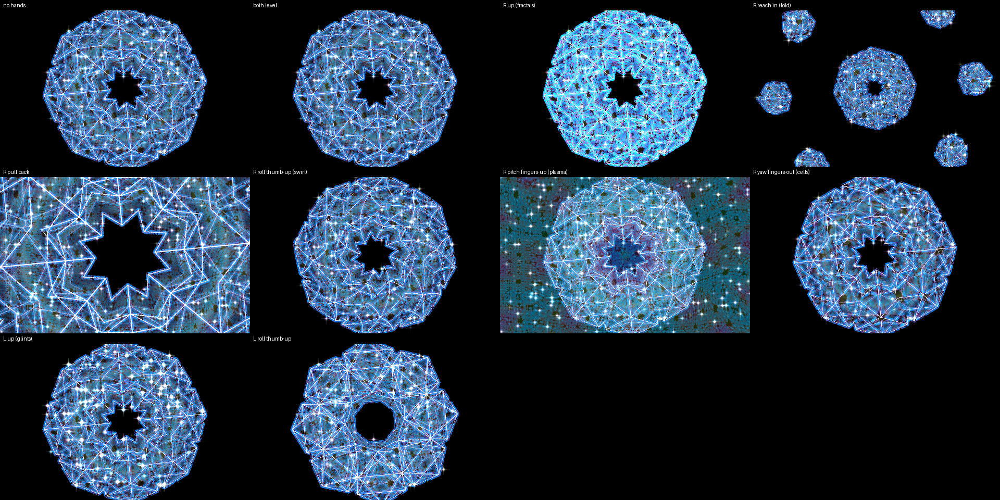

# MANDALA — the fold

*The 24-cell on plasma faces, set off the centre and folded through an
eight-wedge kaleidoscope into a ring; Noita's fractal lattice glows out of
it and glints flare on its edges. The black stays black until you flood
it. Your right hand plays the fold; your left turns the object inside it.*

Effects on: **plasma** (at level 0 until you flood it), **kaleidoscope**,
**fractals**, **glimmer** — the `mandala` FX module preset, with its
full-frame grounds turned down for the glass.

## Your hands

**Right hand — the fold.**
- Raise the hand: the fractal lattice swells over the shape.
- Reach in: the fold tightens — the ring shrinks and copies of it spin out
  to the corners. Pull back: it opens until the ring fills the frame.
- Roll your palm: the fold swirls, one way or the other (level = straight).
- Tip your fingers up: the plasma floods in behind the ring; down or level:
  black.
- Turn your fingers out: the lattice's cells grow; in: they go fine.

**Left hand — the object inside the fold.**
- Roll, tip and turn your palm: the object turns (up to 45°), and every
  wedge of the mandala turns with it.
- Raise the hand: the glints brighten.

Nothing to pinch. A hand out of the box changes nothing.

## The desk

- Device knobs 1–8: fx mix · plasma level · kaleido segments · kaleido
  zoom · fractals · fractals ground · glints · glints ground — each ring
  shows its base. The two grounds light the black too (a full-screen
  generator): leave them at 0 on the glass.
  (With SHIFT latched they are the band strip; press SHIFT again to get
  them back. F7 puts every one back where it was.)
- Track knobs as on every preset: brightness, speed, … zoom on 8.

## To load

1. PRESETS page → the **party** show (once per night).
2. Press **F7** — MANDALA: the look, the hands and the desk in one step.
