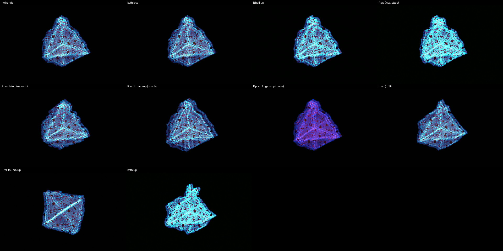

# NOITA — the trip

*The 16-cell on ember faces under Noita's trip at "heavily tripping": the
rim swims on drifting noise, the colours pump between magenta and hot
green, a fractal lattice glows out of the light, and a drunk ghost of the
picture floats beside it. Your right hand takes the trip further; your
left holds the object.*

Effects on: **trip warp**, **trip colour**, **fractals** — the
`noita heavily tripping` FX module preset — and **double vision**
(Noita's drunk ghost).

## Your hands

**Right hand — the trip.**
- Raise the hand: the next stage — the warp, the colour and the fractals
  all deepen together.
- Reach in: the warp ripples finer. Pull back: it heaves slowly.
- Roll your palm thumb up: the ghosts slide further out; thumb down: they
  close onto the picture.
- Tip your fingers up: the colour pumps faster; down: slower.

**Left hand — the object and the drift.**
- Roll, tip and turn your palm: the object turns with it (up to 45°).
- Raise the hand: the warp's noise drifts faster under the picture.

Nothing to pinch. A hand out of the box changes nothing: the scene is
"heavily tripping" on its own.

## The desk

- Device knobs 1–8: FX mix · Trip warp amount · Trip warp scale · Trip
  colour amount · Fractals amount · Fractals size · Double vision amount ·
  Double vision ghost — each ring shows its base. (With SHIFT latched they
  are the band strip; press SHIFT again to get them back. F8 puts every
  one back where it was.)
- Track knobs as on every preset: brightness, speed, … zoom on 8.

## To load

1. PRESETS page → show ▾ → **party**, if it is not the open show.
2. Press **F8**, or clip row 1's eighth pad — NOITA: the look, the hands
   and the desk in one step.
