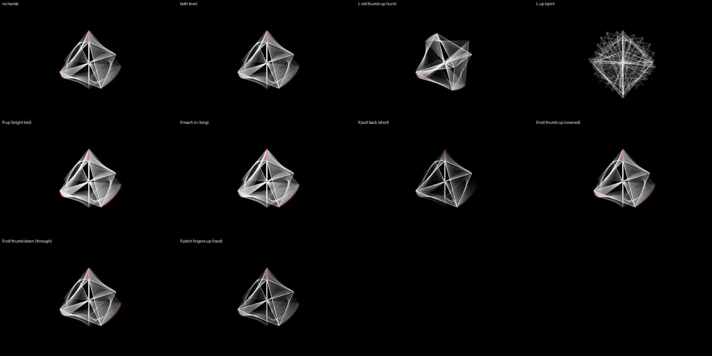

# TRACER — the trail you can read

*The 16-cell's white points and lines, no faces, spinning on the music and
leaving a clear trail of itself: 24 echoes, one every 1/15 s, so the trail
reaches 1.6 s back, each halving in brightness every 0.76 s. It looks the
same on a 60 Hz screen and a 120 Hz one. Your left hand turns the object —
that is what draws the trail; your right hand shapes the trail.*

The look-back alone — the dream buffer stays out (dream mix 0), so this
reads the same with or without the dream worker.

## Your hands

**Left hand — move the object.**
- Roll your palm, tip your fingers, turn them out: it turns (up to 45°),
  and the turn draws a trail.
- Raise the hand: it spins faster; the trail fans out around it.

**Right hand — the trail.**
- Raise the hand: the trail brightens (0.7 → 1).
- Reach in: it lasts longer (each echo halving in up to 1.9 s). Pull back:
  it snaps short (0.3 s).
- Roll your palm thumb up: the shape covers its own trail; thumb down: the
  trail glows through the shape.
- Tip your fingers up: only the trail's brightest lines stay (contrast);
  down: the faint ones come in.

Nothing to pinch. A hand out of the box changes nothing.

## The desk

- Device knobs 1–8: echo mix · fade · echoes · spacing · darken ·
  contrast · occlude · 4D depth — each ring shows its base. Echoes ×
  spacing is how far back the trail reaches. (With SHIFT latched they are
  the band strip; press SHIFT again to get them back. Loading TRACER again
  puts every one back where it was.)
- Track knobs as on every preset: brightness, speed, … zoom on 8.

## To load

TRACER is a ninth party preset: it is in the PRESETS list, not on an
F-key (F1–F8 are the five and the three effect families). PRESETS page →
presets → **TRACER**. To play it from the desk, put it in a slot of your
own show and save.
