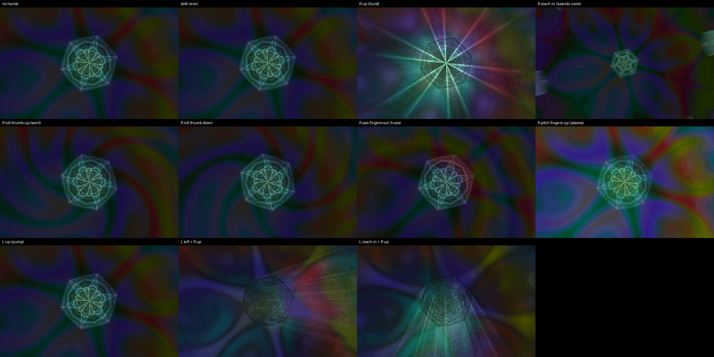

# TRIP — the effect stack

*A mandala: plasma under a kaleidoscope, a burst of light on top, hues
cycling. Your right hand plays the effects; your left hand makes it beat.*

## Your hands

**Right hand — the effects.**
- Raise the hand: the burst — light shoots out from the centre, more the
  higher you go.
- Reach in: the kaleidoscope folds tighter. Pull back: it opens out.
- Roll your palm: the fold swirls, one way or the other (level = straight).
- Turn your fingers out: the rainbow bands tighten; in: they go.
- Tip your fingers up: the plasma floods in; down: it drains.

**Left hand — the beat and the burst's centre.**
- Raise the hand: the picture starts pumping on the beat (nothing at the
  bottom, full at the top).
- Move it left or right: the burst's centre follows.
- Reach in: the burst rises to the top of the frame; pull back: it drops.

Nothing to pinch. A hand out of the box changes nothing.

## The desk

- **First:** tap TAP TEMPO four to eight times with the music, then press
  METRONOME once on a downbeat. (Until METRONOME is pressed once, every
  tap moves the downbeat and the pump hiccups.)
- Track knob 8: base zoom. The effect amounts are on the FX page (the
  `trip` preset in its strip puts them back).

## To load

1. PRESETS page → project → load ▾ → **party** (once per night).
2. Press **F5** — the TRIP scene.
3. ROUTING page → strip → **party-trip**.
