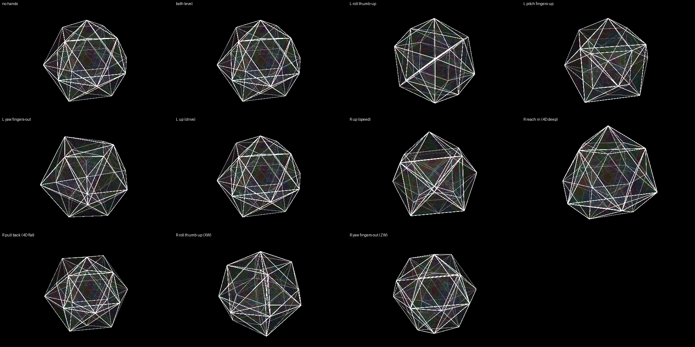

# TUMBLE — the polytope

*One object, turned inside out by the music. Your left hand holds it;
your right hand drives it.*

## Your hands

**Left hand — hold the object.**
- Roll your palm (thumb up or down): the object rolls with it.
- Tip your fingers up or down: it tips away from you or toward you.
- Turn your fingers out or in: it turns about the vertical.
- Raise the hand: the music grips it harder (every kick and bass hit spins
  it further). Bottom of the box = the desk's drive fader as set.
- Hold it level and it does nothing. Take it out and it eases back.

**Right hand — drive it.**
- Raise the hand: faster. Bottom of the box = the calm speed.
- Reach in (away from you): deeper into 4D — the inner cell swells through
  the outer. Pull back toward you: flatter.
- Roll your palm, or turn your fingers out: an extra 4D turn on top.

Nothing to pinch. A hand out of the box changes nothing.

## The desk

- MASTER fader: the drive your left hand pushes from.
- Track knobs 1 and 2: base brightness and speed. Knob 8: zoom.
- Clip rows 4 and 5: the shape. Activator buttons: which planes the music
  turns (XW, YW, ZW are set).

## To load

1. PRESETS page → project → load ▾ → **party** (once per night).
2. Press **F1** (or the first green button of clip row 1) — the TUMBLE scene.
3. ROUTING page → strip → **party-tumble**.
