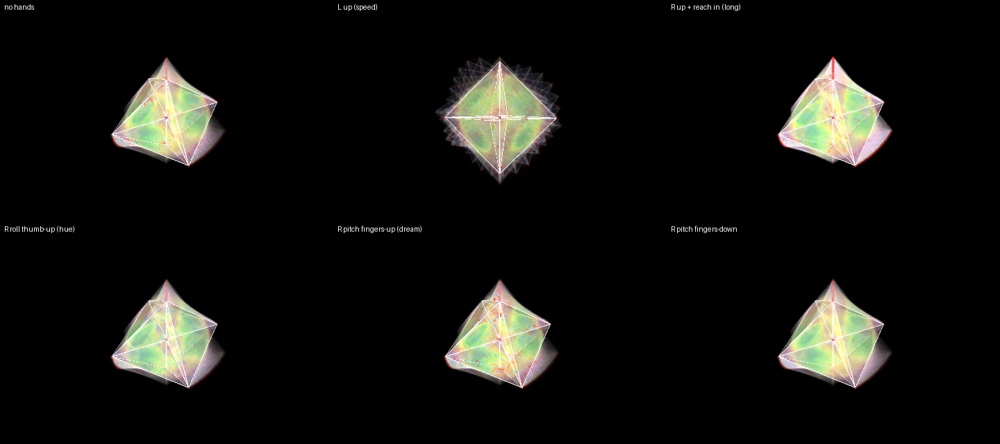

# WAKE — the trail and the dream

*A 16-cell on plasma faces and points, leaving a wake of itself behind —
24 echoes over 1.2 s, each halving in 0.6 s, the same on a 60 Hz or a
120 Hz screen — with the dream painted into it. Your left
hand moves it, which is what paints the wake; your right hand is the wake.*

The dream worker is on by default; the same poses with it running:

## Your hands

**Left hand — move the object.**
- Roll your palm, tip your fingers, turn them out: it turns, and the turn
  leaves a trail.
- Raise the hand: it spins faster, the trail stretches.
- Level, nothing; out of the box, it eases back.

**Right hand — the wake.**
- Raise the hand: brighter echoes (0.6 at the bottom, full at the top).
- Reach in: the trail lasts (each echo halving in 1.5 s). Pull back: it
  snaps off short (0.24 s).
- Roll your palm: the dream's colours go round the whole wheel (level =
  as painted).
- Tip your fingers up: more of the dream under the wake; down: less.

Nothing to pinch. A hand out of the box changes nothing. The two dream
controls (roll, tip) need the dream worker — the LOOKBACK page says
whether it is running.

## The desk

- Track knob 1: base brightness. Knob 2: base speed.
- Device knobs 1–8: Echo brightness · Echo fade time · Darken · Contrast ·
  Shape hides wake · Dream brightness · Dream saturation · Dream speed —
  each ring shows its base. (With SHIFT latched they are the band strip;
  press SHIFT again to get them back. F4 puts every one back where it was.)
- Cue knob: the shape.

## To load

1. PRESETS page → show ▾ → **party**, if it is not the open show.
2. Press **F4**, or clip row 1's fourth pad — WAKE: the look, the hands
   and the desk in one step.
