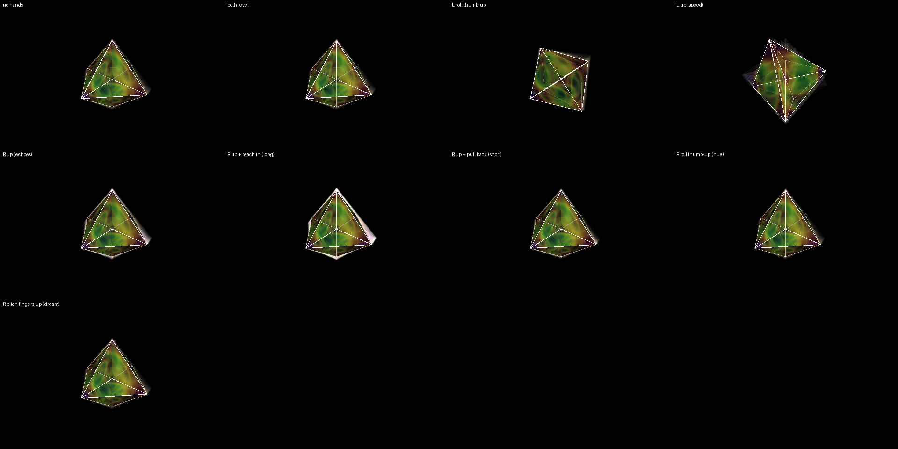

# WAKE — the trail and the dream

*A 16-cell on plasma faces, leaving a wake of itself behind. Your left
hand moves it, which is what paints the wake; your right hand is the wake.*

## Your hands

**Left hand — move the object.**
- Roll your palm, tip your fingers, turn them out: it turns, and the turn
  leaves a trail.
- Raise the hand: it spins faster, the trail stretches.
- Level, nothing; out of the box, it eases back.

**Right hand — the wake.**
- Raise the hand: more echoes (faint at the bottom, solid at the top).
- Reach in: the trail lasts and lasts. Pull back: it snaps off short.
- Roll your palm: the dream's colours go round the whole wheel (level =
  as painted).
- Tip your fingers up: more of the dream texture under the wake; down: less.

Nothing to pinch. A hand out of the box changes nothing. The two dream
controls (roll, tip) need the dream worker running — the LOOKBACK page
says whether it is.

## The desk

- Track knob 1: base brightness. Knob 2: base speed.
- The echo and dream bases are on the LOOKBACK page (the `wake` preset in
  its strip puts them back).

## To load

1. PRESETS page → project → load ▾ → **party** (once per night; if it is
   not listed, copy `hyperspace/library/projects/party.hyp.json` into
   `~/Hyperspace/projects/` first).
2. Press **F4** — the WAKE scene.
3. ROUTING page → strip → **party-wake**.
