# The face patterns: the migration map (plan 37 P2, dry run)

Generated by `tools/faces_sheets.py --map`; **do not edit by hand** —
`tests/test_faces_map.py` fails when this file and the presets disagree.
The sheets beside it (`sheet.png` on `party-faces`' tesseract,
`heart-sheet.png` on `plasma-heart`'s Heart, one `<NAME>.png` per mode) are
what the owner judges D1 from; nothing has been removed.

**How to read it.** For each mode: what it draws; the presets that show
it — *on screen* (a `pattern → … → shape.faces` wire drawn and the faces
on), *faces off* (the wire drawn, `view.faces` off: nothing shows until a
performer turns the faces on) and *unwired* (the mode is carried, the
faces read nothing from the pattern: dropping it changes nothing on
screen); and its nearest neighbours by look, nearest first. Whichever
subset the owner keeps, a dropped mode's presets move to the **first kept
name in its list** (`faces_sheets.nearest_kept`).

**The ranking rule**: the same structure on the face first (radial about
the centre; a straight-line lattice; a cell lattice; a flowing field; a
reader of the bands), then the same palette and light (bright lines on a
dark ground, or a full fill), then the same motion.

**Beyond the presets.** The desk rows in the *driven* column below put
`view.pattern` on a knob (`abs`), so a performer sweeps every mode there;
after P2 the knob's throw is the kept list. Presets in the owner's Drive
library are not read here (never touched by a build); P2 migrates them
with the same table, on the owner's say, the way plan 36's
`tools/migrate_library.py` moved it to `/7` (backup first).

Inputs on the sheets: the factory pattern depth (0.35) on a medium
passage (plan 22 B3's MEDIUM bands), `view.pattern_mix` 1.0,
3 frames in, hands absent; each tile is the frame's middle at full
resolution; the Heart sheet is lit at `view.bright` 2.5.

## Summary

| # | mode | on screen | faces off | unwired | nearest (ranked) |
|---|---|---|---|---|---|
| 0 | FLAT | 0 | 7 | 0 | PLASMA · CAUSTIC · EMBER |
| 1 | RINGS | 5 | 0 | 0 | BLOOM · SPIRAL · MOIRE |
| 2 | PLAID | 0 | 0 | 0 | WEAVE · MOIRE · TRUCHET |
| 3 | MOIRE | 1 | 0 | 0 | PLAID · RINGS · CAUSTIC |
| 4 | BLOOM | 0 | 0 | 0 | KALEIDO · SPIRAL · RINGS |
| 5 | CAUSTIC | 1 | 0 | 0 | MARBLE · PLASMA · MOIRE |
| 6 | HEX | 11 | 0 | 8 | CELLS · TRUCHET · METER |
| 7 | SPIRAL | 1 | 0 | 0 | BLOOM · RINGS · KALEIDO |
| 8 | CELLS | 1 | 0 | 0 | HEX · MARBLE · TRUCHET |
| 9 | PLASMA | 6 | 4 | 0 | MARBLE · CAUSTIC · EMBER |
| 10 | WEAVE | 0 | 1 | 0 | PLAID · TRUCHET · HEX |
| 11 | EMBER | 3 | 0 | 0 | MARBLE · PLASMA · CAUSTIC |
| 12 | METER | 0 | 0 | 0 | PULSE · BLOOM · KALEIDO |
| 13 | PULSE | 0 | 0 | 0 | METER · RINGS · BLOOM |
| 14 | MARBLE | 0 | 0 | 0 | CAUSTIC · EMBER · PLASMA |
| 15 | TRUCHET | 0 | 0 | 0 | WEAVE · HEX · PLAID |
| 16 | KALEIDO | 0 | 0 | 0 | BLOOM · SPIRAL · METER |

## Per mode

### 0 FLAT

No pattern: a plain white fill, tinted by the shape's own colour; reads no input.

- on screen, factory: —
- on screen, fixture: —
- faces off, factory: `hands-fx`, `hands-orbit`, `hands-pinch`, `hands-play`, `legacy6`, `lfo-breathe`, `seq-demo`
- faces off, fixture: —
- unwired, factory: —
- unwired, fixture: —
- nearest kept, in order:
  1. **PLASMA** — a full, soft fill of the face, the least 'pattern' of the rest
  2. **CAUSTIC** — a full fill of one cool hue family
  3. **EMBER** — a full fill, dark to bright, no hard lines

### 1 RINGS

Concentric rings from the face centre, beaten by a second ring set into travelling bands; the hue cycles along the ring phase.

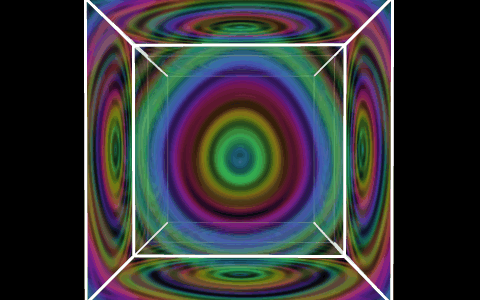

- on screen, factory: `dial`, `inverse-halo`, `party-acid`
- on screen, fixture: `palette-glass`, `wired-outputs`
- faces off, factory: —
- faces off, fixture: —
- unwired, factory: —
- unwired, fixture: —
- nearest kept, in order:
  1. **BLOOM** — radial about the face centre, the hue riding round it
  2. **SPIRAL** — radial, lines leaving the centre, the colour running outward
  3. **MOIRE** — beating line fields into travelling bands

### 2 PLAID

Two crossing straight-stripe wave systems, warm red on one axis and cool blue on the other, adding where they agree and going dark where they cancel.

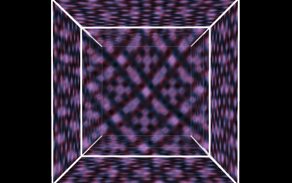

- on screen, factory: —
- on screen, fixture: —
- faces off, factory: —
- faces off, fixture: —
- unwired, factory: —
- unwired, fixture: —
- nearest kept, in order:
  1. **WEAVE** — a straight warm/cool lattice crossing at right angles
  2. **MOIRE** — straight stripe fields interfering into dark and bright
  3. **TRUCHET** — a square tile lattice of lines on a dark ground

### 3 MOIRE

Two near-equal straight stripe fields at a slight angle, beating into broad moiré bands; a teal–magenta duotone.

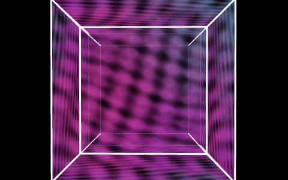

- on screen, factory: `strobe-cage`
- on screen, fixture: —
- faces off, factory: —
- faces off, fixture: —
- unwired, factory: —
- unwired, fixture: —
- nearest kept, in order:
  1. **PLAID** — straight stripe fields interfering
  2. **RINGS** — two line systems beating into bands
  3. **CAUSTIC** — interfering sine fields, a two-tone cool palette

### 4 BLOOM

A single ring of seven petals round the centre, turning, the hue round the wheel; the middle and the corners dark.

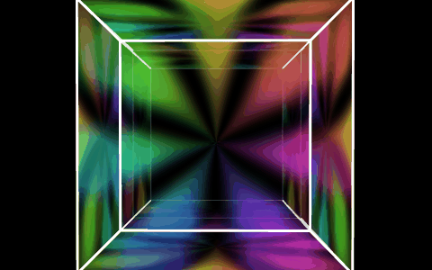

- on screen, factory: —
- on screen, fixture: —
- faces off, factory: —
- faces off, fixture: —
- unwired, factory: —
- unwired, fixture: —
- nearest kept, in order:
  1. **KALEIDO** — radial symmetry about the centre, turning, round the wheel
  2. **SPIRAL** — radial arms about a centre, turning
  3. **RINGS** — radial about the centre, hue round the phase

### 5 CAUSTIC

Deep water: dark-blue troughs and bright cyan-white filaments where three sine swells cross.

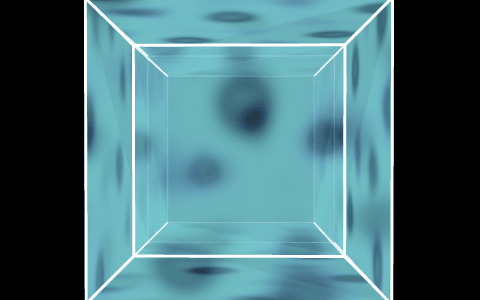

- on screen, factory: `big-blue-wave`
- on screen, fixture: —
- faces off, factory: —
- faces off, fixture: —
- unwired, factory: —
- unwired, fixture: —
- nearest kept, in order:
  1. **MARBLE** — flowing liquid lines on deep blue, bright filaments
  2. **PLASMA** — summed sine fields flowing over the whole face
  3. **MOIRE** — interfering sine stripes, a cool duotone

### 6 HEX

A honeycomb of round cells, each flashing on its own phase in its own hue.

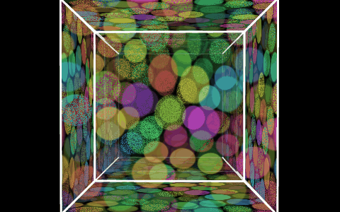

- on screen, factory: `hex-engine`, `party-faces`
- on screen, fixture: `backdrop-still`, `blend-luma-key`, `delay-trails`, `displace-luma`, `faces-media`, `media-chain-backdrop`, `media-to-output-2`, `resize-crop`, `through-one-output`
- faces off, factory: —
- faces off, fixture: —
- unwired, factory: —
- unwired, fixture: `blank-frame`, `branch-two-sizes`, `channel-out-only`, `delay-faces`, `echo-faces`, `media-chain-faces`, `resize-faces`, `switch-faces`
- nearest kept, in order:
  1. **CELLS** — a lattice of cells each in its own hue
  2. **TRUCHET** — a regular tile lattice that flips and flows
  3. **METER** — discrete segments each lit on its own

### 7 SPIRAL

Five galaxy arms winding out of a hot white core, the colour running out along the arms.

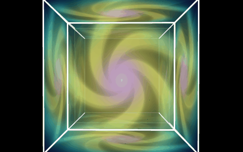

- on screen, factory: `spiral-silk`
- on screen, fixture: —
- faces off, factory: —
- faces off, fixture: —
- unwired, factory: —
- unwired, fixture: —
- nearest kept, in order:
  1. **BLOOM** — radial about a centre, turning, hue round the wheel
  2. **RINGS** — radial lines out from the centre
  3. **KALEIDO** — radial symmetry, turning

### 8 CELLS

Voronoi cells: drifting nuclei, each cell a flat hue, bright white membranes between them.

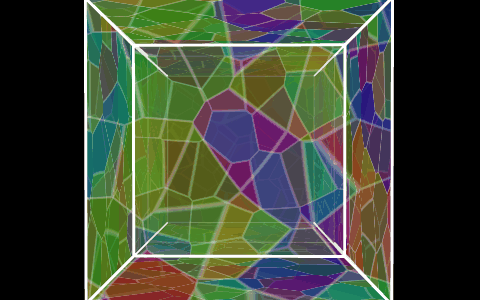

- on screen, factory: `party-tumble`
- on screen, fixture: —
- faces off, factory: —
- faces off, fixture: —
- unwired, factory: —
- unwired, fixture: —
- nearest kept, in order:
  1. **HEX** — a lattice of cells each in its own hue
  2. **MARBLE** — organic, drifting, bright veins between darker regions
  3. **TRUCHET** — a tiling with bright paths along its edges

### 9 PLASMA

The classic folded sine field: soft rainbow contour bands flowing over the whole face.

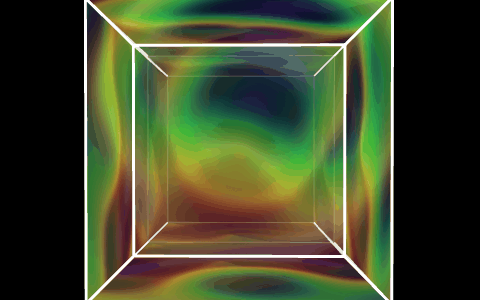

- on screen, factory: `party-mandala`, `party-trip`, `party-wake`, `plasma-heart`
- on screen, fixture: `acid-scene`, `glimmer-bug`
- faces off, factory: `party-tracer`
- faces off, fixture: `hands-glass-only`, `hands-lines`, `palette-hands`
- unwired, factory: —
- unwired, fixture: —
- nearest kept, in order:
  1. **MARBLE** — a flowing noise/sine field over the whole face
  2. **CAUSTIC** — summed sine fields flowing
  3. **EMBER** — a soft flowing field, no hard edges

### 10 WEAVE

Orange warp and blue weft ribbons interlaced over and under on a checker, breathing.

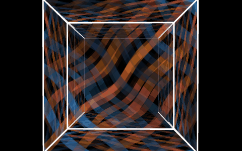

- on screen, factory: —
- on screen, fixture: —
- faces off, factory: `woven-lattice`
- faces off, fixture: —
- unwired, factory: —
- unwired, fixture: —
- nearest kept, in order:
  1. **PLAID** — a straight warm/cool lattice crossing at right angles
  2. **TRUCHET** — a square tile lattice of ribbons and paths
  3. **HEX** — a regular lattice of discrete elements

### 11 EMBER

Rising fractal noise: dark coals under ash, glowing orange, white-hot where it peaks.

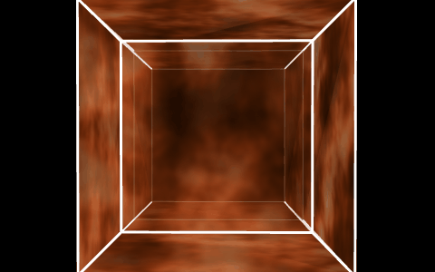

- on screen, factory: `ember-orbit`, `party-field`, `party-noita`
- on screen, fixture: —
- faces off, factory: —
- faces off, fixture: —
- unwired, factory: —
- unwired, fixture: —
- nearest kept, in order:
  1. **MARBLE** — fractal noise flowing, bright veins out of dark
  2. **PLASMA** — a soft flowing field over the whole face
  3. **CAUSTIC** — bright where it peaks out of a dark ground

### 12 METER

The bands themselves: a radial LED equaliser, a spectrum-coloured wedge per band lit out from the hub as far as it reads (dark tracks in silence).

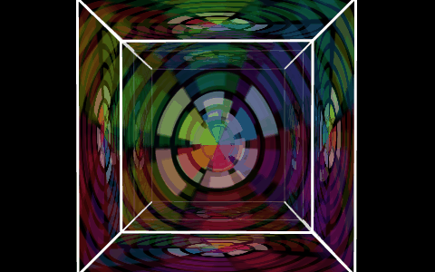

- on screen, factory: —
- on screen, fixture: —
- faces off, factory: —
- faces off, fixture: —
- unwired, factory: —
- unwired, fixture: —
- nearest kept, in order:
  1. **PULSE** — the other mode that draws the bands themselves
  2. **BLOOM** — radial wedges round the centre, hue round the wheel
  3. **KALEIDO** — radial wedges of flat colour, turning

### 13 PULSE

The beat as shapes: a magenta kick disc throwing a ring, yellow snare rays, cyan hat sparkle; an idle heartbeat in silence.

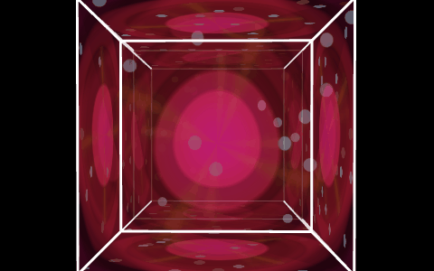

- on screen, factory: —
- on screen, fixture: —
- faces off, factory: —
- faces off, fixture: —
- unwired, factory: —
- unwired, fixture: —
- nearest kept, in order:
  1. **METER** — the other mode that draws the bands themselves
  2. **RINGS** — rings thrown out from the centre
  3. **BLOOM** — a radial shape about the centre, on black

### 14 MARBLE

Domain-warped noise folded through itself: lapis ink, teal currents and fine gold veins, flowing.

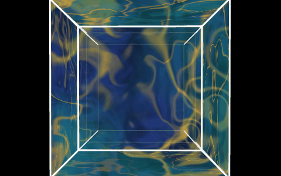

- on screen, factory: —
- on screen, fixture: —
- faces off, factory: —
- faces off, fixture: —
- unwired, factory: —
- unwired, fixture: —
- nearest kept, in order:
  1. **CAUSTIC** — flowing liquid lines on deep blue
  2. **EMBER** — fractal noise flowing, bright veins out of dark
  3. **PLASMA** — a flowing field over the whole face

### 15 TRUCHET

A maze of quarter-circle arcs on a navy checker, tiles flipping, a neon cyan-to-magenta current running along the paths.

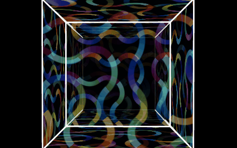

- on screen, factory: —
- on screen, fixture: —
- faces off, factory: —
- faces off, fixture: —
- unwired, factory: —
- unwired, fixture: —
- nearest kept, in order:
  1. **WEAVE** — a square lattice of ribbons crossing
  2. **HEX** — a regular tile lattice
  3. **PLAID** — a straight lattice of lines on dark

### 16 KALEIDO

Six mirrored wedges of flat pop colour — magenta, yellow, cyan, black bands and dots — turning, hard-edged.

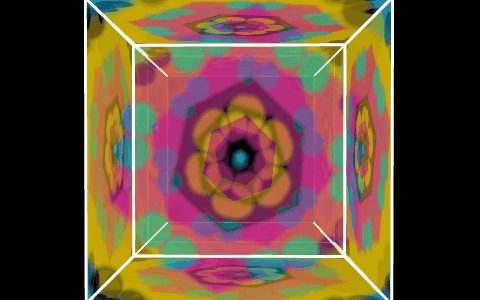

- on screen, factory: —
- on screen, fixture: —
- faces off, factory: —
- faces off, fixture: —
- unwired, factory: —
- unwired, fixture: —
- nearest kept, in order:
  1. **BLOOM** — radial symmetry about the centre, turning, saturated
  2. **SPIRAL** — radial, turning
  3. **METER** — radial wedges of flat colour

## Every preset

As the real loader lands each file (schema as on disk; a fixture of an
older schema is migrated on load). *path* is the drawn run from the
pattern to the faces; *also* any other port the pattern's picture goes
into; *driven* the file's own rows that set `view.pattern`.

| preset | where | schema | mode | faces | state | path | also | driven |
|---|---|---|---|---|---|---|---|---|
| `big-blue-wave` | factory | /7 | 5 CAUSTIC | on | on screen | pattern → shape.faces | — | desk: cc:*:19 abs |
| `dial` | factory | /7 | 1 RINGS | on | on screen | pattern → shape.faces | — | desk: cc:*:19 abs |
| `ember-orbit` | factory | /7 | 11 EMBER | on | on screen | pattern → shape.faces | — | desk: cc:*:19 abs |
| `hands-fx` | factory | /7 | 0 FLAT | off | faces off | pattern → shape.faces | — | — |
| `hands-orbit` | factory | /7 | 0 FLAT | off | faces off | pattern → shape.faces | — | desk: cc:*:19 abs |
| `hands-pinch` | factory | /7 | 0 FLAT | off | faces off | pattern → shape.faces | — | desk: cc:*:22 abs |
| `hands-play` | factory | /7 | 0 FLAT | off | faces off | pattern → shape.faces | — | desk: cc:*:19 abs |
| `hex-engine` | factory | /7 | 6 HEX | on | on screen | pattern → shape.faces | — | desk: cc:*:19 abs |
| `inverse-halo` | factory | /7 | 1 RINGS | on | on screen | pattern → shape.faces | — | desk: cc:*:19 abs |
| `legacy6` | factory | /7 | 0 FLAT | off | faces off | pattern → shape.faces | — | desk: cc:*:19 abs |
| `lfo-breathe` | factory | /7 | 0 FLAT | off | faces off | pattern → shape.faces | — | — |
| `party-acid` | factory | /7 | 1 RINGS | on | on screen | pattern → shape.faces | — | — |
| `party-faces` | factory | /7 | 6 HEX | on | on screen | pattern → shape.faces | — | desk: cc:*:19 abs |
| `party-field` | factory | /7 | 11 EMBER | on | on screen | pattern → shape.faces | — | desk: cc:*:19 abs |
| `party-mandala` | factory | /7 | 9 PLASMA | on | on screen | pattern → shape.faces | — | — |
| `party-noita` | factory | /7 | 11 EMBER | on | on screen | pattern → shape.faces | — | — |
| `party-tracer` | factory | /7 | 9 PLASMA | off | faces off | pattern → shape.faces | — | — |
| `party-trip` | factory | /7 | 9 PLASMA | on | on screen | pattern → shape.faces | — | — |
| `party-tumble` | factory | /7 | 8 CELLS | on | on screen | pattern → shape.faces | — | desk: cc:*:19 abs |
| `party-wake` | factory | /7 | 9 PLASMA | on | on screen | pattern → shape.faces | — | — |
| `plasma-heart` | factory | /7 | 9 PLASMA | on | on screen | pattern → shape.faces | — | desk: cc:*:19 abs |
| `seq-demo` | factory | /7 | 0 FLAT | off | faces off | pattern → shape.faces | — | desk: cc:*:19 abs |
| `spiral-silk` | factory | /7 | 7 SPIRAL | on | on screen | pattern → shape.faces | — | desk: cc:*:19 abs |
| `strobe-cage` | factory | /7 | 3 MOIRE | on | on screen | pattern → shape.faces | — | desk: cc:*:19 abs |
| `woven-lattice` | factory | /7 | 10 WEAVE | off | faces off | pattern → shape.faces | — | desk: cc:*:19 abs |
| `acid-scene` | fixture | /2 | 9 PLASMA | on | on screen | pattern → shape.faces | — | — |
| `backdrop-still` | fixture | /4 | 6 HEX | on | on screen | pattern → shape.faces | — | desk: cc:*:19 abs |
| `blank-frame` | fixture | /6 | 6 HEX | on | unwired | — | — | desk: cc:*:19 abs |
| `blend-luma-key` | fixture | /4 | 6 HEX | on | on screen | pattern → shape.faces | — | desk: cc:*:19 abs |
| `branch-two-sizes` | fixture | /5 | 6 HEX | on | unwired | — | — | desk: cc:*:19 abs |
| `channel-out-only` | fixture | /6 | 6 HEX | on | unwired | — | — | desk: cc:*:19 abs |
| `delay-faces` | fixture | /5 | 6 HEX | on | unwired | — | — | desk: cc:*:19 abs |
| `delay-trails` | fixture | /5 | 6 HEX | on | on screen | pattern → shape.faces | — | desk: cc:*:19 abs |
| `displace-luma` | fixture | /4 | 6 HEX | on | on screen | pattern → shape.faces | — | desk: cc:*:19 abs |
| `echo-faces` | fixture | /5 | 6 HEX | on | unwired | — | — | desk: cc:*:19 abs |
| `faces-media` | fixture | /4 | 6 HEX | on | on screen | pattern → shape.faces | — | desk: cc:*:19 abs |
| `glimmer-bug` | fixture | /5 | 9 PLASMA | on | on screen | pattern → shape.faces | — | — |
| `hands-glass-only` | fixture | /2 | 9 PLASMA | off | faces off | pattern → shape.faces | — | — |
| `hands-lines` | fixture | /2 | 9 PLASMA | off | faces off | pattern → shape.faces | — | — |
| `media-chain-backdrop` | fixture | /5 | 6 HEX | on | on screen | pattern → shape.faces | — | desk: cc:*:19 abs |
| `media-chain-faces` | fixture | /5 | 6 HEX | on | unwired | — | — | desk: cc:*:19 abs |
| `media-to-output-2` | fixture | /4 | 6 HEX | on | on screen | pattern → shape.faces | — | desk: cc:*:19 abs |
| `palette-glass` | fixture | /2 | 1 RINGS | on | on screen | pattern → shape.faces | — | — |
| `palette-hands` | fixture | /2 | 9 PLASMA | off | faces off | pattern → shape.faces | — | — |
| `resize-crop` | fixture | /6 | 6 HEX | on | on screen | pattern → shape.faces | — | desk: cc:*:19 abs |
| `resize-faces` | fixture | /6 | 6 HEX | on | unwired | — | — | desk: cc:*:19 abs |
| `switch-faces` | fixture | /5 | 6 HEX | on | unwired | — | — | desk: cc:*:19 abs |
| `through-one-output` | fixture | /6 | 6 HEX | on | on screen | pattern → shape.faces | — | desk: cc:*:19 abs |
| `wired-outputs` | fixture | /2 | 1 RINGS | on | on screen | pattern → shape.faces | — | — |
