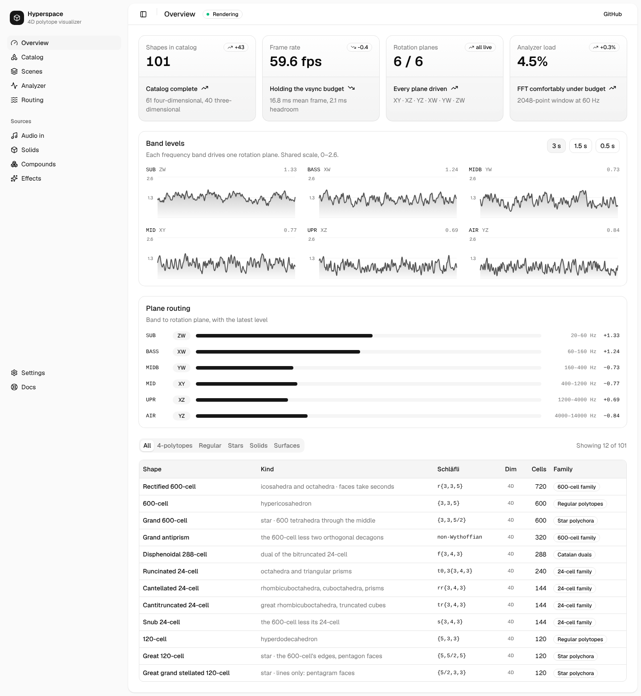

# Dashboard

A sketch of a **Hyperspace control surface** built from
[shadcn/ui](https://ui.shadcn.com) components, to see how that component
library reads against this project's data. Vite + React + Tailwind v4, built
through the `shadcn` CLI. Not part of the app, and nothing here drives the
renderer — it is a look at a toolkit, not a proposed UI.



## It is also an oracle

This dashboard is the ground truth for
[`hyperspace-python/hyperspace/dkit/`](../../hyperspace-python/hyperspace/dkit/), which
rebuilds the same surface in Dear ImGui and diffs itself against it. Three
things here are load-bearing for that and should not be changed casually:

- `src/Gallery.tsx` renders the real shadcn components pinned to the rects in
  `hyperspace/dkit/dev/spec.json`, reachable at `?gallery` (`&dark`, `&text`);
- `hyperspace/dkit/dev/flex_oracle.js` uses this project's browser to lay out the flex
  conformance cases;
- `node_modules/@fontsource-variable/geist` and `lucide-react` are where the
  kit's fonts and icons are cut from.

## What it shows

Four panels, each fed from the real catalog rather than invented numbers:

- **Stat cards** — catalog size, frame rate, rotation planes, analyzer load.
- **Band levels** — the six frequency bands as small multiples on one shared
  0–2.6 scale (`CEIL` in `bands.py`), each labelled with the rotation plane
  it drives.
- **Plane routing** — the band → plane table, with each band's crossover
  range and direction.
- **Shape catalog** — all 101 shapes, filterable by dimension and family.

## Where the data comes from

Two of the four are real, and two are stand-ins. That split is deliberate —
the point was to exercise the components, not to fake telemetry.

| Panel | Source |
|---|---|
| Shape catalog | **Real.** `src/data/shapes.json`, exported from `hyperspace.geometry.SHAPES` (101 shapes, 61 four-dimensional and 40 three-dimensional). |
| Plane routing | **Real.** `src/data/bands.ts` mirrors `BANDS` in `hyperspace-python/hyperspace/bands.py` — the same six bands, crossovers and directions. |
| Band levels | **Synthetic.** A seeded generator stands in for a live analyzer frame, so the page renders identically every time. |
| Stat cards | **Synthetic**, apart from the catalog count. |

To refresh the catalog after the shape list changes:

```bash
cd hyperspace-python && python3 -c "
import sys, json; sys.path.insert(0, '.')
import hyperspace.geometry as G
out = [{'name': s.name, 'kind': s.alias, 'cells': int(s.cells),
        'schlafli': s.sym, 'family': s.family, 'dims': int(s.dims)}
       for s in G.SHAPES]
out.sort(key=lambda r: (-r['dims'], -r['cells'], r['name']))
json.dump(out, open('../prototypes/dashboard/src/data/shapes.json', 'w'),
          indent=2, ensure_ascii=False)
print('wrote', len(out))
"
```

## Run it

```bash
cd prototypes/dashboard
npm install
npm run dev
```

`npm run build` type-checks and emits a static bundle to `dist/`, which is
relative-path based (`base: "./"`) so it opens from any directory.

## A note on the chart

The shadcn preset used here (Nova) ships a five-step **greyscale** chart
ramp — a sequential one, with no hue. Six independent band series cannot be
told apart on it, and cycling the five steps would reuse a colour across two
bands. So the chart is **small multiples**: one facet per band on a shared
scale, with identity carried by the facet label instead of by colour. That
also avoids stacking six series that are not parts of a whole.
