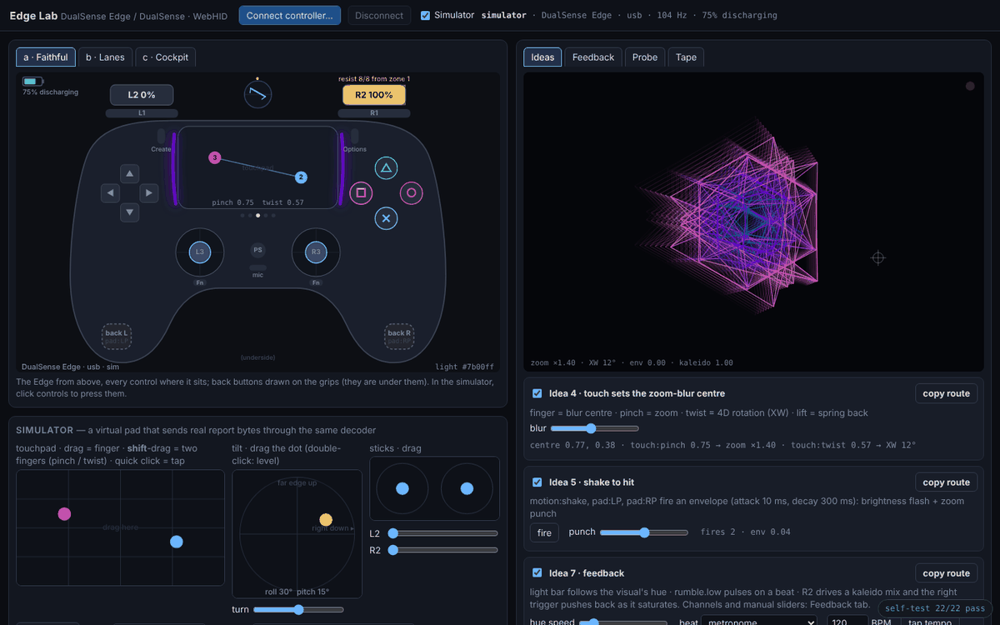
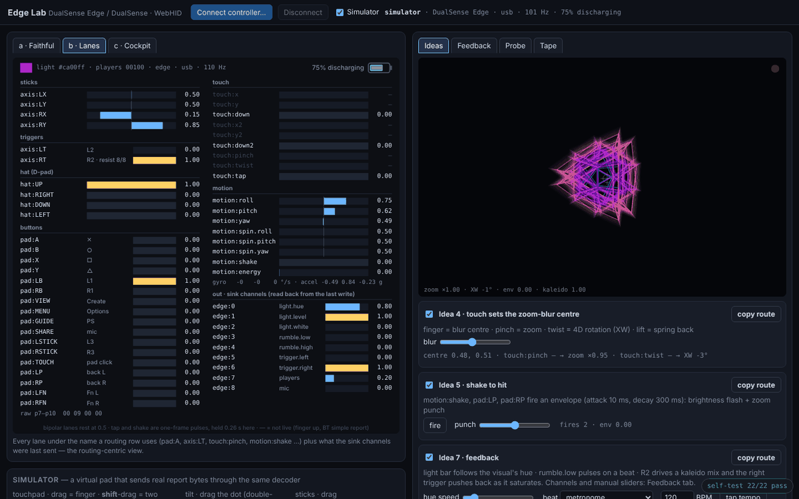
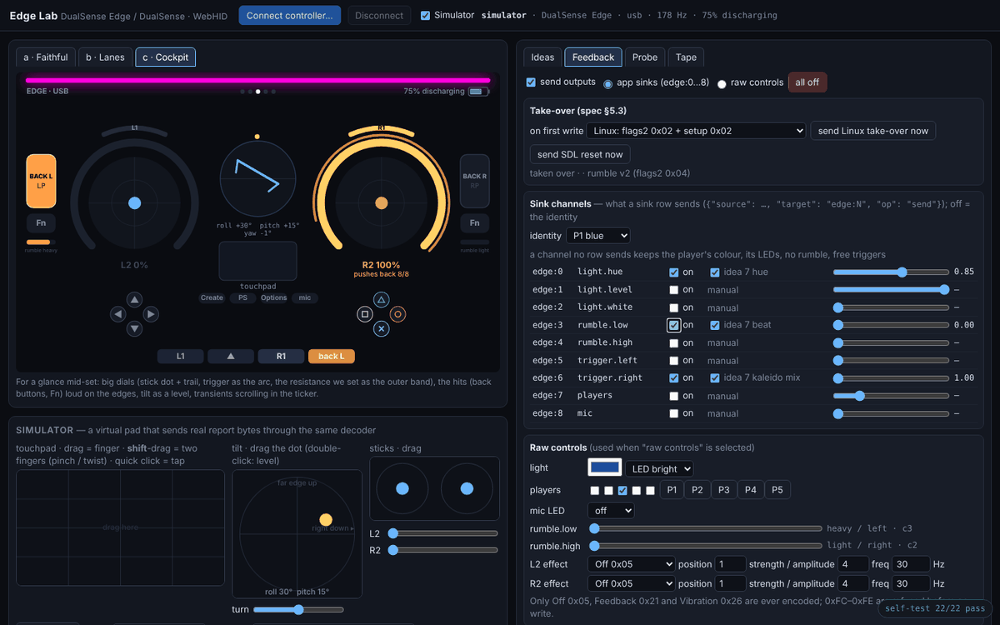
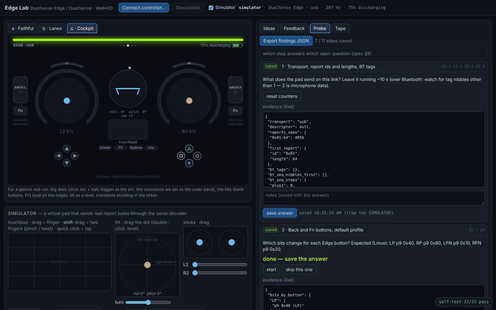
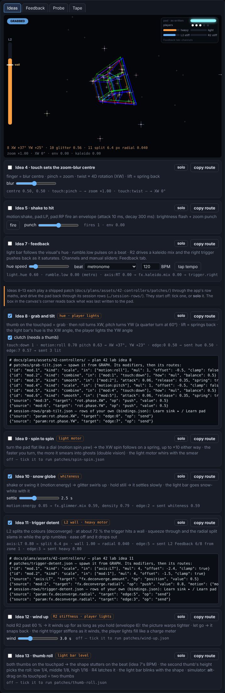

# Edge Lab

A single-page browser lab for the Sony **DualSense Edge** (and the plain
DualSense) over **WebHID**. You can see every control live, try routing
ideas on a small 4D visual, drive the light bar, rumble and triggers, and
run the hardware checks the Python driver still needs answered. It also
works with no controller: a simulator sends real report bytes through the
same decoder.

The bytes follow `hyperspace-python/docs/plans/assets/42-controllers/sony-hid.md`.
The lane names, sink channels and tape format are the Python app's
(`pads/sony.py`, `pads/gesture.py`, `devices.pad_effects`), so whatever you
find here carries over. The spec's §8 test vectors run on load: the badge in
the bottom-right corner should read `self-test 30/30 pass`; click it for the
details.



## Open it

Use Chrome, Edge or Brave on the Mac. Safari and Firefox have no WebHID,
though the simulator still works in them. WebHID also needs a secure page,
so serve the folder from localhost:

```sh
cd prototypes/edge-lab
python3 -m http.server        # then open http://localhost:8000
```

**Connect the pad** with a USB-C cable, or over Bluetooth:

1. Hold **Create + PS** until the light bar flashes.
2. Open System Settings ▸ Bluetooth and connect the "DualSense Edge
   Wireless Controller".
3. Press **Connect controller…** and pick it.

Chrome remembers the device: the page reopens it on reload and when it comes
back after a disconnect.

**Only one program can hold the pad at a time.** If Chrome has it open, the
app may fail to open it, because hidapi opens it exclusively. Close the tab
(or press **Disconnect**) before you start Hyperspace with the pad. Quit the
app before you connect here. Steam can also grab the pad or its LEDs. If the
device list is empty or no reports arrive, check System Settings ▸ Privacy
& Security ▸ Input Monitoring for Chrome.

## Panels

- **Readouts.** Three views to compare for the app's on-screen pad:
  - **a · Faithful:** the Edge from above, each control lit where it sits.
    It shows the trigger travel and the resistance zone we set, the light
    bar colour, the player LEDs, both touch fingers, tilt, and the back and
    Fn buttons. In the simulator you can click controls to press them.
  - **b · Lanes:** every lane under the name a routing row uses (`pad:A`,
    `axis:LT`, `hat:UP`, `touch:pinch`, `motion:shake`, …). It also reads
    back what the sink channels `edge:0…8` were last sent.
  - **c · Cockpit:** a glanceable view for mid-set. Big stick dials have the
    trigger as an arc and the resistance as an outer band. The back and Fn
    buttons are loud on the edges, tilt is shown as a level, and presses,
    taps and shakes scroll past in a ticker.

  
- **Simulator.** Shown when nothing is connected, or turn it on with the
  checkbox.
  - Left stick `WASD`, right stick `IJKL`, D-pad on the arrow keys.
  - ✕ `Space`, ○ `B`, □ `X`, △ `Y`.
  - L1 / R1 `Q` / `E`; L2 / R2 `Z` / `C` (hold to ramp).
  - Create `V`, Options `N`, PS `G`, mic `M`; L3 / R3 `F` / `H`; touchpad
    click `T`.
  - Back buttons `[` `]`, Fn buttons `-` `=`.
  - Shake: `Enter`.
  - Drag on the touchpad for one finger, shift-drag for two (pinch and
    twist), alt-drag for two thumbs (one parked on the left, the other
    under the pointer: idea 13's roll). Drag the tilt dot to tilt the
    pad; the "turn" slider spins it flat (idea 9). The model and transport
    can be switched, including the 10-byte BT simple report.
- **Ideas.** A tesseract with:
  - **4:** touch moves the zoom-blur centre, pinch zooms, twist turns XW, and
    everything springs back when the finger lifts.
  - **5:** a shake or a back button fires an envelope (10 ms attack, 300 ms
    decay).
  - **7:** feedback. The light bar follows the visual's hue, rumble.low
    pulses on a beat (metronome, tap tempo or the laptop mic's low band),
    and R2 drives a kaleido mix while the right trigger pushes back.
  - **8–13:** six more, each a patch that ships with its session rows. See
    [Ideas 8–13](#ideas-813-the-pad-plays-back) below.

  **copy route** shows the app's rows for each idea and copies them.
  **solo** turns every other idea off, and leaves only the soloed idea's
  output channels on.
- **Feedback.**
  - The nine sink channels in the app's order. Each has an on/off switch
    (off keeps the player identity), an auto setting (what the ticked idea
    sends; the label names the idea and the param), and a manual slider.
    Ticking one of ideas 8–13 turns its channels on, as adding its sink
    rows would.
  - Raw controls: light colour, player LEDs, mic LED, both motors, and a
    trigger tester (Off 0x05, Feedback 0x21, Vibration 0x26). 0xFC–0xFE are
    refused before any write.
  - Take-over: Linux's runs automatically on the first write; SDL's reset
    is a button.
  - The last report as hex, with a write log.

  Writes go out only when something changes, at most 60 per second.

  
- **Probe.** Eleven guided steps that answer the spec's §9 open questions,
  plus the back-button, profile, Fn, axis, touch-range, USB-length,
  take-over and jitter checks. Each step saves its answer with the raw
  evidence; **Export findings JSON** downloads them all. Answers recorded in
  the simulator are marked as such.

  
- **Tape.** Records raw input reports in the app's tape format,
  `hyperspace.padtape/1`. The first line is
  `{"tape": …, "model": …, "transport": …}`. After it comes one
  `{"t": seconds, "r": "<hex>"}` line per report; the hex is the full
  report with its id byte first, as hidapi returns it. Notes, including the
  probe steps' prompts, become `{"t": …, "note": …}` lines.

## Ideas 8–13: the pad plays back



Six more ideas, built on what only the Edge has: both touch points, the
gyro, the back buttons, the adaptive triggers, the light bar, the motors and
the player lights. Each one is a patch the app spawns as it is today, with
existing lanes, params and ops only. It lives in
`hyperspace-python/docs/plans/assets/42-controllers/patches/`, and the rows
that drive the pad back sit beside it in `…/session-rows/` under the same
name. The lab plays those same files: it runs each patch's numbers through a
copy of the app's row maths, so what it sends `edge:N` is what the app would
send. `tests/test_pads_examples.py` holds the lab's copy equal to the files
and to the app's ranges.

**Why the outputs are separate.** A patch can't carry a sink row:
`patches.check` refuses `param:… → edge:N` ("nothing of the patch's"), and
sinks belong to the session anyway. So each idea takes two steps:

1. Copy the patch into the library's `patches/` and spawn it from GRAPH.
2. Add its session rows: right-click the param → **Learn sink ▸** the
   channel (and **Learn pad** for idea 13's R4). Each session-rows file lists
   them; it's one or two rows per idea.

The rows say `edge:N`, after plan 42's example config (`role = "edge"`). On
the default device list the pad's role is `pad`, so Learn sink offers
`pad:N` instead. If a spawn renames an effect because the preset already has
one (`deconverge.2`), Learn the sink on the renamed param.

**To vet one,** tick it or press **solo**, then play the pad or the
simulator. The box in the canvas's top-right corner reads back what was last
written to the pad, decoded from the report bytes: the light bar, the player
lights, both motors and how stiff each trigger is. The live line under each
card shows the lanes coming in, the params they move, and what each channel
was sent.

| | You do | Out to the pad | Patch |
|---|---|---|---|
| 8 | thumb on the touchpad, then tilt | light bar hue, player lights | `grab-tilt.json` |
| 9 | turn the pad flat like a dial | light motor | `spin-spin.json` |
| 10 | shake or swing it, then hold still | light bar whiteness | `snow-globe.json` |
| 11 | squeeze L2 through a wall | left trigger stiffness, heavy motor | `trigger-detent.json` |
| 12 | hold R2, then let go | right trigger stiffness, player lights | `wind-up.json` |
| 13 | both thumbs on the touchpad; R4 | light bar level | `thumb-roll.json` |

**8 · Grab and tilt.** Rest a thumb on the touchpad to grab the shape, then
tilt the pad: roll turns it in XW, pitch in YW, a quarter turn at 60°. Lift
the thumb and it springs back.
- Maps: `motion:roll` and `motion:pitch`, each centred (a scale, −0.5),
  multiplied by `touch:down` (a combine) and sprung (a smooth with spring
  on) → push `rot.phase.XW` / `rot.phase.YW` 0.5.
- Out: `param:rot.phase.XW → edge:0`, so the light bar's hue *is* the XW
  angle and cycles as the shape spins. `param:rot.phase.YW → edge:7`, so the
  player lights are a spirit level for YW (two or three lit when level).
- Feel for: does it feel like holding the object, or like dragging it? Does
  grabbing jump the shape when your natural hold isn't level? Tilt is
  absolute, and mod.4's offset sets where "level" is. Can you tell the XW
  angle from the light bar without looking? In the lab, untick **clutch**
  and see whether always-on tilt is usable or too twitchy.

**9 · Spin to spin.** Turn the pad flat, like a dial, either way. The XW spin
follows on a spring, and the faster you turn, the more the shape smears into
ghosts.
- Maps: `motion:spin.yaw` → a springy smooth (about 0.75 s) → push
  `rot.rate.XW` 0.15 about rest 0.5, which is ±10× the spin at ±360°/s.
  The spin's size (two clamped scales and a max) → a smooth with a 0.6 s
  release → position `fx.doublevision.mix`. The patch holds the double
  vision: three ghosts, amount 6.
- Out: `param:fx.doublevision.mix → edge:4`: the light motor whirs with the
  smear and fades with it.
- Feel for: does the whir match how hard you're spinning? Is the spring's
  overshoot fun or annoying? It briefly spins the shape back when you stop.
  Is turning flat comfortable with both hands on? Is ×10 too much?

**10 · Snow globe.** Shake or swing the pad and glitter swirls up over the
picture. Hold it still and it settles over a few seconds.
- Maps: `motion:energy` → a smooth (0.08 s attack, 2.5 s release) →
  position `fx.glimmer.mix`, and push `fx.glimmer.density` 0.4 (more flakes
  the harder you shake).
- Out: `param:fx.glimmer.mix → edge:2`: the light bar goes snow-white while
  the glitter is up and gets its colour back as it settles.
- Feel for: is the settle time musical? Try the lab's **settle** slider;
  2.5 s is about a bar at 96 BPM. Does it fight idea 5, which also listens
  to a shake? Idea 5 is a hit, this is a texture. Is the whitening visible
  in a lit room?

**11 · Trigger detent.** Squeeze L2 and the colours split apart. At about
72 % the trigger pushes back. Squeeze through that wall and the radial split
slams in while the grip rumbles; ease off and it drops out.
- Maps: `axis:LT` → position `fx.deconverge.amount` 0.5 (up to 8 px). This
  route also takes L2 off its default 4D-depth job. Two clamped scales
  (×4 −2.4, then ×4 −1.5) turn L2 into a step from 69 % to 76 % → push
  `fx.deconverge.radial` 0.8 (in within 5 ms, out over 0.18 s).
- Out: `param:fx.deconverge.radial → edge:5`, the left trigger at Feedback
  6/8, only past the wall. The same param → `edge:3`, the heavy motor at 0.8
  while you hold it through.
- Feel for: can you rest just under the wall, or does the trigger buzz at
  the edge? The resistance can push your finger back under 69 %. Is a steady
  heavy rumble while through too much? If so, drop the `edge:3` row or move
  it to `edge:4`. Is 72 % the right place? The scales' offsets set it. The
  pad's resistance always starts at 15 % of the travel, because a sink sets
  only the strength, so this wall is the whole trigger stiffening at once
  rather than a zone of it.

**12 · Wind up.** Hold R2 past 60 % and the picture winds up, warping
tighter for as long as you hold. Let go and it snaps back.
- Maps: `axis:RT` → position `env.6.gate`, which opens at 60 % and shuts
  under 40 % (a toggle's hysteresis). Envelope 6 (gate, a 3 s attack with a
  slow start, a 0.15 s release) → push `fx.warp.amount` 1.0. The patch holds
  the trip warp, which reaches 2.0, very heavy, at full.
- Out: `param:fx.warp.amount → edge:6`, so the right trigger stiffens as it
  winds, to 8/8 at full. The same param → `edge:7`, so the player lights fill
  from none to five like a charge meter.
- Feel for: does the stiffening read as tension? At 8/8, can you stay past
  40 % or does the trigger push you out early? Is 3 s right? Try the lab's
  **wind** slider. Would a hit on release help? This patch has none; it would
  take a second envelope fired as R2 drops.

**13 · Thumb roll.** Put both thumbs on the touchpad and the shape stutters
on the beat. The second thumb's height picks the roll: low 1/4, middle 1/8,
high 1/16. Lift a thumb and it stops. R4 latches it on.
- Maps: `touch:down2` → push `env.6.gate` 1.0, so two thumbs open it.
  `touch:y2` → push `lfo.1.sync` 0.4, and the division snaps to 1/4, 1/8 or
  1/16. Envelope 6 (5 ms in, 40 ms out) → push `lfo.1.depth`. LFO 1 (a
  square on the app's clock) → push `view.lines_alpha` and
  `view.points_alpha` 2.0: the off half blanks the shape and the on half
  leaves it as it was.
- Out: `param:view.lines_alpha → edge:1`, so the light bar blinks with the
  shape. The session row `pad:RP → env.6.gate` (toggle, from Learn pad) is
  the R4 latch.
- Feel for: is the roll tight to the beat? It runs on the app's clock, so tap
  the tempo. Can you find the three heights by feel? Does the blinking bar
  read from the corner of your eye? At 1/16 and 120 BPM it blinks 8 times a
  second, so mind photosensitive viewers; only the shape blinks, not the
  whole frame. Learn pad on a toggle writes `toggle`, so R4 latches (press
  on, press off) rather than holding.

## Back into the app

- **Tape.** Point a pad entry at the file with `tape = "file.jsonl"`. The
  app replays it (looping) as if the pad were plugged in.
- **Findings.** Give the JSON to the developer, or commit it under
  `hyperspace-python/docs/plans/assets/42-controllers/`. Its `proposed`
  block maps onto the driver's constants:

  | `proposed` field | driver constant |
  |---|---|
  | `axis_map` | `gesture.AxisMap` |
  | `touch_w` / `touch_h` | `sony.TOUCH_W` / `TOUCH_H` |
  | `usb_out_len` | `sony.USB_OUT_LENS` |
  | `bt_takeover` | the §5.3 take-over choice |
  | `update_version` | the rumble mode |
  | `stick_deadzone` | the dead zone |

  The `steps` hold the raw evidence behind each answer.

## What was checked, and what wasn't

These were checked headless with Playwright:

- The self-test: the CRC and encoder against the §8 vectors, decoding, and
  the gestures.
- The simulator: all three readouts, the ideas, the feedback writes, the
  probe steps (the axis probe proposes the identity map for the simulated
  pad), the findings export and the tape export.
- Ideas 8–13 in Chromium (2026-11-02), on the simulator, each one soloed and
  played: the grab, the spin either way, the shake and the settle, L2 under
  and through the wall, the wind and the release, the two-thumb roll at two
  heights and the R4 latch. Each time the bytes written to the pad were read
  back: the light bar's hue, whiteness and level, the player lights, both
  motors, and each trigger's Feedback level and zone. Also checked: ideas 4,
  5 and 7 still run, there were no console errors, and the self-test reads
  30/30.
- The WebHID code path, against a mock `navigator.hid`: the id-less input
  DataView, feature reads that come back with the id byte, Bluetooth
  simple → full, the outgoing BT sequence nibble and CRC, and the USB
  length taken from the descriptor.

**Real WebHID with a real pad has not been run yet.** That is what the probe
is for.
