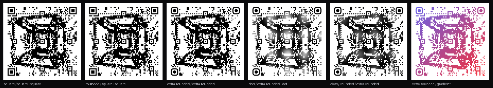
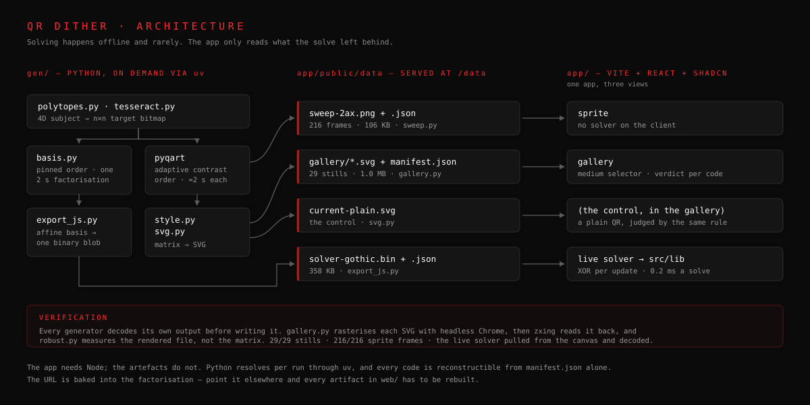
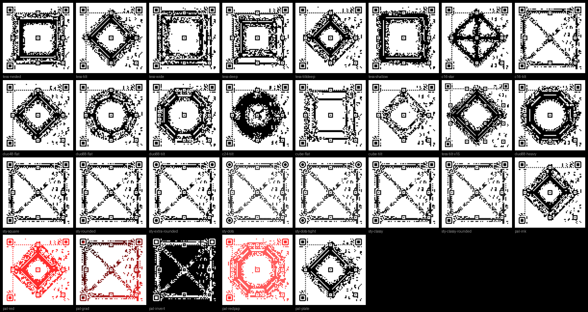
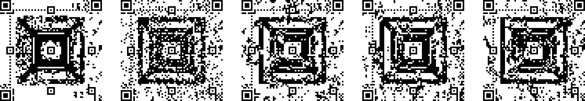

# QR Dither

> **[STATUS.md](STATUS.md)** is the handoff: current state, what is verified,
> and the four open questions. Start there.

A tesseract drawn *in the data of a QR code*, not on top of one. Grab it, fold
it through the fourth dimension, and the code re-derives itself every update —
always scanning, always landing on `hyperspace.cutaiar.io`.



The trick is [Russ Cox's QArt](https://research.swtch.com/qart): Reed-Solomon
encoding is linear over GF(2), so "make module (x, y) black" is a linear
constraint and the message bits that satisfy it come out of Gaussian
elimination. The picture is not overlaid and rescued by error correction the
way every other QR-art tool works — the picture **is** the payload, with zero
corrected errors. The filler lands in a `#fragment`, which the browser
discards, so no DNS or redirect is involved.

## Get started

```sh
cd app && npm install && npm run dev
```

Then <http://localhost:5181>. Vite 8 binds IPv6 only, so `127.0.0.1` will not
answer — use `localhost`. Six views:

- **gallery** — 29 stills across eight 4D subjects, seven dot styles and six
  palettes. Pick a destination and every code gets a verdict against it.
- **families** — the same stills grouped by what the solid *is*. Which
  orientations survive module quantisation is a property of a family's edge
  set, not of any one solid, so the family is the unit that explains why the
  tesseract has six orientations and the 5-cell has none.
- **live solver** — re-derives the whole code per update, **0.2 ms** a solve.
  Grab it and fold it.
- **sprite** — 216 precomputed frames, 94 KB, every one decode-verified.
- **editions** — a pose paired with an irrational constant pinned into the
  fragment, re-derived live. The factorisation is independent of *which*
  constant, so swapping π for φ costs one re-solve and no new data.

Nothing is generated at page load. `app/public/data` holds finished artefacts,
served at `/data`, and each is rebuilt by one command:

```sh
uv run --with pyqart --with pillow --with numpy --with segno --with zxing-cpp \
  python3 gen/gallery.py --url https://hyperspace.cutaiar.io
```

`uv` resolves the dependencies per run, so there is no virtualenv to create or
activate. That one also shells out to headless Chrome, which it uses to check
its own output; it fails loudly if Chrome is not where it expects.

`npm run build` emits a static `dist/` that any server can host with no Node
involved — the app needs the toolchain, the thing it builds does not.

## Architecture



Two layers that meet at `app/public/data`. Solving is slow, offline and rare;
the app only reads what the solve left behind. The one asymmetry worth knowing
is that only `export_js.py` takes the fast path through `basis.py` —
everything else calls pyqart directly and pays the ~2 s elimination per image,
which is fine for a still and impossible for a frame.

`src/lib/solver.js` and `src/lib/render.js` moved out of the old static pages
unchanged. They touch no DOM globals — `ctx`, `mods` and `n` all arrive as
arguments — which is why the port was a move rather than a rewrite, and why
React stays out of the 60 Hz path: the loop reads a ref and writes its readouts
straight to the DOM, so a slider re-renders but a frame never does.

## What makes it live

[`gen/basis.py`](gen/basis.py) is the whole idea. pyqart redoes the elimination
for every image, because it sorts pivots by image contrast. But the generator
basis of the code depends only on the block geometry — the image only supplies
target *values*. Pin the pivot order and the whole thing collapses to

```
result = base XOR  SUM over pivots p of  (base_p != want_p) * u_p
```

with `{u_p}` computed once. `gen/export_js.py` ships that as a 358 KB blob and
[`web/solver.js`](web/solver.js) does nothing per frame but XOR 30-word
vectors. One 2-second factorisation buys unlimited sub-millisecond solves.

Two things had to be pinned for the payload to survive: the data bits below the
numeric filler (they carry the mode indicators and **the URL itself**) and the
pad bits above `upper`. Leave them writable and you get beautiful hypercubes
that decode to nothing. The numeric filler also needs each 10-bit group under
1000, which pyqart handles by *retrying* — fatal for a live loop, so each
group's top bit is pinned to zero instead, capping it at 511. Validity is
structural: no control in the UI can break it, only make it harder to read.

## The gallery



```sh
uv run --with pyqart --with pillow --with numpy --with zxing-cpp \
  python3 gen/gallery.py --url https://hyperspace.cutaiar.io
```

[`gen/polytopes.py`](gen/polytopes.py) generalises the tesseract to a family —
the 16-cell, the 24-cell, the 4-8 and 8-8 duoprisms, a plain 3-cube — reusing
the projection maths rather than copying it. [`gen/style.py`](gen/style.py) is
the vector twin of `web/render.js`: the same dot shapes, the same
neighbour-aware corner rounding, the same even-odd finder rings, emitted as SVG
so a still can be printed at any size.

The constraint that decides everything is quantisation. Only edges landing on
0, 45 or 90 degrees survive sampling on a square grid, so each pose is chosen,
not arbitrary. What that rules out, after rendering and rejecting each by eye
at 65 modules: the 5-cell (no axis to align to), the 3-8 duoprism (its
triangles staircase), the 24-cell seen cell-first (fills solid), and the
tesseract folded part-way through XW (an angle that is neither 0 nor 45, so its
edges become dotted staggers).

Stroke weight is the other lever, and it is per-subject. The 16-cell seen axis
first has four of its eight vertices projecting to the origin, so its arms
converge on a point: at a 2-module stroke they dissolve into the halo and it
needs 5. The 24-cell's 96 edges go the other way and need 2.

**Verification is on the shipped artefact, not a model of it.** Every SVG the
generator writes is rasterised by headless Chrome and decoded by zxing, so what
is checked is the exact file the page serves — 29/29, the inverted palette and
the circular-module ones included.

## The texture question



A fixed pivot order is what buys the speed, and it is also what costs the look.
pyqart's contrast ordering is *adaptive* — it spends freedom exactly where the
drawing has edges, which is what grows the organic halo in the stills. A fixed
order is guessing at a drawing it has not seen, so the leftover noise has to be
placed blind. The `noise` control picks how:

| order | leftovers land | reads as |
| --- | --- | --- |
| `gothic` | vertical low-frequency blobs | heavy strokes, line artefacts |
| `streak` | strongly vertical cells | streaks down the grid |
| `clump` | isotropic blobs | calmer gothic |
| `even` | a low-discrepancy sequence, one module at a time | sparkle |
| `centre` | all of it in a ring at the rim | crisp middle, noisy border |

Measured as mean vertical run length of uncontrolled modules: `even` 1.29,
`clump`/`gothic` 1.59, `streak` 1.63, against pyqart's 1.66.

**Only `gothic` is committed.** The other four are 358 KB each and regenerate in
about five seconds; the UI tells you the command when you click one that is
missing:

```sh
uv run --with pyqart --with pillow --with numpy \
  python3 gen/export_js.py --url https://hyperspace.cutaiar.io \
  --order streak --out solver-streak
```

## The URL is baked in

The data bits *are* the drawing, so the URL is part of the factorisation. Point
it somewhere else and everything — blobs, sprite, stills — has to be rebuilt:

```sh
uv run --with pyqart --with pillow --with numpy --with zxing-cpp \
  python3 gen/export_js.py --url https://example.com --order gothic --out solver-gothic
uv run --with pyqart --with pillow --with numpy --with zxing-cpp \
  python3 gen/sweep.py --url https://example.com --frames 36 --frames2 6 --tag sweep-2ax
```

## Verification

Nothing here is trusted on looks. `gen/verify_affine.py` checks the affine
reconstruction against zxing in Python; the browser's own output was pulled out
of the running page and decoded the same way (24/24 orientations, 15/15 across
all five textures, 16/16 across every dot and eye style). `gen/gallery.py`
rasterises each SVG it writes with headless Chrome and decodes *that* — the
shipped file, not a model of it.

The sticker exporters get the same treatment. [`app/src/lib/style.ts`](app/src/lib/style.ts)
is the TypeScript twin of `gen/style.py`, so a sheet exports with the dot, eye
and colour treatment it previews with — and [`gen/sheets.py`](gen/sheets.py)
rasterises every sheet `npm run check` writes, with Chrome for the SVG and
poppler for the PDF, decodes every sticker on the page and measures one of each
code. **276/276**, 24/24 of them on a vendor sheet at zero gutter with inverted
and light codes alternating.

[`gen/robust.py`](gen/robust.py) measures the three things that actually kill a
code in the world: minimum camera pixels per module, blur tolerance, and a
specular hotspot from a phone flash. It measures the **rendered** code, never
the bare matrix — styling cannot change what a code says, but it very much
changes whether a camera can read it, and measuring the matrix would report one
number for all seven dot styles and hide the entire effect. It does not:

| | min px/module | blur | flash |
| --- | --- | --- | --- |
| square | 1 | 0.45 | 1.2 |
| extra-rounded | 2 | 0.45 | 1.2 |
| dots | 2 | 0.45 | 1.2 |
| **dots-tight** | **3** | 0.45 | 1.2 |
| **inverted** | **3** | **0.35** | 1.0 |
| **red on white** | 1 | 0.40 | **0.6** |
| plain ECC M control | 1 | 0.50 | 1.2 |

Circular modules cost resolution; inversion costs both; red costs half the glare
headroom, which is the luminance argument showing up as a number.

Read `blur` carefully: it is a Gaussian sigma in **modules**, so it compares
fairly across versions but *not* across physical sizes. A 65-module code's
modules are 29/65 the width of a 29-module one printed the same size, so its
real blur budget is about 0.4× the control's — which is the honest reason an
art code needs to be physically bigger, not a reason it is fragile.

## The manifest

`web/gallery/manifest.json` (33 KB) is the single source of truth for what
exists. Each item carries its pose, stroke, version and dot style; its measured
`min_ppm`, `blur` and `flash`; and `matrix` — the module grid itself, base64,
row-major, MSB first, bit `i = y * n + x`. The grid is there because the next
consumers do not want an SVG: a Hyperspace node wants a texture, and a sticker
sheet wants to re-render at a physical size. All 29 were unpacked and decoded
as a check that the packed grid is the same code the SVG draws.

`manifest.baselines` holds plain ECC L/M/Q/H codes for the same URL, measured
identically, so every verdict on the page has something to be a verdict against.

## Shape and projection

[`gen/tesseract.py`](gen/tesseract.py). Only axis-aligned projections survive
module quantisation — a square grid renders horizontal, vertical and 45° edges
cleanly and everything else as staircases, so rotated projections of the
original sweep dissolved into blobs. The XW fold works because it is a
perspective change, not an in-plane rotation. A hypercube turned 90° in XW maps
its own vertex set onto itself, so 36 frames is a seamless loop. The drag
planes follow the app's own mapping (x → XW, y → YW; x → XZ, y → YZ in 3D
mode); `max_span()` fixes the scale across all orientations so the shape does
not snap to refill the frame as it folds.
