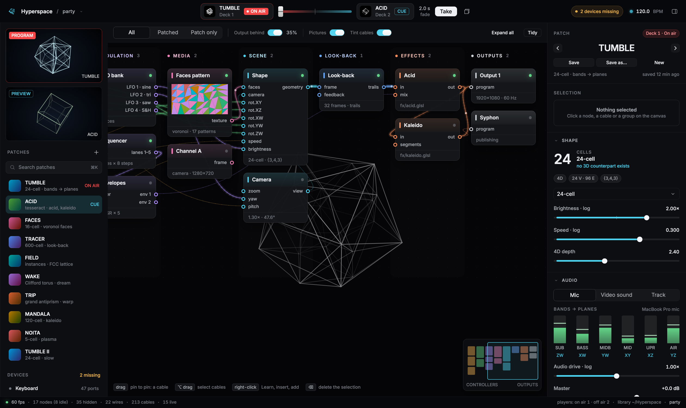

# Rune panel

Hyperspace's control window redrawn in [Rune](https://github.com/anomalyco/rune),
a Rust UI framework that draws everything itself on the GPU. **It is UI only**:
nothing here drives the renderer, reads a device or saves a file. It is here to
show what the panel could look and feel like on Rune, not to replace the Python
app.


The information is the real panel's: the GRAPH's columns, nodes, ports and
cables, the two decks and the crossfader, the side pane's sections. The names
come from the Python app: bands and the planes they turn (`bands.BANDS`), shapes
(`geometry.SHAPES`), effects (`shaders/fx/`) and the party show's patches.
The layout is new.

## What's in it

- **Top bar.** Deck 1 and deck 2, each with a live thumbnail, ON AIR or CUE, a
  crossfader between them, the fade time and **Take**. Take springs the
  crossfader across, and ON AIR, the program monitor and the library follow it.
  On the right: the devices warning and a BPM light on the beat.
- **Library** (left). Program and preview monitors with the shape turning in
  4D, the patches (click one to cue it on the deck that's off air) and the
  devices with their status.
- **GRAPH** (middle). The patch as eight columns, Controllers to Outputs. Live
  cables carry a pulse, and a selected node lights its cables in the accent.
  The program output turns behind the graph. Drag the background to pan, drag
  a node by its header to move it, and use the minimap in the corner to jump.
  The toolbar has the original's filters (All, Patched, Patch only), Output
  behind, Pictures, Tint cables and Tidy, which springs every node home.
- **Inspector** (right). The patch on air, the selection, then Shape (the
  cells, the shape menu, brightness, speed, 4D depth), Audio (source, six band
  meters labelled with their planes, drive, master), Tempo & LFOs (BPM, the
  beat, four LFOs with their waves and targets), Camera and Output. Each
  section folds to a one-line summary.
- **Status bar.** Frame rate, the graph's counts, the players, the library and
  the show.




### Choices

- **One accent, and red only for on air.** Interaction is cyan. Red is kept for
  what the audience sees, as a broadcast tally light is; amber for warnings.
  The original uses red for every active toggle and slider.
- **A hue per column.** A cable takes its source column's colour, so you can
  read where a signal comes from without following it. *Tint cables* off draws
  them neutral.
- **Proper controls.** Switches for on/off, a segmented control for exclusive
  choices, a field-style menu for the shape and the screen, sliders with the
  value on their label line and a tick at unity or the centre.
- **Folded sections say their values.** A closed section shows a summary
  (`24-cell · 2.00×`, `1.30× · +0°`), so the pane can stay short.
- **Tabular figures** wherever a number moves, so readouts don't jitter.

Components: rune-kit's `Button`, `IconButton`, `Switch`, `SegmentedControl`
and `Select`. The slider, the meters, the sections, the crossfader, the graph
and the minimap are this prototype's, in `src/widgets.rs`, `src/graph.rs` and
`src/chrome.rs`.

## Run it

Rune pins Rust 1.99.1 (`rust-toolchain.toml`); rustup installs it on the first
build. The first build compiles wgpu and takes a few minutes.

```sh
cd prototypes/rune-panel
cargo run --release
```

On Linux the build needs `libxkbcommon-dev` and `libwayland-dev`; Rune's README
has the rest.

### Headless

Every Rune app can render without a window, on a fixed virtual clock:

```sh
B=target/release/rune-panel
$B --snap panel.png --at 1.3                       # a PNG at 2×
$B --snap selected.png --scene selected --at 1.3   # a scene by name
$B --list-scenes
$B --script scripts/tour.json --video tour.mp4 --pointer --duration auto
$B --tree tree.json --at 1.3                        # the element tree, as JSON
```

The scenes: `default`, `selected` (the Shape node), `analyzer`, `effects` (the
canvas panned to the right-hand columns), `folded`, `camera`, `shape-menu`,
`tesseract`, `patched`, `plain` (no tint, pictures or output behind), `taken`
(deck 2 on air) and `still` (the clock stopped).

`scripts/tour.json` selects the Analyzer, drags the Channel A node, drags the
brightness slider, opens Camera, jumps with the minimap, presses Take and
folds Shape.

### What a headless run can't tell you

Speed. In a cloud session Rune draws through lavapipe, Mesa's software Vulkan,
and a frame costs about 32 ms whether the clock runs or not, in debug or
release: that is the rasteriser, not the view. Frame rate is a check on the
Mac. The view does rebuild every frame while the shape turns (`poll` returns
true); the cards, the patch list and the dot grid are `memo`ised so only what
moves is rebuilt.

## Files

| File | What |
|---|---|
| `src/main.rs` | The state, the root view, the scenes, the clock |
| `src/data.rs` | The mock patch: nodes, cables, patches, devices, bands |
| `src/graph.rs` | The GRAPH: toolbar, canvas, cards, cables, minimap |
| `src/inspector.rs` | The right pane and its sections |
| `src/chrome.rs` | Top bar, decks, crossfader, library, status bar |
| `src/widgets.rs` | Slider, section, meter, dots, tags |
| `src/polytope.rs` | The 24-cell, tesseract and 16-cell, turned in six planes and projected |
| `src/theme.rs` | Colours, type, the column hues, the kit |

## What it isn't

- No link to the Python app. A real panel would need a protocol to read state
  and write params, routing rows and undo. The OSC device only takes input, and
  the bridge only sends lanes out.
- No node editor behaviour beyond moving cards: no making or deleting cables,
  no Learn, no grouping.
- No live media in the panel. The faces thumbnail is drawn, not read off the
  GPU.
- Rune is pre-release. This pins one revision of its `dev` branch.
