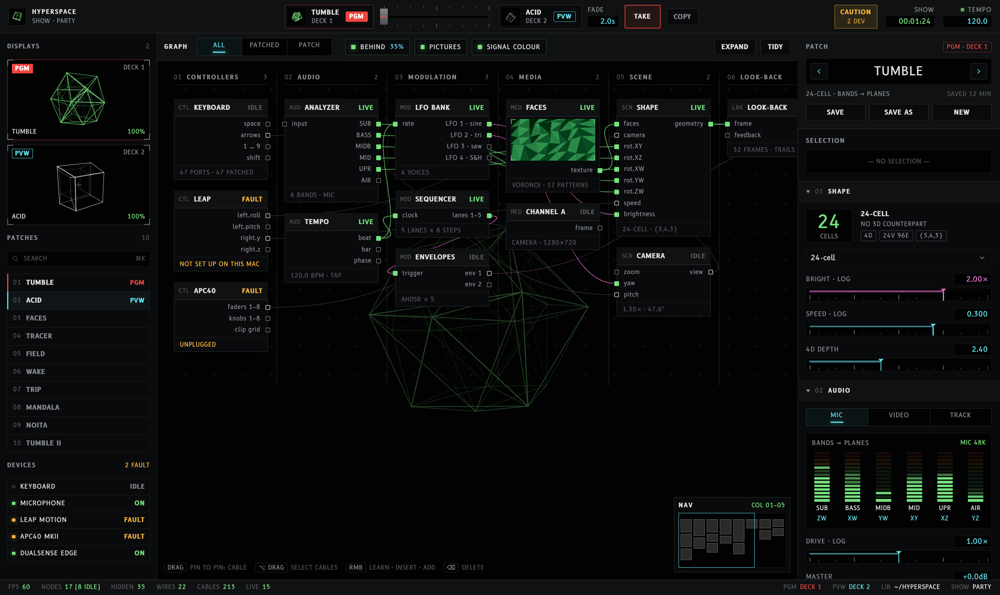
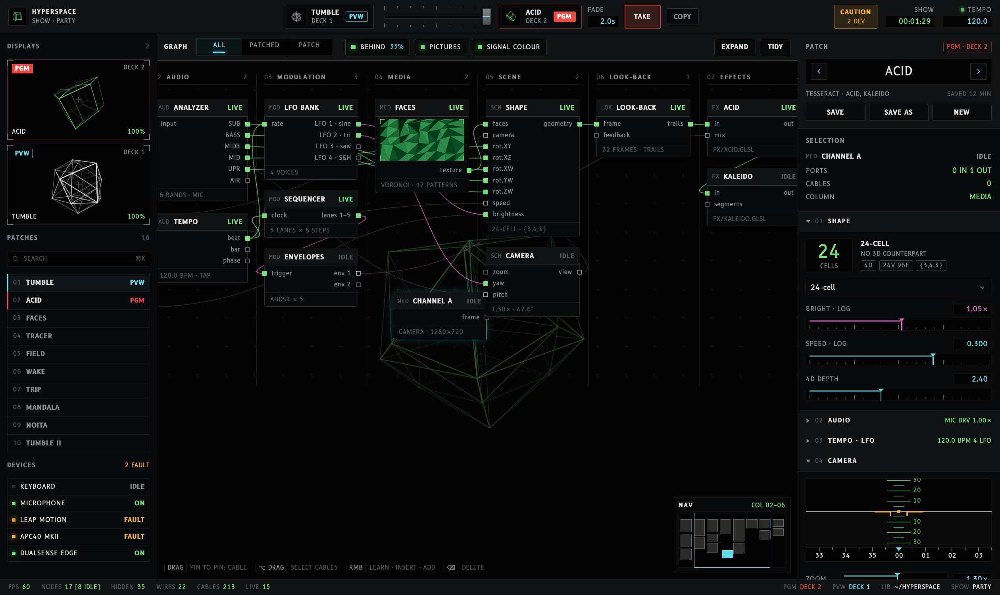
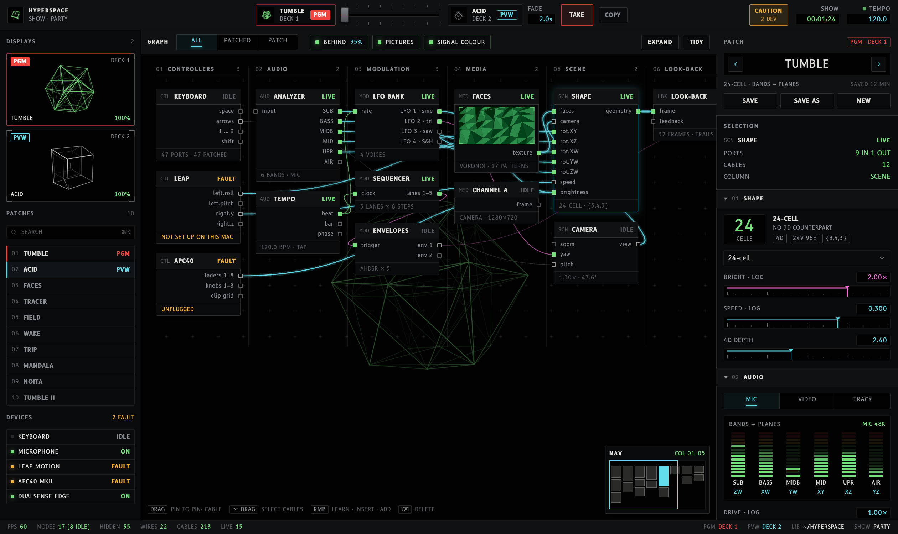
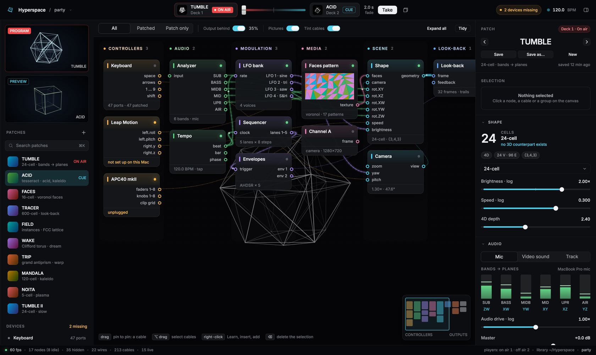

# Rune panel

Hyperspace's control window redrawn in [Rune](https://github.com/anomalyco/rune),
a Rust UI framework that draws everything itself on the GPU, as a glass cockpit.
**It is UI only**: nothing here drives the renderer, reads a device or saves a
file. It is here to show what the panel could look and feel like on Rune, not to
replace the Python app.



The information is the real panel's: the GRAPH's columns, nodes, ports and
cables, the two decks and the crossfader, the side pane's sections. The names
come from the Python app: bands and the planes they turn (`bands.BANDS`), shapes
(`geometry.SHAPES`), effects (`shaders/fx/`) and the party show's patches.
The layout and the look are new.

## The look

A flight deck's displays, where colour is meaning and never decoration:

| Colour | Means | Where |
|---|---|---|
| White | Labels and scales | Legends, titles, tick marks |
| Green | Measured, normal, live | Live cables and ports, LIVE, level meters, the shape on PGM |
| Cyan | Set by the operator | Gauge pointers and readouts, the selection, PVW |
| Magenta | Driven by automation | Cables out of the LFOs, envelopes and sequencer; values they drive (brightness, camera yaw) |
| Amber | Caution | Master caution, FAULT, the camera symbol |
| Red | Warning, and on air | PGM, TAKE |

So a readout in magenta is a value an LFO is moving under you, and a magenta
cable is modulation, without reading a label. The first version of this
prototype gave every graph column its own hue; that is gone, and so are the
gradients and coloured swatches.

Type is [B612](https://github.com/polarsys/b612), the face Airbus had made
for cockpit screens, in `fonts/` under the SIL Open Font License
(`fonts/OFL.txt`). Numbers use its tabular figures; B612 Mono is kept for the
module codes (CTL, AUD, MOD …) because it gives a point or a colon a whole
cell.

## What's in it

- **Top bar.** Deck 1 and deck 2 with live thumbnails and PGM or PVW, a
  crossfader lever between them with detents, the fade time, **TAKE** and
  COPY (on air to off air). TAKE springs the lever across, and PGM, the
  displays and the patch list follow it. On the right: the master caution
  (2 devices), the show clock and the tempo with a lamp on the beat.
- **Library** (left). PGM and PVW displays with the shape turning in 4D in
  a reticle, the patches as a numbered list (click one to cue it on the deck
  that's off air) and the devices with ON, IDLE or FAULT.
- **GRAPH** (middle). The patch as eight numbered columns on a screen with
  a crosshair grid, the program output faint behind it. Modules carry a code,
  a name and LIVE, IDLE or FAULT; a port is a square, filled green while a
  live signal passes. Drag the background to pan, drag a module by its title
  bar, and use the NAV display to jump. The toolbar has the original's
  filters (All, Patched, Patch), Behind, Pictures, Signal colour (off draws
  every cable white) and Tidy.
- **Inspector** (right). The patch on air, the selection, then numbered
  modules: Shape (the cells, the shape menu, gauges for brightness, speed and
  4D depth), Audio (a source selector, six segmented meters with the plane
  each band turns, drive, master), Tempo · LFO (BPM, the beat, four LFOs on
  scopes with their targets), Camera (an attitude indicator: pitch moves the
  horizon, yaw runs the heading tape) and Output (dim, the screen, four
  annunciators). Each module folds to its values on one line.
- **Status line.** Frame rate, the graph's counts, PGM and PVW, the library
  and the show.





### The controls

- **Gauges** instead of sliders: a tape with a tick scale, a pointer and a
  boxed readout. Press away from the pointer to jump; drag it to move by the
  drag.
- **Annunciators** instead of switches: a name over an ON or OFF that lights.
- **Selectors** for exclusive modes: push-buttons in a row, the one in use
  lit cyan with a bar under it.
- **Segmented meters**: green, then amber, then red, with the held peak lit.
- **Readouts** wherever a number is shown, in the colour of whose number it is.

rune-kit supplies the shape and screen menus (`Select`), squared off and set
in B612 through the kit's tokens. Everything else is this prototype's, in
`src/widgets.rs` and `src/instruments.rs`.

The first version, before the cockpit:



## Run it

Rune pins Rust 1.99.1 (`rust-toolchain.toml`); rustup installs it on the first
build. The first build compiles wgpu and takes a few minutes.

```sh
cd prototypes/rune-panel
cargo run --release
```

On Linux the build needs `libxkbcommon-dev` and `libwayland-dev`; Rune's README
has the rest.

### Headless

Every Rune app can render without a window, on a fixed virtual clock:

```sh
B=target/release/rune-panel
$B --snap panel.png --at 1.3                       # a PNG at 2×
$B --snap selected.png --scene selected --at 1.3   # a scene by name
$B --list-scenes
$B --script scripts/tour.json --video tour.mp4 --pointer --duration 7
$B --tree tree.json --at 1.3                        # the element tree, as JSON
```

The scenes: `default`, `selected` (the Shape module), `analyzer`, `effects`
(the canvas panned to the right-hand columns), `folded`, `camera`,
`shape-menu`, `tesseract`, `patched`, `plain` (white cables, no pictures, no
output behind), `taken` (deck 2 on air) and `still` (the clock stopped).

`scripts/tour.json` selects the Analyzer, drags the Channel A module, drags
the brightness pointer, folds Audio and Tempo, opens Camera, jumps with the
NAV display and presses TAKE. A scripted tap doesn't scroll: a control below
the inspector's fold has to be brought up by folding what's above it, as a
person would.

### What a headless run can't tell you

Speed. In a cloud session Rune draws through lavapipe, Mesa's software Vulkan,
and a frame costs about 30 ms whether the clock runs or not, in debug or
release: that is the rasteriser, not the view. Frame rate is a check on the
Mac. The view does rebuild every frame while the shape turns (`poll` returns
true); the modules, the patch list and the grid are `memo`ised so only what
moves is rebuilt.

## Files

| File | What |
|---|---|
| `src/main.rs` | The state, the root view, the scenes, the clock |
| `src/data.rs` | The mock patch: nodes, cables, patches, devices, bands |
| `src/graph.rs` | The GRAPH: toolbar, canvas, modules, cables, NAV |
| `src/inspector.rs` | The right pane and its modules |
| `src/chrome.rs` | Top bar, decks, lever, library, status line |
| `src/widgets.rs` | Gauge, annunciator, selector, meter, readout, section |
| `src/instruments.rs` | The attitude indicator and the LFO scope |
| `src/polytope.rs` | The 24-cell, tesseract and 16-cell, turned in six planes and projected |
| `src/theme.rs` | Colours, type, the kit |
| `fonts/` | B612 and B612 Mono, regular and bold, with their licence |

## What it isn't

- No link to the Python app. A real panel would need a protocol to read state
  and write params, routing rows and undo. The OSC device only takes input, and
  the bridge only sends lanes out.
- No node editor behaviour beyond moving modules: no making or deleting
  cables, no Learn, no grouping.
- No live media in the panel. The faces thumbnail is drawn, not read off the
  GPU.
- Rune is pre-release. This pins one revision of its `dev` branch.
