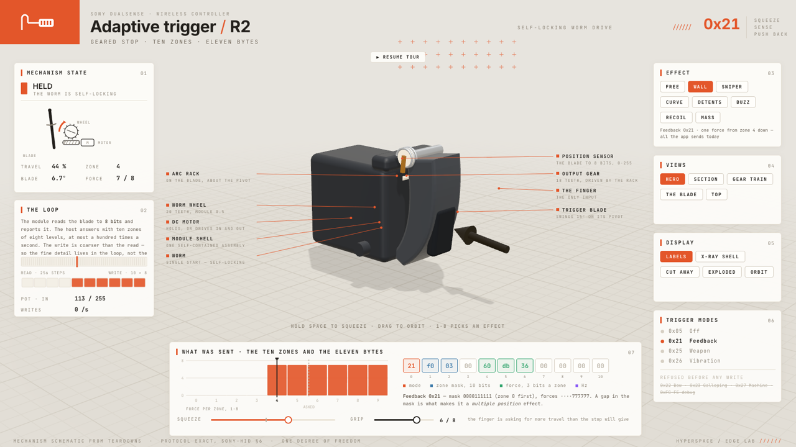
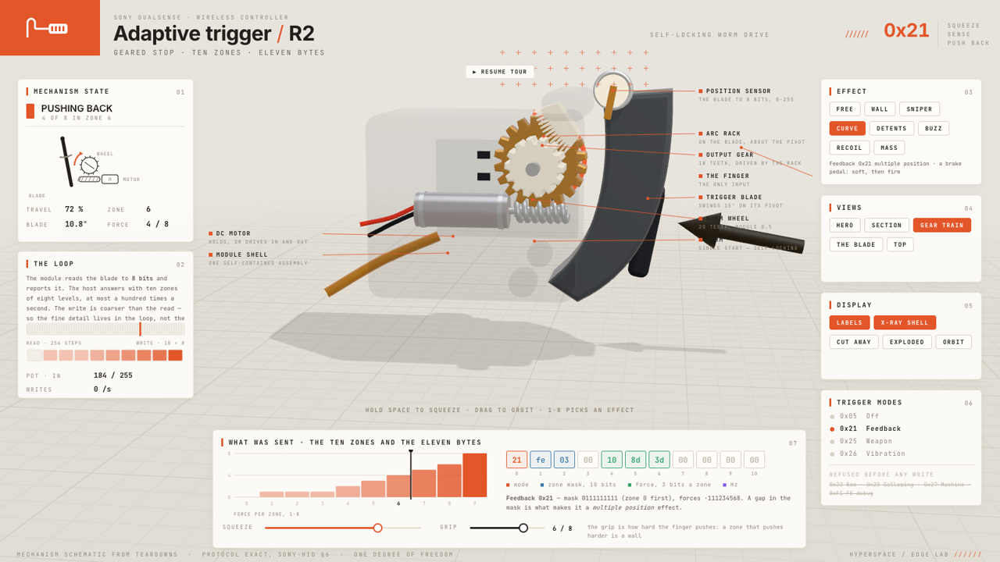
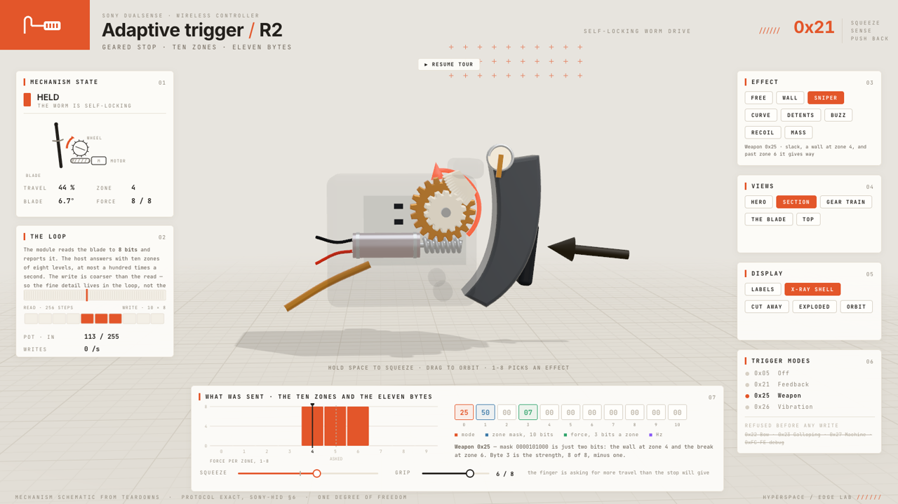
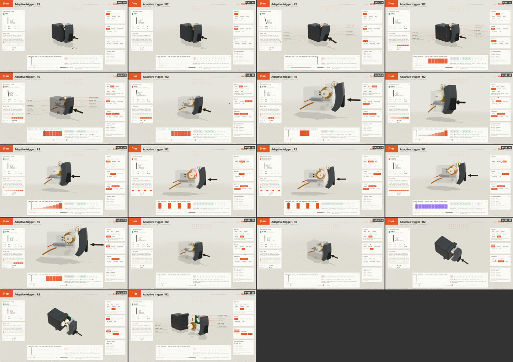

# Trigger Teardown

The DualSense adaptive trigger, taken apart: one page you can squeeze, open,
cut away and explode, with the eleven bytes that drive it live on screen
beside the ten zones they mean. Everything the Edge Lab's bench taught us
about the protocol, standing next to the mechanism that answers it.



Built with the [`teardown`](../../.claude/skills/teardown) skill (three.js,
one self-contained offline HTML page, no server, no network).

## Open it

```sh
open teardown-out/dist/trigger-live.html
```

The page works from `file://`. Left alone it plays itself: a 38-second tour
walks the eight effects, opens the shell and explodes it, with the operator's
cursor pressing the buttons. Click anything and it hands over; 25 seconds of
quiet and it takes the tour back up.

- **Hold SPACE** to squeeze the trigger, or drag the **SQUEEZE** slider to
  park the finger anywhere.
- **GRIP** is how hard the finger pushes, 1–8. A zone that pushes back harder
  than the grip is a wall the finger cannot get through — which is the whole
  point of the mechanism.
- **1–8** pick an effect · **X** x-ray · **C** cut away · **E** explode ·
  **L** labels · **O** orbit · **V** cycles the views · drag to orbit, wheel
  to zoom.

## What it shows

**The mechanism.** A trigger blade on a pivot, an arc rack on its back, a
pinion the rack drives, a worm wheel on the same shaft, a worm on the motor's
shaft, the motor, and a potentiometer at the pivot reading where the blade is.
One degree of freedom: the finger. Everything else is posed from it.

The arrangement explains the one thing worth understanding: **a worm drive is
self-locking**. The motor can hold the train against any force the finger
brings, and it costs the motor nothing to keep holding. That is what a "wall"
is — not a spring pushing back, but a gearbox refusing to turn.



**The protocol.** Eleven bytes, drawn live as hex with each field coloured —
the mode in byte 0, the ten-bit zone mask in 1–2, three bits of force per zone
in 3–6, the frequency in byte 9. Next to them, the ten zones as a ladder with
the force in each, the blade's real position marked on it, and the finger's
*asked-for* position marked separately whenever the stop is refusing to let it
through.

**The loop.** The module reads the blade to 8 bits — 256 steps — and reports
it. The host answers with ten zones of eight levels, at most a hundred times a
second. The write is coarser than the read, which is why the fine detail in
any interesting trigger effect lives in the loop and not in the packet. The
panel counts the writes for real: a still shape is silent, a buzz runs at the
cap.

**Eight effects**, the same ones the Edge Lab's bench sends:

| | |
|---|---|
| FREE | Off 0x05 — nothing in the way |
| WALL | one force from zone 4 down. All the app sends today |
| SNIPER | Weapon 0x25 — slack, a wall at zone 4, and past zone 6 it gives way |
| CURVE | Feedback 0x21 multiple position — a brake pedal, soft then firm |
| DETENTS | a mask with gaps: notches the finger counts |
| BUZZ | Vibration 0x26 — the same motor driving the stop in and out |
| RECOIL | a wall that fires, then comes back |
| MASS | not a shape at all: the force follows how fast the finger is moving |



## Where the numbers come from

- **The protocol is exact**, from
  [`sony-hid.md` §6](../../hyperspace-python/docs/plans/assets/42-controllers/sony-hid.md):
  the mode bytes, the packing, the ranges, and the refusal list (0x22 / 0x23 /
  0x27 unofficial, 0xFC–0xFE never). `packet()` in `shared/trigger.js` is the
  same encoder as the lab's, and the page draws the bytes it really built.
- **The mechanism is a schematic reconstruction.** Teardowns agree on the
  parts and their arrangement — a DC motor, a worm on its shaft, a gear train,
  a geared wheel the blade contacts, a potentiometer on the module board — and
  the module's outside is in the teardown photographs. Sony publishes no
  dimensions, so every length in `M` is this model's own, chosen to match the
  photographs and to make the gears mesh: each centre distance is the sum of
  two pitch radii, so nothing passes through anything.

So: trust the bytes, read the mechanism as a diagram.

## The files

| | |
|---|---|
| `shared/trigger.js` | the maths: the module in metres, the protocol byte for byte, the recipes, and `solve()` — one input, every pose and readout |
| `shared/module3d.js` | the geometry, built from code; `update(s)` poses it |
| `shared/stage.js` | the studio: pale ground, three soft boxes, one sun, GTAO |
| `shared/console.js` | the overlay at 1600 × 900: the panels, the zone ladder, the bytes |
| `shared/film.js` | the tour as a pure function of time, and the labels |
| `shared/live.js` | the page you drive; with no input it plays the tour |
| `trigger-live/`, `trigger-film/` | the two entry points |

## Rebuilding

```sh
node ~/.claude/skills/teardown/sims/build.mjs ./trigger-live
```

The film (the same machine as a recorded tour) builds the same way with
`./trigger-film`, and renders stills or a video through the skill's capture
script — point `CHROMIUM` at a local Chrome if Playwright has no browser:

```sh
CHROMIUM="/Applications/Google Chrome.app/Contents/MacOS/Google Chrome" node ~/.claude/skills/teardown/sims/capture.mjs trigger-film --size 1600x900 --dpr 1 --stills beats --timeline trigger-film/timeline.json --cols 4 --out teardown-out/beats.png
```



No video has been rendered yet; `capture.mjs` without `--stills` writes one,
and `shared/` has no score beside it.

## What has not been checked

Nobody has held the real module against this. The mechanism's proportions come
from photographs and its internals from written teardowns, so the gear sizes,
the travel angle and the housing are plausible rather than measured. The
protocol half can be checked against the hardware today — that is what
`prototypes/edge-lab/` is for.
