# Baseline red/cyan first, then challenge with magenta/green

Hyperspace should start with a **red/cyan baseline**, rendered by a linear-light compositor built around two 3×3 matrices whose first preset is a pure channel mask. It should treat **magenta/green as the challenger** most likely to beat red/cyan on comfort, and run **amber/blue third, as a DIY-gel-only test**. Red/cyan has the lowest measured crosstalk of any colour pair and the only projector-specific measurements. Magenta/green trails it modestly, has better brightness balance (a claim, unquantified) and still has premade glasses in US stock. Amber/blue has the worst measured crosstalk, the dimmest eye and no verified premade US source ([Woods & Harris 2010](https://cmst.curtin.edu.au/wp-content/uploads/sites/4/2016/05/2010-11.pdf); [Woods & Rourke 2004](https://cmst.curtin.edu.au/wp-content/uploads/sites/4/2016/05/2004-08.pdf)). No published matrix fits this cart: the Dubois presets were fitted to CRT, plasma or LCD primaries and to commercial glasses. Ghosting will be set by how the cart projector's primaries overlap each filter's stop band, and that has to be measured. A **$173.45 first order** from three California sellers gets the lab going: Rainbow Symphony glasses, a LEE swatch book and eight LEE gel sheets. It should reach San Francisco in about 2–5 business days and is enough for a fast "Path A" calibration. A **$109 one-week Sekonic C-800 rental** adds "Path B": measured spectra and recomputed matrices. Hyperspace has no stereo or colour-space code yet, so the coding agent must add per-eye projection, two eye passes and a profile-driven compositor. The quickest first experiment needs none of that code, only a projector, premade glasses, a phone and a few static test frames.

All prices, stock flags and links below were verified on **2026-10-17** (a Saturday), unless a figure is marked as a search snippet. Delivery times to SF are estimates from ship-from location and stated handling time; no seller showed a live delivery date for zip 94103. The supporting engineering files referenced throughout are in [`anaglyph_handoff/`](anaglyph_handoff/README.md). They hold the Mermaid diagram sources, the spectral plots, the JSON schema and YAML profiles, the Dubois matrix calculator, the experiment log and the test-pattern specification.

## Every anaglyph method is one matrix pair, and projector spectra set the ghost floor

Every classical anaglyph is a fixed linear map, **A = M_L·L + M_R·R**, where L and R are the two eye images and M_L and M_R are 3×3 matrices. The familiar variants (true, gray, colour, half-colour and optimized) differ only in their coefficients ([Wimmer, 3dtv.at](https://3dtv.at/Knowhow/AnaglyphComparison_en.aspx)). The pure channel mask is Wimmer's "Color" anaglyph: red from the left image, green and blue from the right. Blender implements anaglyph as exactly this per-channel source selection ([Blender stereoimbuf.cc](https://github.com/blender/blender/blob/main/source/blender/imbuf/intern/stereoimbuf.cc)). Dubois's method computes the matrices instead of choosing them by hand. It takes the display primaries' spectra, the filter transmissions and the CIE observer, and projects the six-dimensional ideal stereo percept onto the three dimensions an anaglyph can reproduce ([Dubois ICASSP 2001](https://www.site.uottawa.ca/~edubois/icassp01/anaglyphdubois.pdf)). The McAllister group's Lab-space methods drop the fixed matrix and solve a nonlinear least-squares problem for every pixel, which is far more compute for a real-time renderer ([McAllister/Zhou/Sullivan 2010 abstract](https://worldwidescience.org/topicpages/s/space+images+anaglyph.html)). For Hyperspace the practical consequence is that **the choice of algorithm is a choice of data, not of code path**. One shader with two `mat3` uniforms covers the mask, every Wimmer variant, every published Dubois preset, and matrices later recomputed from measurements.

| Method | Definition | What it buys | What it costs | Role in Hyperspace |
|---|---|---|---|---|
| Channel mask ("Color") | ra = r1; ga = g2; ba = b2 | Exact when each filter passes only its own primaries; trivial | Partial colour, severe retinal rivalry on coloured objects | **First preset** ([profile](anaglyph_handoff/config/profiles/red_cyan_channel_mask.yaml)) |
| Gray / half-colour | One or both eyes get luminance (0.299, 0.587, 0.114) | Less rivalry | Less colour | Option for saturated red points |
| Optimized (Wimmer) | ra = 0.7 g1 + 0.3 b1; ga = g2; ba = b2 | Almost no rivalry | Cannot reproduce reds | Comparison only |
| Dubois least squares | P = N (RᵀWR)⁻¹ RᵀW C₂, a fixed 3×6 matrix | Better colour and less rivalry than hand-made matrices (author's claim) | Needs spectra to be correct for this hardware | **Second preset**, then recomputed |
| Lab per-pixel (McAllister) | Nonlinear optimisation per pixel in CIELab | Perceptual matching | Per-pixel solve; full text not reviewed | Not recommended |

Sources: [Wimmer](https://3dtv.at/Knowhow/AnaglyphComparison_en.aspx); [Dietz 2012](https://aggregate.org/DIT/SPIEEI2012/spieei2012paper.pdf); [Dubois 2001](https://www.site.uottawa.ca/~edubois/icassp01/anaglyphdubois.pdf).

**Dubois's method works in linear light**, and that one detail separates correct implementations from approximate ones. His March 2009 note assumes sRGB input. The input is decoded with the sRGB EOTF and the matrices are applied. **Each eye's term is clipped to [0,1] before adding**, and the sum is then re-encoded with the sRGB OETF ([Dubois 2009](https://www.site.uottawa.ca/~edubois/anaglyph/LeastSquaresHowToPhotoshop.pdf)). three.js stores its eye images in the linear working space and clips once after summing ([three.js AnaglyphEffect.js](https://github.com/mrdoob/three.js/blob/dev/examples/jsm/effects/AnaglyphEffect.js)). ffmpeg's `stereo3d` applies its integer matrices directly to gamma-encoded 8-bit values with a single clip ([ffmpeg vf_stereo3d.c](https://github.com/FFmpeg/FFmpeg/blob/master/libavfilter/vf_stereo3d.c)). That makes ffmpeg's output an approximation, and its file is GPL v2-or-later, so it should not be copied. The matrices are published facts. The recipe for recomputing P for custom hardware follows the 2001 paper directly. Measure each projector primary's SPD with the other channels at zero and the black frame subtracted. Measure each filter's transmission. Integrate both against the CIE 1931 2° functions to form C, A_l and A_r. Choose a weighting W, starting from the identity and then trying more weight on Y. Normalise so that white maps to white. No public code computing Dubois matrices from spectra was found, so the package ships a numpy implementation, [`compute_dubois_matrix.py`](anaglyph_handoff/config/compute_dubois_matrix.py), whose tests pass on synthetic data.

The published presets are good starting points, but **none was designed for a projector or for theatrical gels**. All four satisfy the useful unit test that each output channel's row sums across M_L and M_R add to about 1.000. The red/cyan 2009 set was labelled "for red/cyan glasses and CRT/plasma display". The green/magenta and amber/blue sets were published in late 2010 as StereoPhoto Maker screenshots "optimized for LCD display" with TrioScopics and ColorCode glasses respectively ([Flickr SPM_GM](https://www.flickr.com/photos/e_dubois/5132528166/); [Flickr SPM_YB](https://www.flickr.com/photos/e_dubois/5230654930/)). ffmpeg and three.js ship an older "classic" red/cyan set that differs from the 2009 values.

```text
Row-major output rows; anaglyph = M_L·L + M_R·R in linear light (rendering_algorithms.md Q3)

Red/cyan, Dubois 2009 (CRT/plasma)        M_L = [[ 0.437,  0.449,  0.164],   M_R = [[-0.011, -0.032, -0.007],
                                                 [-0.062, -0.062, -0.024],          [ 0.377,  0.761,  0.009],
                                                 [-0.048, -0.050, -0.017]]          [-0.026, -0.093,  1.234]]
Green(L)/magenta(R), Dubois 2010 (LCD)    M_L = [[-0.062, -0.158, -0.039],   M_R = [[ 0.529,  0.705,  0.024],
                                                 [ 0.284,  0.668,  0.143],          [-0.016, -0.015, -0.065],
                                                 [-0.015, -0.027,  0.021]]          [ 0.009,  0.075,  0.937]]
Amber(L)/blue(R), Dubois 2010 (LCD)       M_L = [[ 1.062, -0.205,  0.299],   M_R = [[-0.016, -0.123, -0.017],
                                                 [-0.026,  0.908,  0.068],          [ 0.006,  0.062, -0.017],
                                                 [-0.038, -0.173,  0.022]]          [ 0.094,  0.185,  0.911]]
Red/cyan, "classic" (ffmpeg arcd, three.js; older, not used)
                                          M_L = [[ 0.456,  0.500,  0.176], ...]  (see compute_dubois_matrix.py)
```

**A channel mask is adequate for the first prototype, and a matrix pays off under three conditions.** The first is that the filters do not line up with the projector primaries, for example a cyan gel that passes some red. The second is that the content is saturated enough to provoke rivalry. The third is that the measured crosstalk is high enough to need compensation. Building the matrix uniform from day one costs nothing, because a mask is just a matrix of zeros and ones. Hyperspace's content cuts both ways. It is mostly bright wireframe lines and points on black, which is the worst case for visible ghosting, because the maximum ghost occurs with full signal in one eye and black in the other ([Woods & Rourke 2004](https://cmst.curtin.edu.au/wp-content/uploads/sites/4/2016/05/2004-08.pdf)). Few colours are present, which is the best case for rivalry. The exception is the scene's saturated red point colour, `RED = (1.0, 43/255, 43/255)` in `hyperspace/view.py`. Under a red/cyan mask it would vanish from the cyan eye. The palette needs remapping to colours both filters pass, or a Dubois or half-colour matrix that leaks luminance into both eyes.

### Projectors beat monitors, but only with the white boost off

**Display spectra matter more than processing.** In the only measured anaglyph study of projectors, 3LCD projectors had red/cyan overall crosstalk factors of about 3–5. Single-chip DLPs were worse at 8.9–20.1, a CRT was worse again, and a broadband laptop LCD was worst of all, where "there is little a filter can do" ([Woods & Rourke 2004](https://cmst.curtin.edu.au/wp-content/uploads/sites/4/2016/05/2004-08.pdf)). Woods defines the overall factor as the sum of the two eyes' crosstalk percentages, so it is not itself a percentage. The best cyan filters on 3LCD projectors reached about 0.3–0.5% crosstalk and the best red filters about 1.6–2.8%. The weak lens in red/cyan is therefore the red one, which the green and blue primaries leak into. Two units of the same projector model gave different results because their colour balance differed, so the measurements have to be made on the cart's actual unit.

| Display (Woods & Rourke 2004, lamp era) | Best overall red/cyan crosstalk factor |
|---|---|
| Boxlight 3LCD | 3.08 / 4.59 (two units) |
| Epson 3LCD | 3.92 |
| NEC VT540 3LCD | 4.66 / 3.93 |
| InFocus 1-chip DLP | 8.9 |
| NEC 1-chip DLP | 20.1 |
| Diamond CRT | 22.5 |
| Acer laptop LCD | 41.2 |

Three projector features threaten both separation and the additive model behind Dubois's method. A DLP **white segment or BrilliantColor** processing injects broadband light and shifts the primaries. On one reviewed unit it raised peak white from 25.9 to 32.8 ft-L and moved the colour temperature, and reviewers disable it for calibration ([Sound & Vision](https://www.soundandvision.com/node/115199); [TI DLPC7540](https://www.ti.com/document-viewer/lit/html/DLPU082B/GUID-565634CC-4C7B-4FAE-904D-9AEE4004C04A)). **Laser-phosphor** sources split broadband yellow phosphor light into red and green, so they behave more like lamps than like RGB lasers. Discrete-laser RGB primaries are spectrally purer ([Barco](https://barco.com/en/residential/creating-the-experience/the-architectural-digital-canvas/technology-ingredients/laser-light); [Celluloid Junkie 2026](https://celluloidjunkie.com/2026/03/25/cj-tech-rgb-laser-vs-phosphor-laser-understanding-the-difference/)). Narrowband primaries with wide spectral gaps should separate well, but **no measured anaglyph crosstalk exists for RGB-laser, LED or laser-phosphor projectors**. Treat that as a hypothesis to test, not a finding. **High-gain and ALR screens** darken and colour-shift the image off-axis ([Audioholics](https://audioholics.com/stewart-filmscreen-firehawk-g4-screen-review)), so a single matrix is only exact on-axis. A low-gain neutral surface is the safer default for a cart audience spread across angles. Dichroic filters add a further angle effect, because their passbands shift toward the blue off-normal; absorptive gels do not. Monitors are useful for developing the code, but **calibrate on the installation projector, in one locked colour mode, and keep a separate profile per display**.

The conceptual separation diagram below shows the red/cyan case. Magenta/green and amber/blue follow the same logic with different channel splits.

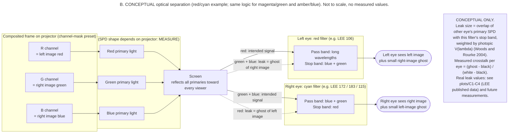

### Off-axis cameras and a 63 mm divergence ceiling

Stereo geometry decides comfort independently of colour. Use **parallel cameras with asymmetric (off-axis) frusta** converging on a zero-parallax plane. Never toe the cameras in, because toe-in introduces vertical parallax ([Bourke](http://paulbourke.net/stereographics/stereorender/)). Bourke suggests an eye separation of about 1/30 of the focal distance, with 1/20 as roughly the maximum, and angular disparity within about ±1.5°. Lambooij et al. find classical problems minor below about 1° ([IS&T JIST 53(3)](https://library.imaging.org/jist/articles/53/3/art00001)). Behind-screen parallax must never exceed the viewer's interocular distance, or the eyes are forced to diverge. Adult IPD averages **63.36 mm (SD 3.83 mm, range 52–78 mm)** in ANSUR 1988 data cited via Dodgson ([USPTO 10429648](https://image-ppubs.uspto.gov/dirsearch-public/print/downloadPdf/10429648)). Screen parallax follows p = e·(1 − V/Z), so the same content is more demanding on a bigger, farther screen. In the notes' worked example (viewer at 4 m, a 4 m, 1920 px screen), 1° is already about 70 mm, so the **divergence limit of about 63 mm, roughly 30 px, binds first**. The Shibata zone-of-comfort fit puts the near limit at about 1.08 m for a 3 m viewing distance ([Shibata et al. 2011](https://pmc.ncbi.nlm.nih.gov/articles/PMC3369815)). Size the limits for the closest seat and the smallest IPD, and keep crossed (in-front) parallax more conservative. Expect about **7% of viewers to lack usable stereopsis** whatever the colour pair ([SKI summary](https://www.ski.org/?p=15507)).

## Red/cyan leads on evidence, and magenta/green is the comfort challenger

Only three pairs have peer-reviewed crosstalk comparisons. Woods & Harris simulated 16 pairs of glasses against measured spectra from 13 LCDs, 15 plasma panels and a CRT. Red/cyan had the lowest average crosstalk, green/magenta was close behind, and blue/yellow was clearly worst except on plasma ([Woods & Harris 2010](https://cmst.curtin.edu.au/wp-content/uploads/sites/4/2016/05/2010-11.pdf)). Two caveats limit how far this transfers. **The study contained no projectors**, and its red/cyan samples were chosen for good performance, which biases the comparison toward red/cyan. The authors also report that green/magenta glasses "generally have better brightness balance" and blue/yellow "the greatest brightness imbalance", but they published no numbers for either.

| Display | Red/cyan | Green/magenta | Blue/yellow |
|---|---|---|---|
| LCD | 14.7 (min 7.6) | 20.1 (min 11.7) | 33.9 (min 24.7) |
| Plasma | 15.7 (min 8.4) | 18.4 (min 11.2) | 16.9 (min 12.5) |
| CRT | 27.1 (min 22.8) | 27.1 (min 24.9) | 36.7 (min 32.2) |
| **All displays** | **15.7** | **19.5** | **25.2** |

Average overall crosstalk factor, best 4 gel glasses per type (best 3 for green/magenta) ([Woods & Harris 2010](https://cmst.curtin.edu.au/wp-content/uploads/sites/4/2016/05/2010-11.pdf)). Dichroic versions were simulated as well. Dichroic red/cyan averaged 13.6 and green/magenta 17.6. Dichroic blue/yellow scored 73.9, because its blue edge sat at about 505 nm instead of 480–490 nm. Inkjet-printed filters averaged 93.8.

**Brightness balance follows from where luminance lives.** The Rec.601 luma weights (0.299, 0.587, 0.114), which ffmpeg also uses, give a signal-level split of 0.299 / 0.701 for red/cyan and 0.587 / 0.413 for green/magenta. Amber/blue comes out at about 0.886 / 0.114 before the lenses' own losses ([ffmpeg source](https://github.com/FFmpeg/FFmpeg/blob/master/libavfilter/vf_stereo3d.c)). Green/magenta is therefore the most naturally balanced pair. Amber/blue leaves the blue eye very dim, and in a dim eye even small ghosts become proportionally more visible. Unequal eye luminance can also cause Pulfrich false depth on horizontal motion ([Woods & Rourke 2004](https://cmst.curtin.edu.au/wp-content/uploads/sites/4/2016/05/2004-08.pdf)).

| Pair | Crosstalk evidence | Colour | Brightness balance | Premade glasses (US, Oct 2026) | Matrices | Verdict |
|---|---|---|---|---|---|---|
| **Red/cyan** | Lowest: 15.7 average; 3–5 on 3LCD projectors | Poor reds | Cyan eye brighter | Abundant | Dubois 2009, classic, mask | **Test 1: baseline** |
| **Magenta/green** | 19.5 average; dichroic 17.6 | Better reds (claimed) | Best (claimed, unquantified) | In stock: RS, APO TrioScopics, 3Dstereo TriOviz, Berezin | Dubois GM 2010, mask | **Test 2: challenger** |
| **Amber/blue** (ColorCode-style) | 25.2 average; worst on LCD | Near-full colour in the amber eye | Worst; dim blue eye | **None verified** (eBay only, unloadable) | Dubois YB 2010, mask | **Test 3: DIY gels only** |
| Pink/green (pale pink) | None; spectra show 10–49% green leak | — | Pink eye bright | — | — | **Reject as a separating filter** |
| Red/blue, red/green | Red/blue 5.89 on CRT | Monochrome only | Dark | Available | ffmpeg `arbg`, `argg` | Fallback only |
| Anachrome | Red/cyan variant with an intentional ~2% red leak and +0.5 D red lens | Better than red/cyan (claimed) | — | Berezin 5481, $14.95 | — | Optional sample |
| Inficolor/TriOviz (proprietary processing) | None independent | Claimed natural | Unknown | TriOviz-branded cardboard sold | Proprietary | Use glasses only as a magenta/green sample |
| Magenta/cyan | None | Claimed | Claimed | None | Experimental | Not viable |
| Infitec/Dolby wavelength multiplex | Different technology | Full colour | — | Berezin Dolby glasses $24.49 | — | **Defer**; needs 6 primaries |

Sources: [Woods & Harris 2010](https://cmst.curtin.edu.au/wp-content/uploads/sites/4/2016/05/2010-11.pdf); [Woods & Rourke 2004](https://cmst.curtin.edu.au/wp-content/uploads/sites/4/2016/05/2004-08.pdf); [Wikipedia Anaglyph 3D](https://en.wikipedia.org/wiki/Anaglyph_3D) (Anachrome, Inficolor and magenta/cyan claims, secondary); [Berezin](https://www.berezin.com/3d/3dglasses.htm); [stereoscopy.com Infitec FAQ](https://stereoscopy.com/faq/interference-filters.html).

**Visible colour contrast is not spectral separation, and pale pink is the trap.** A lens looks pale because it transmits broadly, and a pale pink lens therefore transmits the green the other eye is meant to see. LEE publishes numeric per-wavelength transmission for every colour, at 400–700 nm in 5 nm steps ([LEE 106 page](https://leefilters.com/colour/106-primary-red/)). On those numbers, LEE 035 Light Pink passes **48.6%** in the 530–560 nm green band, 036 Medium Pink 27.4% and 002 Rose Pink 10.1%. The saturated magentas pass about 0.5%: 795 Magical Magenta 0.49% and 128 Bright Pink 0.54% ([LEE 795](https://leefilters.com/colour/795-magical-magenta/); [LEE 035](https://leefilters.com/colour/035-light-pink/)). That is a **20–100× difference** in leakage between lenses that all look "pinkish-magenta". It is also why the stop-band, not the hue, has to drive gel selection. The same logic disqualifies Rosco CalColor as a separating filter. A CalColor "90" grade is defined as three stops of attenuation of the complementary colour, which is roughly 12.5% leakage, far above the ~1% anaglyph needs. That is an inference from Rosco's stop definition, not a measured spectrum ([Rosco CalColor PDF](https://www.castinfo.de/downloaditem//r/o/rosco_photo_filter_kits_calcolor.pdf)).

| LEE gel (published, not measured by us) | Role | Blue 445–465 nm | Green 530–560 nm | Red 610–640 nm | Daylight Y |
|---|---|---|---|---|---|
| 106 Primary Red | red eye | 0.14 | 0.03 | **57.16** | 9.3 |
| 172 Lagoon Blue | cyan eye | **58.96** | 24.50 | 0.12 | 25.4 |
| 183 Moonlight Blue | cyan eye | **69.14** | 21.65 | 0.15 | 18.7 |
| 115 Peacock Blue | cyan eye | 61.46 | **49.93** | 1.05 | 35.2 |
| 139 Primary Green | green eye | 0.03 | **23.65** | 0.02 | 11.9 |
| 124 Dark Green | green eye | 4.34 | **44.94** | 0.51 | 29.7 |
| 795 Magical Magenta | magenta eye | **47.53** | 0.49 | **62.38** | 13.3 |
| 128 Bright Pink | magenta eye | 35.28 | 0.54 | **75.77** | 13.7 |
| 010 Medium Yellow | amber eye | 0.05 | **88.72** | **89.90** | 86.5 |
| 101 Yellow | amber eye | 0.09 | **81.66** | **88.15** | 80.0 |
| 363 Special Medium Blue | blue eye | **44.88** | 0.97 | 0.05 | 4.2 |
| 119 Dark Blue | blue eye | **45.75** | 1.10 | 0.01 | 3.1 |
| 035 / 036 / 002 pale pinks | rejected | 67.09 / 51.99 / 67.15 | **48.58 / 27.38 / 10.09** | 88.40 / 85.14 / 86.55 | 61.3 / 45.4 / 32.7 |

Mean %T over illustrative bands, from [`band_summary.csv`](anaglyph_handoff/plots/band_summary.csv), which was computed from LEE's published data in `gel_spectra.csv`. The daylight Y values are LEE's own figures ([LEE colour pages](https://leefilters.com/lighting/colour-effect-lighting-filters/)). The bands are stand-ins for projector primaries, not measurements.

The table supports specific gel choices. For red/cyan, **LEE 106 with 172 or 183** keeps the cyan eye's red leak to about 0.1–0.2%. The cyan eye is green-starved at about 22–25%, though, so it will look blue-heavy unless the renderer compensates. 115 Peacock Blue doubles the green but leaks about 1% red, roughly 7–9× worse. If the projector's red primary carries energy at 590–600 nm, as lamp projectors often do, 026 Bright Red or 029 Plasa Red cut harder below 600 nm at about 20–25% less brightness. For magenta/green, **139** is the cleanest green (red and blue ≤0.03%) but dim, and 124 is twice as bright but leaks 4% blue. The magenta eye is best served by **795 or 128**; 113 Magenta and 046 Dark Magenta pass too little blue. For amber/blue, **010 or 101** block 455 nm to ≤0.1% while passing 82–90% elsewhere, and **363 or 119** make the blue eye. That blue eye has a daylight Y of only 3–4%, which confirms the imbalance risk numerically.

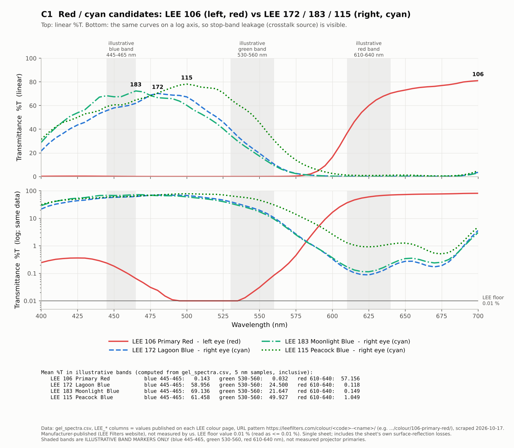

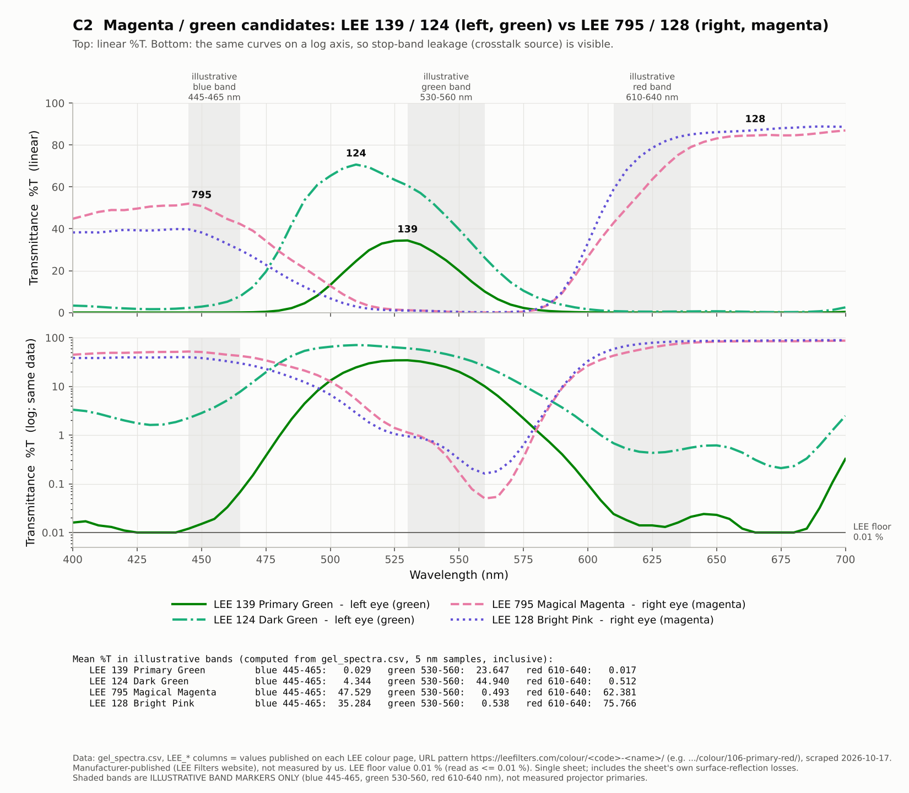

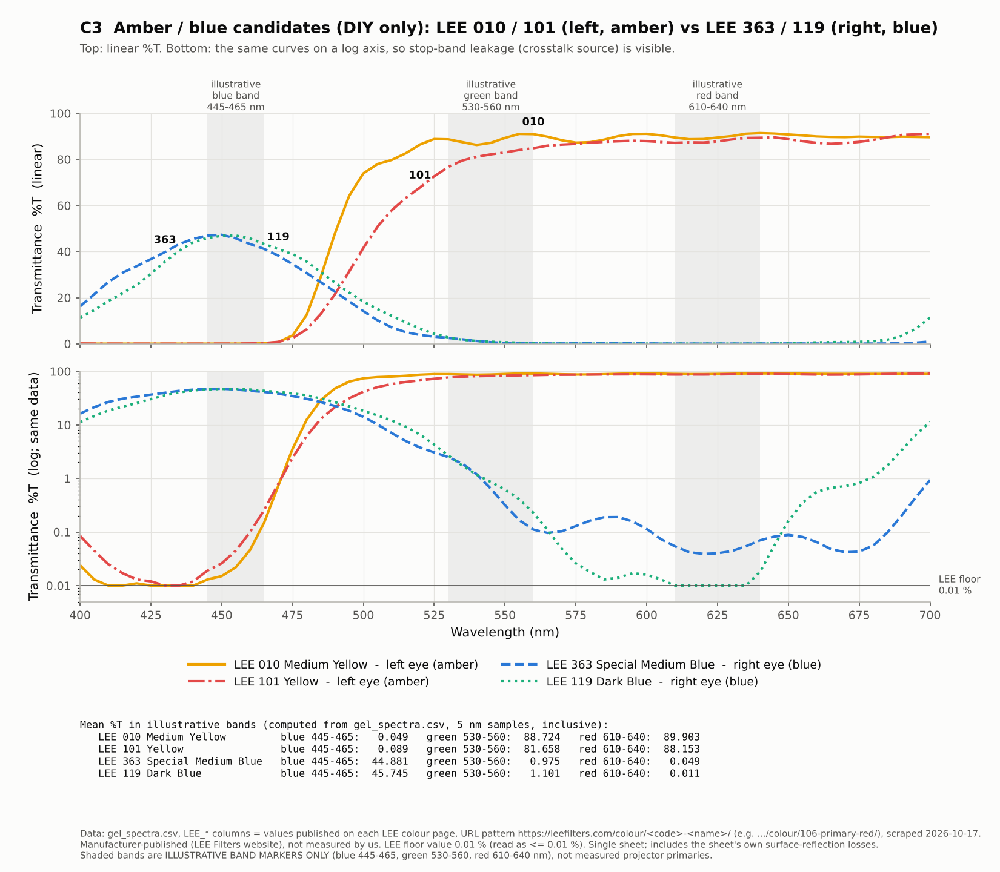

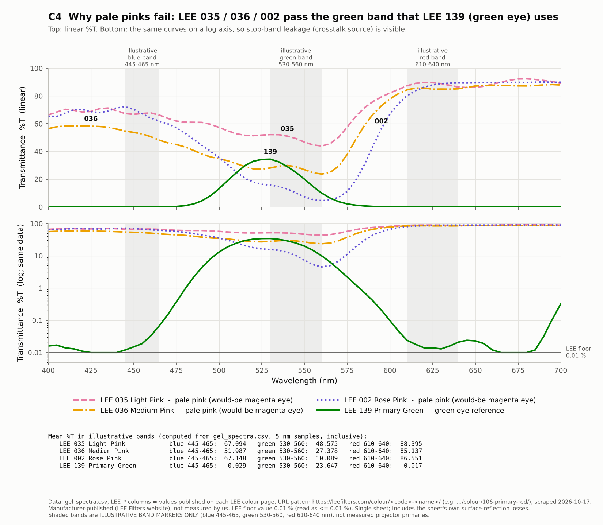

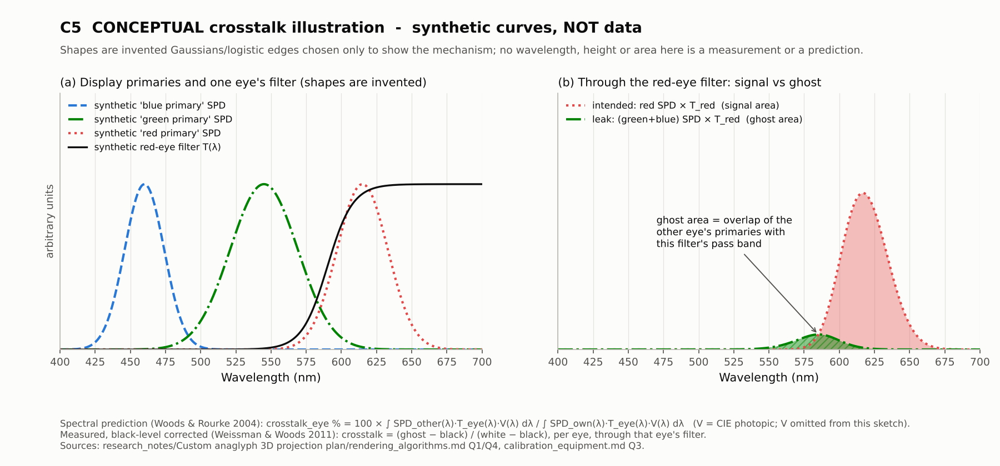

The plots come from the data flow below. Every curve is manufacturer-published (the LEE website), not measured by the team, and LEE floors its values at 0.01%.

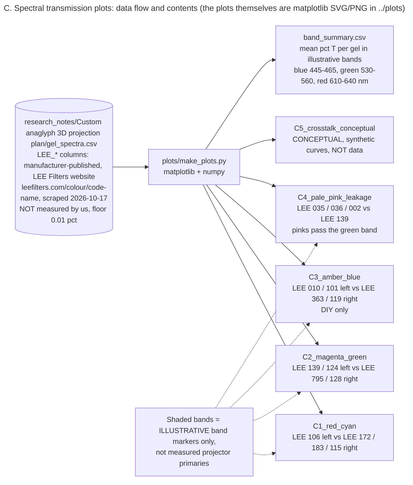

**The recommended test order is red/cyan, then magenta/green, then amber/blue.** Red/cyan comes first because it has the lowest measured crosstalk, the only projector data, abundant glasses and established matrices, which makes it the baseline every later result is judged against. Magenta/green comes second because its measured crosstalk is close to red/cyan's, its brightness balance is better and its premade glasses are still sold. It is the pair most likely to beat red/cyan on comfort, and Hyperspace's saturated red points survive it better. Amber/blue comes third and is worth the effort only if colour fidelity in one eye outweighs a dim, ghost-prone blue eye. Note that "magenta/green" is not one standard. 3Dstereo states that its TriOviz glasses are "NOT the same as Trioscopic" ([3Dstereo collection](https://3dstereo.com/collections/anaglyph-glasses/products.json)). Each brand needs its own calibration, and an audience should be supplied from a single brand.

## A $173 order from three California sellers starts the lab

**No seller publishes transmission curves for premade anaglyph glasses.** The most specific vendor language is Rainbow Symphony's "cast acrylic lenses tinted to exacting color standards" ([RS ProView](https://www.rainbowsymphony.com/products/proview-plastic-3dglasses)). Every premade lens therefore enters the profiles as `data_type: unknown` until it is measured. Rainbow Symphony (RS) in Reseda, CA is the fastest source of premade glasses. Orders "usually" ship within 24–48 hours, returns are accepted within 30 days for unused items with a 10% restocking fee, and RS sells **no amber/blue product** ([RS FAQ](https://www.rainbowsymphony.com/pages/faq); [RS refund policy](https://www.rainbowsymphony.com/policies/refund-policy)). American Paper Optics (APO) sells its proprietary TrioScopics magenta/green from 50 units at $0.40, but ships from Memphis within 48 hours ([the3dmarket shipping](https://the3dmarket.com/policies/shipping-policy)). 3Dstereo has the widest specialist range with no minimum order, but its ship-from location is not stated. Bulk magenta/green ProView is sold out at RS, so a large audience in that pair means paper glasses or several 2-pack orders.

| Product (direct link) | SKU | Pair | Price on 2026-10-17 | Stock | Ships from / est. SF delivery |
|---|---|---|---|---|---|
| [RS ProView Professional plastic](https://www.rainbowsymphony.com/products/proview-plastic-3dglasses) | 03401 | Red/cyan | 2-pack $18.00; 25 $164.50; 50 $291.50; 500 $2,425 | 2/25/50/100/500 in stock; 12-pack sold out | Reseda CA; ~2–4 business days (est.) |
| [RS paper red/cyan](https://www.rainbowsymphony.com/products/red-cyan-paper-3d-glasses) | 03201-10…-500 | Red/cyan | 10 $7.50; 25 $15; 100 $50; 500 $200 | All except 250-pack | Reseda CA; ~2–4 days |
| [RS Magenta/Green ProView](https://www.rainbowsymphony.com/products/magenta-green-proview-3d-glasses) | 03410 | Magenta/green | 2-pack $18.00 | **Only the 2-pack** in stock | Reseda CA; ~2–4 days |
| [RS M/G ProView clip-on](https://www.rainbowsymphony.com/products/clip-on-3d-glasses-magenta-green) | 03412 | Magenta/green | $6.95 | In stock | Reseda CA |
| [RS GEMS magenta/green](https://www.rainbowsymphony.com/products/magenta-green-plastic-3d-glasses) | 03461/03462/03463 | Magenta/green | $6.00 per listing (pack count unstated) | In stock | Reseda CA |
| [RS paper magenta/green](https://www.rainbowsymphony.com/products/magenta-green-paper-3d-glasses) | 03218-100 | Magenta/green | 100 for $50 | Only the 100-pack in stock | Reseda CA |
| [APO TrioScopics paper](https://the3dmarket.com/products/trioscopics-3d-glasses) | — | Magenta(R)/green(L) | 50–200 @ $0.40; 1,000 @ $0.25 (min 50) | In stock | Memphis TN; ~6–7 days Ground, 3–4 by 2-Day (est.) |
| [APO plastic "Classic"](https://the3dmarket.com/products/anaglyphic-plastic) | — | Red/cyan | 1–6 @ $5.50; 100 @ $3.50 | In stock | Memphis TN |
| [3Dstereo TriOviz black cardboard](https://3dstereo.com/products/magenta-green-3d-anaglyph-cardboard-glasses-official-trioviz-pro-anatm-quality-black-cardboard-new) | GLA-TO | Magenta/green | $1.95 | In stock | Not stated |
| [3Dstereo Pro-Ana plastic](https://3dstereo.com/products/red-cyan-3d-anaglyph-glasses-pro-anatm-highest-quality-plastic-frame-new) | GLA-PROA | Red/cyan | $6.95 | In stock | Not stated |
| [Berezin catalog](https://www.berezin.com/3d/3dglasses.htm) | 545M / 542 / 5481 | M/G cardboard (10 for $4.50); ProVu red/cyan $9.95; Anachrome $14.95 | — | No stock indicator | Mission Viejo CA; 1–5 day handling |
| [eBay amber/blue](https://www.ebay.com/itm/127274830807) | 127274830807 | Amber/blue | Unverified (page 403) | Unverified | Unknown |

Sources: [RS catalog JSON](https://www.rainbowsymphony.com/products.json?limit=250); [the3dmarket catalog JSON](https://the3dmarket.com/products.json?limit=250); [3Dstereo collection JSON](https://3dstereo.com/collections/anaglyph-glasses/products.json); [Berezin](https://www.berezin.com/3d/3dglasses.htm).

**LEE gels are the best-characterised cheap filter material, and Studio Depot in Burbank is the fastest source.** It lists the candidate LEE codes at **$12.00 per 21"×24" sheet**, "In Stock: Order now to ship the next business day", and the LEE Designer's Edition swatch book at $28.00 ([Studio Depot LEE 106](https://www.studiodepot.com/31-lee-s106.html); [Studio Depot swatchbook](https://www.studiodepot.com/leeswatchbook.html)). The swatch book holds "a sample of every colour in our lighting gel collection", including 795, the pale pinks and the alternates. Each sample of about 38×83 mm cuts into two pieces of about 38×38 mm, enough for one lens of a cardboard frame. LEE 795 is not listed at Studio Depot (404). Production Advantage sells any LEE colour at $11.00 per sheet but does not show per-colour stock ([Production Advantage](https://proadv.com/lee-color-gel/)). Rosco products are real and in stock: Stage Lighting Store lists Roscolux sheets at $11.50 with live quantities ([Stage Lighting Store R27](https://www.stagelightingstore.com/27-Medium-Red)). But Rosco no longer publishes numeric spectra on the web, only a single "Transmission = X%" per colour, so **Rosco is a second-tier choice until a spectrometer is available** ([Rosco R27](https://us.rosco.com/en/products/filters/r27-medium-red)). For the same day in San Francisco, call **Holzmueller Productions** (1050 25th St, 415-826-8383, expendables sold by appointment) and Samy's Camera SF before going ([Holzmueller](https://www.holzmueller.com/)). Neither had confirmed gel stock.

| Gel (direct link) | SKU | Price | Status 2026-10-17 | Use |
|---|---|---|---|---|
| [LEE swatch book, Designer's Edition](https://www.studiodepot.com/leeswatchbook.html) | LEE swatchbook | $28.00 | In stock, ships next business day | Every LEE code incl. 795, 115, 124, 026, 029, pinks |
| [LEE 106 Primary Red](https://www.studiodepot.com/31-lee-s106.html) | 106S | $12.00 | In stock | Red eye |
| [LEE 172 Lagoon Blue](https://www.studiodepot.com/31-lee-s172.html) | 172S | $12.00 | In stock | Cyan eye |
| [LEE 183 Moonlight Blue](https://www.studiodepot.com/31-lee-s183.html) | 183S | $12.00 | In stock | Cyan eye (alt.) |
| [LEE 139 Primary Green](https://www.studiodepot.com/31-lee-s139.html) | 139S | $12.00 | In stock | Green eye |
| [LEE 128 Bright Pink](https://www.studiodepot.com/31-lee-s128.html) | 128S | $12.00 | In stock | Magenta eye (alt.) |
| [LEE 010 Medium Yellow](https://www.studiodepot.com/31-lee-s010.html) | 010S | $12.00 | In stock | Amber eye |
| [LEE 363 Special Medium Blue](https://www.studiodepot.com/31-lee-s363.html) | 363S | $12.00 | In stock | Blue eye |
| [LEE 795 Magical Magenta (any colour)](https://proadv.com/lee-color-gel/) | LEE-GEL-SHT | $11.00 | Per-colour stock not shown | Magenta eye (profile default) |
| [Glazer's LEE 106](https://www.glazerscamera.com/collections/all/products/primary-red-21-x24) | 62749 | $12.00 | Listed | Backup LEE source |
| [LEE Filters Direct (UK)](https://leefiltersdirect.com/products/106-primary-red) | — | £10.25 full sheet | GBP store | Not the fast option |

Studio Depot's "In Stock" message is the same on every code and may be a generic flag rather than a live count. Its 1–2 day ground delivery to SF is an estimate; the retailer does not state it ([theatrical_gels notes, Studio Depot pages](https://www.studiodepot.com/31-lee-s172.html)).

**Calibrated filter materials cost more and serve as references, not audience eyewear.** Edmund Optics' 50 mm 0° dichroic filters have the sharpest published passbands of anything priced. The red #30-634 ($44.50) has Tavg <1% at 390–570 nm and >85% at 620–750 nm. The cyan #39-912 ($44.75) has >80% at 400–550 nm and <1% at 640–740 nm. Both are 2 mm BOROFLOAT glass ([Edmund #30-634](https://www.edmundoptics.com/p/50mm-square-red-dichroic-filter/1901/); [Edmund #39-912](https://www.edmundoptics.com/p/50mm-square-cyan-dichroic-filter/4596/)). Edmund's green dichroic #52-535 is $44.75 and the magenta #52-541 is listed at the same price, though that figure comes from a search snippet ([Edmund #52-535](https://www.edmundoptics.com/p/50mm-diameter-green-dichroic-filter/10613/)). Kodak Wratten 2 sheets cost $131 for #25 red and #47 blue and $266 for #44A cyan. They are 0.10 mm, scratch easily and cloud in humidity, and Kodak publishes density curves only as PDF graphs ([Edmund #53-699](https://www.edmundoptics.com/p/red-25-kodak-wratten-color-filter/10790/); [Kodak Wratten 2](https://www.kodak.com/en/motion/page/wratten-2-filters/)). No evidence was found that LEE makes Wratten 2 under licence. Edmund's CR-39 cast-plastic squares ($22.75 for 2"×2") come only in red, green and blue, so they can make red/green or red/blue pairs but not red/cyan ([Edmund cast plastic](https://www.edmundoptics.com/f/optical-cast-plastic-color-filters/12257/)). TAP Plastics, a Bay Area chain, cuts coloured cast acrylic to size "often" in under five minutes. It publishes only one luminous transmission figure per colour, for example Dark Red 49.9%, so it is a mock-up material ([TAP Plastics](https://www.tapplastics.com/product/plastics/cut_to_size_plastic/acrylic_sheets_transparent_colors/516)). No vendor sells empty anaglyph frames. The practical carriers are the free [Printables "Modular filter glasses"](https://www.printables.com/model/410694-modular-filter-glasses) slot frame (1.25"×2" inserts), laser-cut cardboard or acrylic, or premade paper frames re-lensed with gel.

### Prioritized starter shopping list

| Priority | Item | Seller / SKU | Qty | Line cost | Why now |
|---|---|---|---|---|---|
| **P1** | ProView red/cyan plastic | RS 03401 (2-pack) | 1 | $18.00 | Durable red/cyan baseline; fits over glasses |
| **P1** | Paper red/cyan | RS 03201-10 | 1 | $7.50 | Second red/cyan dye set; spare frames |
| **P1** | Magenta/green ProView | RS 03410 (2-pack) | 1 | $18.00 | Premade challenger |
| **P1** | M/G clip-on | RS 03412 | 1 | $6.95 | Over-prescription test |
| **P1** | LEE Designer's swatch book | Studio Depot | 1 | $28.00 | Every candidate code for lens-size trials |
| **P1** | LEE 106, 172, 183, 139, 128, 010, 363 | Studio Depot 106S…363S | 7 sheets | $84.00 | Full-size lenses for all three pairs |
| **P1** | LEE 795 | Production Advantage LEE-GEL-SHT | 1 sheet | $11.00 | Default magenta in the profile |
| | **P1 subtotal** | | | **$173.45** | **Order today** |
| P2 | TrioScopics paper | APO (min 50) | 50 | $20.00 | Second magenta/green brand; audience-scale price |
| P2 | TriOviz cardboard | 3Dstereo GLA-TO | 2 | $3.90 | Third magenta/green dye set |
| P2 | Dichroic red + cyan reference pair | Edmund #30-634 + #39-912 | 1 each | $89.25 | Low-crosstalk reference (hand-held only) |
| | **Running total P1+P2** | | | **$286.60** | |
| P3 | Sekonic C-800, 7-day rental | Lensrentals | 1 | $109.00 ($131 with damage waiver) | Path B spectra |
| | **Running total P1–P3** | | | **$395.60** | |
| P3 opt. | C12880MA spectrometer breakout | GroupGets BO-HAMA-V2 | 1 | $69.99 | Owned low-res spectrometer (confirm the sensor is included) |
| P3 opt. | Randot stereo test | Stereo Optical / Precision Vision | 1 | $205–273 (snippet) | Viewer screening in Phase 5 |

All totals are before tax and shipping, which no seller quoted without a checkout session. The order is placed on a Saturday. Studio Depot ships the next business day, Monday 19 October, so gels should arrive around 20–21 October. RS ships within 24–48 hours, so its glasses should arrive around 21–23 October. APO weekend orders ship within 72 hours, so TrioScopics should arrive around 27–28 October by FedEx Ground. Lensrentals showed the C-800 "Available Thursday" ([Lensrentals C-800](https://www.lensrentals.com/rent/sekonic-c-800-spectromaster-color-meter)). All these dates are estimates derived from the sellers' stated handling times.

## Gels make good filters and poor eyewear

LEE colour filters are 0.08 mm polyester ([LEE Filters Direct FAQ](https://leefiltersdirect.com/apps/frequently-asked-questions)). Roscolux is either 35–64 µm deep-dyed PET or 75–100 µm body-coloured polycarbonate ([Rosco Roscolux](https://us.rosco.com/en/product/roscolux)). Both are non-diffusing films that cut cleanly with a sharp blade. Their published transmissions already include the sheet's own surface-reflection losses of roughly 10–12% for two surfaces, a figure consistent with LEE's ~88–91% in-band peaks for the yellows. Stacking two layers with an air gap multiplies the transmittances. Two layers of 172 would push red leakage to near LEE's 0.01% floor, but cut 545 nm transmission to about 6%. The stack is therefore a tool for the leaky eye, not a general upgrade. Thin film ripples unless it is held flat, so sandwich it between clear rigid sheets or tension it in a frame. Handle it by the edges and cut on a clean surface. PET is birefringent, which does not matter for anaglyph.

**Theatrical gels are lighting products with no eyewear rating**, so they belong in supervised, indoor, seated use only. Rosco documents softening and melting temperatures and RoHS compliance, not ophthalmic properties, and LEE's FAQ gives no eye-safety guidance ([Rosco Roscolux](https://us.rosco.com/en/product/roscolux)). The regulatory picture is governed by **21 CFR 801.410**, which requires that eyeglass and sunglass lenses survive a 5/8-inch, roughly 0.56 oz steel ball dropped from 50 inches ([eCFR 801.410](https://www.ecfr.gov/current/title-21/chapter-I/subchapter-H/part-801/subpart-H/section-801.410)). FDA's 2010 guidance says FDA "in general, does not require impact testing of novelty eyewear" that claims neither corrective power nor sun protection, provided dark-lensed items carry a "not for use as sunglasses" warning. FDA still "strongly recommends" impact testing. Any "blocks UV" claim turns the product into a regulated sunglass, and CPSC small-parts rules can apply ([FDA guidance PDF](https://www.fda.gov/media/71020/download)). ANSI Z80.3 covers sunglasses and fashion eyewear, Z87.1 covers occupational safety eyewear and ISO 12312-1 covers solar protection. None was found to address 3D glasses specifically ([ANSI Z80.3 blog](https://blog.ansi.org/ansi/ansi-z80-3-sunglasses-requirements/); [ISO 12312-1](https://www.evs.ee/en/iso-12312-1-2022)).

The practical rules follow from those facts, and they are recommendations, not legal advice. Make no UV, sun or impact claims, and label the glasses "Not sunglasses. Do not wear outdoors." Keep **glass dichroics out of worn eyewear**: mount them in a hand-held lorgnette, or behind a clear polycarbonate shield. Prefer plastic (CR-39, acrylic or gel) near the eyes. Keep cut film away from projector exhaust, because it softens at 125°C for PET. Remember that red gels such as LEE 106 still pass about 81% at 700 nm, and that dark filters dilate the pupils, so never pair them with bright IR or UV sources. Seat viewers, limit session length, offer a no-glasses fallback, and advise removing the glasses before walking in the dark. **For hygiene, use materials that tolerate wipe-down**. Edmund rates CR-39 as resistant to alcohols, while Wratten gel and paper frames are not wipeable ([Edmund cast plastic](https://www.edmundoptics.com/f/optical-cast-plastic-color-filters/12257/)). Cinema practice is to wash or wipe between users and discard scratched pairs ([PCO Group](https://www.pco-group.com/our-products/3d-glasses.html)). Acrylic's tolerance of alcohol was not sourced, so test it on an offcut. For audience volume later, American Paper Optics and Rainbow Symphony quote custom frames and lenses, and Edmund offers custom CR-39 colours only to "qualified high volume OEM applications" ([APO custom](https://www.3dglassesonline.com/products/custom-shapes/); [Edmund](https://www.edmundoptics.com/f/optical-cast-plastic-color-filters/12257/)).

## Calibrate against black: Path A takes an evening, Path B a rental week

Use one crosstalk definition throughout: the black-level-corrected observed crosstalk of Weissman & Woods, **crosstalk = (ghost − black) / (white − black)**, measured through each eye's filter ([Weissman & Woods 2011](https://cmst.curtin.edu.au/wp-content/uploads/sites/4/2016/05/2011-15-weissman-woods-measuring_crosstalk.pdf)). Here "white" means that eye's own primary set, "ghost" means the other eye's white leaking through, and "black" means both views black. Subtracting black matters because projectors in ambient light have a nonzero black floor. "Good" stereo displays reach about **1% (100:1)**. Measured anaglyph systems run above 2%, and broadband anaglyph filters exceed 40% ([Baker et al. 2016](https://pmc.ncbi.nlm.nih.gov/articles/PMC5172160/)). For prediction, Woods & Rourke integrate display SPD × filter transmission × photopic V(λ). Their best red/cyan pair reached **1.89% (red eye) and 0.32% (cyan eye)** on an Epson 3LCD, against up to 15.4% for the red eye on a DLP ([Woods & Rourke 2004](https://cmst.curtin.edu.au/wp-content/uploads/sites/4/2016/05/2004-08.pdf)). Instruments matter because eyes cannot rank differences under about 2%. In Woods & Rourke's visual ranking, the eye agreed with the model except where the gap was that small.

| Instrument | Link | Price (2026-10-17) | Gives | Limits |
|---|---|---|---|---|
| Phone camera, RAW/DNG | — | $0 | Relative ghost/signal ratios, registration, uniformity | Not V(λ)-weighted; no spectra; JPEG nonlinear |
| Dr.Meter LX1330B lux meter | [eBay](https://www.ebay.com/p/2238960293) | ~$38–60 (snippet) | Through-filter illuminance at signal level | 0.1 lx resolution is too coarse for ghosts |
| Hamamatsu C12880MA breakout | [GroupGets](https://groupgets.com/products/c12880ma-c16767ma-breakout-board) | $69.99 | Spectra at 340–850 nm, ~15 nm FWHM | Blurs laser lines and dichroic edges; sensor inclusion unconfirmed; no software |
| **Sekonic C-800 (rent)** | [Lensrentals](https://www.lensrentals.com/rent/sekonic-c-800-spectromaster-color-meter) | **$76 for 3 days; $109 for 7 days** | 380–780 nm SPD and illuminance, through-filter SPD | Cosine diffuser (illuminance geometry); 1 nm is output pitch, not resolution |
| Calibrite ColorChecker Studio | [Full Compass](https://www.fullcompass.com/prod/660943-calibrite-ccstudio-colorchecker-studio) | $569 (snippet) | Emissive spectra via ArgyllCMS `spotread -s` | Transmission mode unconfirmed |
| Colorimeter (Display Plus HL) | [Pictureline](https://www.pictureline.com/collections/peripherals/products/calibrite-display-plus-hl) | $259–339 (snippet) | White point, signal levels | **Failed at ghost levels** behind stereo filters |
| Ocean ST-VIS / UPRtek MK350S | [Edmund](https://www.edmundoptics.com/p/ocean-st-vis-microspectrometer/56524/) / [Gamma Sci](https://gamma-sci.com/product/mk350s-premium-spectrometer/) | $1,820 / $4,125 (snippets) | Lab-grade spectra | Cost is justified only beyond Path B |

The colorimeter row matters. In a published attempt, a Spyder colorimeter behind stereo filters lost a factor of 39 in luminance and "the Spyder results were not reliable, especially at the lower intensity levels representative of the ghost image" ([Weissman & Woods 2011](https://cmst.curtin.edu.au/wp-content/uploads/sites/4/2016/05/2011-15-weissman-woods-measuring_crosstalk.pdf)). A spot photometer pointed through one goggle aperture did succeed, using regression slopes over 32 luminance levels rather than single-point ratios ([Baker et al. 2016](https://pmc.ncbi.nlm.nih.gov/articles/PMC5172160/)).

**Path A (fast, about $0–70, one evening) produces relative comparisons only.** It combines through-filter visual checks, a Weissman-style SCT chart and phone RAW captures. The SCT chart lets the viewer match the ghost of a white bar against gray patches scaled in percent of linear intensity. Older gray-level charts read wrong unless gamma is accounted for. The phone captures use locked exposure, ISO, white balance and focus, a tripod, a fixed pixel region and bracketed exposure times, because ghost and signal can be 50–100× apart. Consumer camera RAW is highly linear while JPEG is not, but flat-field factors reach 2.79 across the frame and RGB responses "differed wildly between camera models" ([Burggraaff et al. 2019](https://arxiv.org/pdf/1906.04155)). Path A therefore compares filters and settings on one device. It does not produce V(λ)-weighted absolute crosstalk.

**Path B (high-confidence, about $109, one rental week) produces numbers that can feed matrices.** Rent the C-800 and measure the projector's R, G, B, W and K SPDs at the screen plane, in the locked mode after warm-up. Then measure each filter's transmission on a halogen or incandescent source as T(λ) = (S − D)/(R − D). A white LED is a poor reference because it is weak below about 430 nm and dips near 480 nm. Next compute the Woods–Rourke V(λ)-weighted crosstalk and recompute Dubois matrices with `compute_dubois_matrix.py`. Finally, **cross-validate against direct through-filter photometric crosstalk**: agreement within about 1 percentage point supports the model. Before trusting any Dubois matrix, compare the white SPD with the sum of the R, G and B SPDs. A mismatch means a white segment or other processing is breaking the additive assumption.

The decision tree maps seven symptoms to likely causes, diagnostics and next adjustments.

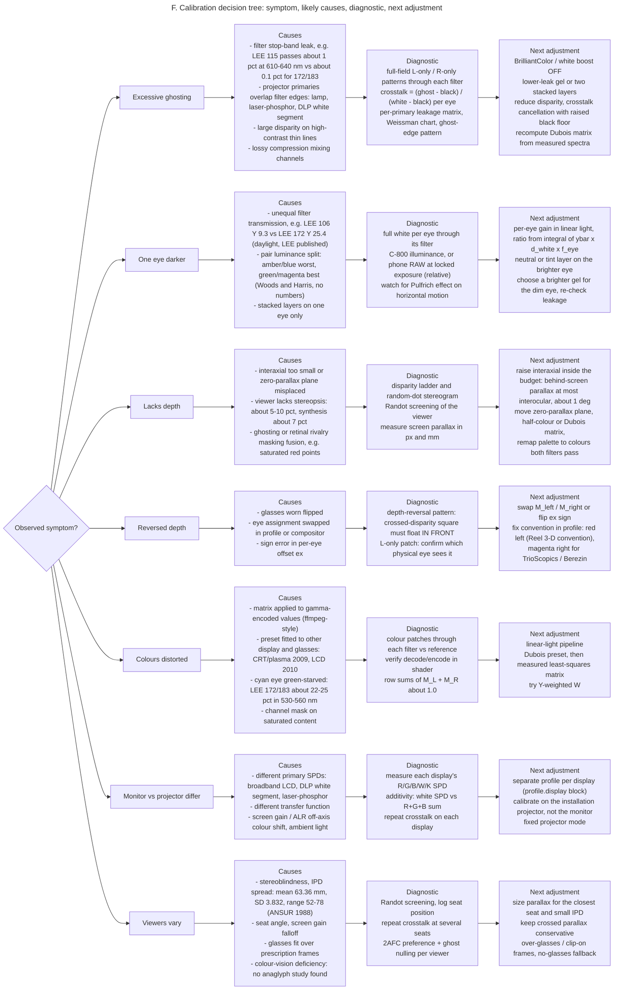

### Step-by-step calibration protocol with acceptance criteria

The test patterns TP1–TP9 are specified pixel-exactly in [`test_patterns.md`](anaglyph_handoff/templates/test_patterns.md) on a 1920×1080 reference raster. "Mode D" sends the RGB frame directly to the projector, testing only the projector and filters. "Mode E" routes the L and R eye images through the compositor under test.

| Step | Action | Pattern | Record | Acceptance |
|---|---|---|---|---|
| 1 | Lock the projector: fixed colour mode; BrilliantColor/white boost, dynamic contrast/iris, eco, auto keystone and ambient sensor OFF; warm up 20–30 min (unsourced inference) | — | Model, mode, all settings | Settings logged; identical on every later run |
| 2 | Darken the room, fix the meter or camera at the viewer position, and choose a seat map | — | Distance, angle, ambient | Geometry reproducible |
| 3 | Additivity check (Path B) | TP1-PR/PG/PB, TP1-W, TP1-K0 (mode D) | SPDs with black subtracted | W ≈ R+G+B; tolerance is an **open decision**. If they differ markedly, change mode or fit the model to patches |
| 4 | Per-eye full-field leakage, ≥5 repeats | TP1-LW, TP1-RW, TP1-K (modes D, then E) | white, ghost, black per eye | Mean ± SD reported; prototype target **≤5% red eye, ≤3% cyan eye** (team judgment, not a standard); stretch target 1% |
| 5 | Per-primary leakage table | TP1-PR/PG/PB through both filters | 3×2 leakage fractions | Table written to `calibration.per_primary_leakage` |
| 6 | Linearity of the ghost (optional, better) | TP1-RAMP, 32 levels | Regression slope | Slope-based crosstalk within the SD of step 4 |
| 7 | Visual SCT chart, both directions | TP2b | Matching patch % | Within one patch step of the instrument value from step 4 |
| 8 | Ghost edges and adjacency | TP2a, TP3a, TP3b | Visible ghost width and strength | Complementary half goes visibly black through each filter |
| 9 | Eye assignment and depth sign | TP6 | Square in front of the frame? L/R markers? | **Must pass**: crossed square in front, "L" seen by the left eye |
| 10 | Colour and rivalry | TP4 | Hue and brightness per patch; rivalry flicker | No rivalry on Hyperspace red (255,43,43) after palette or matrix fix |
| 11 | Depth range and comfort | TP5, TP7, TP8 | Fusion per rung; legibility; RDS seen and its sign | All rungs within budget fuse; RDS seen by screened viewers |
| 12 | Registration | TP9 | Nonius offset | No visible offset at y = 540 |
| 13 | Spectral model cross-check (Path B) | Woods–Rourke integration vs step 4 | Predicted vs measured | Agreement within about 1 percentage point |
| 14 | Matrix sanity | Recomputed P | Row sums | Each output row of M_L + M_R sums to 1.000 ± 0.001 |
| 15 | Freeze the profile | — | Write `calibration.status: measured` with date and numbers | Schema validation passes (`validate_configs.py`) |

### Experiment log template

Every run appends one row to [`experiment_log.csv`](anaglyph_handoff/templates/experiment_log.csv). The 20 columns are fixed so results stay comparable across pairs, gels and matrices. A matching YAML form (`kind: anaglyph_experiment`) embeds the profile used ([`experiment_example.yaml`](anaglyph_handoff/config/experiment_example.yaml)).

```csv
experiment_id,date,filter_pair,lens_product_codes,projector_model_and_settings,screen_and_ambient,render_algorithm,matrix_or_channel_config,stereo_interaxial,zero_parallax,test_scene,crosstalk_left_pct,crosstalk_right_pct,observed_ghosting,relative_brightness_L_R,color_quality,depth_quality,viewer_ids_and_feedback,outcome,next_experiment
EXAMPLE-RC-001,EXAMPLE (YYYY-MM-DD),EXAMPLE red/cyan premade (red left / cyan right),EXAMPLE Rainbow Symphony 03401 ProView; 03201 paper,EXAMPLE <model> / <colour mode> / BrilliantColor OFF / dynamic contrast OFF / eco OFF,EXAMPLE <screen material + gain> / room dark,EXAMPLE channel mask (linear light; clip each term then sum),EXAMPLE config/profiles/red_cyan_channel_mask.yaml v0.1.0,EXAMPLE PLACEHOLDER (world units),EXAMPLE z1 = 0 plane (Zc about 3.78 world units),EXAMPLE TP1+TP2+TP3+TP6 (test_patterns.md),EXAMPLE <measured %>,EXAMPLE <measured %>,EXAMPLE <describe: where / how strong>,EXAMPLE <L/R ratio>,EXAMPLE <notes>,EXAMPLE <notes>,EXAMPLE V01: <feedback>,EXAMPLE - not a real run,EXAMPLE switch to red_cyan_dubois_2009.yaml with same patterns
```

## Two eye passes and one compositor fit hyperspace-python's CPU projection

**Hyperspace has no stereo, anaglyph or colour-space code today.** The active app, `hyperspace-python`, is a moderngl (OpenGL 3.3 core), GLFW and imgui-bundle renderer with 4× MSAA. It projects 4D→3D→2D **on the CPU** in `geometry.project_h()` (`geometry.py:1009`), using a single mono camera, and sends pixel-space vertices plus a homogeneous divisor to inline GLSL in `render.py`. Outputs draw "one frame per loop" to up to four windows (`outputs.py`, `MAX_OUTPUTS = 4`). A grep for `srgb|gamma|anaglyph|stereo|parallax|IPD` found no colour-space or stereo code, and no sRGB framebuffer is used. These facts were observed in the working tree at commit `cdd6364` and are recorded in the research notes.

The cleanest injection point is the final 3D→2D step, which is the only step that should differ between eyes. The 4D perspective divide stays mono, because both eyes should see the same 3D shadow of the 4D object. The perspective step `k2 = CAM3/(CAM3 − 0.9·z1)` with `CAM3 = 3.4` is equivalent to a pinhole at Zc = CAM3/0.9 ≈ 3.78, at which k2 = 1. That makes **z1 = 0 a natural zero-parallax plane**. An off-axis eye offset ex = ±e/2 then gives `px_eye = w/2 + (x1·k2 + ex·(1 − k2))·scale` with y unchanged, so there is no vertical parallax. This derivation is an inference in the notes and **must be verified against `tests/test_core.py` parity before use**. The scene is then drawn twice into two textures and composited in one full-screen pass. Channel-shifting effects such as `fx/deconverge.glsl` must run per eye before compositing, or they will corrupt the eye separation.

```mermaid
---
title: "A. Hyperspace anaglyph system architecture (existing code observed at commit cdd6364; anaglyph blocks are PROPOSED, not built)"
---
flowchart LR
  subgraph EXIST["Existing: hyperspace-python (observed, rendering_algorithms.md Q9)"]
    direction TB
    APP["hyperspace.app:main<br/>GLFW window, OpenGL 3.3 core<br/>moderngl + imgui-bundle, 4x MSAA"]
    GEO["geometry.project_h()<br/>geometry.py:1009<br/>CPU, single MONO camera<br/>_to3: 4D rotate + 4D divide<br/>_camera: yaw, pitch<br/>3D divide: k2 = CAM3/(CAM3 - 0.9 z1)"]
    REN["render.py<br/>inline GLSL, FACE_VS line 153<br/>pixel-space vertices + divisor in_wc<br/>2D FX in hyperspace/shaders/fx"]
    OUT["outputs.py<br/>one frame per loop<br/>up to MAX_OUTPUTS = 4 windows"]
    APP --> GEO --> REN --> OUT
  end

  subgraph NEW["PROPOSED anaglyph additions (inferences, verify vs tests/test_core.py)"]
    direction TB
    PROF["Profile YAML<br/>config/profiles/*.yaml<br/>schema: anaglyph_profile.schema.json<br/>M_left, M_right, gains, stereo params"]
    STEREO["Per-eye x offset ex = +/- e/2<br/>off-axis onto plane z1 = 0<br/>px_eye = w/2 + (x1 k2 + ex (1 - k2)) scale<br/>y unchanged: no vertical parallax"]
    EYEL["Left-eye scene pass<br/>+ per-eye FX chain<br/>into texture L"]
    EYER["Right-eye scene pass<br/>+ per-eye FX chain<br/>into texture R"]
    COMP["Compositor pass, linear light<br/>decode, gains, M_L L + M_R R,<br/>clip, optional ghost cancel, encode"]
    STEREO --> EYEL
    STEREO --> EYER
    EYEL --> COMP
    EYER --> COMP
  end

  GEO -. "replace final 3D to 2D step per eye; 4D divide stays mono" .-> STEREO
  PROF --> STEREO
  PROF --> COMP
  COMP --> OUT

  subgraph PHYS["Physical chain"]
    direction TB
    PROJ["Projector<br/>fixed colour mode<br/>BrilliantColor / white boost OFF<br/>model: PLACEHOLDER"]
    SCR["Screen<br/>low-gain neutral preferred<br/>material: PLACEHOLDER"]
    FL["Left-eye filter<br/>e.g. LEE 106 red / LEE 139 green / LEE 010 amber"]
    FR["Right-eye filter<br/>e.g. LEE 172 cyan / LEE 795 magenta / LEE 363 blue"]
    EL(["Viewer left eye"])
    ER(["Viewer right eye"])
    PROJ --> SCR
    SCR --> FL --> EL
    SCR --> FR --> ER
  end

  OUT --> PROJ

  subgraph CAL["Calibration loop"]
    direction TB
    PA["Path A: through-filter visual tests<br/>Weissman crosstalk chart<br/>phone RAW, locked exposure (relative only)"]
    PB["Path B: rent Sekonic C-800 (Lensrentals)<br/>projector primary SPDs + filter T on halogen<br/>Woods and Rourke V-weighted integration"]
    DUB["config/compute_dubois_matrix.py<br/>P = N (RtWR)^-1 RtW C2<br/>row-sum check"]
    LOG["templates/experiment_log.csv"]
    PA --> LOG
    PB --> DUB
    PB --> LOG
  end

  EL -. "observations" .-> PA
  ER -. "observations" .-> PA
  SCR -. "measured SPD, through-filter readings" .-> PB
  DUB -- "measured matrices" --> PROF
  LOG -- "next experiment" --> PROF
```

```mermaid
---
title: "D. Proposed anaglyph rendering pipeline: stage inputs/outputs and where matrices, masks, gains and compensation apply"
---
flowchart TB
  S0["Stage 0: scene state<br/>IN: 4D polytope vertices, rotations, UI state<br/>OUT: 4D points"]
  S1["Stage 1: 4D to 3D, MONO for both eyes<br/>geometry._to3, geometry.py:972<br/>k = d4 / (d4 - w)<br/>OUT: 3D points + div4"]
  S2["Stage 2: camera rotation, MONO<br/>geometry._camera, geometry.py:988, yaw then pitch<br/>OUT: camera-space x1, y1, z1"]
  S3L["Stage 3L: 3D to 2D, LEFT eye, CPU<br/>k2 = CAM3/(CAM3 - 0.9 z1), CAM3 = 3.4<br/>px = w/2 + (x1 k2 + ex (1 - k2)) scale, ex = -e/2<br/>py = h/2 - y1 k2 scale<br/>OUT: pixel verts + divisor div4 div3"]
  S3R["Stage 3R: 3D to 2D, RIGHT eye, CPU<br/>same as 3L with ex = +e/2<br/>zero parallax at z1 = 0 (Zc = CAM3/0.9, about 3.78)<br/>OUT: pixel verts + divisor"]
  S4L["Stage 4L: scene pass + per-eye FX<br/>IN: left verts, shaders FACE_VS etc<br/>OUT: texture L (display-encoded RGBA8 today)"]
  S4R["Stage 4R: scene pass + per-eye FX<br/>IN: right verts<br/>OUT: texture R"]

  S0 --> S1 --> S2
  S2 --> S3L --> S4L
  S2 --> S3R --> S4R

  subgraph COMP["Stage 5: compositor fragment shader (one full-screen pass)"]
    direction TB
    C1["5a decode to linear<br/>IN: L', R' encoded<br/>sRGB EOTF: S'/12.92 if S' at most 0.04045, else ((S'+0.055)/1.055)^2.4<br/>or measured projector EOTF<br/>OUT: L, R linear"]
    C2["5b per-eye gains (optional)<br/>uniforms g_L, g_R from profile.eye_gains<br/>OUT: g_L L, g_R R"]
    C3["5c ANAGLYPH MATRICES<br/>uniform mat3 u_ML, u_MR from profile.matrices<br/>channel mask = 0/1 identity rows<br/>Dubois presets or measured P = [M_L | M_R]<br/>OUT: tL = M_L L, tR = M_R R"]
    C4["5d clip + sum<br/>Dubois 2009: clip tL and tR to 0..1 separately, then add<br/>alt: sum then clip once (three.js style)<br/>OUT: A linear"]
    C5["5e crosstalk cancellation (optional, extrapolated to anaglyph)<br/>out = in - k leak, black floor raised for headroom<br/>k from profile.crosstalk_compensation<br/>OUT: A'"]
    C6["5f clamp to 0..1 and encode<br/>sRGB OETF: 12.92 S if S at most 0.0031308, else 1.055 S^(1/2.4) - 0.055<br/>or projector inverse EOTF<br/>OUT: framebuffer RGB"]
    C1 --> C2 --> C3 --> C4 --> C5 --> C6
  end

  S4L -- "texture L" --> C1
  S4R -- "texture R" --> C1
  PROF[("Profile YAML<br/>matrices, eye_gains,<br/>crosstalk_compensation,<br/>stereo.interaxial e,<br/>stereo.zero_parallax")]
  PROF -. "e, zero-parallax plane" .-> S3L
  PROF -. "e, zero-parallax plane" .-> S3R
  PROF -. "g_L, g_R" .-> C2
  PROF -. "u_ML, u_MR" .-> C3
  PROF -. "k, black floor" .-> C5
  C6 --> S6["Stage 6: outputs.py windows, projector<br/>IN: composited frame<br/>OUT: light on screen"]
  NOTE["Notes<br/>- FX that shift channels, e.g. fx/deconverge.glsl, must run per eye BEFORE compositing.<br/>- No sRGB framebuffer or gamma code exists today: decode/encode are new.<br/>- Stages 3L/3R and 5 are proposals from rendering_algorithms.md Q4/Q5/Q9, not implemented."]
  S6 ~~~ NOTE
```

The compositor is small. The sketch below implements stages 5a, 5b, 5c, 5d and 5f of the pipeline with the sRGB transfer functions from Dubois 2009, and leaves the optional cancellation stage 5e out. It is a starting point for the coding agent, not code that exists in the repo. Profiles store matrices row-major with output rows, while GLSL `mat3` is column-major, so **upload the transpose**: in moderngl, write `np.asarray(M, 'f4').T.tobytes()`. Current outputs carry premultiplied RGBA8, so composite opaque eye frames, or un-premultiply before decoding.

```glsl
#version 330 core
uniform sampler2D u_left, u_right;
uniform mat3 u_ML, u_MR;          // transpose of profile.matrices.M_left / M_right
uniform vec2 u_gain;              // profile.eye_gains.left, .right (linear, before matrix)
uniform bool u_clip_each;         // clip_mode == clip_each_term_then_sum
in vec2 v_uv;
out vec4 f_color;
vec3 eotf(vec3 c) { return mix(c / 12.92, pow((c + 0.055) / 1.055, vec3(2.4)), step(vec3(0.04045), c)); }
vec3 oetf(vec3 c) { return mix(12.92 * c, 1.055 * pow(c, vec3(1.0 / 2.4)) - 0.055, step(vec3(0.0031308), c)); }
void main() {
    vec3 L = eotf(texture(u_left,  v_uv).rgb) * u_gain.x;
    vec3 R = eotf(texture(u_right, v_uv).rgb) * u_gain.y;
    vec3 tL = u_ML * L, tR = u_MR * R;
    vec3 A = u_clip_each ? clamp(tL, 0.0, 1.0) + clamp(tR, 0.0, 1.0) : tL + tR;
    f_color = vec4(oetf(clamp(A, 0.0, 1.0)), 1.0);
}
```

### Machine-readable profile schema and sample profiles

One JSON Schema (Draft 2020-12), [`anaglyph_profile.schema.json`](anaglyph_handoff/config/anaglyph_profile.schema.json), covers two document kinds selected by `kind`. An `anaglyph_profile` describes a filter pair with everything needed to render it. An `anaglyph_experiment` is one run that embeds a profile and adds the test plan, viewers and observations. The governing rule is that **unknown values are `null` and the enclosing `status` is `placeholder`, never a guessed number**. Status distinguishes `placeholder`, `published` (copied from a citation for its original conditions) and `measured`. If calibration status is `measured`, the schema requires a date, a method and numeric crosstalk for both eyes. `validate_configs.py` passes all three profiles and the example experiment, and rejects six deliberately malformed documents.

```json
"profile": {
  "required": ["kind", "schema_version", "name", "version", "status", "provenance", "filters",
               "matrices", "eye_gains", "crosstalk_compensation", "stereo", "display", "calibration"],
  "properties": {
    "kind": { "const": "anaglyph_profile" },
    "schema_version": { "const": "1.0.0" },
    "status": { "enum": ["placeholder", "measured"] },
    "color_pair": { "enum": ["red_cyan", "magenta_green", "amber_blue", "other"] },
    "filters": { "required": ["left", "right"], "properties": { "alternates": { "type": "array" } } },
    "matrices": { "$ref": "#/$defs/matrices" }
  }
},
"matrices": {
  "required": ["M_left", "M_right", "layout", "input_color_space", "output_color_space",
               "math_domain", "clip_mode", "status", "source"],
  "properties": {
    "layout":      { "const": "row_major_output_rows" },
    "math_domain": { "enum": ["linear", "encoded"] },
    "decode_transfer": { "enum": ["srgb_eotf", "gamma_2.2", "projector_measured", "none"] },
    "encode_transfer": { "enum": ["srgb_oetf", "gamma_2.2_inverse", "projector_measured_inverse", "none"] },
    "clip_mode":   { "enum": ["clip_each_term_then_sum", "sum_then_clip"] },
    "row_sum_check": { "type": ["array", "null"] }
  }
},
"filter.transmission.data_type": { "enum": ["measured", "published", "unknown"] },
"calibration": {
  "required": ["status", "date", "method", "operator", "measured_crosstalk_pct"],
  "method": { "enum": ["none", "path_a_visual", "path_a_weissman_chart", "path_a_phone_raw",
                       "path_b_c800_spectral", "path_b_spectrometer", "combined"] },
  "formula": { "default": "(ghost - black) / (white - black)" }
}
```

Three sample profiles ship in [`config/profiles/`](anaglyph_handoff/config/profiles/). The excerpts below show the parts that drive rendering; the full files carry suppliers, transmission references, stereo, display and calibration blocks.

```yaml
# red_cyan_channel_mask.yaml  (FIRST preset; overall status placeholder)
kind: anaglyph_profile
schema_version: "1.0.0"
name: red_cyan_channel_mask
color_pair: red_cyan
filters:
  left:  { eye: left,  nominal_color: red,  designation: "Rainbow Symphony ProView Professional plastic, red lens",
           kind: premade_glasses, product_codes: ["03401"], transmission: { data_type: unknown, reference: null } }
  right: { eye: right, nominal_color: cyan, designation: "Rainbow Symphony ProView Professional plastic, cyan lens",
           kind: premade_glasses, product_codes: ["03401"], transmission: { data_type: unknown, reference: null } }
  # alternates: RS paper 03201; LEE 106 (left); LEE 172 / 183 / 115 (right), data_type: published
matrices:
  M_left:  [[1.0, 0.0, 0.0], [0.0, 0.0, 0.0], [0.0, 0.0, 0.0]]
  M_right: [[0.0, 0.0, 0.0], [0.0, 1.0, 0.0], [0.0, 0.0, 1.0]]
  layout: row_major_output_rows
  math_domain: linear
  decode_transfer: srgb_eotf
  encode_transfer: srgb_oetf
  clip_mode: clip_each_term_then_sum
  status: published
  row_sum_check: [1.0, 1.0, 1.0]
eye_gains: { left: 1.0, right: 1.0, applied_in: linear_before_matrix, status: placeholder }
crosstalk_compensation: { enabled: false, method: none, k_left_from_right: null, k_right_from_left: null, status: placeholder }
stereo:
  zero_parallax_distance: { value: 3.78, units: world_units, status: placeholder }   # z1 = 0 plane (inference)
  max_positive_parallax: { fraction_of_screen_width: null, mm: 63, px: null, status: placeholder }
  off_axis: true
  interocular_mm: 63.36
  eye_assignment: "red left / cyan right"
calibration: { status: placeholder, date: null, method: none, formula: "(ghost - black) / (white - black)",
               measured_crosstalk_pct: { left: null, right: null } }
```

```yaml
# red_cyan_dubois_2009.yaml  (SECOND preset; LEE 106 left / LEE 172 right)
matrices:
  M_left:  [[0.437, 0.449, 0.164], [-0.062, -0.062, -0.024], [-0.048, -0.050, -0.017]]
  M_right: [[-0.011, -0.032, -0.007], [0.377, 0.761, 0.009], [-0.026, -0.093, 1.234]]
  input_color_space: "sRGB (Dubois 2009: input 'assumed to be sRGB')"
  math_domain: linear
  clip_mode: clip_each_term_then_sum
  status: placeholder          # fitted to CRT/plasma + generic glasses, not this projector or LEE gels
  row_sum_check: [1.000, 0.999, 1.000]
```

```yaml
# magenta_green_lee795_lee139.yaml  (CANDIDATE; LEE 139 green left / LEE 795 magenta right)
matrices:
  M_left:  [[-0.062, -0.158, -0.039], [0.284, 0.668, 0.143], [-0.015, -0.027, 0.021]]
  M_right: [[0.529, 0.705, 0.024], [-0.016, -0.015, -0.065], [0.009, 0.075, 0.937]]
  status: placeholder          # Dubois GM 2010 "LCD + TrioScopics3D" preset, NOT calibrated for these gels
  row_sum_check: [0.999, 0.999, 1.000]
# Fallback channel mask: M_left = [[0,0,0],[0,1,0],[0,0,0]]; M_right = [[1,0,0],[0,0,0],[0,0,1]]
stereo: { eye_assignment: "green left / magenta right" }
```

No amber/blue profile ships yet. When Phase 3 reaches that pair, the coding agent should create `amber_blue_lee010_lee363.yaml`: left = LEE 010 amber, right = LEE 363 blue, with the Dubois YB 2010 preset shown earlier as a placeholder and the channel mask M_left = [[1,0,0],[0,1,0],[0,0,0]], M_right = [[0,0,0],[0,0,0],[0,0,1]] as fallback.

## Five phases take the cart from parcels to a measured profile

The ten prototyping steps below are grouped into five phases. Phases 1 and 2 run in parallel while parcels ship. Time estimates are planning judgments, not sourced figures.

```mermaid
---
title: "E. Prototyping process: 10 steps (test order red/cyan, then magenta/green, then amber/blue)"
---
flowchart TB
  P1["1. Lock the projector<br/>fixed colour mode, BrilliantColor / white boost, dynamic contrast, eco,<br/>auto keystone, ambient sensor OFF. Warm up (20-30 min is an unsourced inference).<br/>Record model + settings in experiment_log.csv"]
  P2["2. Build the compositor<br/>two eye passes, off-axis per-eye offset at the CPU camera step,<br/>mat3 u_ML / u_MR uniforms in LINEAR light, clip, re-encode.<br/>First preset: red_cyan_channel_mask.yaml (identity rows)"]
  P3["3. Red/cyan baseline, premade<br/>Rainbow Symphony paper 03201 + ProView plastic 03401.<br/>Run test_patterns.md: leakage L-only/R-only, ghost edges, disparity ladder"]
  P4["4. Red/cyan DIY gels<br/>LEE 106 Primary Red (left) +<br/>LEE 172 Lagoon Blue / 183 Moonlight Blue / 115 Peacock Blue (right).<br/>Compare to premade; plot C1 shows published spectra"]
  P5["5. Calibration Path A for each pair<br/>through-filter visual checks, Weissman-style crosstalk chart,<br/>phone RAW with locked exposure (relative comparisons only).<br/>crosstalk = (ghost - black) / (white - black) per eye"]
  P6["6. Switch matrix preset<br/>red_cyan_dubois_2009.yaml (linear, clip each term then sum).<br/>Re-run patterns; log colour, ghosting, brightness L/R"]
  P7["7. Magenta/green<br/>premade: RS ProView 03410 / GEMS / clip-on 03412,<br/>APO TrioScopics paper, 3Dstereo TriOviz (TriOviz is NOT TrioScopics).<br/>DIY: LEE 795 or 128 (magenta) + LEE 139 or 124 (green).<br/>Matrix: Dubois GM 2010 LCD preset, PLACEHOLDER for gels.<br/>Show pale-pink leakage: LEE 035 / 036 / 002 (plot C4)"]
  P8["8. Amber/blue, DIY gels only<br/>no verified premade US source.<br/>LEE 010 or 101 (amber) + LEE 363 or 119 (blue).<br/>Matrix: Dubois YB 2010 LCD preset. Expect dim blue eye"]
  P9["9. Calibration Path B<br/>rent Sekonic C-800 (Lensrentals, 3-7 days):<br/>projector R/G/B/W/K SPD at screen, filter T on a halogen source.<br/>Woods and Rourke V-weighted crosstalk; cross-check vs Path A"]
  P10["10. Recompute matrices from measured spectra<br/>config/compute_dubois_matrix.py, Dubois least squares,<br/>row-sum check about 1.0. Write measured profile (calibration.status = measured),<br/>re-test with viewer pilot, pick pair, plan next experiment"]

  P1 --> P2 --> P3 --> P4 --> P5 --> P6 --> P7 --> P8 --> P9 --> P10
  P7 -. "repeat step 5 for this pair" .-> P5
  P8 -. "repeat step 5 for this pair" .-> P5
  P10 -. "iterate: new profile" .-> P3
```

### Phase 1: order, lock and baseline (days 0–5)

| Field | Content |
|---|---|
| Objective | Get materials moving and establish a red/cyan baseline crosstalk number on the cart projector using premade glasses and static frames |
| Prerequisites | Access to the cart projector and screen; a dark room; a phone that shoots RAW/DNG; a tripod |
| Tasks | Place the P1 order; record the projector model, technology and modes; lock settings (protocol step 1); render TP1, TP3b and TP6 as static PNGs (TP6 composited offline with the channel mask); run protocol steps 2, 4, 8 and 9 in mode D with RS 03401 and 03201 |
| Materials | RS 03401, 03201-10, 03410, 03412; LEE swatch book; LEE sheets 106/172/183/139/128/010/363 and 795 |
| Cost | **$173.45** plus tax and shipping |
| Time | Order on day 0; glasses ~2–4 business days and gels ~1–2 after dispatch (estimates); about 2 hours of testing |
| Success criteria | Per-eye crosstalk logged with n ≥ 5 for both red/cyan dye sets; TP6 passes; projector settings documented |
| Deliverables | First `experiment_log.csv` rows; filled `display` block (model, technology, mode, white_boost_off) |
| Risks | Projector cannot disable its white segment; RS 2-pack stock changes; Studio Depot "In Stock" is generic |

### Phase 2: stereo compositor in hyperspace-python (parallel, about 3–5 developer days, estimate)

| Field | Content |
|---|---|
| Objective | Render true per-eye views and composite them with any profile, with no hard-coded colours |
| Prerequisites | `tests/test_core.py` passing; the profile schema and YAMLs from the package |
| Tasks | Add the per-eye offset at the CPU 3D→2D step and verify the z1 = 0 zero-parallax derivation against parity tests; render two eye passes to textures; move channel-shifting FX per eye; add the linear-light compositor with `u_ML`/`u_MR` (transposed), gains and clip mode; load and validate profile YAML at startup; add a hot-swap key for presets; implement TP1–TP9 as built-in pattern scenes |
| Materials | None |
| Cost | $0 |
| Time | ~3–5 developer days (estimate) |
| Success criteria | The channel-mask profile reproduces pure channels through the full decode/encode path (the same check `compute_dubois_matrix.py --test` makes); mode E TP1 matches mode D within measurement SD; TP6 passes with the live renderer; no vertical parallax on TP9 |
| Deliverables | Stereo and compositor code, preset switching, built-in test patterns, updated tests |
| Risks | The stereo derivation is wrong; premultiplied-alpha outputs; MSAA resolve before compositing; frame time doubles with two passes |

### Phase 3: DIY gels for three pairs under Path A (about 1 week)

| Field | Content |
|---|---|
| Objective | Rank premade and gel filters for red/cyan, magenta/green and amber/blue on the real projector |
| Prerequisites | Phases 1 and 2; cut gels mounted flat in frames |
| Tasks | Build slot or cardboard frames; test LEE 106 + 172/183/115, then 139/124 + 795/128 (alongside RS 03410, APO TrioScopics and 3Dstereo TriOviz), then 010/101 + 363/119; demonstrate pale-pink leakage with 035/036/002 from the swatch book; switch from mask to Dubois presets (protocol steps 4–12 per pair); try a two-layer stack on the leakiest eye; set per-eye gains for brightness balance |
| Materials | P1 gels and glasses; P2 items (TrioScopics, TriOviz, Edmund dichroic reference pair) |
| Cost | $113.15 for P2 items |
| Time | ~1 week |
| Success criteria | Each pair has per-eye crosstalk, L/R brightness and colour/rivalry notes; the red/cyan gel pair meets the ≤5% / ≤3% prototype target or the shortfall is explained; a shortlist of one or two filter sets per pair |
| Deliverables | Log rows per configuration; `amber_blue` profile created; ranking memo |
| Risks | Phone RAW nonlinearity at low signal; differences under 2% that the eye cannot rank; the blue eye too dim for amber/blue |

### Phase 4: Path B spectra and measured matrices (one rental week)

| Field | Content |
|---|---|
| Objective | Replace placeholders with measured projector SPDs and filter transmissions, and recompute matrices |
| Prerequisites | A shortlist from Phase 3; a halogen or incandescent reference lamp; CIE 1931 2° CMFs downloaded from cvrl.org |
| Tasks | Rent the C-800; measure R/G/B/W/K SPDs at the screen; run the additivity check; measure T(λ) for every shortlisted filter, premade lenses included; compute Woods–Rourke crosstalk; run `compute_dubois_matrix.py` with W = I and Y-weighted; derive gains and crosstalk-compensation k from the leakage terms; cross-validate against photometric crosstalk |
| Materials | Sekonic C-800 rental; optionally the GroupGets C12880MA |
| Cost | $109 (7 days), $131 with damage waiver; +$69.99 optional |
| Time | 7-day rental window, plus about 2 days of analysis |
| Success criteria | Model and measurement agree within ~1 pp; recomputed row sums are 1.000 ± 0.001; measured matrices reduce ghosting or rivalry against the presets in 2AFC |
| Deliverables | SPD and transmission CSVs in `calibration.data_files`; profiles with `calibration.status: measured` |
| Risks | The C-800's cosine geometry differs from the luminance seen at a seat; ghost levels sit near the instrument floor; non-additive projector modes |

### Phase 5: viewer pilot and installation handoff (about 1 week)

| Field | Content |
|---|---|
| Objective | Choose the installation pair and glasses from human data, and freeze profile v1.0.0 |
| Prerequisites | Measured profiles for at least red/cyan and magenta/green |
| Tasks | Recruit 8–12 viewers and screen them with Randot (report stereoblind viewers separately); run 2AFC between pairs and matrices, plus method-of-adjustment ghost nulling; repeat crosstalk at several seats and angles; size the parallax budget for the closest seat; finalise safety labels and the hygiene routine; order audience-quantity glasses from one brand |
| Materials | Randot (optional, $205–273 snippet); audience glasses (e.g. TrioScopics $0.25–0.40 each, or RS paper $0.40–0.75) |
| Cost | ~$20–275 plus audience glasses |
| Time | ~1 week |
| Success criteria | The winning pair is preferred by most screened viewers and meets crosstalk targets at every seat; no depth reversal; comfort complaints logged and addressed |
| Deliverables | Installation profile v1.0.0; seat map; glasses order; safety and hygiene sheet |
| Risks | Small panel; stereoblind or older viewers skew amber/blue; supply of the chosen brand |

### The quickest first experiment: a two-hour red/cyan leak test with no new code

The quickest first experiment can run the day the Rainbow Symphony parcel arrives, or the same day if Holzmueller or Samy's has LEE 106/172 or a swatch book. It needs no Hyperspace code changes. Its output is the first real crosstalk number for the cart's projector, which is the single most decision-relevant unknown.

| Step | Action |
|---|---|
| 1 | Generate static 1920×1080 PNGs per `test_patterns.md`: TP1-LW (255,0,0) full field, TP1-RW (0,255,255), TP1-K (0,0,0), TP3b red \| cyan halves, and a TP6 depth-reversal frame composited offline with the red/cyan channel mask (R from the left image, G and B from the right) |
| 2 | Lock the projector (BrilliantColor/white boost, dynamic contrast, eco and keystone off; fixed colour mode) and darken the room |
| 3 | Put the phone on a tripod at the viewer position in RAW with manual exposure, ISO, white balance and focus; hold the RS 03401 red lens over the lens of the camera |
| 4 | Shoot TP1-LW (white), TP1-RW (ghost) and TP1-K (black) five times each, bracketing exposure for the ghost; repeat through the cyan lens with the roles swapped |
| 5 | Compute crosstalk = (ghost − black)/(white − black) per eye over the central [760,340,1160,740) region, as mean ± SD |
| 6 | View TP3b and TP6 through the glasses; confirm the complementary half goes black and that the square floats in front of the frame |
| 7 | Repeat with RS 03201 paper glasses and, if available, LEE 106/172; log every run in `experiment_log.csv` |

A red-eye number well above the cyan-eye number confirms the published pattern that the red lens is the weak eye. A result far above the ~2–3% range Woods & Rourke found on 3LCD projectors points first at the projector's white segment or a lamp/phosphor spectrum, and only second at the glasses.

## Eight risks and ten open decisions remain before the build hardens

| Risk | Likelihood / impact | Mitigation |
|---|---|---|
| Projector spectra (DLP white segment, laser-phosphor) push crosstalk well above 3LCD levels | Medium / high | Lock a mode with the white boost off; measure in Phase 1; prefer a 3LCD or RGB-laser unit if the projector is still open |
| Presets mismatch the projector and gels, giving colour casts and ghosting | High / medium | Treat presets as placeholders; recompute from Path B spectra |
| The stereo-injection maths (z1 = 0 zero-parallax plane) is wrong | Medium / high | Verify against `tests/test_core.py`; TP6 and TP9 gates |
| Premade lens dyes vary by brand and batch; no published spectra | High / medium | Measure each brand; supply the audience from one brand |
| Magenta/green bulk ProView sold out; no premade amber/blue | High / medium | Paper TrioScopics at volume; DIY gels for amber/blue |
| Brightness imbalance leads to rivalry and Pulfrich artefacts | Medium / medium | Per-eye gains; neutral tint layer on the bright eye; prefer magenta/green if balance wins |
| Eye safety and hygiene in a public cart | Medium / high | Novelty-eyewear labelling; no glass in worn frames; wipeable materials; supervised seated use |
| ~7% stereoblind viewers; IPD range 52–78 mm | Certain / low–medium | Conservative parallax for the closest seat; no-glasses fallback |

Ten decisions are still open, and the first two dominate the rest.

| # | Open decision | Detail |
|---|---|---|
| 1 | Projector model and technology | These are still unknown and dominate every result. |
| 2 | Screen | Material, gain, width in metres and pixels, and the seat-distance range, which set the parallax budget in px. |
| 3 | Audience size and glasses format | Paper disposable versus plastic reusable, and over-prescription coverage. |
| 4 | Installation pair | Red/cyan or magenta/green, decided after Phase 5. |
| 5 | Matrix choice | Whether to ship the mask, a Dubois preset or a measured matrix. |
| 6 | Crosstalk cancellation | Whether to enable it. It is extrapolated from shutter-display work and costs black level. |
| 7 | Crosstalk acceptance targets | The ≤5% / ≤3% prototype target is a judgment call. |
| 8 | Additivity tolerance | For the white versus R+G+B check. |
| 9 | Point palette | Whether to remap Hyperspace's saturated red points. |
| 10 | Owned spectrometer | Whether to buy one ($70–4,125) after the rental. |

## Conclusion

The research changes where the effort should go. Colour-pair choice is real but second-order. The measured spread between red/cyan and green/magenta averages is modest, roughly 16 against 20 overall crosstalk factor, while the spread between display technologies is close to an order of magnitude: 3LCD at about 3–5 against single-chip DLP at up to 20. **The projector and its colour mode are therefore the biggest variable in the system**, and the cheapest high-value action is to measure the cart's unit in its locked mode before anyone tunes a matrix. The second insight is that Hyperspace's content is unusually suited to anaglyph. A sparse, bright, few-colour wireframe on black tolerates rivalry well. It punishes ghosting, though, which shifts priority from colour fidelity to filter–primary matching and parallax discipline.

The architecture decision that pays off most is to make the compositor data-driven from day one. A two-matrix, linear-light shader that loads schema-validated profiles turns every later finding (a new gel, a measured spectrum, a different projector) into a YAML change instead of a code change. Combined with the 20-column experiment log, that gives the team a ledger that compounds. If magenta/green wins Phase 5, it will be because its balance and the survival of Hyperspace's red points beat a few points of crosstalk. The pipeline will show that with numbers rather than taste.

## Engineering handoff summary

| Question | Answer |
|---|---|
| **Which pair first** | **Red/cyan** as the baseline: lowest measured crosstalk, the only projector data, abundant glasses. **Magenta/green second** as the comfort challenger; amber/blue third, DIY gels only |
| **Exact products to order now (P1)** | Rainbow Symphony [03401 ProView red/cyan 2-pack](https://www.rainbowsymphony.com/products/proview-plastic-3dglasses) $18.00; [03201-10 paper red/cyan](https://www.rainbowsymphony.com/products/red-cyan-paper-3d-glasses) $7.50; [03410 Magenta/Green ProView 2-pack](https://www.rainbowsymphony.com/products/magenta-green-proview-3d-glasses) $18.00; [03412 M/G clip-on](https://www.rainbowsymphony.com/products/clip-on-3d-glasses-magenta-green) $6.95. Studio Depot [LEE swatch book](https://www.studiodepot.com/leeswatchbook.html) $28.00 plus LEE sheets [106S](https://www.studiodepot.com/31-lee-s106.html), [172S](https://www.studiodepot.com/31-lee-s172.html), [183S](https://www.studiodepot.com/31-lee-s183.html), [139S](https://www.studiodepot.com/31-lee-s139.html), [128S](https://www.studiodepot.com/31-lee-s128.html), [010S](https://www.studiodepot.com/31-lee-s010.html), [363S](https://www.studiodepot.com/31-lee-s363.html) at $12.00 each. Production Advantage [LEE 795 sheet](https://proadv.com/lee-color-gel/) $11.00 |
| **Initial cost and delivery** | **$173.45** before tax and shipping. Ordered Saturday 2026-10-17: gels around 20–21 Oct, RS glasses around 21–23 Oct (estimates). P2 adds $113.15 (APO TrioScopics, 3Dstereo TriOviz, Edmund dichroic pair); the C-800 rental adds $109 for 7 days |
| **First algorithm** | Pure **channel mask** expressed as `u_ML`/`u_MR` mat3 uniforms in **linear light** (sRGB EOTF → gains → matrices → clip each term → sum → sRGB OETF), from `red_cyan_channel_mask.yaml`; then the Dubois 2009 preset; then matrices measured with `compute_dubois_matrix.py` |
| **Missing calibration data** | Projector model, technology and colour mode; whether its white boost can be disabled; primary SPDs (R/G/B/W/K) and EOTF; additivity; transmission of every premade lens (all `unknown`); measured gel transmission (LEE data is published, not measured); screen material, gain and size; seat distances and angles; ambient level; per-eye crosstalk and leakage matrix; per-eye luminance ratio; viewer IPD and stereo screening |
| **First experiment** | The two-hour red/cyan leak test: static TP1/TP3b/TP6 frames in mode D, RS 03401 and 03201 lenses over a phone in RAW at locked exposure, crosstalk = (ghost − black)/(white − black) per eye, n ≥ 5, logged in `experiment_log.csv` |
| **Decisions for the Hyperspace-aware coding agent** | (1) Inject stereo only at the CPU 3D→2D step of `geometry.project_h()`, keeping the 4D divide mono; verify the z1 = 0 zero-parallax derivation against `tests/test_core.py` first. (2) Two eye passes into textures, then one compositor pass before `outputs.py`. (3) Run channel-shifting FX (`fx/deconverge.glsl` and others) per eye, before compositing. (4) Do the maths in linear light; Dubois 2009 clip-each-term is the default; make `clip_mode` configurable. (5) Upload the transposed matrices to GLSL. (6) Load and schema-validate profile YAML; never hard-code matrices; hot-swap presets. (7) Expose parallax limits in px from screen width and seat distance; off-axis only, never toe-in. (8) Handle premultiplied RGBA8 and MSAA resolve before decoding. (9) Remap or matrix-handle the saturated red point colour. (10) Keep one profile per display; calibrate on the installation projector |

## Bibliography

| Topic | Source |
|---|---|
| Algorithms | Dubois, "A projection method to generate anaglyph stereo images", ICASSP 2001 — [PDF](https://www.site.uottawa.ca/~edubois/icassp01/anaglyphdubois.pdf); [IEEE Xplore 941256](http://ieeexplore.ieee.org/xpls/abs_all.jsp?arnumber=941256) |
| Algorithms | Dubois, "Conversion of a Stereo Pair to Anaglyph with the Least-Squares Projection Method", March 2009 — [PDF](https://www.site.uottawa.ca/~edubois/anaglyph/LeastSquaresHowToPhotoshop.pdf); [Dubois anaglyph page](https://www.site.uottawa.ca/~edubois/anaglyph/) |
| Algorithms | Dubois green-magenta and amber-blue SPM matrices (2010) — [Flickr GM](https://www.flickr.com/photos/e_dubois/5132528166/); [Flickr YB](https://www.flickr.com/photos/e_dubois/5230654930/) |
| Algorithms | Wimmer, "Anaglyph Methods Comparison" — [3dtv.at](https://3dtv.at/Knowhow/AnaglyphComparison_en.aspx) |
| Algorithms | Dietz, "Reprocessing Anaglyph Images", SPIE EI 2012 — [PDF](https://aggregate.org/DIT/SPIEEI2012/spieei2012paper.pdf) |
| Algorithms | Sanders & McAllister 2003 — [SPIE record](https://biomedicaloptics.spiedigitallibrary.org/conference-proceedings-of-spie/5006/0000/Producing-anaglyphs-from-synthetic-images/10.1117/12.474130.full); McAllister, Zhou & Sullivan 2010 — [abstract](https://worldwidescience.org/topicpages/s/space+images+anaglyph.html) |
| Algorithms | Konrad, Lacotte & Dubois crosstalk cancellation — [BU VIP](https://vip.bu.edu/projects/3-d/crosstalk-cancellation); Doutre et al. 2011 — [PDF](https://people.ece.ubc.ca/colind/papers/doutre_EUSIPCO2011.pdf) |
| Code | three.js AnaglyphEffect.js — [GitHub](https://github.com/mrdoob/three.js/blob/dev/examples/jsm/effects/AnaglyphEffect.js); AnaglyphPassNode.js — [GitHub](https://github.com/mrdoob/three.js/blob/dev/examples/jsm/tsl/display/AnaglyphPassNode.js) |
| Code | ffmpeg vf_stereo3d.c (GPL v2+) — [GitHub](https://github.com/FFmpeg/FFmpeg/blob/master/libavfilter/vf_stereo3d.c); [docs](https://ffmpeg.org/ffmpeg-filters.html#stereo3d) |
| Code | Blender stereoimbuf.cc — [GitHub](https://github.com/blender/blender/blob/main/source/blender/imbuf/intern/stereoimbuf.cc); Bino — [man page](https://manpages.ubuntu.com/manpages/bionic/man1/bino.1.html) |
| Crosstalk | Woods & Rourke, "Ghosting in anaglyphic stereoscopic images", SPIE 5291 (2004) — [PDF](https://cmst.curtin.edu.au/wp-content/uploads/sites/4/2016/05/2004-08.pdf) |
| Crosstalk | Woods & Harris, "Comparing levels of crosstalk with red/cyan, blue/yellow, and green/magenta anaglyph 3D glasses", SPIE 7524 (2010) — [PDF](https://cmst.curtin.edu.au/wp-content/uploads/sites/4/2016/05/2010-11.pdf); [SPIE](https://www.spiedigitallibrary.org/conference-proceedings-of-spie/7524/75240Q/Comparing-levels-of-crosstalk-with-red-cyan-blue-yellow-and/10.1117/12.840835.short) |
| Crosstalk | Woods 2011, crosstalk and ghosting definitions — [PDF](http://cmst.curtin.edu.au/wp-content/uploads/sites/4/2016/05/2011-14-woods-crosstalk_and_ghosting.pdf); Woods 2012 review — [Curtin eSpace](https://espace.curtin.edu.au/handle/20.500.11937/31347) |
| Crosstalk | Weissman & Woods 2011, measuring crosstalk, SCT chart — [PDF](https://cmst.curtin.edu.au/wp-content/uploads/sites/4/2016/05/2011-15-weissman-woods-measuring_crosstalk.pdf) |
| Crosstalk | Baker, Kaestner & Gouws 2016, J. Vision 16(15):14 — [PMC](https://pmc.ncbi.nlm.nih.gov/articles/PMC5172160/) |
| Standards | ITU-R BT.2021 (withdrawn) — [ITU](https://www.itu.int/rec/R-REC-BT.2021/en); IEC 62629-12-1 — [preview](https://www.vde-verlag.de/iec-normen/preview-pdf/info_iec62629-12-1{ed1.0}b.pdf) |
| Displays | DLP BrilliantColor — [TI](https://www.ti.com/document-viewer/lit/html/DLPU082B/GUID-565634CC-4C7B-4FAE-904D-9AEE4004C04A); [Sound & Vision](https://www.soundandvision.com/node/115199); [HT HiFi Optoma HD72](https://www.hometheaterhifi.com/volume_14_1/optoma-hd72-projector-1-2007-part-1.html) |
| Displays | Laser phosphor vs RGB laser — [Barco](https://barco.com/en/residential/creating-the-experience/the-architectural-digital-canvas/technology-ingredients/laser-light); [Celluloid Junkie 2026](https://celluloidjunkie.com/2026/03/25/cj-tech-rgb-laser-vs-phosphor-laser-understanding-the-difference/) |
| Displays | Screens — [Audioholics FireHawk](https://audioholics.com/stewart-filmscreen-firehawk-g4-screen-review); [ProjectorCentral Draper Onyx](https://www.projectorcentral.com/draper_onyx_xs850e_screen_review.htm) |
| Stereo geometry | Bourke, stereo rendering — [paulbourke.net](http://paulbourke.net/stereographics/stereorender/); Lambooij et al. 2009 — [IS&T](https://library.imaging.org/jist/articles/53/3/art00001); Shibata et al. 2011 — [PMC](https://pmc.ncbi.nlm.nih.gov/articles/PMC3369815) |
| Viewers | IPD (ANSUR via Dodgson) — [USPTO 10429648](https://image-ppubs.uspto.gov/dirsearch-public/print/downloadPdf/10429648); stereoblindness — [SKI](https://www.ski.org/?p=15507); Randot — [Stereo Optical](https://www.stereooptical.com/product/randot/) |
| Colour pairs | ColorCode patent US6687003B1 — [Google Patents](https://patents.google.com/patent/US6687003B1/en); [Wikipedia Anaglyph 3D](https://en.wikipedia.org/wiki/Anaglyph_3D); [Wikipedia ColorCode 3-D](https://en.wikipedia.org/wiki/ColorCode_3-D) |
| Premade glasses | Rainbow Symphony — [catalog JSON](https://www.rainbowsymphony.com/products.json?limit=250); [FAQ](https://www.rainbowsymphony.com/pages/faq); [refund policy](https://www.rainbowsymphony.com/policies/refund-policy) |
| Premade glasses | American Paper Optics — [the3dmarket catalog](https://the3dmarket.com/products.json?limit=250); [shipping](https://the3dmarket.com/policies/shipping-policy); [3dglassesonline](https://www.3dglassesonline.com/products/plastic-glasses/) |
| Premade glasses | 3Dstereo — [collection JSON](https://3dstereo.com/collections/anaglyph-glasses/products.json); [ordering & shipping](https://3dstereo.com/pages/ordering-credit-shipping); Berezin — [3D glasses](https://www.berezin.com/3d/3dglasses.htm) |
| Gels | LEE colour pages and index — [index](https://leefilters.com/lighting/colour-effect-lighting-filters/); [106](https://leefilters.com/colour/106-primary-red/); [172](https://leefilters.com/colour/172-lagoon-blue/); [795](https://leefilters.com/colour/795-magical-magenta/) |
| Gels | Rosco Roscolux — [product](https://us.rosco.com/en/product/roscolux); [catalog](https://us.rosco.com/en/products/catalog/roscolux); [Lee–Rosco equivalents](https://us.rosco.com/en/lee-rosco-equivalents); CalColor — [PDF](https://www.castinfo.de/downloaditem//r/o/rosco_photo_filter_kits_calcolor.pdf) |
| Gel retail | [Studio Depot](https://www.studiodepot.com/31-lee-s106.html); [Production Advantage](https://proadv.com/lee-color-gel/); [Stage Lighting Store](https://www.stagelightingstore.com/27-Medium-Red); [Glazer's](https://www.glazerscamera.com/collections/all/products/primary-red-21-x24); [Holzmueller](https://www.holzmueller.com/) |
| Optical filters | Edmund dichroics — [#30-634](https://www.edmundoptics.com/p/50mm-square-red-dichroic-filter/1901/); [#39-912](https://www.edmundoptics.com/p/50mm-square-cyan-dichroic-filter/4596/); [#52-535](https://www.edmundoptics.com/p/50mm-diameter-green-dichroic-filter/10613/) |
| Optical filters | Wratten 2 — [Edmund #53-699](https://www.edmundoptics.com/p/red-25-kodak-wratten-color-filter/10790/); [Edmund #54-465](https://www.edmundoptics.com/p/cyan-44a-kodak-wratten-color-filter/11205/); [Kodak](https://www.kodak.com/en/motion/page/wratten-2-filters/) |
| Optical filters | Edmund CR-39 cast plastic — [family](https://www.edmundoptics.com/f/optical-cast-plastic-color-filters/12257/); Thorlabs colored glass — [FGL610](https://www.thorlabs.com/item/FGL610); TAP Plastics — [Chemcast](https://www.tapplastics.com/product/plastics/cut_to_size_plastic/acrylic_sheets_transparent_colors/516); ePlastics 2423 — [listing](https://www.eplastics.com/ACRY24230-060PM48X48) |
| Frames | [Printables 410694](https://www.printables.com/model/410694-modular-filter-glasses); [MyMiniFactory 81280](https://www.myminifactory.com/object/3d-print-81280); [SafeView frames](https://wellbefore.com/products/safeview-safety-glasses-frames) |
| Safety | [21 CFR 801.410](https://www.ecfr.gov/current/title-21/chapter-I/subchapter-H/part-801/subpart-H/section-801.410); [FDA impact-resistant lenses Q&A (2010)](https://www.fda.gov/media/71020/download); [ANSI Z80.3](https://blog.ansi.org/ansi/ansi-z80-3-sunglasses-requirements/); [ISO 12312-1](https://www.evs.ee/en/iso-12312-1-2022); [PCO Group hygiene](https://www.pco-group.com/our-products/3d-glasses.html) |
| Instruments | [Lensrentals C-800](https://www.lensrentals.com/rent/sekonic-c-800-spectromaster-color-meter); [GroupGets C12880MA](https://groupgets.com/products/c12880ma-c16767ma-breakout-board); [Hamamatsu datasheet](https://www.hamamatsu.com/content/dam/hamamatsu-photonics/sites/documents/99_SALES_LIBRARY/ssd/c12880ma_c16767ma_kacc1226e.pdf); [ArgyllCMS spotread](https://www.argyllcms.com/doc/spotread.html) |
| Instruments | Burggraaff et al. 2019, SPECTACLE camera calibration — [arXiv](https://arxiv.org/pdf/1906.04155) |
